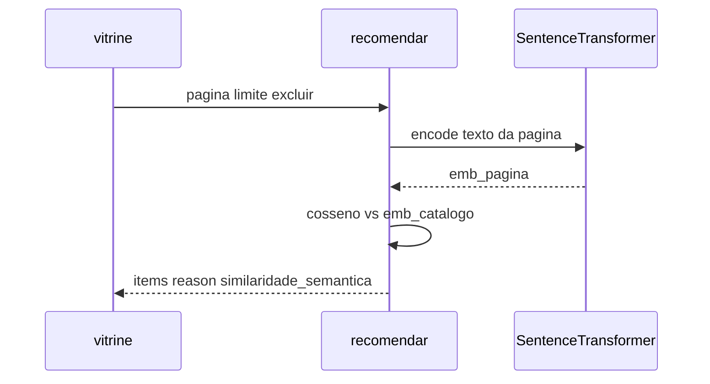

# 03 — Variante embeddings (similaridade semântica)

Cada peça vira uma frase (`nome` + técnica + polo); um encoder pretrained
transforma a frase em vetor; a inferência ranqueia por **cosseno**. O modelo
neural **roda no serviço** (na subida e a cada `POST /recomendar`).

Pasta irmã do baseline em [`../`](../).

| | Baseline (`../`) | Esta variante |
| --- | --- | --- |
| Sinal | `tecnica` + `pop` + `cooc` | cosseno entre embeddings de texto |
| Modelo | mapas no pickle | `paraphrase-multilingual-MiniLM-L12-v2` (HF) |
| Artefato BentoML | `recomendador:…` | `recomendador-embed:…` |
| Porta | 3000 | **3003** |

Nomes distintos na resposta:

| Campo | O que é |
| --- | --- |
| `modelo` | tag no store BentoML (`recomendador-embed:…`) |
| `modelo_hf` | id do checkpoint Hugging Face |

## Subir

Na raiz do repositório o `uv` / `.venv` já existem. Desta pasta:

```bash
just treino    # baixa / aquece o encoder (cache HF)
just serve     # carrega o encoder de novo e serve na :3003
just curl-exemplo
```

Swagger: `http://127.0.0.1:3003`.

## Texto → embedding → cosseno

Cada produto vira uma frase fixa:

```text
"{nome}. Técnica: {tecnica}. Polo: {regiao}."
```

```text
# Variáveis:
#   produtos       — mapa id → registro do catálogo
#   textos         — mapa id → frase enviada ao encoder
#   encoder        — SentenceTransformer(modelo_hf), carregado no serviço
#   emb_catalogo   — matriz (n_produtos × dim), L2-normalizada, encode no init
#   pagina         — id do produto aberto na vitrine
#   emb_pagina     — vetor 1 × dim do texto da página (encode no request)
#   scores         — emb_catalogo @ emb_pagina (cosseno, pois L2=1)
#   excluir, limite, escolhidos

textos[id] ← f"{nome}. Técnica: {tecnica}. Polo: {regiao}."
emb_catalogo ← encoder.encode(todos os textos)   # na subida do serviço
emb_pagina ← encoder.encode(texto da pagina)     # em cada POST /recomendar
scores ← emb_catalogo · emb_pagina
escolhidos ← top-k ids por scores, fora de {pagina} ∪ excluir
```



## Relação com o baseline e com ML

Há **modelo neural pretrained** baixado e executado na inferência: o checkpoint
já veio treinado em outro corpus; aqui ele **representa** o catálogo pt-BR.
O caminho com rótulo de clique (aprendizado supervisionado) está no mapa
Microsoft Learn do [`../README.md`](../README.md#ds-para-ml-microsoft-learn).

Catálogo pequeno (12 itens): encode no `__init__` é barato. Em produção costuma-se
pré-indexar e servir só busca por vizinhos — aqui o encode fica visível no código
do serviço de propósito.

Para empacote OCI: `just imagem` · `just serve-container` (tag
`recomendador-embed:aula`).

## Mapa de arquivos

| Arquivo | Papel |
| --- | --- |
| [`dados/catalogo.json`](dados/catalogo.json) | produtos + cestas (cópia do baseline) |
| [`treino.py`](treino.py) | baixa encoder, monta textos, pickle `recomendador-embed` |
| [`service.py`](service.py) | `RecomendadorEmbed`: encode + cosseno |
| [`justfile`](justfile) | treino / serve :3003 / curl |
| [`bentofile.yaml`](bentofile.yaml) | empacote Bento / container desta variante |
