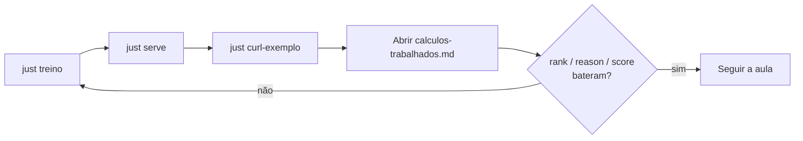

# Material (`material/`)

Depois que o `POST /recomendar` devolve JSON, a aula ainda precisa de um lugar
para **abrir as contas no papel**: popularidade, co-ocorrência, score e o
complemento por popularidade do exemplo do jarro. Esta pasta é o **caderno da
aula** — tutoriais, BI e figuras para ler e projetar ao lado do código.

| Arquivo | Conteúdo |
| --- | --- |
| [`tutorial-arvore-decisao-credito-20261017.md`](tutorial-arvore-decisao-credito-20261017.md) | Cartões, árvores supervisionadas, avaliação separada e decisões fictícias de crédito |
| [`credito/`](credito/README.md) | Cartões imprimíveis, regras aprendidas e gabarito de avaliação de crédito |
| [Versão web · associação](https://lgallindo.github.io/recomendador-bentoml/) | Tutorial de regras com fórmulas, imagens e explorador BI incorporado |
| [Versão web · demanda (média móvel)](https://lgallindo.github.io/recomendador-bentoml/demanda/) | Tutorial de média móvel com explorador de série, erros e MAE |
| [Versão web · demanda (mín. quadrados)](https://lgallindo.github.io/recomendador-bentoml/demanda-mq/) | Tutorial de regressão com explorador da reta e comparação de MAE |
| [`tutorial-media-movel-demanda-20261017.md`](tutorial-media-movel-demanda-20261017.md) | SMA; L1/L2/LinLin; métrica de estoque (quebra/sobra); treino/teste e N\* |
| [`tutorial-regressao-quadrados-minimos-demanda-20261017.md`](tutorial-regressao-quadrados-minimos-demanda-20261017.md) | Reta de mínimos quadrados, walk-forward, BI e exercício da Boneca |
| [`bi-demanda-mq/index.html`](bi-demanda-mq/index.html) | Explorador: série, reta MQ, erros e MAE vs MA / ingênua |
| [Versão web · demanda (LMS)](https://lgallindo.github.io/recomendador-bentoml/demanda-perc/) | Perceptron/ADALINE na série semanal |
| [`tutorial-perceptron-demanda-20261026.md`](tutorial-perceptron-demanda-20261026.md) | Separabilidade, LMS, walk-forward, BI e endpoint BentoML |
| [`bi-demanda-perceptron/index.html`](bi-demanda-perceptron/index.html) | Explorador: série, MSE por época, MAE vs baselines |
| [`tutorial-treino-redes-neurais-20261026.md`](tutorial-treino-redes-neurais-20261026.md) | Loop de treino com um passo de gradiente à mão, MLP rasa, baselines e corridas variando um fator por vez |
| [`tutorial-deep-learning-visao-geral-20261026.md`](tutorial-deep-learning-visao-geral-20261026.md) | Profundidade, contagem de parâmetros, capacidade vs dados, três famílias e varredura de 1 a 4 camadas |
| [`tutorial-fine-tuning-20261026.md`](tutorial-fine-tuning-20261026.md) | Do zero, pré-treino e fine-tune da cabeça; esquecimento, LoRA e plano de congelamento |
| [`tutorial-langchain-20261026.md`](tutorial-langchain-20261026.md) | Chain como composição de etapas, rastro por etapa, falhas e decisão framework vs script |
| [`langchain/`](langchain/) | Saídas do demo de chain (`resultado_chain_loja.json`, `rastros.json`) |
| [`tutorial-llmwiki-20261026.md`](tutorial-llmwiki-20261026.md) | Índice invertido e BM25 à mão; indexar a mini-wiki com `llmwiki` e experimento do erro de digitação |
| [`mini-wiki-rag/`](mini-wiki-rag/) | Corpus Markdown (frete, devolução, catálogo) para llmwiki/RAG |
| [`tutorial-rag-20261026.md`](tutorial-rag-20261026.md) | Recuperar, enriquecer e gerar com citações; falha real de recall, duas correções e conjunto-ouro |
| [`rag/`](rag/) | Respostas ancoradas, conjunto-ouro e avaliação de recall |
| [`tutorial-memoria-agentes-mem0-20261026.md`](tutorial-memoria-agentes-mem0-20261026.md) | Memória entre turnos: escopos, add/search/update/delete, token obsoleto, LGPD e fronteira com RAG |
| [`memoria/`](memoria/) | Resultado do demo de memória e linha do tempo turno a turno |
| [`tutorial-open-webui-20261026.md`](tutorial-open-webui-20261026.md) | Open WebUI + Ollama em Compose: arquitetura, memória dos modelos, API do runtime, runbook e falhas |
| [`open-webui/`](open-webui/) | Compose do Open WebUI + Ollama e variante que publica a API do Ollama |
| [`tutorial-litellm-20261026.md`](tutorial-litellm-20261026.md) | LiteLLM: duas chaves, aliases, SDK, proxy (uv ou Docker), caminho Ollama sem chave paga e falhas |
| [`redes/`](redes/) | JSON dos demos MLP, profundidade e fine-tune (resultados e curvas) |
| [`bi-redes/index.html`](bi-redes/index.html) | Explorador: curvas de perda, profundidade e fine-tune contra baselines |
| [`bi-chain/index.html`](bi-chain/index.html) | Explorador: rastro da chain etapa por etapa |
| [`bi-rag/index.html`](bi-rag/index.html) | Explorador: BM25 termo a termo, prompt aumentado, citações e recall@k |
| [`bi-memoria/index.html`](bi-memoria/index.html) | Explorador: memória turno a turno, escopos e busca |
| [`bi-llm-local/index.html`](bi-llm-local/index.html) | Explorador: caminho da requisição (Open WebUI, Ollama, LiteLLM), portas e chaves |
| [`litellm/`](litellm/README.md) | Config, Compose e `.env.example` do proxy LiteLLM |
| [Versões web · redes e LLMs](https://lgallindo.github.io/recomendador-bentoml/treino-redes/) | Rotas `treino-redes/`, `deep-learning/`, `fine-tuning/`, `langchain/`, `llmwiki/`, `rag/`, `memoria/`, `open-webui/`, `litellm/` |
| [`tutorial-previsao-probabilistica-demanda-20261017.md`](tutorial-previsao-probabilistica-demanda-20261017.md) | Prever distribuição de contagens com regressão de Poisson |
| [`bi-demanda/index.html`](bi-demanda/index.html) | Explorador local: série, erros, MAE por janela e exportações |
| [`planilha-media-movel-demanda.xlsx`](planilha-media-movel-demanda.xlsx) | Planilha de sala: uma aba por produto para contas de média móvel |
| [`tutorial-regras-associacao-logs-autenticacao-20261017.md`](tutorial-regras-associacao-logs-autenticacao-20261017.md) | Variante independente: logs sintéticos, reconstrução de sessões, associação e validação |
| [`logs-autenticacao/`](logs-autenticacao/) | Sessões auditáveis e CSVs reproduzíveis de descoberta e validação |
| [`tutorial-regras-associacao-20261017.md`](tutorial-regras-associacao-20261017.md) | Estudo de 75 minutos: IA, aprendizado de máquina, sistemas especialistas, mineração, generalização, validação, BI e marketing |
| [`bi/index.html`](bi/index.html) | Explorador local e interativo das 14 regras: tabela, dispersão, matriz, rede, comparação de bases e exportações |
| [`regras-associacao-20261017.csv`](regras-associacao-20261017.csv) | 14 regras das dez cestas, com contagens, métricas e limites reproduzíveis |
| [`cestas-validacao-20261017.json`](cestas-validacao-20261017.json) | Cenário sintético adicional para avaliar uma regra fixa, separado das dez cestas originais |
| [`imagens/`](imagens/README.md) | Diagrama de Venn, matriz de transações, comparação de métricas e ilustração da loja |
| [`calculos-trabalhados.md`](calculos-trabalhados.md) | Contas passo a passo do exemplo do jarro (`p01`), alinhadas ao que `just curl-exemplo` deve devolver |
| [Versão web · demanda (Poisson)](https://lgallindo.github.io/recomendador-bentoml/demanda-poisson/) | Tutorial probabilístico com explorador de PMF e cobertura |
| [`bi-demanda-poisson/index.html`](bi-demanda-poisson/index.html) | Explorador: λ, PMF, intervalo 95% e walk-forward |
| [`planilha-minimos-quadrados-demanda.xlsx`](planilha-minimos-quadrados-demanda.xlsx) | Planilha de sala: ajuste MQ, resíduos e erros de teste |
| [Versão web · associação (logs)](https://lgallindo.github.io/recomendador-bentoml/logs-auth/) | Tutorial de associação em sessões de autenticação sintéticas |

## Como usar na sala

O fio é o dos dois pipelines: primeiro o treino grava o artefato; depois a
inferência responde; só então o markdown valida rank, `reason` e score. Se as
contas baterem, a métrica da aula (auditabilidade) ficou satisfeita para o
exemplo `p01`.

1. Suba a API (`just treino` · `just serve` na raiz).
2. Rode `just curl-exemplo`.
3. Compare **rank**, `reason` e score com a tabela final do markdown.
4. Se divergir, o catálogo ou o artefato ficaram desatualizados — `just treino` de novo.

O catálogo que alimenta essas contas está em
[`../dados/README.md`](../dados/README.md). O arco projetado na tela segue em
[`../slides/README.md`](../slides/README.md).
