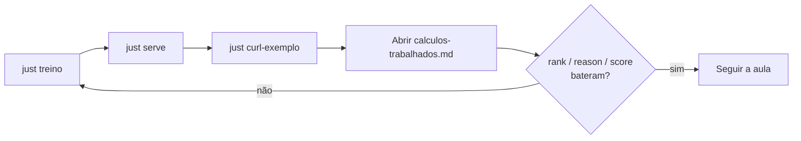

# Material (`material/`)

Depois que o `POST /recomendar` devolve JSON, a aula ainda precisa de um lugar
para **abrir as contas no papel**: popularidade, co-ocorrência, score e o
complemento por popularidade do exemplo do jarro. Esta pasta é o **caderno da
aula** — tutoriais, BI e figuras para ler e projetar ao lado do código.

| Arquivo | Conteúdo |
| --- | --- |
| [`tutorial-arvore-decisao-credito-20261017.md`](tutorial-arvore-decisao-credito-20261017.md) | Cartões, árvores supervisionadas, avaliação separada e decisões fictícias de crédito |
| [`credito/`](credito/README.md) | Cartões imprimíveis, regras aprendidas e gabarito de avaliação de crédito |
| [Versão web · associação](https://lgallindo.github.io/recomendador-bentoml/) | Tutorial de regras com fórmulas, imagens e explorador BI incorporado |
| [Versão web · demanda (média móvel)](https://lgallindo.github.io/recomendador-bentoml/demanda/) | Tutorial de média móvel com explorador de série, erros e MAE |
| [Versão web · demanda (mín. quadrados)](https://lgallindo.github.io/recomendador-bentoml/demanda-mq/) | Tutorial de regressão com explorador da reta e comparação de MAE |
| [`tutorial-media-movel-demanda-20261017.md`](tutorial-media-movel-demanda-20261017.md) | Previsão semanal com média móvel, walk-forward, BI e exercício da Boneca |
| [`tutorial-regressao-quadrados-minimos-demanda-20261017.md`](tutorial-regressao-quadrados-minimos-demanda-20261017.md) | Reta de mínimos quadrados, walk-forward, BI e exercício da Boneca |
| [`bi-demanda-mq/index.html`](bi-demanda-mq/index.html) | Explorador: série, reta MQ, erros e MAE vs MA / ingênua |
| [Versão web · demanda (LMS)](https://lgallindo.github.io/recomendador-bentoml/demanda-perc/) | Perceptron/ADALINE na série semanal |
| [`tutorial-perceptron-demanda-20261026.md`](tutorial-perceptron-demanda-20261026.md) | Separabilidade, LMS, walk-forward, BI e endpoint BentoML |
| [`bi-demanda-perceptron/index.html`](bi-demanda-perceptron/index.html) | Explorador: série, MSE por época, MAE vs baselines |
| [`tutorial-treino-redes-neurais-20261026.md`](tutorial-treino-redes-neurais-20261026.md) | Loop de treino (época, batch, loss, otimizador) + MLP rasa |
| [`tutorial-deep-learning-visao-geral-20261026.md`](tutorial-deep-learning-visao-geral-20261026.md) | Profundidade, três famílias, MLP rasa vs mais funda |
| [`tutorial-fine-tuning-20261026.md`](tutorial-fine-tuning-20261026.md) | Pré-treino → congelar tronco → adaptar cabeça (toy MLP) |
| [`redes/`](redes/) | JSON dos demos MLP / deep / fine-tune (`resultado_*.json`) |
| [`tutorial-previsao-probabilistica-demanda-20261017.md`](tutorial-previsao-probabilistica-demanda-20261017.md) | Prever distribuição de contagens com regressão de Poisson |
| [`bi-demanda/index.html`](bi-demanda/index.html) | Explorador local: série, erros, MAE por janela e exportações |
| [`planilha-media-movel-demanda.xlsx`](planilha-media-movel-demanda.xlsx) | Planilha de sala: uma aba por produto para contas de média móvel |
| [`tutorial-regras-associacao-logs-autenticacao-20261017.md`](tutorial-regras-associacao-logs-autenticacao-20261017.md) | Variante independente: logs sintéticos, reconstrução de sessões, associação e validação |
| [`logs-autenticacao/`](logs-autenticacao/) | Sessões auditáveis e CSVs reproduzíveis de descoberta e validação |
| [`tutorial-regras-associacao-20261017.md`](tutorial-regras-associacao-20261017.md) | Estudo de 75 minutos: IA, aprendizado de máquina, sistemas especialistas, mineração, generalização, validação, BI e marketing |
| [`bi/index.html`](bi/index.html) | Explorador local e interativo das 14 regras: tabela, dispersão, matriz, rede, comparação de bases e exportações |
| [`regras-associacao-20261017.csv`](regras-associacao-20261017.csv) | 14 regras das dez cestas, com contagens, métricas e limites reproduzíveis |
| [`cestas-validacao-20261017.json`](cestas-validacao-20261017.json) | Cenário sintético adicional para avaliar uma regra fixa, separado das dez cestas originais |
| [`imagens/`](imagens/README.md) | Diagrama de Venn, matriz de transações, comparação de métricas e ilustração da loja |
| [`calculos-trabalhados.md`](calculos-trabalhados.md) | Contas passo a passo do exemplo do jarro (`p01`), alinhadas ao que `just curl-exemplo` deve devolver |

## Como usar na sala

O fio é o dos dois pipelines: primeiro o treino grava o artefato; depois a
inferência responde; só então o markdown valida rank, `reason` e score. Se as
contas baterem, a métrica da aula (auditabilidade) ficou satisfeita para o
exemplo `p01`.

1. Suba a API (`just treino` · `just serve` na raiz).
2. Rode `just curl-exemplo`.
3. Compare **rank**, `reason` e score com a tabela final do markdown.
4. Se divergir, o catálogo ou o artefato ficaram desatualizados — `just treino` de novo.

O catálogo que alimenta essas contas está em
[`../dados/README.md`](../dados/README.md). O arco projetado na tela segue em
[`../slides/README.md`](../slides/README.md).
