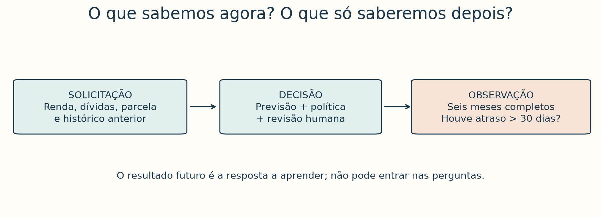
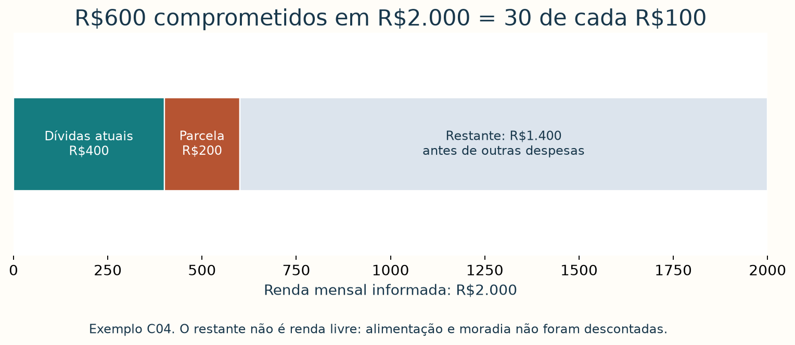
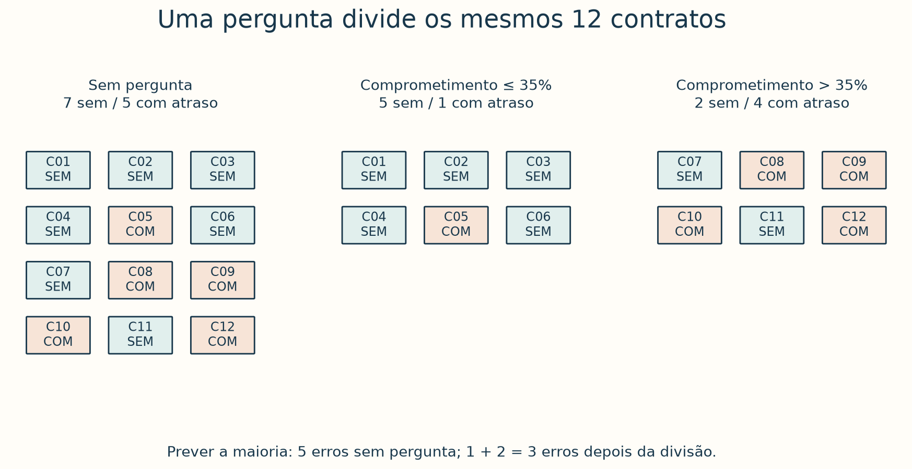
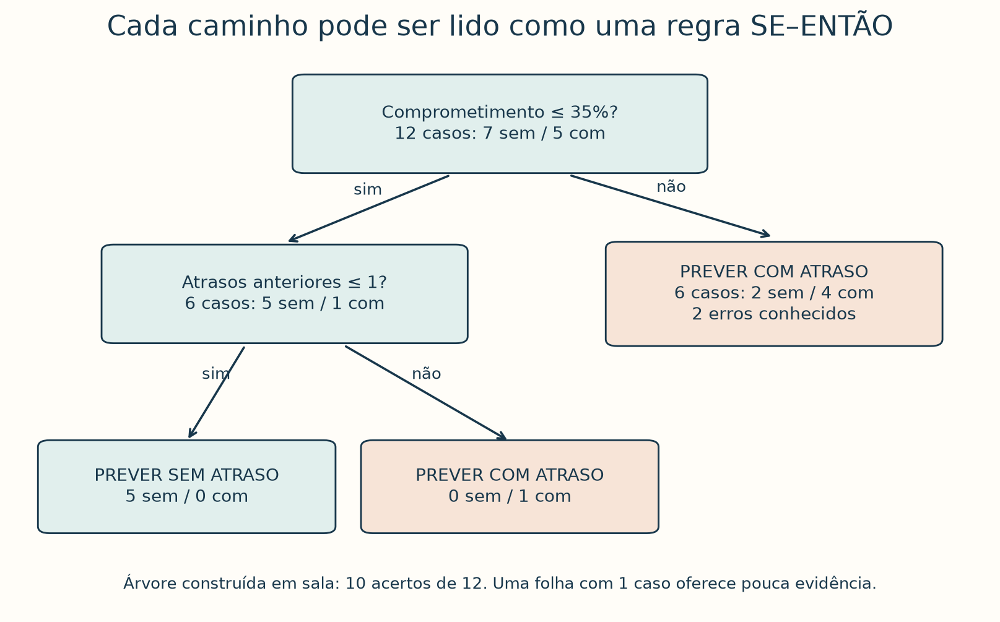
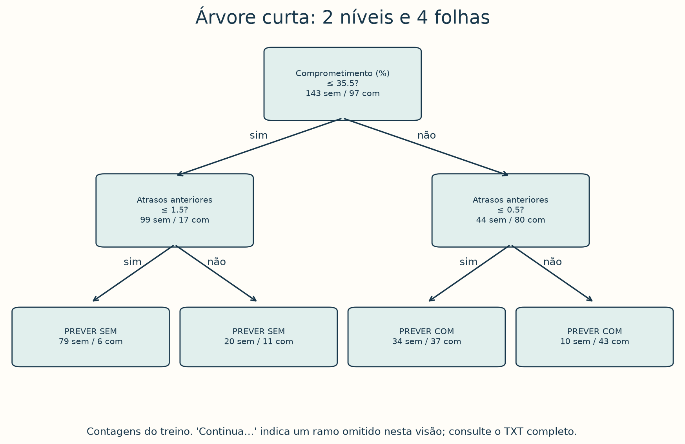
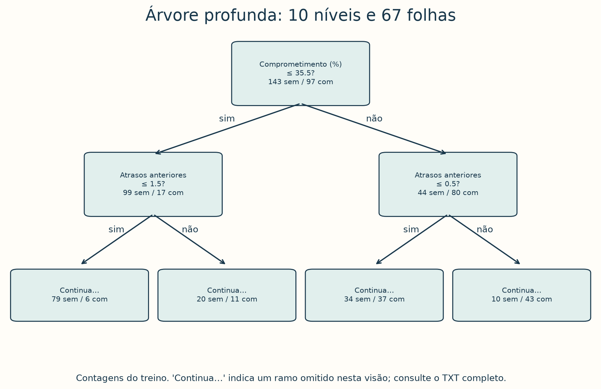
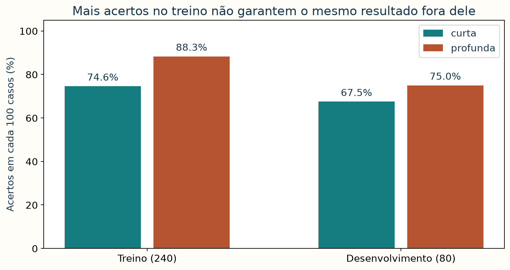
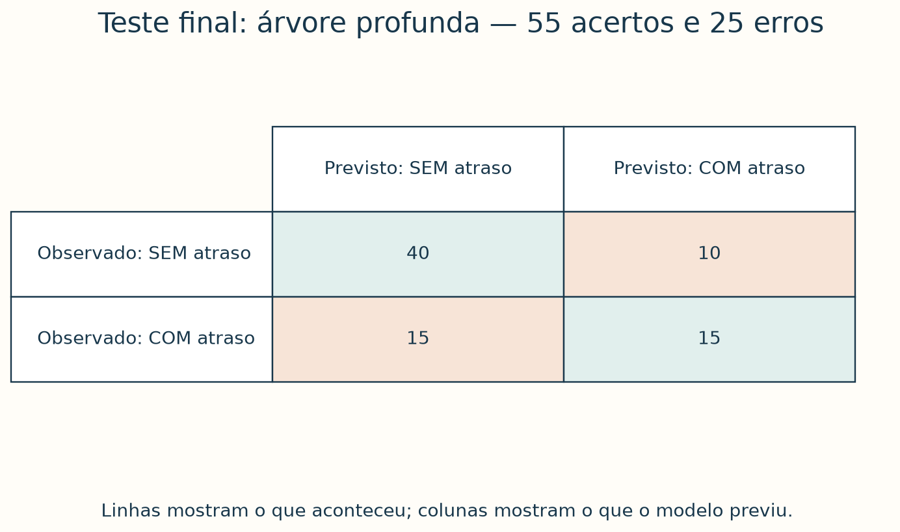

# Crédito orientado por dados: como aprender, interpretar e avaliar uma árvore de decisão

Uma loja de móveis recebe uma solicitação de compra parcelada. A atendente
conhece a renda informada, as prestações já assumidas, a nova parcela e o
histórico anterior de pagamentos. Ela ainda não sabe como esse novo contrato
será pago. Como usar exemplos anteriores para apoiar a análise?

Ao concluir este tutorial, você deverá conseguir ler uma árvore, acompanhar
um contrato pelas suas perguntas, explicar a previsão com contagens e comparar
seus erros com uma referência simples. Você também distinguirá **resultado
observado**, **previsão do modelo** e **decisão de conceder crédito**.

Começaremos com cartões e perguntas. Para acompanhar, basta contar casos,
comparar números e reconhecer qual resultado aparece mais vezes. As porcentagens
virão depois das contagens; as fórmulas de escolha das perguntas ficam para uma
leitura opcional. Você pode realizar a primeira aula sem instalar programas.

A loja, os contratos e os resultados são **inteiramente sintéticos**. As regras
e os limites servem ao exercício, não são uma política recomendada para crédito
real. Os dados são independentes das cestas, produtos e vendas dos outros tutoriais.


*Figura 1 — Da solicitação à análise de crédito. Ilustração gerada por IA; as
formas da tela são ilustrativas, não mostram a árvore aprendida nem resultados
medidos. A árvore efetiva aparece adiante, com suas contagens.*

### Roteiro de estudo

Reserve duas aulas de aproximadamente 75 minutos. No estudo individual, faça
as atividades antes de consultar a resolução ao final.

| Aula | Tempo | Atividade |
| --- | ---: | --- |
| 1 | 10 min | Compreender a solicitação e o instante da previsão |
| 1 | 10 min | Ler os contratos e definir a resposta que queremos aprender |
| 1 | 10 min | Prever sem perguntas e contar erros |
| 1 | 20 min | Separar cartões em pilhas e comparar perguntas |
| 1 | 15 min | Construir e percorrer uma árvore pequena |
| 1 | 10 min | Escrever regras SE–ENTÃO e encontrar exceções |
| 2 | 10 min | Reconstruir um caminho e suas contagens |
| 2 | 15 min | Executar a aprendizagem automática e ler a árvore curta |
| 2 | 15 min | Comparar árvores no desenvolvimento |
| 2 | 15 min | Fixar o modelo e avaliar o teste separado |
| 2 | 10 min | Interpretar os dois tipos de erro |
| 2 | 10 min | Aplicar uma política fictícia e produzir um relato |

Materiais: [12 cartões imprimíveis e rótulos separados](credito/cartoes-impressao.pdf),
[dados e dicionário](../dados/credito/README.md) e
[artefatos reproduzíveis](credito/README.md).

## 1. Uma pergunta sobre o futuro, uma decisão no presente

A loja quer investigar: **este novo contrato terá alguma parcela com mais de
30 dias de atraso dentro dos primeiros seis meses após a concessão?**

Fixamos essa definição antes de contar resultados. Um pagamento com 10 dias de
atraso não atende a ela. Uma parcela que ultrapassou 30 dias e depois foi paga
pode atender. “Com atraso” não significa necessariamente perda definitiva e
não é uma classificação moral do cliente.

| Elemento | Pergunta | Exemplo |
| --- | --- | --- |
| Resultado observado | O que aconteceu depois? | Uma parcela ultrapassou 30 dias de atraso nos seis meses iniciais |
| Previsão | O que o modelo espera, usando o que sabemos agora? | Prever “com atraso”, pois esse resultado é maioria na folha alcançada |
| Decisão de crédito | O que a loja faz segundo sua política? | Aprovar, recusar ou encaminhar para revisão |

A previsão não contém automaticamente a decisão. A loja também precisa definir
critérios de capacidade de pagamento, custos, condições do contrato, tratamento
justo e revisão. Neste exercício, usaremos uma política fictícia explícita para
aprender essa separação.



*Figura 2 — A pergunta usa informações disponíveis na solicitação. A resposta
vem do acompanhamento posterior. Na base histórica, os dois momentos estão
na mesma linha da tabela, mas não ocorreram ao mesmo tempo.*

**Verifique sua interpretação:** “quantas parcelas do novo contrato já foram
pagas?” pode entrar no modelo no instante da solicitação? Não. Essa informação
ainda não existe. Incluí-la seria dar ao modelo uma pista do futuro, um caso
de **vazamento de dados**.

## 2. Da indução de regras ao aprendizado supervisionado

No estudo anterior, você aprendeu a contar casos, ler condições e verificar
padrões em dados separados. Agora haverá uma mudança: escolhemos previamente
**uma resposta específica para prever** e fornecemos exemplos com essa resposta.

```text
Inteligência artificial
└── Aprendizado de máquina
    └── Aprendizado supervisionado
        └── Árvore de decisão para classificação
```

Esse caminho localiza a técnica desta aula; não enumera todas as áreas de IA.
“Supervisionado” significa que os exemplos de aprendizagem têm respostas
registradas. Não significa que uma pessoa aprove cada previsão automaticamente.
“Classificação” significa escolher uma categoria: aqui, “sem atraso” ou “com
atraso”, segundo a definição estabelecida.

Uma árvore aprende uma sequência de perguntas a partir dos exemplos. Cada
caminho pode ser escrito como uma regra **SE condições ENTÃO previsão**.
As condições são aprendidas nos dados; a política que decide o que fazer com a
previsão é estabelecida separadamente. Árvores também podem prever números,
mas nesta aula trabalharemos somente com classificação.
Veja a [introdução técnica a árvores do scikit-learn](https://scikit-learn.org/stable/modules/tree.html).

## 3. Os contratos e as informações disponíveis

Cada cartão representa um contrato anterior **que foi aprovado** e teve seis
meses completos de acompanhamento. Não misturaremos contratos ainda sem tempo
suficiente para observar o resultado. No exemplo, cada contrato pertence a uma
pessoa diferente e não há informações faltantes.

O arquivo [cartoes.csv](../dados/credito/cartoes.csv) contém os valores monetários.
A tabela abaixo destaca as duas informações usadas nas perguntas e a resposta:

| Contrato | Comprometimento mensal | Atrasos anteriores | Resultado posterior |
| --- | ---: | ---: | --- |
| C01 | 15% | 0 | Sem atraso |
| C02 | 20% | 0 | Sem atraso |
| C03 | 25% | 1 | Sem atraso |
| C04 | 30% | 0 | Sem atraso |
| C05 | 30% | 2 | Com atraso |
| C06 | 35% | 1 | Sem atraso |
| C07 | 40% | 0 | Sem atraso |
| C08 | 45% | 0 | Com atraso |
| C09 | 45% | 2 | Com atraso |
| C10 | 50% | 1 | Com atraso |
| C11 | 55% | 2 | Sem atraso |
| C12 | 60% | 3 | Com atraso |

**Atrasos anteriores** conta parcelas que ultrapassaram 30 dias de atraso nos
12 meses antes da solicitação. É um histórico anterior, não o resultado do novo
contrato. Nesta base fictícia o histórico é completo: zero significa nenhum
atraso registrado no período. Em registros reais, “sem histórico disponível”
precisaria ser distinguido de “histórico sem atrasos”.

### O que significa comprometimento?

No contrato C04, a renda mensal informada é R$2.000. As prestações existentes
somam R$400 por mês, e a nova parcela proposta é R$200. Somando as duas, temos
R$600 comprometidos. Isso corresponde a **30 de cada R$100 de renda**, ou 30%.



*Figura 3 — Primeiro leia os valores; depois a proporção. O restante ainda
precisa cobrir despesas como alimentação e moradia. Esta conta não mede sozinha
a capacidade de pagamento.*

Se quiser conferir no papel ou na calculadora:

```text
comprometimento = (dívidas mensais + parcela proposta) / renda mensal × 100
               = (400 + 200) / 2.000 × 100
               = 30%
```

As perguntas do modelo usam somente o comprometimento e os atrasos anteriores.
Renda, dívidas e parcela permanecem no CSV para conferir a conta; não entram
separadamente na árvore. O ID serve para localizar o contrato, nunca para
prever seu pagamento.

| Expressão cotidiana | Nome técnico, quando precisar dele |
| --- | --- |
| Informação disponível para perguntar | Característica ou *feature* |
| Resposta registrada que queremos prever | Alvo ou rótulo |
| Pergunta que divide o grupo | Divisão ou *split* |
| Ponto em que fazemos uma pergunta | Nó interno |
| Ponto em que paramos e fazemos a previsão | Folha |
| Sequência de perguntas até uma folha | Caminho |

## 4. Antes da árvore: prever a maioria

Conte os 12 cartões: **7 sem atraso e 5 com atraso**. Sem usar nenhuma pergunta,
poderíamos prever “sem atraso” para todos. Acertaríamos 7 e erraríamos 5.
Essa será nossa **referência simples**, também chamada de *baseline*.

Não escolhemos “sem atraso” porque seria uma promessa segura. Escolhemos porque
é a resposta mais frequente nesses exemplos. Antes de atribuir valor a uma
árvore, precisamos perguntar se ela melhora essa referência em dados novos.

**Atividade:** se alguém anunciar “acertei mais da metade dos contratos”, isso
já demonstra uma boa solução? Não: a referência já acerta 7 de 12 sem fazer
nenhuma pergunta.

## 5. Construir perguntas com cartões

Imprima as páginas 1–2 do [PDF](credito/cartoes-impressao.pdf). A página 3 contém
os resultados para recortar e associar pelo ID. Durante a construção, mantenha
as respostas visíveis; para prever um caso, esconda a resposta desse caso.
Esconder um rótulo depois de usá-lo na construção não transforma o caso em teste
independente: aqui estamos praticando a leitura.

Experimente: **“o comprometimento é menor ou igual a 35%?”**. O símbolo `≤`
significa “menor ou igual”: C06, com 35%, fica no lado do **sim**.

| Grupo | Contratos | Sem atraso | Com atraso | Prever a maioria | Erros conhecidos |
| --- | --- | ---: | ---: | --- | ---: |
| Sim: até 35% | C01–C06 | 5 | 1 | Sem atraso | 1 |
| Não: acima de 35% | C07–C12 | 2 | 4 | Com atraso | 2 |
| Total depois da pergunta | Todos os 12 | 7 | 5 | Depende do grupo | **3** |



*Figura 4 — A pergunta não altera os contratos nem seus resultados. Ela forma
grupos com maior concentração de uma resposta. Prever a maioria em cada grupo
reduz de cinco para três os erros nesses cartões.*

Compare outra pergunta: **“o comprometimento é menor ou igual a 50%?”**.
No lado do sim ficam seis sem e quatro com atraso: quatro erros ao prever a
maioria. No lado do não ficam um sem e um com. Para resolver esse empate no
exercício, prevemos “sem atraso”: um erro. Total: **cinco erros**.

Entre essas duas perguntas, o corte em 35% foi mais útil pelo nosso critério
manual. Isso não prova que seja um limite de crédito adequado.

### Uma segunda pergunta

Volte ao grupo de até 35%. Pergunte: **“há no máximo um atraso anterior?”**.
Os cinco contratos que respondem sim ficaram sem atraso; o único que responde
não, C05, teve atraso. No grupo acima de 35%, paramos e mantemos a maioria.



*Figura 5 — Essa árvore foi construída em sala. Ela faz dez previsões corretas
e duas erradas nos mesmos 12 exemplos usados para construí-la. A folha de C05
tem apenas um caso: acertá-lo não demonstra estabilidade em outras pessoas.*

Leia dois caminhos em voz alta:

```text
SE comprometimento ≤ 35%
E atrasos anteriores ≤ 1
ENTÃO prever SEM atraso.

SE comprometimento > 35%
ENTÃO prever COM atraso.
```

No segundo caminho, a folha contém quatro com atraso e dois sem. A previsão
segue a maioria, mas **C07 e C11 são exceções**. Uma árvore não elimina a
incerteza nem converte uma frequência em certeza individual.

**Sua vez:** por qual caminho passa C05? Qual é a previsão? Quantos exemplos
a sustentam? Responda antes de avançar.

## 6. Como o programa aprende uma árvore

A construção manual ajuda a entender o processo. O programa também compara
perguntas e cortes, divide grupos e repete o procedimento nos ramos. Nesta
implementação, usa uma medida chamada **Gini**, que quantifica a mistura das
respostas em cada grupo. Grupos com uma única resposta têm mistura zero.
Não é necessário calcular essa medida para ler ou avaliar a árvore.

Contar erros ao prever a maioria foi nosso critério didático. Gini é outro
critério: as escolhas do programa podem diferir das feitas à mão. A busca faz
escolhas locais a cada passo; não garante a melhor árvore possível entre todas.

Agora usaremos uma base maior, separada dos cartões:

| Grupo | Contratos | Sem atraso | Com atraso | Papel |
| --- | ---: | ---: | ---: | --- |
| Treino | 240 | 143 | 97 | Aprender perguntas, cortes e previsões das folhas |
| Desenvolvimento | 80 | 55 | 25 | Comparar configurações antes da escolha |
| Teste | 80 | 50 | 30 | Avaliar o modelo já escolhido |

Os grupos são sorteios sintéticos separados da mesma receita artificial; não
são períodos reais. Veja [a receita, as sementes e o dicionário](../dados/credito/README.md).
As características podem coincidir em contratos diferentes, e seus resultados
podem discordar. Os cartões não são adicionados ao treino.

### Executar sem abrir o teste

Na raiz do repositório, com o ambiente do projeto instalado:

```bash
uv run python scripts/arvore_credito.py --saida material/credito-experimento
```

O script usa scikit-learn, já declarado nas dependências do projeto. Não exige
subir a API BentoML. Se usa o ambiente virtual já preparado, o equivalente é
`.venv/bin/python scripts/arvore_credito.py --saida material/credito-experimento`.
A execução de referência deste texto usa scikit-learn 1.9.1.

O comando lê somente treino e desenvolvimento. Gera dois arquivos de regras e
um `relatorio.json` na pasta de experimento. Não lê o CSV de teste.

Há duas configurações:

- **Curta:** no máximo duas perguntas em cada caminho; pelo menos 12 contratos
  de treino por folha.
- **Profunda:** sem limite explícito de profundidade; permite folhas com um
  contrato. Ela para quando não consegue ou não pode continuar a divisão.



*Figura 6 — Árvore curta aprendida em 240 contratos, não nos 12 cartões. “79
sem / 6 com” significa 85 exemplos de treino na folha. É possível prever sem
atraso e ainda ter seis exemplos conhecidos do resultado oposto.*

O limite `35,5%` aparece porque os dados têm valores inteiros e o programa pode
usar um ponto entre valores consecutivos. `Atrasos anteriores ≤ 1,5` significa,
para esta contagem inteira, zero ou um. Ninguém teve “um atraso e meio”.
O limite é um corte aprendido, não uma fronteira natural entre pessoas.

**Exemplo completo:** uma nova solicitação tem renda de R$2.000, dívidas mensais
de R$400, parcela proposta de R$200 e nenhum atraso anterior. O comprometimento
é 30%. Na árvore curta: `30 ≤ 35,5` → sim; `0 ≤ 1,5` → sim. A previsão é
“sem atraso”, na folha com **79 sem e 6 com atraso**.

Você pode dizer “79 dos 85 exemplos dessa folha ficaram sem atraso”, cerca de
93%. Não pode dizer “este cliente certamente pagará”. A frequência de treino
não é, por si só, uma probabilidade individual bem calibrada para uso real.

## 7. Mais perguntas: aprender detalhes ou memorizar exceções?



*Figura 7 — A árvore profunda tem dez níveis e 67 folhas nesta execução. A figura
mostra somente o início; “Continua…” não é uma previsão final. Todos os caminhos
estão no [TXT completo](credito/arvore-profunda.txt).*

Uma árvore muito detalhada pode aprender particularidades do treino que não se
repetem. Chamamos esse problema de **sobreajuste**, ou *overfitting*. Por isso
comparamos configurações em exemplos que não participaram da construção.



*Figura 8 — A árvore profunda acerta mais nos dois grupos, mas seu desempenho
no treino é melhor que no desenvolvimento. O gráfico ajuda a examinar essa
diferença; não demonstra que a árvore curta deva vencer.*

| Modelo | Treino: acertos | Desenvolvimento: acertos |
| --- | ---: | ---: |
| Referência: sempre prever sem atraso | 143/240 | 55/80 |
| Árvore curta: 2 níveis, 4 folhas | 179/240 | 54/80 |
| Árvore profunda: 10 níveis, 67 folhas | 212/240 | 60/80 |

O critério desta atividade foi fixado antes do teste: **escolher a árvore com
mais acertos no desenvolvimento**. Se houver empate, preferir menor profundidade;
persistindo o empate, menos folhas. Por esse critério, escolhemos a **profunda**.
A curta ficou até um acerto abaixo da referência no desenvolvimento.

Não vamos trocar a base para fazer a curta vencer. Limitar a complexidade é
uma ferramenta, não uma garantia de vitória. A profunda também não chega a
100% no treino: há contratos com as mesmas duas entradas e resultados opostos,
que nenhuma pergunta sobre essas duas entradas consegue separar.

### Experimento opcional, antes de abrir o teste

```bash
uv run python scripts/arvore_credito.py --profundidade 3 --minimo-folha 20 --saida material/credito-experimento-3
```

Compare as configurações usando **desenvolvimento** e registre sua escolha.
Não altere os valores depois de consultar o teste para tentar melhorar sua nota.
Repetir muitas escolhas também pode ajustar suas decisões às particularidades
do desenvolvimento; uma aula com duas configurações é um começo, não um
procedimento completo de seleção para produção.

## 8. Avaliar em contratos separados

Depois de fixar os parâmetros, abra o teste uma única vez. Para reproduzir a
execução padrão descrita aqui:

```bash
uv run python scripts/arvore_credito.py --avaliar-teste --saida material/credito-experimento
```

O programa primeiro aprende com o treino e escolhe usando desenvolvimento.
Somente depois lê o teste e avalia a árvore selecionada e a referência. Não
retreina a árvore com desenvolvimento ou teste. Nas duas bases de avaliação,
a referência mantém a classe majoritária **do treino**, sem reaprender a maioria.

O [relatório publicado](credito/relatorio.json) e o
[CSV de previsões](credito/previsoes-teste.csv) contêm o gabarito da execução
padrão. Se estiver resolvendo a atividade, deixe-os para o final.

**Resultado de referência:** a árvore profunda acerta **55 de 80** contratos do
teste e erra 25. A referência acerta **50 de 80** e erra 30. São cinco acertos
adicionais nesta amostra, não uma demonstração de lucro ou de segurança para
concessão real.

Se quiser usar porcentagens: 55/80 corresponde a 68,75%; 50/80 corresponde a
62,5%. A proporção de previsões corretas é chamada de **acurácia**. Os cinco
acertos adicionais correspondem a 6,25 pontos percentuais neste teste.

### Dois tipos de erro



*Figura 9 — Leia primeiro uma linha, depois a outra. A diagonal soma os acertos:
40 + 15 = 55. Fora da diagonal estão os erros: 10 + 15 = 25.*

| O que aconteceu | Previu sem atraso | Previu com atraso |
| --- | ---: | ---: |
| Sem atraso | 40 | **10** |
| Com atraso | **15** | 15 |

- **Previu sem, mas houve atraso: 15 casos.** Uma política que confiasse demais
  nessa previsão poderia assumir compromissos que depois apresentariam problemas.
- **Previu com, mas não houve atraso: 10 casos.** Uma política que recusasse
  automaticamente poderia negar crédito a alguém que, no registro observado,
  pagou sem o atraso definido.

Os dois erros têm consequências para a loja e para o solicitante. Seu peso
depende de valores, custos e condições que não estão nesta base. Acurácia sozinha
não determina a melhor política. Em uma leitura técnica, tomando “com atraso”
como classe positiva, os dois erros são chamados de falsos negativos e falsos
positivos, respectivamente. Veja a
[documentação de avaliação de classificadores](https://scikit-learn.org/stable/modules/model_evaluation.html#confusion-matrix).

**Verifique sua interpretação:** acertar 55 de 80 permite afirmar que a árvore
é justa com todos os grupos de pessoas? Não. O total não mostra como os erros
se distribuem entre grupos, e estes dados não permitem essa avaliação.

## 9. Da previsão à decisão: uma política fictícia explícita

Para praticar a diferença entre prever e agir, use esta política **somente na
simulação da aula**. Ela foi escrita por pessoas; a árvore não a aprendeu:

| Condição após percorrer a árvore | Ação simulada |
| --- | --- |
| A folha tem menos de 5 exemplos de treino | Encaminhar para revisão |
| A folha tem pelo menos 5 e prevê sem atraso | Aprovar na simulação |
| A folha tem pelo menos 5 e prevê com atraso | Recusar na simulação |

O mínimo de cinco é arbitrário e não comprova evidência suficiente. A política
foi simplificada para tornar as ações auditáveis; não inclui uma avaliação
completa de capacidade de pagamento e não deve ser adotada por uma loja real.
Uma política real também precisa de critérios próprios de revisão, informação
ao solicitante, contestação e avaliação de impactos. Aqui não estamos
estabelecendo requisitos legais nem aprovando pedidos reais.

Aplique a política à **árvore manual da Figura 5**, não à árvore selecionada
no computador:

| Contrato | Caminho | Previsão e apoio | Ação simulada | Resultado conhecido |
| --- | --- | --- | --- | --- |
| C04 | Até 35%; até 1 atraso anterior | Sem atraso; folha com 5 casos | Aprovar | Sem atraso |
| C05 | Até 35%; mais de 1 atraso anterior | Com atraso; folha com 1 caso | Revisão | Com atraso |
| C11 | Acima de 35% | Com atraso; folha com 6 casos | Recusar | Sem atraso |

C11 torna visível uma consequência da política: a simulação recusaria um
contrato que, no registro histórico, não teve o atraso definido. C05 mostra
que prever “com atraso” não obriga a recusar: a política encaminha para revisão
por haver pouca evidência na folha.

### O que nossos dados não respondem

**Quem foi recusado não está na base.** Conhecemos os resultados dos contratos
que a loja aprovou. Não observamos como os recusados teriam pago se recebessem
crédito. Logo, o desempenho nesses contratos não pode ser automaticamente
estendido a todos os solicitantes.

**Informação financeira também pode refletir desigualdades anteriores.** Não
usar atributos como raça ou gênero não prova ausência de discriminação. Esta
base não contém grupos demográficos e não permite medir diferenças de erro
entre eles. Não devemos concluir que o modelo foi aprovado em uma avaliação
de justiça que nem foi realizada.

**Prever e mudar condições são perguntas distintas.** A árvore relaciona entradas
e resultados observados. Ela não demonstra que reduzir a parcela de alguém
causará o resultado previsto para outras pessoas com parcelas menores.

**O histórico não é garantia de futuro.** Mudanças econômicas, novas condições
de contrato e diferenças na população atendida podem alterar o desempenho.
Esses temas exigiriam dados reais e uma avaliação apropriada, fora desta simulação.

## 10. Como escrever um relato auditável

Prefira ligar cada conclusão à sua fonte e ao grupo de avaliação:

> Em contratos inteiramente sintéticos, aprendemos duas árvores com 240 exemplos
> e escolhemos a profunda por seus 60 acertos em 80 casos de desenvolvimento.
> No teste separado, ela acertou 55 de 80, contra 50 da referência fixa que
> sempre prevê sem atraso. Houve 15 casos previstos sem atraso que tiveram atraso
> e 10 previstos com atraso que não tiveram. Esses resultados descrevem a
> classificação de contratos anteriormente aprovados; não demonstram lucro,
> tratamento justo ou desempenho sobre solicitantes recusados. A política de
> aprovar, recusar ou revisar é uma escolha adicional, que precisa ser avaliada
> separadamente.

Para um caso individual, registre: informação disponível → perguntas percorridas
→ folha e contagens → previsão → regra da política → ação simulada. Dizer apenas
“a IA negou” esconde as escolhas que produziram a ação.

## 11. Exercício: produza seu relatório

1. Explique a pergunta-alvo e o instante em que a previsão é feita. Dê uma
   informação válida e uma informação futura que seria proibida como entrada.
2. Refaça a conta do comprometimento de C04. Explique o resultado sem usar
   porcentagens na primeira frase.
3. Conte os erros da referência nos 12 cartões e da primeira divisão em 35%.
   Depois, trace C05 e C11 na árvore manual e aplique a política da seção 9.
4. Para a solicitação de R$2.000 de renda, R$400 de dívidas, R$200 de parcela
   e nenhum atraso anterior, percorra a árvore curta. Informe as contagens da
   folha, a previsão e uma limitação da evidência.
5. Use a execução padrão: justifique a escolha no desenvolvimento e interprete
   os dois tipos de erro no teste. Compare com a referência nos mesmos 80 casos.
6. Explique por que esse procedimento é supervisionado e por que avaliar apenas
   contratos aprovados não responde como os solicitantes recusados teriam pago.
7. Escreva um relato de até seis frases que identifique os dados, a previsão,
   a avaliação, a política e duas limitações. Evite prometer lucro ou certeza.

**Extensão opcional:** localize E001 no teste e trace seu caminho na árvore
profunda completa. Compare o número de perguntas e a evidência da folha com os
da árvore curta. Não altere o modelo depois de observar o resultado de E001.

### Resolução comentada

**Pergunta e tempo:** prever se alguma parcela ultrapassará 30 dias de atraso
dentro dos seis meses iniciais, usando somente informações disponíveis na
solicitação. A parcela proposta é válida; quantas parcelas futuras foram pagas
não é. Os rótulos históricos são fornecidos ao treino, mas não são entradas
para prever um novo contrato.

**Conta:** C04 compromete R$600 dos R$2.000 mensais informados. São 30 de cada
R$100, ou 30%. O restante não considera outras despesas de vida.

**Cartões:** há sete sem e cinco com atraso; prever sempre sem gera cinco erros.
Na divisão em 35%, o grupo de até 35% tem um erro e o grupo acima tem dois:
três no total. A segunda pergunta da árvore manual isola C05 e deixa dois erros,
C07 e C11. C05 segue `30 ≤ 35` e `2 ≤ 1` → não; prevê com atraso, mas vai para
revisão porque a folha tem um caso. C11 segue `55 ≤ 35` → não; prevê com atraso
em uma folha de seis e é recusado na simulação, embora seu resultado registrado
seja sem atraso. As contagens da construção não são uma avaliação independente.

**Árvore curta:** a nova solicitação tem 30% e zero atrasos. Passa por `≤ 35,5`
e `≤ 1,5`, chegando a 79 sem e seis com atraso. Prevê sem atraso. A presença
de resultados opostos e o fato de serem exemplos sintéticos impedem tratar essa
previsão como garantia de pagamento ou recomendação real de concessão.

**Escolha e teste:** a profunda vence por 60/80 no desenvolvimento, contra 54/80
da curta. No teste, acerta 55/80, contra 50/80 da referência. Sua matriz contém
40 sem atraso previstos sem, dez sem previstos com, 15 com previstos sem e 15
com previstos com. Os erros somam 25. Cinco acertos adicionais não informam o
saldo financeiro nem a distribuição dos erros entre grupos.

**Aprendizagem e limites:** o alvo é definido previamente e os exemplos de treino
incluem a resposta observada, caracterizando aprendizado supervisionado. A
base só contém contratos concedidos e acompanhados; não oferece os resultados
contrafactuais dos recusados. A política de ação é externa à árvore e não foi
validada comercialmente por esta atividade.

**Extensão E001:** renda R$5.000, dívidas R$500, parcela R$100, comprometimento
12% e um atraso anterior. Na profunda, as respostas são: `12 ≤ 35,5` → sim;
`1 ≤ 1,5` → sim; `12 ≤ 13,5` → sim; `12 ≤ 12,5` → sim; `12 ≤ 10,5` → não.
Chega à folha 8, com quatro sem e zero com atraso no treino; prevê sem atraso,
coincidindo com o resultado do teste. Pela política fictícia, haveria revisão,
pois a folha tem menos de cinco exemplos. Na curta, seriam duas perguntas e
uma folha com 85 exemplos. O acerto isolado não prova qual árvore será melhor
para outras solicitações.

## Referências e reprodução

As referências técnicas abaixo são de consulta: você pode concluir a atividade
pelas contagens, figuras e exemplos deste texto. Consulta: 17 out. 2026.

1. SCIKIT-LEARN. [Decision Trees](https://scikit-learn.org/stable/modules/tree.html).
   Para aprofundar a estrutura, os critérios de divisão e os limites de complexidade.
2. SCIKIT-LEARN. [Common pitfalls and recommended practices](https://scikit-learn.org/stable/common_pitfalls.html).
   Para compreender a separação das bases e o vazamento de informações.
3. SCIKIT-LEARN. [Confusion matrix](https://scikit-learn.org/stable/modules/model_evaluation.html#confusion-matrix).
   Para consultar a organização das previsões corretas e dos dois tipos de erro.

Arquivos deste exercício:

- [Dados, unidades, rótulos e receita sintética](../dados/credito/README.md).
- [Gerador de dados](../scripts/gerar_dados_credito.py), sem dependências externas.
- [Aprendizagem e avaliação](../scripts/arvore_credito.py).
- [Gerador de diagramas, gráficos e cartões](../scripts/gerar_figuras_credito.py).
- [Cartões e artefatos de referência](credito/README.md).
- [Origem das figuras e prompt da ilustração](imagens/README.md#figuras-do-tutorial-de-crédito).

Para reproduzir o material publicado, com o ambiente do projeto instalado:

```bash
uv run python scripts/gerar_dados_credito.py
uv run python scripts/arvore_credito.py --avaliar-teste --saida material/credito
uv run python scripts/gerar_figuras_credito.py
uv run python -m unittest discover -s scripts -p 'test_credito.py'
```

Esses comandos geram também o gabarito. Para conduzir a aula sem revelar o teste,
siga primeiro o comando da seção 6 e distribua as bases em etapas. O script de
aprendizagem não concede crédito nem modifica a API de recomendação.
