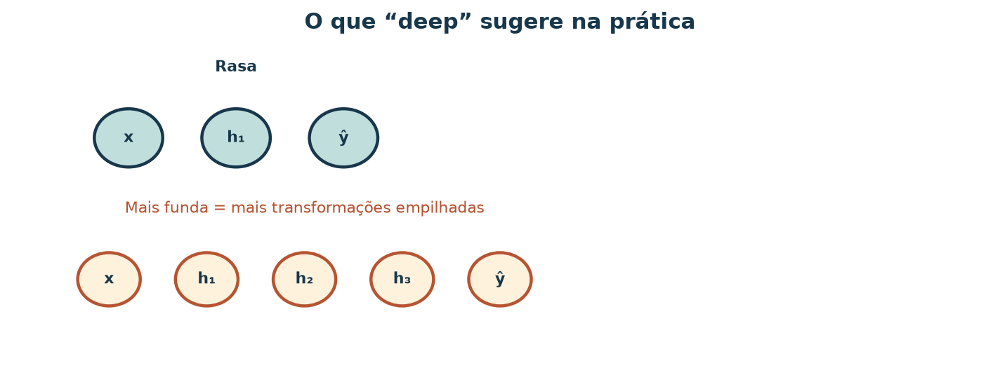
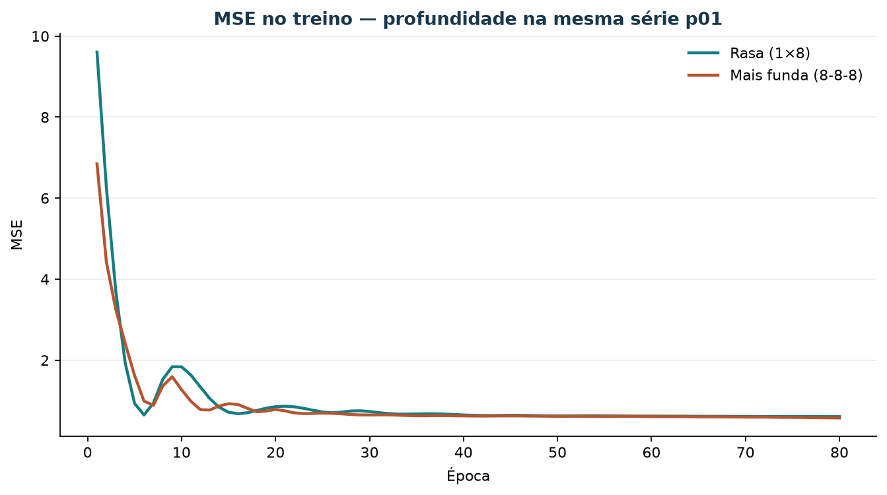

# Deep learning — visão muito alta

Depois do loop de treino (aula da MLP rasa), esta aula situa o que as pessoas
chamam de **deep learning**: empilhar várias transformações aprendidas, famílias
típicas de problema, e quando isso **não** ganha de baselines em dados miúdos.

## Objetivos

1. Explicar “deep” vs rede rasa / perceptron (profundidade = transformações
   empilhadas). Sem derivar backprop.
2. Um cartão: **uma** família (visão *ou* texto *ou* tabular) → trabalho típico →
   biblioteca.
3. Os **outros dois** cartões no mesmo formato (skim).
4. Treinar de forma breve uma MLP **mais funda** e comparar parâmetros e loss com
   a rasa.
5. Com n≈16 semanas de demanda: argumentar se “fundo” bate MA / MQ / LMS.

## 1. O que “deep” costuma significar



*Figura 1 — Mais camadas escondidas = mais etapas não lineares entre entrada e
saída. Isso aumenta a capacidade e o número de parâmetros.*

## 2. Três famílias (cartões)

| Família | Trabalho típico | Biblioteca que as pessoas citam |
| --- | --- | --- |
| Visão | Classificar imagens / detectar objetos | PyTorch + torchvision, Keras |
| Texto / sequência | Classificar sentimento / completar texto | Transformers (Hugging Face), spaCy |
| Tabular / séries | Prever demanda, crédito, churn | scikit-learn, PyTorch tabular, libs de boosting |

Escolha **uma** para aprofundar em cinco linhas (por que essa lib). As outras
duas: só o cartão.

## 3. Experimento nesta série

```bash
uv run python scripts/demo_deep_vs_rasa.py
```

Saída em `material/redes/resultado_deep_vs_rasa_p01.json` e a figura
`imagens/deep-learning-curvas-p01.png`.



*Figura 2 — Mesmos dados `p01`. Mais fundo ≠ automaticamente melhor no teste.*

Compare `n_params` e `mae_teste` da rasa e da mais funda. Relacione com o MAE
dos baselines das aulas de demanda (MA / MQ / LMS).

## 4. Quando não insistir em “deep”

Com poucas dezenas de pontos tabulares:

- o modelo funda **decora** fácil;
- o custo de ajuste e de interpretação sobe;
- baselines transparentes ainda mandam no relato.

Três bullets no seu caderno bastam para a tarefa 5.

## 5. Exercício

1. Definição própria de “deep” (≤10 linhas ou diagrama).
2–3. Três cartões de família.
4. Números do JSON: params e MAE rasa vs funda.
5. Parágrafo “quando não usar” para a demanda de 16 semanas.

## Referência

- Script: `scripts/demo_deep_vs_rasa.py`
- Ponte: `tutorial-treino-redes-neurais-20261026.md`
