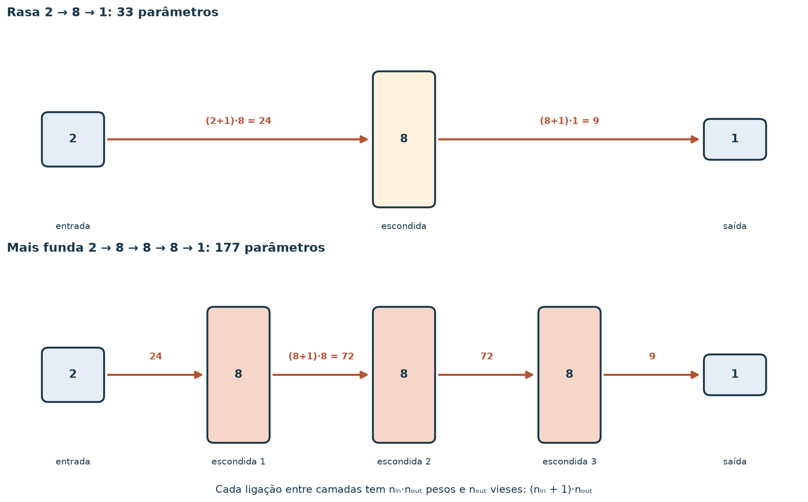
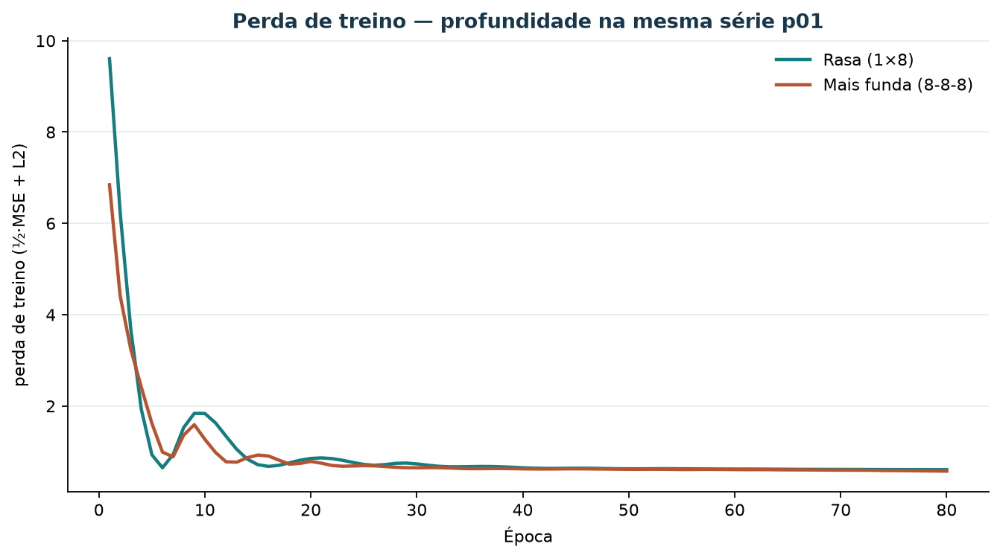
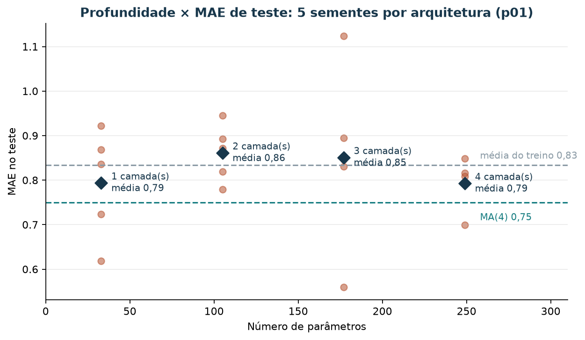

# Deep learning: o que a profundidade compra e quando ela vale

[Leia a versão web com o explorador interativo incorporado](https://lgallindo.github.io/recomendador-bentoml/deep-learning/).

Um fornecedor de software oferece à loja de artesanato uma “IA de deep learning”
para prever a demanda semanal. O argumento de venda é a profundidade: mais
camadas, mais parâmetros, mais inteligência. Antes de assinar, a equipe quer
entender o que “profundo” significa, em que tipo de problema essas redes
mudaram o jogo e se o argumento se sustenta com as 16 semanas de histórico
que a loja tem.

Ao concluir este tutorial, você deverá conseguir explicar *deep learning* como
o empilhamento de transformações aprendidas, contar os parâmetros de uma rede
densa à mão, reconhecer três famílias de problema (visão, texto, dados
tabulares) e o tipo de rede associado a cada uma, e argumentar com números se
uma rede mais funda melhora a previsão de uma série curta. Você também verá
como a semente aleatória pode pesar mais que a arquitetura quando o teste tem
poucas semanas.

Os dados de demanda são **sintéticos**. As comparações reproduzem o método de
avaliação; elas não estabelecem o desempenho de redes profundas em outros
problemas.

### Roteiro de estudo

| Tempo sugerido | Atividade de estudo |
| --- | --- |
| 8 min | Situar *deep learning* em uma linha do tempo curta |
| 10 min | Definir profundidade e contar parâmetros |
| 12 min | Ler três famílias de problema: visão, texto, tabular |
| 15 min | Rodar redes rasa e funda na série; varrer profundidade e sementes |
| 15 min | Explorar o painel de profundidade |
| 10 min | Decidir quando insistir em profundidade; exercício com resolução |

## 1. Uma linha do tempo curta

Redes neurais são uma ideia antiga que só se tornou dominante quando três
ingredientes se encontraram: um método eficiente para calcular gradientes em
muitas camadas, bases de dados enormes e hardware paralelo (GPUs).


*Figura 1 — Marcos selecionados, sem pretensão de completude. Em laranja, os
dois momentos que tornaram redes profundas treináveis (1986) e
competitivamente úteis em escala (2012).*

Em 2012, a AlexNet, com cerca de 60 milhões de parâmetros, venceu a competição
ImageNet de classificação de imagens, treinada em aproximadamente 1,2 milhão
de fotos rotuladas. A loja tem 12 semanas de treino por produto. Guarde essa
diferença de escala: ela volta na seção 5.

Antes da profundidade “de escala”, o Caderno já percorreu o fio curto: neurônio
formal e Perceptron, LMS na demanda,
[rede rasa](tutorial-treino-redes-neurais-20261026.md). O marco de 1969 na
figura 1 (limite do XOR) é o mesmo que o
[laboratório geométrico](bi-demanda-perceptron/lab/index.html) deixa ver no
plano: uma reta não basta; camadas compostas passam a importar.

## 2. O que “profundo” significa

Uma rede densa transforma a entrada camada a camada. Com $L$ camadas, cada
camada $\ell$ aplica uma transformação afim seguida de uma não linearidade:

$$
h^{(\ell)} = \mathrm{ReLU}\!\left(W^{(\ell)} h^{(\ell-1)} + b^{(\ell)}\right),
\qquad h^{(0)} = x .
$$

A saída de regressão é uma combinação linear da última camada escondida.
**Profundidade** é o número de transformações aprendidas empilhadas entre a
entrada e a saída. Uma rede **rasa** tem uma camada escondida; chamamos de
**profunda** (*deep*) uma rede com várias. Não há um número oficial de
camadas que separe as duas: o termo descreve a prática de compor muitas
etapas, em que as primeiras aprendem representações simples e as seguintes
combinam essas representações.

A não linearidade é indispensável. Sem a ReLU, a composição de camadas afins
seria uma única transformação afim, e empilhar camadas não acrescentaria
capacidade.

### Contar parâmetros

Entre uma camada com $n_{\ell-1}$ neurônios e a seguinte com $n_\ell$, há
$n_{\ell-1} \cdot n_\ell$ pesos e $n_\ell$ vieses. O total da rede é

$$
P = \sum_{\ell=1}^{L} \left(n_{\ell-1} + 1\right) n_\ell .
$$



*Figura 2 — Cada caixa mostra o número de neurônios; cada seta, quantos
parâmetros ligam duas camadas. Acrescentar duas camadas de 8 neurônios
multiplica o total por mais de cinco.*

| Rede | Conta | Parâmetros |
| --- | --- | ---: |
| 2 → 8 → 1 | $3 \cdot 8 + 9 \cdot 1$ | 33 |
| 2 → 8 → 8 → 1 | $24 + 9 \cdot 8 + 9$ | 105 |
| 2 → 8 → 8 → 8 → 1 | $24 + 72 + 72 + 9$ | 177 |
| 2 → 8 → 8 → 8 → 8 → 1 | $24 + 3 \cdot 72 + 9$ | 249 |

Com 12 semanas de treino, mesmo a rede rasa tem quase três parâmetros por
exemplo. Em visão computacional, a AlexNet tinha cerca de 50 parâmetros por
imagem de treino, mas cada imagem traz mais de 150 mil números de entrada e as
camadas de convolução reutilizam os mesmos pesos em toda a imagem.

## 3. Três famílias de problema


*Figura 3 — A mesma estrutura em três domínios: entrada, transformação
aprendida, saída. O que muda é o formato da entrada e o tipo de camada que
explora sua estrutura.*

| Família | Entrada típica | Estrutura que a rede explora | Arquitetura usual | Exemplo na loja |
| --- | --- | --- | --- | --- |
| Visão | Matriz de pixels (altura × largura × cor) | Vizinhança espacial: bordas formam texturas, texturas formam objetos | Convolucional (CNN); Transformer de visão | Classificar fotos de peças enviadas por artesãos |
| Texto / sequência | Sequência de *tokens* | Ordem e contexto entre palavras | Transformer (atenção) | Separar mensagens de reclamação de dúvidas de frete |
| Tabular / séries curtas | Poucas colunas numéricas ou categóricas | Relações entre atributos já definidos por pessoas | MLP; com frequência, árvores com *boosting* | Prever linhas de pedido da semana |

Em visão e texto, a entrada bruta tem milhares ou milhões de números sem
significado individual (um pixel isolado diz pouco), e as camadas profundas
aprendem os atributos úteis. Em dados tabulares, as colunas costumam já ser
atributos com significado; estudos comparativos mostram que árvores com
*boosting* frequentemente igualam ou superam redes profundas nessas bases
(Grinsztajn, Oyallon e Varoquaux, 2022).

Escolha uma das três famílias e aprofunde-se: qual biblioteca você usaria,
qual seria a entrada e o que significaria “acertar” naquele problema.

## 4. O experimento: rasa, funda e a semente

Na raiz do repositório:

```bash
uv run python scripts/demo_deep_vs_rasa.py
```

O script usa a mesma série do Jarro (`p01`), as mesmas entradas (tempo
normalizado $t/15$ e atraso $y_{t-1}$) e a mesma separação temporal: semanas
0–11 para treino, 12–15 para teste (demanda observada 4, 2, 2, 2). Todas as
redes usam 8 neurônios por camada, Adam com $\eta = 0{,}05$ e 80 épocas.

| Arquivo | Conteúdo |
| --- | --- |
| [`redes/resultado_deep_vs_rasa_p01.json`](redes/resultado_deep_vs_rasa_p01.json) | Rasa (1 camada) vs funda (3 camadas), semente 0 |
| [`redes/profundidade_p01.json`](redes/profundidade_p01.json) | 1 a 4 camadas, cada uma com 5 sementes |
| `imagens/deep-learning-curvas-p01.png` | Curvas de perda da rasa e da funda |

Resultado esperado em `resultado_deep_vs_rasa_p01.json`, com scikit-learn 1.9:

| Rede | Parâmetros | Perda final de treino | MAE no teste |
| --- | ---: | ---: | ---: |
| Rasa (8) | 33 | 0,606 | 0,836 |
| Mais funda (8-8-8) | 177 | 0,574 | 0,895 |
| Média do treino (referência) | — | — | 0,833 |
| MA(4) (referência) | — | — | 0,750 |



*Figura 4 — A rede mais funda termina o treino com perda menor. Com mais
parâmetros, ela se ajusta melhor às 12 semanas conhecidas; o teste mostra se
esse ajuste se transfere para as semanas seguintes.*

A rede funda ajusta melhor o treino e erra mais no teste. Esse é o padrão
clássico de **mais capacidade sem mais dados**. A perda de treino é a do
scikit-learn: metade do erro quadrático médio, mais uma penalidade L2 pequena.

### A semente pesa tanto quanto a arquitetura

Uma comparação com uma única semente pode enganar. O script repete cada
arquitetura com as sementes 0 a 4, que mudam apenas a inicialização aleatória
dos pesos:

| Camadas | Parâmetros | MAE de teste por semente (0, 1, 2, 3, 4) | Média | Faixa |
| ---: | ---: | --- | ---: | --- |
| 1 | 33 | 0,836; 0,619; 0,922; 0,724; 0,869 | 0,794 | 0,62–0,92 |
| 2 | 105 | 0,779; 0,871; 0,819; 0,893; 0,945 | 0,861 | 0,78–0,94 |
| 3 | 177 | 0,895; 0,560; 0,846; 0,831; 1,124 | 0,851 | 0,56–1,12 |
| 4 | 249 | 0,700; 0,809; 0,815; 0,791; 0,849 | 0,793 | 0,70–0,85 |

Se você olhasse só a semente 0, concluiria que 4 camadas (0,700) vencem a MA(4)
(0,750). Com cinco sementes, a média de 4 camadas é 0,793, e as faixas de todas
as arquiteturas se sobrepõem. Com quatro semanas de teste, as diferenças entre
profundidades estão dentro da variação produzida pela inicialização.

Há outra pista. As previsões de teste da rede rasa ficam entre 2,57 e 2,69,
muito perto da média do treino (2,67). As redes, rasas ou fundas, quase não
encontram sinal nas entradas além do nível médio da série. Mais camadas não
criam um sinal que os dados não têm.

## 5. Quando insistir em profundidade

| Situação | Profundidade tende a ajudar? | Por quê |
| --- | --- | --- |
| Milhões de exemplos rotulados, entrada bruta (pixels, áudio, texto) | Sim | Camadas aprendem atributos que seriam difíceis de escrever à mão |
| Modelo pré-treinado disponível para a mesma família de dados | Sim, com ajuste fino | Reaproveita representações aprendidas em bases grandes |
| Dados tabulares com colunas já significativas, milhares de linhas | Às vezes | Árvores com *boosting* são uma referência forte e mais barata |
| Série curta (dezenas de pontos), um produto | Raramente | Mais parâmetros que exemplos; variação da semente domina |
| Decisão que precisa ser auditada por pessoas | Com cautela | Cada camada a mais dificulta explicar uma previsão |

Para a loja, a resposta ao fornecedor é uma pergunta: “quantos exemplos o seu
modelo usa, e qual é o erro dele no mesmo teste em que a média móvel erra
0,75?”.

## 6. Explore a profundidade com BI

O [explorador de redes neurais](bi-redes/index.html) tem um painel de
profundidade que mostra, para cada arquitetura, o número de parâmetros, o MAE
de teste das cinco sementes e o MAE de treino, com as referências como linhas
tracejadas. Você pode escolher uma semente e ver como a “vencedora” muda. Use-o
incorporado à
[versão web deste tutorial](https://lgallindo.github.io/recomendador-bentoml/deep-learning/#explorador-interativo)
ou abra o HTML a partir de uma cópia local do repositório. O
[roteiro de exploração](bi-redes/README.md) descreve todos os painéis.



*Figura 5 — Espelho estático do painel 05. Os pontos claros são sementes; os
losangos, médias. Nenhuma média fica abaixo da MA(4).*

### Atividade no painel

1. Escolha a semente 0. Qual arquitetura parece a melhor? E com a semente 1?
2. Volte para a média das sementes. Alguma arquitetura fica abaixo da linha da
   MA(4)?
3. Qual arquitetura tem a maior faixa entre sementes? O que isso diz sobre a
   confiabilidade de uma única corrida?

**Resolução comentada:** com a semente 0, 4 camadas parecem vencer (0,70);
com a semente 1, a vencedora é a de 3 camadas (0,56), que na semente 4 é a pior
(1,12). Nenhuma média fica abaixo de 0,75. A rede de 3 camadas tem a maior
faixa (0,56–1,12): uma corrida isolada dela poderia sustentar conclusões
opostas.

## 7. Limitações

- Quatro semanas de teste e cinco sementes ainda são pouco para estimar a
  incerteza com rigor; o experimento ilustra o raciocínio.
- Todas as redes usam a mesma largura, o mesmo número de épocas e a mesma taxa
  de aprendizado. Redes mais fundas costumam pedir outros ajustes
  (normalização, regularização, *early stopping*), fora do escopo desta aula.
- As famílias de visão e texto aparecem como cartões conceituais; nenhuma rede
  convolucional ou Transformer é treinada aqui.

## 8. Exercício: responda ao fornecedor

1. Escreva, em até dez linhas ou num diagrama, sua definição de *deep learning*
   com as palavras “transformação”, “camada” e “não linearidade”.
2. Conte à mão os parâmetros da rede 2 → 16 → 8 → 1.
3. Preencha um cartão (entrada, transformação, saída, biblioteca) para a família
   que você escolheu na seção 3 e cartões resumidos para as outras duas.
4. Com os números de `profundidade_p01.json`, compare a média de MAE das redes
   de 1 e 3 camadas com a MA(4).
5. Escreva um parágrafo ao fornecedor: o que você pediria como evidência e por
   que 16 semanas não bastam para justificar uma rede profunda.

### Resolução comentada

**1.** Exemplo: “*Deep learning* é treinar redes com várias camadas de
transformações aprendidas. Cada camada combina linearmente as saídas da
anterior e aplica uma não linearidade; a composição permite representar
relações que uma única camada exigiria muito mais neurônios para aproximar.”

**2.** $(2+1) \cdot 16 + (16+1) \cdot 8 + (8+1) \cdot 1 = 48 + 136 + 9 = 193$.

**3.** Use a tabela da seção 3. Para visão, por exemplo: entrada 224 × 224 × 3
pixels; transformação, convoluções empilhadas; saída, a classe da peça;
biblioteca, PyTorch com torchvision.

**4.** 1 camada: média 0,794; 3 camadas: média 0,851; MA(4): 0,750. As duas
redes erram mais que a média móvel em média; a rede de 3 camadas tem faixa
0,56–1,12, o que torna sua comparação instável.

**5.** Exemplo: “Peço o erro do modelo no mesmo período de teste em que a média
móvel de quatro semanas erra 0,75 linha por semana, com várias inicializações
e sem uso das semanas de teste na escolha do modelo. Com 12 semanas de treino
por produto, redes de 33 a 249 parâmetros não superaram a média móvel em nosso
teste e variaram mais com a semente que com a profundidade.”

## Referências bibliográficas e roteiro de leitura

Consulta dos materiais on-line: 7 nov. 2026.

1. GOODFELLOW, Ian; BENGIO, Yoshua; COURVILLE, Aaron. **Deep learning**.
   Cambridge, MA: MIT Press, 2016.
   [Texto on-line em inglês](https://www.deeplearningbook.org/).
   **Para aprofundar:** capítulo 1 (história) e capítulo 6 (redes densas).
2. HAYKIN, Simon. **Redes neurais: princípios e prática**. 2. ed. Porto Alegre:
   Bookman, 2001.
   **Para aprofundar:** fundamentos do perceptron de múltiplas camadas em
   português.
3. LECUN, Yann; BENGIO, Yoshua; HINTON, Geoffrey. Deep learning. **Nature**,
   v. 521, p. 436–444, 2015. DOI: 10.1038/nature14539.
   **Para consultar:** panorama curto escrito por três pioneiros da área.
4. KRIZHEVSKY, Alex; SUTSKEVER, Ilya; HINTON, Geoffrey E. ImageNet
   classification with deep convolutional neural networks. In: **NeurIPS**,
   2012.
5. VASWANI, Ashish et al. Attention is all you need. In: **NeurIPS**, 2017.
   [arXiv:1706.03762](https://arxiv.org/abs/1706.03762).
6. GRINSZTAJN, Léo; OYALLON, Edouard; VAROQUAUX, Gaël. Why do tree-based models
   still outperform deep learning on typical tabular data? In: **NeurIPS
   Datasets and Benchmarks**, 2022. [arXiv:2207.08815](https://arxiv.org/abs/2207.08815).
   **Para aprofundar:** quando redes profundas perdem em dados tabulares.
7. SCIKIT-LEARN. **Neural network models (supervised)**.
   [Guia do usuário em inglês](https://scikit-learn.org/stable/modules/neural_networks_supervised.html).

### Artefatos no repositório

| Artefato | Papel |
| --- | --- |
| `dados/vendas_semanais.csv` | Série semanal sintética |
| `scripts/demo_deep_vs_rasa.py` | Rasa vs funda; varredura de profundidade e sementes |
| `material/redes/resultado_deep_vs_rasa_p01.json` | Comparação com semente 0 |
| `material/redes/profundidade_p01.json` | 1–4 camadas × 5 sementes |
| `material/bi-redes/` | Explorador interativo |
| `material/imagens/` (regenerar: `.local/scripts/gerar_figuras_redes.py`) | Linha do tempo, famílias e contagem de parâmetros |
