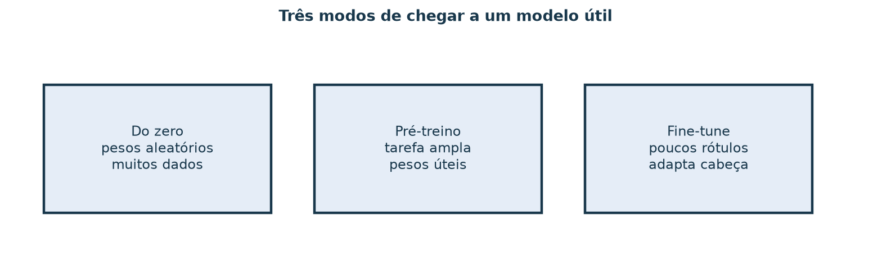
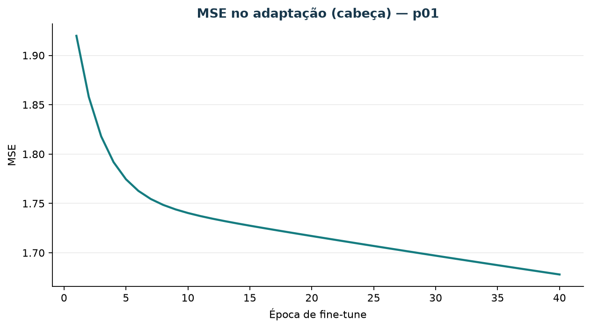

# Fine-tuning — adaptar em vez de começar do zero

Esta aula mostra o **padrão** pré-treino → adaptar, sem baixar um LLM gigante.
O demo usa MLP no scikit-learn: pré-treina em vários produtos da série sintética,
congela o tronco e atualiza só a cabeça em `p01`.

## Objetivos

1. Três caixas: do zero / pré-treino / fine-tune.
2. Plano escrito: o que congelar vs atualizar (tronco vs cabeça).
3. Rodar o fine-tune curto; anotar loss/MSE e wall-clock.
4. Métrica **antes vs depois** no mesmo holdout.
5. Dois riscos + uma mitigação.

## 1. Três modos



*Figura 1 — Fine-tune parte de pesos já úteis e usa poucos rótulos novos.*

## 2. Plano de freeze (antes de treinar)

Neste demo:

- **Congela:** camadas escondidas (tronco).
- **Atualiza:** camada de saída (cabeça).

Em modelos de hub (visão/texto) a ideia é a mesma: tronco pré-treinado, cabeça
da tarefa nova. Libs típicas: `torchvision`, `transformers` — aqui ficam como
leitura; o laboratório roda offline com sklearn.

## 3. Rodar

```bash
uv run python scripts/demo_fine_tuning_mlp.py
```

Arquivos:

- `material/redes/resultado_fine_tuning_p01.json`
- `imagens/fine-tuning-curva-p01.png`



## 4. Antes / depois / do zero

No JSON, compare:

- `pretreino.mae_teste_p01_antes_ft`
- `fine_tune.mae_teste_depois`
- `do_zero_so_p01.mae_teste`

Uma frase: o fine-tune ajudou, empatou ou piorou frente ao zero neste toy?

## 5. Riscos

O JSON já lista dois riscos e a mitigação usada. Reescreva com as suas palavras
(overfit, split frágil, etc.).

## 6. Exercício

1. Diagrama das três caixas.
2. Freeze plan em duas linhas.
3–4. Números before/after + wall-clock.
5. Riscos + mitigação.

## Limite honesto

Isto **não** é fine-tune de fundacional de linguagem. É o esqueleto do ritual
para caber em CPU de sala. A série de 16 semanas continua melhor contada com
MA / MQ / LMS quando o objetivo é previsão de demanda auditável.

## Referência

- `scripts/demo_fine_tuning_mlp.py`
