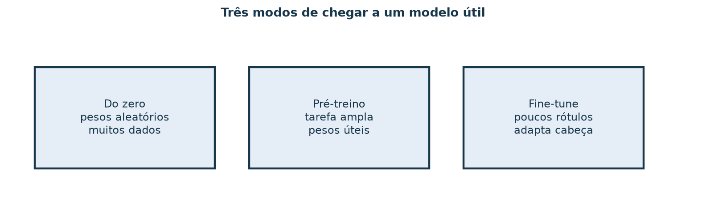
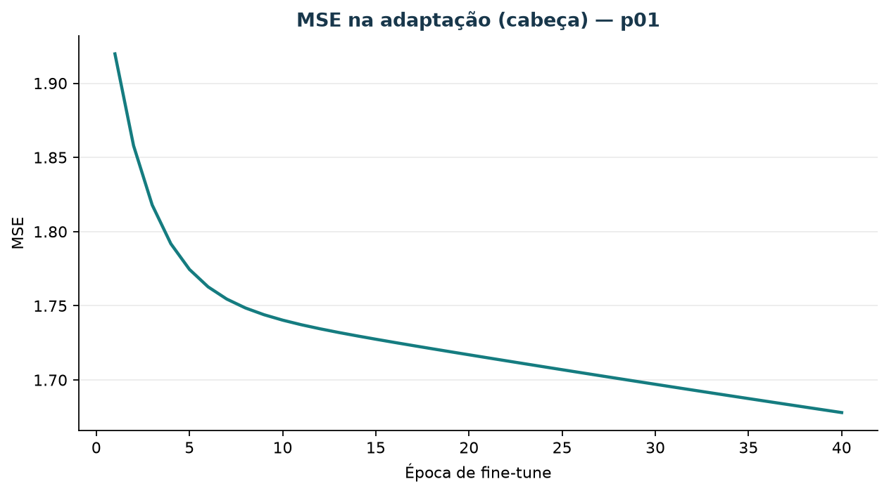
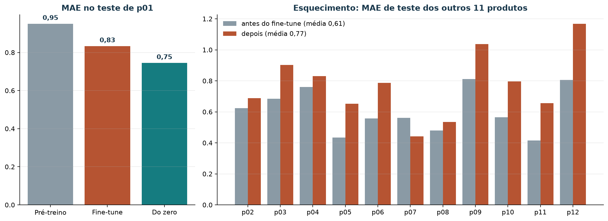

# Fine-tuning: adaptar um modelo pré-treinado em vez de começar do zero

[Leia a versão web com o explorador interativo incorporado](https://lgallindo.github.io/recomendador-bentoml/fine-tuning/).

A loja de artesanato tem doze produtos com histórico semanal. Quando chega uma
peça nova, ou quando um produto muda de comportamento, a equipe se pergunta:
vale a pena reaproveitar o que um modelo aprendeu com todo o catálogo e só
**ajustar** para aquela peça? Essa é a ideia do *fine-tuning* (ajuste fino),
o mesmo gesto que se faz com modelos grandes de imagem e de linguagem
baixados de repositórios públicos.

Ao concluir este tutorial, você deverá conseguir distinguir treino do zero,
pré-treino e ajuste fino; escrever um **plano de congelamento** (que partes do
modelo ficam fixas e quais são atualizadas); contar os parâmetros treináveis;
medir o resultado antes e depois do ajuste no mesmo teste; e verificar se o
ajuste fez o modelo **esquecer** o que sabia sobre os outros produtos. Você
também conhecerá, como leitura, o LoRA, a técnica que torna o ajuste de
modelos de linguagem viável em hardware modesto.

O laboratório roda em CPU, em menos de um segundo, sem baixar pesos da
internet: o “modelo pré-treinado” é uma MLP pequena treinada na própria série
sintética. Ele reproduz o **ritual** do ajuste fino em miniatura; os números
não indicam o que acontece com modelos de bilhões de parâmetros.

### Roteiro de estudo

| Tempo sugerido | Atividade de estudo |
| --- | --- |
| 8 min | Três modos de chegar a um modelo útil |
| 10 min | Tronco, cabeça e o plano de congelamento |
| 10 min | Quanto do modelo aprende de novo: do congelamento ao LoRA |
| 12 min | Rodar o pré-treino, o ajuste e o treino do zero |
| 10 min | Ler antes, depois, do zero e o esquecimento |
| 10 min | Explorar o painel de fine-tuning |
| 10 min | Riscos, mitigação e exercício com resolução |

## 1. Três modos de chegar a um modelo útil



*Figura 1 — O ajuste fino começa de pesos que já representam algo útil e usa
poucos exemplos da tarefa nova.*

| Modo | Ponto de partida | Dados usados | Quando faz sentido |
| --- | --- | --- | --- |
| **Do zero** | Pesos aleatórios | Só a tarefa alvo | Há dados suficientes da tarefa alvo |
| **Pré-treino** | Pesos aleatórios | Uma base ampla e relacionada | Construir representações reutilizáveis |
| **Ajuste fino** | Pesos do pré-treino | Poucos exemplos da tarefa alvo | A tarefa alvo tem poucos dados e se parece com o pré-treino |

O pré-treino e o ajuste fino formam a **aprendizagem por transferência**
(*transfer learning*): o que foi aprendido numa tarefa é transferido para
outra. Em visão, uma rede treinada no ImageNet aprende bordas e texturas que
servem para classificar fotos de cerâmica. Em texto, um modelo de linguagem
pré-treinado em grandes coleções de texto aprende regularidades da língua que
servem para classificar mensagens de clientes.

## 2. Tronco, cabeça e o plano de congelamento

Uma rede pode ser lida em duas partes:

- o **tronco** (*backbone*), as camadas escondidas que transformam a entrada
  numa representação $h$;
- a **cabeça** (*head*), a última camada, que transforma $h$ na resposta da
  tarefa.

$$
h = \phi_{\theta_{\mathrm{tronco}}}(x), \qquad
\widehat{y} = w^\top h + b .
$$

**Congelar** uma parte significa não atualizar seus parâmetros durante o
ajuste. Se o tronco está congelado, só $w$ e $b$ recebem gradiente. Para a
perda $L = \frac{1}{2n}\sum_i (y_i - \widehat{y}_i)^2$,

$$
\frac{\partial L}{\partial w} = -\frac{1}{n}\sum_{i=1}^{n} e_i\,h_i,
\qquad
\frac{\partial L}{\partial b} = -\frac{1}{n}\sum_{i=1}^{n} e_i,
\qquad e_i = y_i - \widehat{y}_i ,
$$

e a atualização é $w \leftarrow w - \eta\,\partial L/\partial w$. Com o tronco
fixo, a cabeça resolve uma regressão linear sobre atributos $h_i$ que o
pré-treino aprendeu.


*Figura 2 — O plano de congelamento deste laboratório. O tronco foi
pré-treinado em 144 exemplos (12 produtos × 12 semanas); a cabeça é ajustada
às 12 semanas de treino do Jarro.*

Escreva o plano **antes** de treinar, em duas linhas:

> **Congela:** as duas camadas escondidas (16 e 8 neurônios, 184 parâmetros).
> **Atualiza:** a camada de saída (9 parâmetros), por 40 épocas com $\eta = 0{,}02$.

## 3. Quanto do modelo aprende de novo?


*Figura 3 — Estratégias de ajuste ordenadas pelo que você deixa mudar. O
exemplo de LoRA usa uma matriz de pesos 4096 × 4096 com posto 8.*

| Estratégia | O que é atualizado | Custo | Risco principal |
| --- | --- | --- | --- |
| Extração de atributos | Só a cabeça | Muito baixo | A representação do tronco pode não servir à tarefa nova |
| Ajuste parcial | As últimas camadas e a cabeça | Médio | Escolher quantas camadas liberar |
| Ajuste completo | Todos os parâmetros | Alto (memória para todos os gradientes) | Sobreajuste e esquecimento com poucos dados |
| Adaptadores / LoRA | Matrizes pequenas acrescentadas; pesos originais fixos | Baixo | Posto pequeno demais limita a adaptação |

### LoRA em uma fórmula

No LoRA (*Low-Rank Adaptation*, Hu et al., 2022), uma matriz de pesos
pré-treinada $W \in \mathbb{R}^{d \times k}$ fica congelada, e o ajuste aprende
uma correção de posto baixo:

$$
W' = W + B A, \qquad B \in \mathbb{R}^{d \times r},\; A \in \mathbb{R}^{r \times k},\; r \ll \min(d, k).
$$

Os parâmetros treináveis passam de $d \cdot k$ para $r\,(d + k)$. Com
$d = k = 4096$ e $r = 8$: de $16\,777\,216$ para $8 \cdot 8192 = 65\,536$, cerca
de 0,39%. É por isso que se ajustam modelos de linguagem grandes em uma única
GPU. Este laboratório não aplica LoRA; a fórmula está aqui para você
reconhecer o termo e fazer a conta.

## 4. O experimento

Na raiz do repositório:

```bash
uv run python scripts/demo_fine_tuning_mlp.py
```

O script executa três treinos com a mesma arquitetura (2 → 16 → 8 → 1, ReLU),
as mesmas entradas (tempo normalizado $t/15$ e atraso $y_{t-1}$) e o mesmo teste
(semanas 12–15 do Jarro, demanda observada 4, 2, 2, 2):

1. **Pré-treino:** 60 épocas de Adam nas semanas 0–11 dos 12 produtos
   (144 exemplos). Nenhuma semana de teste participa.
2. **Ajuste fino:** copia os pesos do pré-treino, congela o tronco e aplica 40
   passos de gradiente descendente à cabeça, só com as semanas 0–11 do Jarro.
3. **Do zero:** a mesma arquitetura, com pesos aleatórios, treinada 60 épocas
   só nas semanas 0–11 do Jarro.

Resultado gravado em
[`redes/resultado_fine_tuning_p01.json`](redes/resultado_fine_tuning_p01.json)
(scikit-learn 1.9; o tempo de relógio varia com a máquina):

| Modelo | Previsões nas semanas 12–15 | MAE no teste de p01 |
| --- | --- | ---: |
| Pré-treino (antes do ajuste) | 1,64; 2,68; 1,62; 1,62 | 0,951 |
| Ajuste fino (cabeça) | 2,10; 3,27; 2,09; 2,08 | 0,834 |
| Do zero, só p01 | 2,55; 2,55; 2,50; 2,48 | **0,745** |
| MA(4) (referência) | 2,50; 2,75; 2,25; 2,50 | 0,750 |

O pré-treino leva cerca de 0,01–0,03 s e o ajuste, menos de 0,01 s.



*Figura 4 — O MSE de treino durante o ajuste cai de 1,92 para 1,68 e ainda está
descendo na época 40. Quarenta passos com $\eta = 0{,}02$ deixam a cabeça a meio
caminho.*

### Leitura honesta

- **O ajuste ajudou em relação ao pré-treino.** O modelo genérico prevê cerca
  de 1,6 linhas por semana, abaixo do nível do Jarro (média de treino 2,67);
  ajustar a cabeça eleva as previsões e reduz o MAE de 0,951 para 0,834.
- **O treino do zero venceu o ajuste.** Com 12 semanas, o Jarro tem tantos
  exemplos quanto cada produto do pré-treino. Não há escassez de dados para a
  transferência compensar, e o tronco aprendeu uma representação do produto
  “médio” do catálogo, que não é o Jarro.
- **Nenhum dos três supera com folga a MA(4).** O treino do zero (0,745) e a
  média móvel (0,750) empatam em quatro semanas de teste.

Ajuste fino costuma compensar quando a base de pré-treino é muito maior que a
da tarefa alvo e as duas compartilham estrutura: milhões de imagens para
ajustar com algumas centenas de fotos de cerâmica, por exemplo. O exercício
pede que você formule esse caso para a loja.

## 5. O modelo esqueceu os outros produtos?

O tronco ficou congelado, mas a cabeça é compartilhada: os mesmos 9 parâmetros
produzem a previsão de qualquer produto. Ajustá-los ao Jarro pode piorar os
demais. Esse fenômeno se chama **esquecimento catastrófico** (McCloskey e
Cohen, 1989). O script mede o MAE nas semanas de teste dos outros 11 produtos
antes e depois do ajuste:

| Produto | p02 | p03 | p04 | p05 | p06 | p07 | p08 | p09 | p10 | p11 | p12 |
| --- | ---: | ---: | ---: | ---: | ---: | ---: | ---: | ---: | ---: | ---: | ---: |
| Antes | 0,62 | 0,69 | 0,76 | 0,44 | 0,56 | 0,56 | 0,48 | 0,81 | 0,56 | 0,41 | 0,81 |
| Depois | 0,69 | 0,90 | 0,83 | 0,65 | 0,79 | 0,44 | 0,54 | 1,04 | 0,80 | 0,66 | 1,17 |

A média sobe de **0,609 para 0,772**. Só `p07` melhora. Se a loja precisa de um
modelo único para todo o catálogo, o ajuste ao Jarro tem um custo visível nos
outros produtos. A mitigação mais simples é manter **uma cabeça por produto**
sobre o mesmo tronco congelado: o ajuste de uma cabeça não altera as outras.

## 6. Explore o ajuste com BI

O [explorador de redes neurais](bi-redes/index.html) tem um painel de
fine-tuning com o MAE de `p01` para pré-treino, ajuste e treino do zero, ao
lado das barras de esquecimento dos outros 11 produtos. Use-o incorporado à
[versão web deste tutorial](https://lgallindo.github.io/recomendador-bentoml/fine-tuning/#explorador-interativo)
ou abra o HTML a partir de uma cópia local do repositório. Consulte o
[roteiro de exploração](bi-redes/README.md). Os outros painéis do mesmo
explorador mostram as curvas de treino de uma MLP rasa e o efeito da
profundidade, como contexto opcional.



*Figura 5 — Espelho estático do painel 06. O ajuste melhora o Jarro em
relação ao pré-treino e piora a maioria dos outros produtos.*

### Atividade no painel

1. Qual produto teve o maior aumento de MAE depois do ajuste? Quanto?
2. Algum produto melhorou? Proponha uma explicação para isso.
3. Compare o ganho no Jarro (antes → depois) com a perda média nos outros
   produtos. O ajuste compensa para um modelo único do catálogo?

**Resolução comentada:** `p12` passa de 0,81 para 1,17 (+0,36). `p07` melhora
de 0,56 para 0,44; elevar o nível das previsões, que o ajuste fez para o
Jarro, também aproximou as previsões de `p07` de sua demanda de teste. No Jarro,
o MAE cai 0,12 (0,95 → 0,83); nos outros produtos, a média sobe 0,16
(0,61 → 0,77). Para um modelo único, o ajuste não compensa; com uma cabeça por
produto, o Jarro poderia receber o ajuste sem afetar os demais.

## 7. Riscos e mitigação

| Risco | Como aparece | Mitigação |
| --- | --- | --- |
| Sobreajuste na tarefa alvo | Perda de treino cai, MAE de teste sobe | Congelar mais, poucas épocas, parar cedo com um período de validação |
| Esquecimento | Pior desempenho nas tarefas antigas | Uma cabeça por tarefa; reavaliar as tarefas antigas depois do ajuste |
| Vazamento entre pré-treino e teste | Teste otimista porque o pré-treino viu o período avaliado | Pré-treinar só com semanas anteriores ao teste (como aqui) |
| Avaliação frágil | Conclusões trocam com a semente ou com uma semana | Mais semanas de teste; várias sementes; comparar com referências |
| Representação inadequada | O tronco não captura o que a tarefa nova precisa | Ajuste parcial ou completo; outro modelo pré-treinado |
| Licença e origem dos pesos | Pesos baixados com restrições de uso | Ler a licença e o cartão do modelo antes de ajustar |

## 8. Limitações

- O “pré-treino” usa a mesma série e a mesma tarefa, com apenas 144 exemplos.
  Ele reproduz a mecânica do ajuste fino, não sua vantagem típica de escala.
- O ajuste da cabeça é um gradiente descendente simples escrito no script, com
  40 passos; outra taxa ou mais passos mudariam o resultado.
- Modelos de visão (`torchvision`) e de linguagem (`transformers`) usam o
  mesmo padrão tronco/cabeça, mas exigem baixar pesos de centenas de megabytes
  ou mais. Eles ficam como leitura nas referências.

## 9. Exercício: plano de ajuste para a loja

1. Desenhe as três caixas (do zero, pré-treino, ajuste fino) com uma frase cada,
   aplicada à loja.
2. Escreva o plano de congelamento do laboratório em duas linhas e calcule a
   fração de parâmetros treináveis.
3. Se você descongelasse também a camada de 8 neurônios, quantos parâmetros
   seriam treináveis? Que fração do total?
4. Copie do JSON o MAE antes, depois e do zero, e escreva uma frase: o ajuste
   ajudou, empatou ou piorou frente ao treino do zero? Por quê?
5. Calcule os parâmetros treináveis de um LoRA de posto $r = 4$ numa matriz
   $768 \times 768$ e compare com o ajuste completo dessa matriz.
6. Escolha dois riscos da seção 7 e uma mitigação para cada, com suas palavras.
   Descreva um caso da loja em que o ajuste fino provavelmente compensaria.

### Resolução comentada

**1.** Do zero: treinar uma rede só com o histórico de uma peça. Pré-treino:
treinar com o histórico de todo o catálogo. Ajuste fino: partir do modelo do
catálogo e adaptá-lo à peça com poucas semanas.

**2.** Congela as camadas de 16 e 8 neurônios (184 parâmetros); atualiza a
saída (9 parâmetros). Fração: $9/193 \approx 4{,}7\%$.

**3.** $136 + 9 = 145$ parâmetros treináveis; $145/193 \approx 75\%$.

**4.** Antes 0,951; depois 0,834; do zero 0,745. O ajuste melhorou o pré-treino,
mas perdeu para o treino do zero: o Jarro tem tantas semanas quanto cada
produto do pré-treino, e o tronco representa o produto médio do catálogo.

**5.** $r(d + k) = 4 \cdot 1536 = 6144$ parâmetros, contra
$768 \cdot 768 = 589\,824$ no ajuste completo: cerca de 1,04%.

**6.** Exemplo: sobreajuste — com 12 semanas, muitas épocas na cabeça fariam o
modelo seguir o ruído; mitigação: poucas épocas e um período de validação
separado do teste. Esquecimento — a cabeça compartilhada piorou 10 de 11
produtos; mitigação: uma cabeça por produto. Caso favorável: um produto novo
com três ou quatro semanas de vendas, numa loja com centenas de produtos de
histórico longo; o tronco pré-treinado traria o padrão sazonal do catálogo que
quatro semanas não revelam.

## Referências bibliográficas e roteiro de leitura

Consulta dos materiais on-line: 7 nov. 2026.

1. GOODFELLOW, Ian; BENGIO, Yoshua; COURVILLE, Aaron. **Deep learning**.
   Cambridge, MA: MIT Press, 2016.
   [Texto on-line em inglês](https://www.deeplearningbook.org/).
   **Para aprofundar:** seção 15.2, aprendizagem por transferência.
2. YOSINSKI, Jason et al. How transferable are features in deep neural
   networks? In: **NeurIPS**, 2014. [arXiv:1411.1792](https://arxiv.org/abs/1411.1792).
   **Para aprofundar:** quais camadas transferem bem entre tarefas.
3. HU, Edward J. et al. LoRA: low-rank adaptation of large language models.
   In: **ICLR**, 2022. [arXiv:2106.09685](https://arxiv.org/abs/2106.09685).
4. MCCLOSKEY, Michael; COHEN, Neal J. Catastrophic interference in
   connectionist networks: the sequential learning problem. **Psychology of
   Learning and Motivation**, v. 24, p. 109–165, 1989.
5. KIRKPATRICK, James et al. Overcoming catastrophic forgetting in neural
   networks. **PNAS**, v. 114, n. 13, p. 3521–3526, 2017.
   DOI: 10.1073/pnas.1611835114.
6. PYTORCH. **Transfer learning for computer vision tutorial**.
   [Tutorial em inglês](https://pytorch.org/tutorials/beginner/transfer_learning_tutorial.html).
   **Para consultar:** congelar o tronco de uma rede de visão e treinar a
   cabeça (exige baixar pesos).
7. HUGGING FACE. **Fine-tuning a pretrained model**.
   [Documentação em inglês](https://huggingface.co/docs/transformers/training).
   **Para consultar:** o mesmo ritual com modelos de linguagem.

### Artefatos no repositório

| Artefato | Papel |
| --- | --- |
| `dados/vendas_semanais.csv` | Série semanal sintética (12 produtos) |
| `scripts/demo_fine_tuning_mlp.py` | Pré-treino, ajuste da cabeça, treino do zero e esquecimento |
| `material/redes/resultado_fine_tuning_p01.json` | Números desta aula |
| `material/bi-redes/` | Explorador interativo |
| `material/imagens/` (regenerar: `.local/scripts/gerar_figuras_redes.py`) | Diagramas de congelamento e de estratégias |
