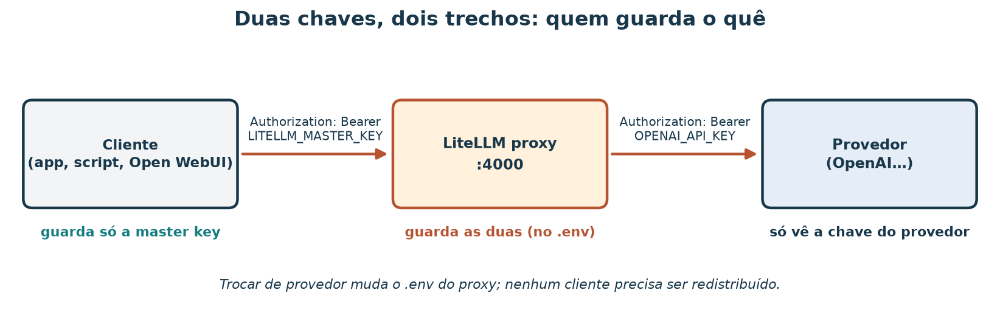
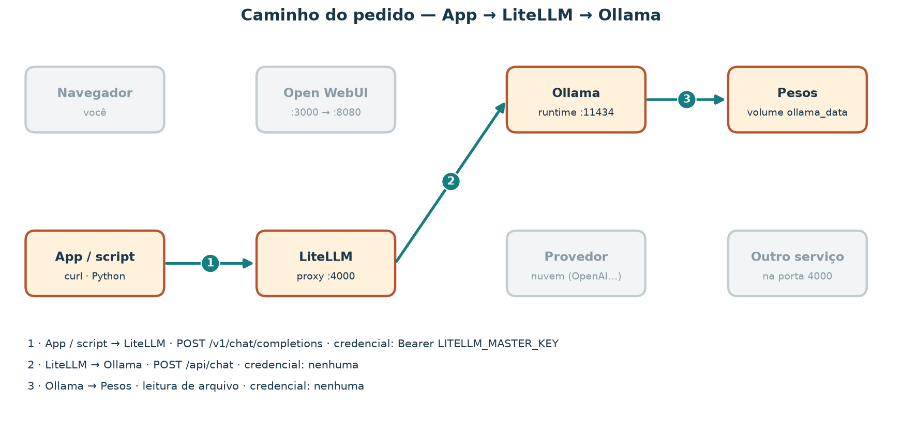

# Um gateway para modelos de linguagem com LiteLLM

A loja de artesanato já tem três programas que querem conversar com um modelo
de linguagem: a interface de chat do atendimento, um script que resume
avaliações e um agente que consulta o catálogo. Cada um foi escrito para a API
da OpenAI. Hoje o modelo é local, num Ollama; amanhã pode ser um provedor em
nuvem, ou os dois, com um de reserva. Se cada programa guardar sua própria
chave e seu próprio endereço, toda troca vira três mudanças de código e três
cópias de segredo espalhadas.

Um **gateway** resolve isso: os programas falam um único contrato
(OpenAI-compatible) com um único endereço, e o gateway decide para onde
encaminhar cada pedido. Nesta aula você monta esse gateway com **LiteLLM**,
usando um modelo local no Ollama, sem chave paga.

Ao concluir, você deverá conseguir separar a **chave do provedor** da **chave
do proxy**, escrever um `model_list` com aliases, rodar LiteLLM como
biblioteca e como proxy (no host ou em contêiner), apontar um cliente para
`http://127.0.0.1:4000/v1` e diagnosticar os erros mais comuns pelo status e
pela mensagem. Tudo o que você precisa está em
[`litellm/`](litellm/) e em dois scripts da raiz. As respostas de erro
mostradas aqui foram registradas com LiteLLM 1.108.2; outras versões podem
mudar textos e códigos.

### Roteiro de estudo

| Tempo sugerido | Atividade de estudo |
| --- | --- |
| 10 min | Situar o gateway entre aplicações e modelos |
| 10 min | Separar as duas chaves e preparar o `.env` |
| 10 min | Ler o `model_list` e os aliases |
| 10 min | Caminho A: uma completion pela biblioteca, sem proxy |
| 15 min | Caminhos B e C: subir o proxy na porta 4000 |
| 10 min | Cliente OpenAI-compatible contra o proxy |
| 15 min | Provocar e diagnosticar falhas com o explorador |
| 10 min | Exercício e resolução comentada |

## 1. O que um gateway faz


*Figura 1 — Um contrato de entrada, vários destinos. O proxy traduz o formato,
guarda as chaves dos destinos, registra uso e pode tentar um destino de
reserva. A figura mostra papéis; ela não indica desempenho nem custo.*

| Termo | Definição nesta aula |
| --- | --- |
| **API OpenAI-compatible** | Conjunto de rotas e formatos popularizado pela OpenAI: `POST /v1/chat/completions`, `GET /v1/models`, cabeçalho `Authorization: Bearer <chave>` |
| **Provedor** | Quem de fato executa o modelo: um serviço em nuvem ou um runtime local como o Ollama |
| **Gateway / proxy** | Serviço intermediário que recebe pedidos no contrato comum e os encaminha ao provedor certo |
| **Alias** | Nome estável que o cliente pede (`loja-chat`), mapeado no proxy para um modelo concreto |
| **Master key** | Chave que os clientes apresentam ao proxy; ela não serve no provedor |
| **Chave do provedor** | Chave que o proxy apresenta ao provedor; os clientes nunca a veem |

LiteLLM tem duas formas. Como **biblioteca** (`import litellm`), ela traduz
chamadas dentro do seu programa, sem servidor. Como **proxy**, ela vira um
processo HTTP que qualquer programa alcança. Os dois usam a mesma notação de
modelo: `provedor/modelo`, como `ollama_chat/qwen2.5:0.5b` ou
`openai/gpt-4o-mini`.

## 2. Duas chaves, dois trechos



*Figura 2 — Cada chave vale num trecho. Trocar de provedor muda o `.env` do
proxy; nenhum cliente precisa receber uma chave nova.*

O pacote traz o modelo de variáveis em
[`litellm/.env.example`](litellm/.env.example):

```bash
# Chave do PROXY: quem chama http://127.0.0.1:4000 apresenta esta no header.
LITELLM_MASTER_KEY=sk-loja-local-troque

# Onde o proxy encontra o Ollama.
OLLAMA_API_BASE=http://127.0.0.1:11434

# Chave do PROVEDOR (opcional; só para o alias loja-chat-nuvem).
OPENAI_API_KEY=
```

Prepare as cópias de trabalho e confirme que o Git as ignora:

```bash
cp material/litellm/.env.example material/litellm/.env
cp material/litellm/config.example.yaml material/litellm/config.yaml
git check-ignore -v material/litellm/.env material/litellm/config.yaml
```

O `check-ignore` deve citar `material/litellm/.gitignore` para os dois
arquivos. Se não imprimir nada, **pare**: o arquivo seria versionado. Troque a
master key de exemplo por um valor seu, começando com `sk-`. Ao relatar a aula,
mostre as chaves redigidas (`sk-***`), nunca o valor.

## 3. O `model_list`: aliases no lugar de modelos

[`litellm/config.example.yaml`](litellm/config.example.yaml):

```yaml
model_list:
  - model_name: loja-chat
    litellm_params:
      model: ollama_chat/qwen2.5:0.5b
      api_base: os.environ/OLLAMA_API_BASE

  - model_name: loja-chat-nuvem
    litellm_params:
      model: openai/gpt-4o-mini
      api_key: os.environ/OPENAI_API_KEY

litellm_settings:
  drop_params: true
  # fallbacks: [{"loja-chat": ["loja-chat-nuvem"]}]

general_settings:
  master_key: os.environ/LITELLM_MASTER_KEY
```

| Chave | Leitura |
| --- | --- |
| `model_name` | O alias que o cliente pede no campo `model` |
| `litellm_params.model` | O destino real, no formato `provedor/modelo` |
| `api_base` | Endereço do provedor; para o Ollama, a URL do runtime |
| `os.environ/VAR` | Lê o valor da variável de ambiente `VAR` quando o proxy sobe; o YAML não guarda segredo |
| `drop_params` | Descarta parâmetros que o destino não aceita, em vez de falhar |
| `fallbacks` | (comentado) Se `loja-chat` falhar, tentar `loja-chat-nuvem` |
| `master_key` | A chave que o proxy exige dos clientes |

O alias é o que torna a troca barata: os três programas da loja pedem
`loja-chat`. Mudar de `qwen2.5:0.5b` para outro modelo é editar uma linha do
YAML e reiniciar o proxy.

## 4. Pré-requisito: um Ollama alcançável

O destino local é o Ollama do stack de Open WebUI
([`open-webui/`](open-webui/)). Quem chama o Ollama precisa de um endereço que
funcione **de onde ele roda**:

| Quem chama | Endereço do Ollama | Como garantir |
| --- | --- | --- |
| Processo no host (biblioteca, proxy via `uv`) | `http://127.0.0.1:11434` | Subir o stack com `docker-compose.ollama-host.yml`, que publica a porta só em `127.0.0.1` |
| Contêiner na rede do stack (proxy via Docker) | `http://ollama:11434` | O compose de `litellm/` entra na rede `open-webui_default` e sobrescreve `OLLAMA_API_BASE` |

```bash
cd material/open-webui
docker compose -f docker-compose.yml -f docker-compose.ollama-host.yml up -d
docker compose exec ollama ollama pull qwen2.5:0.5b
curl -s http://127.0.0.1:11434/api/tags
```

O `curl` deve devolver um JSON cuja lista `models` inclui `qwen2.5:0.5b`.
Sem Docker, você ainda pode fazer as seções 5 a 8 no modo `--offline` dos
scripts e no explorador; a seção 10 descreve esse caminho.

## 5. Caminho A — biblioteca, sem proxy

O script [`demo_litellm_sdk.py`](../scripts/demo_litellm_sdk.py) faz uma
completion com `litellm.completion`. Comece pelo modo `--offline`, que não
acessa a rede e não exige o pacote:

```bash
uv run python scripts/demo_litellm_sdk.py --offline
```

Saída esperada (início):

```text
Chamada que litellm.completion receberia:
{
  "model": "ollama_chat/qwen2.5:0.5b",
  "messages": [
    {
      "role": "system",
      "content": "Política da loja: o cliente tem 7 dias corridos após o recebimento para solicitar devolução de peça sem uso, com embalagem original."
    },
```

A chamada termina com `"max_tokens": 80` e `"api_base": "http://127.0.0.1:11434"`.
Com o Ollama no ar, rode de verdade:

```bash
uv run --with litellm python scripts/demo_litellm_sdk.py
```

A saída é uma frase gerada pelo modelo (varia a cada execução) e uma linha
`tokens: prompt=… resposta=…`. Nesse caminho **não há porta 4000**: o processo
da biblioteca é o seu script, que fala direto com o Ollama. É o jeito mais
curto para um script isolado. O custo aparece quando há vários programas: cada
um embute biblioteca, endereço e chave.

## 6. Caminhos B e C — o proxy na porta 4000

### B — proxy no host, via `uv`

Terminal 1, na raiz do repositório:

```bash
set -a && . material/litellm/.env && set +a
uv run --with 'litellm[proxy]' litellm --config material/litellm/config.yaml --host 127.0.0.1 --port 4000
```

Quando o log mostrar `Uvicorn running on http://127.0.0.1:4000`, o proxy está
pronto. `--host 127.0.0.1` restringe o acesso à própria máquina; sem ele, o
proxy escuta em todas as interfaces.

### C — proxy em contêiner

Com o stack de Open WebUI no ar (ele cria a rede `open-webui_default`):

```bash
cd material/litellm
docker compose up -d
docker compose logs -f litellm
```

O [`docker-compose.yml`](litellm/docker-compose.yml) monta o `config.yaml`
como somente leitura, lê o `.env`, publica `127.0.0.1:4000` e troca
`OLLAMA_API_BASE` para `http://ollama:11434`, o nome do serviço na rede
compartilhada. B e C expõem **o mesmo contrato HTTP**; o cliente não sabe qual
dos dois está no ar. Use um de cada vez, porque os dois ocupam a porta 4000.

### Primeiras verificações

```bash
curl -s http://127.0.0.1:4000/health/liveliness
curl -s http://127.0.0.1:4000/v1/models -H "Authorization: Bearer $LITELLM_MASTER_KEY"
```

Respostas registradas com LiteLLM 1.108.2:

```text
"I'm alive!"
{"data":[{"id":"loja-chat","object":"model",...},{"id":"loja-chat-nuvem","object":"model",...}],"object":"list"}
```

`/v1/models` lista **aliases**, não os modelos do Ollama. O alias de nuvem
aparece mesmo sem chave do provedor: o proxy só descobre a falta da chave
quando tenta usá-la.

## 7. O cliente fala só com o proxy

O script [`demo_litellm_proxy.py`](../scripts/demo_litellm_proxy.py) usa só a
biblioteca padrão do Python. Ele lê `material/litellm/.env` (o ambiente do
processo tem prioridade) e faz três pedidos: liveliness, modelos e uma chat
completion no alias `loja-chat`. Veja primeiro o que ele enviaria:

```bash
uv run python scripts/demo_litellm_proxy.py --offline
```

```text
[chat]
POST http://127.0.0.1:4000/v1/chat/completions
  Authorization: Bearer sk-***
  Content-Type: application/json
  {"model": "loja-chat", "messages": [{"role": "user", "content": "Em uma frase: o que faz um gateway de LLM?"}], "max_tokens": 80}
```

Depois, com o proxy no ar:

```bash
uv run python scripts/demo_litellm_proxy.py
```

A saída esperada tem três linhas de status 200 (`[liveliness]`,
`[modelos] HTTP 200: loja-chat, loja-chat-nuvem` e `[chat] HTTP 200`), seguidas
da frase gerada. O mesmo pedido com `curl`:

```bash
curl -s http://127.0.0.1:4000/v1/chat/completions \
  -H "Authorization: Bearer $LITELLM_MASTER_KEY" \
  -H "Content-Type: application/json" \
  -d '{"model":"loja-chat","messages":[{"role":"user","content":"oi"}]}'
```

E com o pacote `openai`, sem mudar nada além do endereço e da chave:

```bash
uv run --with openai python -c '
import os
from openai import OpenAI
cliente = OpenAI(base_url="http://127.0.0.1:4000/v1", api_key=os.environ["LITELLM_MASTER_KEY"])
r = cliente.chat.completions.create(model="loja-chat", messages=[{"role": "user", "content": "oi"}])
print(r.choices[0].message.content)'
```

Em todos os casos, o cliente aponta para `127.0.0.1:4000` e apresenta a master
key. Nenhum deles conhece `api.openai.com` nem a porta 11434. O Open WebUI
também pode usar o proxy como conexão OpenAI-compatible: de dentro da rede do
stack, o endereço é `http://litellm:4000/v1`, quando o proxy roda pelo caminho C.

## 8. Quando dá errado: ler o status e a mensagem

O proxy devolve o erro do **primeiro salto que falhou**, mesmo quando a causa
está mais adiante. Estas respostas foram registradas com LiteLLM 1.108.2, sem
banco de dados e sem Ollama no ar; estão completas em
[`litellm/respostas-registradas.json`](litellm/respostas-registradas.json).

| Situação | Status | Trecho da mensagem | Onde está o problema |
| --- | ---: | --- | --- |
| Chave diferente da master key | 400 | `No connected db.` | Salto cliente → proxy |
| Alias inexistente (`model=nao-existe`) | 400 | `Invalid model name passed in model=nao-existe` | `model_list` ou nome pedido |
| Ollama fora do ar | 500 | `Cannot connect to host … 11434` | Salto proxy → Ollama |
| Alias de nuvem sem `OPENAI_API_KEY` | 500 | `Missing credentials` | `.env` do proxy |
| Proxy parado | — | conexão recusada (sem HTTP) | Processo do proxy |
| Outro serviço na porta 4000 | 200 | HTML no lugar de JSON | Conflito de porta |

A primeira linha merece atenção. Sem banco de dados, o proxy conhece uma única
chave, a master key; qualquer outra é procurada num banco de chaves virtuais
que não existe, e o erro sai como 400 `No connected db.`. Com banco
configurado, a mesma situação costuma dar 401. A última linha aconteceu de
verdade na máquina de preparo desta aula: outro programa ocupava a porta 4000
e respondia páginas HTML. O script detecta esse caso e sugere
`ss -ltnp | grep 4000`.

Provoque três dessas falhas com o próprio cliente:

```bash
LITELLM_MASTER_KEY=sk-errada uv run python scripts/demo_litellm_proxy.py
uv run python scripts/demo_litellm_proxy.py --modelo nao-existe
uv run python scripts/demo_litellm_proxy.py --base http://127.0.0.1:4999
```

Cada execução termina com uma linha de diagnóstico: chave diferente da master
key, alias desconhecido e conexão recusada, respectivamente.

### O caminho de cada pedido no explorador

O [explorador do caminho do pedido](bi-llm-local/index.html) mostra, para
cada cenário, os saltos, a porta, a credencial que viaja e o status que volta.
Os cenários de erro usam as respostas registradas acima. Consulte o
[roteiro de exploração](bi-llm-local/README.md).



*Figura 3 — Espelho estático de um cenário. No explorador, troque o cenário e
o salto em detalhe para ver pedido e resposta de cada trecho.*

**Atividade no explorador.**

1. Compare **App → LiteLLM → Ollama** e **App → LiteLLM → provedor**. Em
   qual salto aparece `OPENAI_API_KEY`?
2. Abra **Ollama fora do ar** e escolha o salto 2. Por que o cliente recebe
   500, e não um erro de conexão?
3. Abra **Master key errada**. Quantos saltos acontecem?
4. Exporte o CSV de um cenário de erro.

**Resolução comentada.** A chave do provedor só viaja no salto proxy →
provedor; o app apresenta a master key nos dois cenários. No Ollama fora do ar,
o cliente conversa normalmente com o proxy, que tenta o salto seguinte, recebe
conexão recusada e traduz isso em 500 para o cliente. Com a master key errada,
o pedido para no primeiro salto: nenhum destino é acionado, e trocar de modelo
não resolveria nada.

## 9. Limitações

- O proxy desta aula roda **sem banco de dados**: não há chaves virtuais por
  equipe, limites de gasto nem painel administrativo. Esses recursos existem e
  exigem um banco (veja a documentação).
- Imagem `main-latest` e pacote sem versão fixada mudam com o tempo. Para
  reproduzir resultados, fixe uma versão.
- O `.gitignore` protege o repositório, não a máquina: um `.env` legível por
  outros usuários, colado num chat ou num print continua exposto.
- O modelo local pequeno responde mal a perguntas abertas. A aula avalia o
  caminho do pedido, não a qualidade da resposta.

## 10. Exercício

Entregue:

1. As três linhas do seu `.env` com valores redigidos (`sk-***`) e uma frase
   dizendo quem guarda cada chave.
2. A saída de `git check-ignore -v` para `.env` e `config.yaml`.
3. A saída do Caminho A (`demo_litellm_sdk.py`), real ou `--offline`.
4. A saída de `/health/liveliness` e de `/v1/models` no proxy (caminho B ou C).
5. Uma chat completion via proxy com o alias `loja-chat` (script, `curl` ou
   pacote `openai`).
6. Duas falhas provocadas, com status, trecho da mensagem e o salto onde está
   o problema.

**Caminho sem Docker nem Ollama.** Entregue 1 e 2; para 3 e 5, use o modo
`--offline` dos dois scripts; para 4, suba o proxy pelo caminho B mesmo sem
Ollama (ele sobe e responde a `/health` e `/v1/models`); para 6, provoque a
master key errada e o Ollama ausente, que funcionam exatamente nessa situação.

### Resolução comentada

**Chaves.** `LITELLM_MASTER_KEY=sk-***` fica com os clientes e com o proxy;
`OPENAI_API_KEY=sk-***` (ou vazia) fica só no proxy; `OLLAMA_API_BASE` é um
endereço, não um segredo. O cliente nunca recebe a chave do provedor.

**Ignore.** As duas linhas citam `material/litellm/.gitignore` com os padrões
`.env` e `config.yaml`.

**Caminho A.** No `--offline`, a chamada mostra `ollama_chat/qwen2.5:0.5b`, a
mensagem de sistema com a política de devolução e `api_base`. Na execução real,
a frase gerada deve mencionar 7 dias, porque a política está no sistema; um
modelo pequeno às vezes erra mesmo assim.

**Proxy.** `"I'm alive!"` e uma lista com `loja-chat` e `loja-chat-nuvem`.

**Completion.** `[chat] HTTP 200 · modelo pedido: loja-chat`, seguida de uma
frase. Os três clientes (script, `curl`, `openai`) usam a mesma URL base e a
mesma master key.

**Falhas.** Master key errada: 400 `No connected db.`, primeiro salto. Alias
inexistente: 400 `Invalid model name`, configuração ou nome pedido. Ollama
ausente: 500 `Cannot connect to host … 11434`, segundo salto. Proxy parado:
conexão recusada, sem status HTTP. Em cada caso, a correção acontece num lugar
diferente; ler o status sem a mensagem levaria ao lugar errado.

## Referências e artefatos

1. LITELLM. **Proxy — quick start**.
   [docs.litellm.ai/docs/proxy/quick_start](https://docs.litellm.ai/docs/proxy/quick_start).
   **Para consultar:** `model_list`, `master_key` e primeira chamada.
2. LITELLM. **Proxy — configs**.
   [docs.litellm.ai/docs/proxy/configs](https://docs.litellm.ai/docs/proxy/configs).
   **Para aprofundar:** `os.environ/`, `litellm_settings` e fallbacks.
3. LITELLM. **Providers — Ollama**.
   [docs.litellm.ai/docs/providers/ollama](https://docs.litellm.ai/docs/providers/ollama).
   **Para consultar:** prefixos `ollama/` e `ollama_chat/` e o `api_base`.
4. LITELLM. **Docker deploy**.
   [docs.litellm.ai/docs/proxy/deploy](https://docs.litellm.ai/docs/proxy/deploy).
   **Para aprofundar:** imagens, versões fixas e deploy com banco de dados.
5. OPENAI. **Chat Completions API reference**.
   [platform.openai.com/docs/api-reference/chat](https://platform.openai.com/docs/api-reference/chat).
   **Para consultar:** o contrato que o proxy reproduz.

Consulta dos materiais on-line: 7 nov. 2026.

| Artefato | Papel |
| --- | --- |
| `material/litellm/config.example.yaml` | Aliases `loja-chat` e `loja-chat-nuvem` |
| `material/litellm/.env.example` | Forma das variáveis; a cópia `.env` é ignorada pelo Git |
| `material/litellm/docker-compose.yml` | Proxy em contêiner na rede do stack Ollama |
| `material/litellm/respostas-registradas.json` | Respostas reais do proxy em cenários de erro |
| `scripts/demo_litellm_sdk.py` | Caminho A, com `--offline` |
| `scripts/demo_litellm_proxy.py` | Cliente do proxy só com biblioteca padrão, com `--offline` e diagnóstico |
| `material/open-webui/` | Stack Ollama usado como destino local |
| `material/bi-llm-local/` | Explorador do caminho do pedido |
| `material/imagens/` (regenerar: `.local/scripts/gerar_figuras_llm_local.py`), `scripts/gerar_bi_llm_local.py` | Figuras e dados do explorador |
