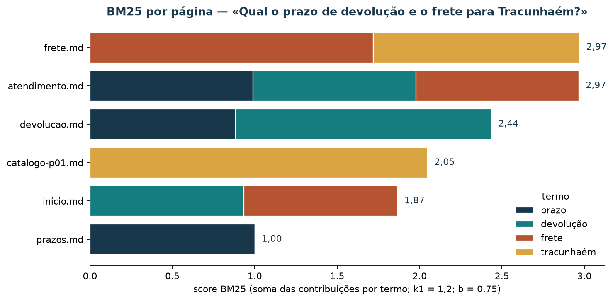

# Busca local em Markdown: índice invertido, BM25 e llmwiki

[Leia a versão web com o explorador interativo incorporado](https://lgallindo.github.io/recomendador-bentoml/llmwiki/).

A loja de artesanato guarda suas políticas em páginas Markdown: frete, devolução,
prazos de produção, horário do atendimento. Quando um cliente pergunta “qual o
prazo de devolução?”, alguém da equipe abre arquivo por arquivo até achar a
frase certa. Com oito páginas isso ainda funciona; com oitenta, a resposta
atrasa e às vezes sai errada. O que a equipe precisa é de uma busca que
devolva, em ordem, as páginas que mais provavelmente contêm a resposta, e que
mostre por que cada uma ficou naquela posição.

Ao concluir este tutorial, você deverá conseguir construir à mão um **índice
invertido** pequeno, calcular a pontuação **BM25** de um termo numa página,
indexar uma pasta de Markdown com o binário `llmwiki` e ler um ranking
explicando de onde vem cada posição. Você também verá, com números, como um
erro de digitação muda o resultado e por que uma página “de entrada” pode
vencer a página que de fato responde.

O corpus é sintético: oito páginas curtas em
[`mini-wiki-rag/`](mini-wiki-rag/). Os scores servem para aprender o método;
eles não descrevem o desempenho de uma busca num acervo real.

### Roteiro de estudo

| Tempo sugerido | Atividade de estudo |
| --- | --- |
| 8 min | Situar busca por palavra-chave na IA e na recuperação de informação |
| 7 min | Ler o corpus e o contrato de frontmatter |
| 10 min | Montar um índice invertido à mão |
| 15 min | Calcular TF, DF, IDF e um score BM25 completo |
| 10 min | Indexar com a llmwiki e confirmar o que fica fora do Git |
| 10 min | Rodar três consultas e explicar o ranking |
| 10 min | Fazer o experimento do erro de digitação |
| 10 min | Explorar o ranking no painel e exportar uma evidência |
| 10 min | Resolver o exercício |

## 1. Onde a busca por palavra-chave se situa

**Inteligência artificial (IA)** é o campo que estuda sistemas capazes de
tarefas como perceber, raciocinar, aprender e apoiar decisões.
**Recuperação de informação** é a área que estuda como encontrar, numa coleção
de documentos, aqueles que atendem a uma necessidade expressa numa consulta.
Ela é mais antiga que os modelos de linguagem atuais e continua sendo a base
de buscadores, catálogos e assistentes que respondem a partir de documentos.


*Figura 1 — Mapa conceitual, não proporcional. Este tutorial fica na caixa da
esquerda: o BM25 é uma fórmula estatística fixa, sem parâmetros aprendidos de
exemplos. A busca semântica e a híbrida da llmwiki usam vetores produzidos por
um modelo treinado, e por isso já tocam a caixa da direita.*

O BM25 conta palavras e pondera raridade e tamanho de documento. Ele não
aprende com exemplos rotulados; você escolhe dois números, $k_1$ e $b$, e a
fórmula faz o resto. Essa transparência é a razão de começar por ele: cada
ponto do score pode ser refeito com lápis e papel.

## 2. O corpus e seu contrato

Cada página da mini-wiki começa com um **frontmatter** YAML com três campos:

```yaml
---
title: Política de devolução
description: Prazo, estado da peça e como abrir o pedido de devolução.
tags: [devolucao, politica, pt-br]
---
```

A llmwiki só admite no índice arquivos que tragam esse cabeçalho. O
`README.md` da pasta não tem frontmatter e fica de fora; a própria ferramenta
avisa na indexação:

```text
Warning: skipping README.md — No frontmatter found
```

| Página | `title` | Assunto que responde |
| --- | --- | --- |
| `inicio.md` | Início — loja de artesanato PE | Apresenta o corpus e cita todos os temas |
| `frete.md` | Frete — polos de Pernambuco | Frete por CEP; frete grátis acima de R\$ 200 no Pilar; prazos de entrega |
| `devolucao.md` | Política de devolução | **7 dias corridos** após o recebimento, peça sem uso |
| `prazos.md` | Prazos de produção artesanal | 1–2 dias úteis de prateleira; até 15 dias úteis para encomenda de cerâmica |
| `atendimento.md` | Atendimento e canais | Chat das 9h às 18h, dias úteis; o que sobe para humano |
| `recomendador.md` | Como o recomendador sugere peças | Popularidade, co-ocorrência, `score` e `reason` |
| `catalogo-p01.md` | Peça p01 — Jarro barro Tracunhaém | Ficha da peça de cerâmica |
| `catalogo-p04.md` | Peça p04 — Rendeira Alto do Moura | Ficha da peça de renda |

Repare em `inicio.md` e `atendimento.md`: são páginas que **mencionam** frete,
devolução e prazo sem dar os números. Elas vão reaparecer na seção 6.

```bash
find material/mini-wiki-rag -name '*.md' | sort
```

Resultado esperado: nove arquivos, dos quais oito têm frontmatter.

## 3. O índice invertido

Um livro técnico traz no fim um índice remissivo: “frete, p. 12, 47, 90”. O
**índice invertido** é a mesma ideia: para cada termo, a lista das páginas
onde ele aparece, com a contagem. Essa lista se chama **lista de postagens**.
Em vez de ler todas as páginas a cada pergunta, a busca consulta só as listas
dos termos da consulta.

Para montar o índice, cada página passa por uma **tokenização**. Nas contas
deste tutorial, feitas por [`scripts/avaliar_rag.py`](../scripts/avaliar_rag.py),
as regras são:

1. O texto pesquisável junta `title`, `description` e o corpo da página.
2. Tudo vai para minúsculas; acentos são preservados (`devolução` ≠ `devolucao`).
3. Um token é uma sequência de letras e dígitos; pontuação separa tokens.
4. Palavras muito frequentes do português (*stopwords*, como “de”, “o”, “para”)
   e tokens de uma letra são descartados.
5. Não há redução de plural nem de conjugação: `encomenda` e `encomendas`
   são termos diferentes.


*Figura 2 — Índice invertido parcial da mini-wiki. O número após cada página
é a contagem do termo nela (tf). O `df` é o número de páginas da lista. Os
valores vêm das oito páginas com as regras acima.*

**Minúcia.** O termo `frete` aparece seis vezes no texto pesquisável de
`frete.md`: uma no `title` (“Frete — polos…”), duas na `description` (“Regras
de frete… frete grátis…”) e três no corpo (o título `# Frete`, “frete
calculado” e “frete grátis”). Ele aparece uma vez em `atendimento.md` e uma em
`inicio.md`. Por isso a lista de postagens de `frete` tem três páginas.

## 4. Pontuar: TF, DF, IDF e BM25

Saber **onde** um termo aparece não basta; a busca precisa **ordenar** as
páginas. Três perguntas orientam a pontuação.

### Frequência do termo: quantas vezes o termo aparece na página?

$\mathrm{tf}(t,d)$ é a contagem do termo $t$ no documento $d$. Mais
ocorrências sugerem que a página trata do assunto, mas a vigésima ocorrência
acrescenta menos informação que a segunda.

### Frequência nos documentos: em quantas páginas o termo aparece?

$\mathrm{df}(t)$ é o número de documentos com $t$. Um termo presente em quase
todas as páginas ajuda pouco a distinguir uma da outra.

### Raridade: quanto vale encontrar o termo?

A **frequência inversa nos documentos** usada pelo BM25, com $N$ documentos, é

$$
\mathrm{idf}(t) = \ln\left(1 + \frac{N - \mathrm{df}(t) + 0{,}5}{\mathrm{df}(t) + 0{,}5}\right).
$$

| df na mini-wiki ($N = 8$) | idf | Leitura |
| ---: | ---: | --- |
| 1 | 1,7918 | Termo exclusivo de uma página: vale muito |
| 2 | 1,2809 | Termo raro |
| 3 | 0,9445 | Termo comum a três páginas |
| 4 | 0,6931 | Termo presente em metade do corpus |

### BM25: frequência saturada, raridade e tamanho

O **BM25** (*Best Matching 25*) soma, para cada termo da consulta $q$, uma
contribuição que combina as três ideias:

$$
\mathrm{BM25}(q,d) = \sum_{t \in q} \mathrm{idf}(t)\,
\frac{\mathrm{tf}(t,d)\,(k_1+1)}{\mathrm{tf}(t,d) + k_1\left(1 - b + b\,\dfrac{|d|}{\overline{|d|}}\right)}.
$$

- $|d|$ é o número de tokens do documento e $\overline{|d|}$ a média do corpus
  (36 tokens na mini-wiki).
- $k_1$ controla a **saturação**: com $k_1 = 1{,}2$, a fração com $\mathrm{tf}$
  nunca passa de $k_1 + 1 = 2{,}2$, por mais que o termo se repita.
- $b$ controla a **normalização por tamanho**: com $b = 0{,}75$, uma página
  mais longa que a média precisa de mais ocorrências para obter o mesmo peso.

Os valores $k_1 = 1{,}2$ e $b = 0{,}75$ são usuais na literatura e são os
deste tutorial.

### Conta completa: `frete` em `frete.md`

| Grandeza | Valor | De onde vem |
| --- | ---: | --- |
| $N$ | 8 | páginas com frontmatter |
| $\mathrm{tf}$ | 6 | seção 3 |
| $\mathrm{df}$ | 3 | frete, atendimento, inicio |
| $\mathrm{idf}$ | $\ln(1 + 5{,}5/3{,}5) = \ln 2{,}5714 = 0{,}9445$ | fórmula |
| $\lvert d\rvert / \overline{\lvert d\rvert}$ | $38/36 = 1{,}0556$ | contagem de tokens |
| denominador | $6 + 1{,}2\,(0{,}25 + 0{,}75 \cdot 1{,}0556) = 6 + 1{,}25 = 7{,}25$ | |
| contribuição | $0{,}9445 \cdot 6 \cdot 2{,}2 / 7{,}25 = 1{,}7196$ | |

Para a consulta `frete Tracunhaém`, some a contribuição de `tracunhaém` em
`frete.md` ($\mathrm{tf}=1$, $\mathrm{df}=2$, $\mathrm{idf}=1{,}2809$):
$1{,}2809 \cdot 2{,}2 / (1 + 1{,}25) = 1{,}2525$. O total é
$1{,}7196 + 1{,}2525 = 2{,}9721$.

Confira com o script, que usa só a biblioteca padrão do Python:

```bash
uv run python scripts/avaliar_rag.py --explicar frete --pagina frete.md
```

Resultado esperado (trecho): `"tf": 6`, `"df": 3`, `"idf": 0.9445`,
`"comprimento": 38`, `"contribuicao": 1.7196`. Decimais no JSON usam ponto.

## 5. Indexar com a llmwiki

A **llmwiki** é um binário escrito em Rust que lê uma pasta de Markdown com
frontmatter, grava um índice em `.index/` e responde a buscas por palavra-chave
(BM25), semânticas (vetores) ou híbridas. Tudo fica no disco local; não há
servidor.

### Caminho A — com Rust instalado

```bash
cargo install llmwiki        # uma vez; exige o Rust via rustup
llmwiki --version
```

Este tutorial foi conferido com `llmwiki 0.2.1`. Se o binário já estiver em
`~/.cargo/bin`, confira apenas se essa pasta está no `PATH`.

Na raiz do repositório:

```bash
llmwiki init  --wiki-root material/mini-wiki-rag
llmwiki index --wiki-root material/mini-wiki-rag
llmwiki list  --wiki-root material/mini-wiki-rag
```

A indexação avisa sobre o `README.md` sem frontmatter e termina com uma linha
como `Indexed 9 files (… 1 skipped …)`. O `list` mostra as oito páginas, cada
uma com sua `description` e suas `tags`. Dentro de `.index/` você encontra o
índice de palavras (`tantivy/`), o índice de vetores (`vectors.usearch`) e os
metadados dos arquivos.

O índice é um artefato reconstruível e não deve ir para o Git. Confirme:

```bash
git check-ignore -v material/mini-wiki-rag/.index
```

Resultado esperado: `material/mini-wiki-rag/.gitignore:1:.index/` seguido do
caminho. O `.gitignore` da raiz também lista essa pasta.

### Caminho B — sem Rust

Se não for possível instalar o Rust, você reproduz o BM25 com o script da
seção 4, que lê as mesmas páginas, e acompanha o ranking no explorador da
seção 9. Para uma busca textual com SQLite, também sem instalar nada:

```bash
uv run python scripts/demo_rag_fts.py --indexar
uv run python scripts/demo_rag_fts.py "frete Tracunhaém"
```

## 6. Três consultas e a leitura do ranking

```bash
llmwiki search --wiki-root material/mini-wiki-rag --keyword "frete Tracunhaém"
llmwiki search --wiki-root material/mini-wiki-rag --keyword "devolução frete Tracunhaém"
llmwiki search --wiki-root material/mini-wiki-rag --keyword "Qual o prazo de devolução e o frete para Tracunhaém?"
```

Resultados com `llmwiki 0.2.1` (três primeiras posições):

| Consulta | 1º | 2º | 3º |
| --- | --- | --- | --- |
| `frete Tracunhaém` | `frete.md` 6,87 | `catalogo-p01.md` 3,58 | `atendimento.md` 0,98 |
| `devolução frete Tracunhaém` | `frete.md` 6,87 | `devolucao.md` 4,94 | `catalogo-p01.md` 3,58 |
| pergunta completa | `devolucao.md` 13,90 | `atendimento.md` 11,93 | `frete.md` 10,17 |

Cada hit vem com a linha onde o termo casou (`→ match at: L2 "frete" · …`).
Os scores da llmwiki diferem dos calculados na seção 4 porque a ferramenta usa
sua própria tokenização e seus próprios pesos. **Compare posições, não
valores.** Para `frete Tracunhaém`, o script da biblioteca padrão produz a
mesma ordem: `frete.md` 2,97, `catalogo-p01.md` 2,05, `atendimento.md` 0,99,
`inicio.md` 0,93.

### Por que uma página que só menciona o assunto pode vencer

Na pergunta completa, o BM25 da seção 4 coloca `atendimento.md` empatada com
`frete.md` e à frente de `devolucao.md`, a página que tem o prazo.



*Figura 3 — Cada cor é a contribuição de um termo. `atendimento.md` soma três
contribuições pequenas porque cita três assuntos numa página curta;
`devolucao.md` soma duas maiores. O BM25 recompensa cobrir vários termos da
consulta, e isso não equivale a responder.*

O efeito fica mais forte na consulta curta `devolução frete Tracunhaém`: o
BM25 da seção 4 põe `devolucao.md` em **quinto**, com 1,55, atrás de
`atendimento.md` (1,98) e `inicio.md` (1,87). A llmwiki a põe em segundo.
Duas buscas razoáveis, duas ordens diferentes: o ranking depende de
tokenização, campos e pesos, e por isso precisa ser avaliado com perguntas de
verdade, como no tutorial de RAG.

## 7. O experimento do erro de digitação

Um índice só conhece os tokens que viu. Para sentir isso, troque
temporariamente uma letra:

1. Em `material/mini-wiki-rag/frete.md`, troque `Tracunhaém e Alto` por
   `Tracunhaen e Alto`.
2. Reindexe só o que mudou:
   `llmwiki index --wiki-root material/mini-wiki-rag --incremental`
   (saída: `… 1 updated, 8 skipped …`).
3. Repita `llmwiki search … --keyword "frete Tracunhaém"` e anote.
4. Busque o erro: `llmwiki search … --keyword "Tracunhaen"`.
5. **Restaure** o texto original, reindexe e confira com `git diff
   material/mini-wiki-rag/frete.md`, que deve sair vazio.

| Situação | `frete.md` | `catalogo-p01.md` |
| --- | ---: | ---: |
| Original | 6,87 | 3,58 |
| Com o erro | 5,64 | 4,33 |
| Busca por `Tracunhaen` | 1,72 (único hit) | — |

Duas coisas mudaram. `frete.md` perdeu a contribuição de `tracunhaém` e
caiu. `catalogo-p01.md` **subiu** sem ter sido editada: com o erro,
`tracunhaém` passou de duas páginas para uma, e o idf desse termo foi de
$1{,}2809$ ($\mathrm{df}=2$) para $1{,}7918$ ($\mathrm{df}=1$). Uma edição numa
página altera o score de outra, porque o idf é uma propriedade do corpus
inteiro.


*Figura 4 — O índice é uma fotografia do corpus. Até você reindexar, a busca
responde sobre a versão antiga das páginas.*

## 8. Palavra-chave, semântica e híbrida

Sem `--keyword`, a llmwiki faz busca **híbrida**: combina a lista do BM25 com
uma lista por similaridade de vetores (*embeddings*). Com `--semantic`, usa só
os vetores.

| Modo | `devolução frete Tracunhaém`, três primeiros | Escala dos scores |
| --- | --- | --- |
| `--keyword` | frete, devolucao, catalogo-p01 | 1,92 a 6,87 |
| `--semantic` | devolucao, catalogo-p01, frete | 0,35 a 0,53 |
| híbrido (padrão) | devolucao, frete, catalogo-p01 | cerca de 0,03 |

A busca semântica pode aproximar “troca” de “devolução” sem palavra em comum;
a busca por palavra-chave explica cada ponto do score. Nesta mini-wiki as
duas acham as mesmas páginas, em ordens diferentes. As escalas não se
comparam entre modos. Use `--keyword` quando precisar de resultados
reproduzíveis e auditáveis, como nas tabelas deste tutorial.

## 9. Explorar o ranking no painel

O [explorador de busca e RAG](bi-rag/index.html) recalcula o BM25 no navegador
com as mesmas regras da seção 3, mostra a contribuição de cada termo por
página e compara com os rankings já calculados do FTS5 e da llmwiki. Você pode
usá-lo incorporado à
[versão web deste tutorial](https://lgallindo.github.io/recomendador-bentoml/llmwiki/#explorador-interativo)
ou abrir o HTML numa cópia local do repositório. Consulte o
[roteiro de exploração](bi-rag/README.md).

O painel não reindexa a pasta: ele traz o texto das oito páginas embutido.
Se você editar a mini-wiki, regenere os dados com
`uv run python scripts/gerar_bi_rag.py`.

### Atividade no painel

1. Escolha **BM25 ao vivo** e digite `frete Tracunhaém`. Na tabela de termos,
   localize a linha `frete.md · frete` e confira os valores da seção 4.
2. Escolha a pergunta pronta **x1** (`devolução frete Tracunhaém`). Em que
   posição fica `devolucao.md`? Quais termos sustentam `atendimento.md`?
3. Troque para **llmwiki** e compare a posição de `devolucao.md`.
4. Digite `encomenda cerâmica` e depois `encomendas cerâmica`. Explique a
   diferença pela regra 5 da seção 3.
5. Exporte o PNG do ranking e escreva duas frases sobre o que ele mostra.

## 10. Limitações

- Oito páginas curtas mostram o mecanismo, mas não a escala: em milhares de
  documentos, o idf se estabiliza e páginas “de entrada” pesam menos.
- A tokenização deste tutorial não junta plural e singular nem corrige
  acentos; ferramentas reais costumam ter estratégias para isso, com custos
  próprios.
- O score ordena páginas; ele não garante que a primeira contenha a
  resposta. Isso só se verifica com perguntas cujas respostas você conhece.
- `--keyword` é determinística; os modos semântico e híbrido dependem do
  modelo de vetores embutido na versão da ferramenta.

## 11. Exercício

Use a mini-wiki e a consulta **`Qual o horário do chat?`**.

1. Liste os termos que sobram depois da tokenização.
2. Monte a lista de postagens de cada termo (página e tf).
3. Calcule à mão o BM25 de `atendimento.md` ($|d| = 32$ tokens).
4. Rode a consulta na llmwiki com `--keyword` e registre o top-3.
5. Diga qual página responde à pergunta e se ela ficou em primeiro nos dois
   cálculos.
6. Explique, em até três frases, o que aconteceria com o score de
   `atendimento.md` se uma nova página `horarios.md` também citasse “horário”.

### Resolução comentada

**Termos:** `horário` e `chat` (“qual”, “o” e “do” são stopwords).

**Postagens:** `horário` → `atendimento.md` (2); `chat` →
`atendimento.md` (2), `prazos.md` (1). Logo $\mathrm{df}(\text{horário}) = 1$
e $\mathrm{df}(\text{chat}) = 2$.

**Conta:** a normalização de tamanho é
$0{,}25 + 0{,}75 \cdot 32/36 = 0{,}9167$, e o denominador com $\mathrm{tf} = 2$
é $2 + 1{,}2 \cdot 0{,}9167 = 3{,}1$.
`horário`: $1{,}7918 \cdot 2 \cdot 2{,}2 / 3{,}1 = 2{,}5432$.
`chat`: $1{,}2809 \cdot 2 \cdot 2{,}2 / 3{,}1 = 1{,}8181$.
Total: $4{,}3613$. `prazos.md` soma só `chat` e fica com 1,36.

**llmwiki:** `atendimento.md` 9,14; `catalogo-p04.md` 2,81;
`recomendador.md` 2,58. A página certa fica em primeiro nos dois cálculos,
mas os vizinhos mudam. A llmwiki pontua também palavras como “o” e “do”,
que o script descarta como stopwords: a linha `→ match at: L2 "o" · …` de
`catalogo-p04.md` mostra isso. Por esse motivo ela devolve páginas sem
`horário` nem `chat`.

**Nova página:** `horário` passaria a ter $\mathrm{df} = 2$, o idf cairia de
1,7918 para 1,2809 e o score de `atendimento.md` diminuiria, mesmo sem
nenhuma edição nela. A ordem entre as duas dependeria de tf e de tamanho.

## Referências bibliográficas e roteiro de leitura

Consulta dos materiais on-line: 7 nov. 2026.

1. MANNING, Christopher D.; RAGHAVAN, Prabhakar; SCHÜTZE, Hinrich.
   **Introduction to Information Retrieval**. Cambridge: Cambridge University
   Press, 2008. [Texto integral on-line, em inglês](https://nlp.stanford.edu/IR-book/).
   **Para aprofundar:** os capítulos 1 (índice invertido), 2 (tokenização) e
   6 (tf-idf) acompanham as seções 3 e 4.
2. ROBERTSON, Stephen; ZARAGOZA, Hugo. **The probabilistic relevance
   framework: BM25 and beyond**. *Foundations and Trends in Information
   Retrieval*, v. 3, n. 4, p. 333–389, 2009. DOI: 10.1561/1500000019.
   **Para aprofundar:** a origem do BM25, o papel de $k_1$ e $b$ e as variantes
   por campo.
3. LLMWIKI. **Repositório e documentação do binário `llmwiki`** (crate Rust).
   [crates.io/crates/llmwiki](https://crates.io/crates/llmwiki).
   **Para consultar:** opções de `init`, `index`, `search` e o formato do
   frontmatter na versão que você instalou.
4. SQLITE. **SQLite FTS5 Extension**.
   [Documentação em inglês](https://www.sqlite.org/fts5.html).
   **Para consultar:** o caminho B da seção 5, tokenizadores e a função `bm25()`.

| Artefato | Papel |
| --- | --- |
| `material/mini-wiki-rag/` | Corpus de oito páginas com frontmatter |
| `scripts/avaliar_rag.py` | BM25 da biblioteca padrão; `--explicar` detalha um termo |
| `scripts/demo_rag_fts.py` | Índice FTS5 em SQLite (caminho B) |
| `material/bi-rag/` | Explorador de busca e RAG |
| `scripts/gerar_figuras_rag.py` | Figuras deste tutorial |
