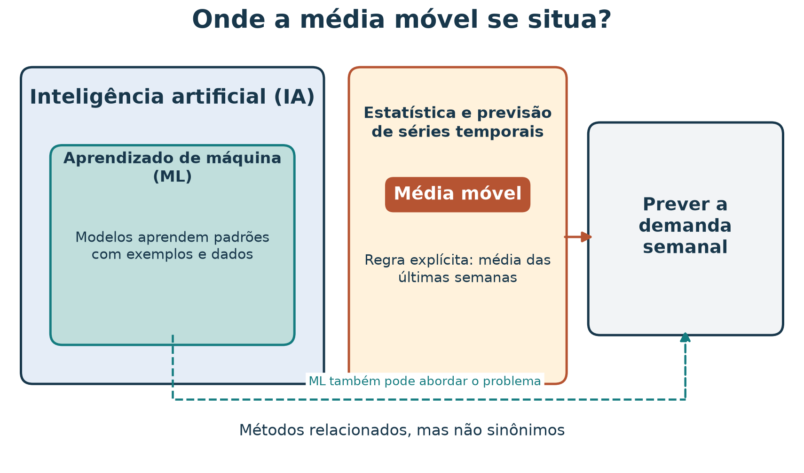
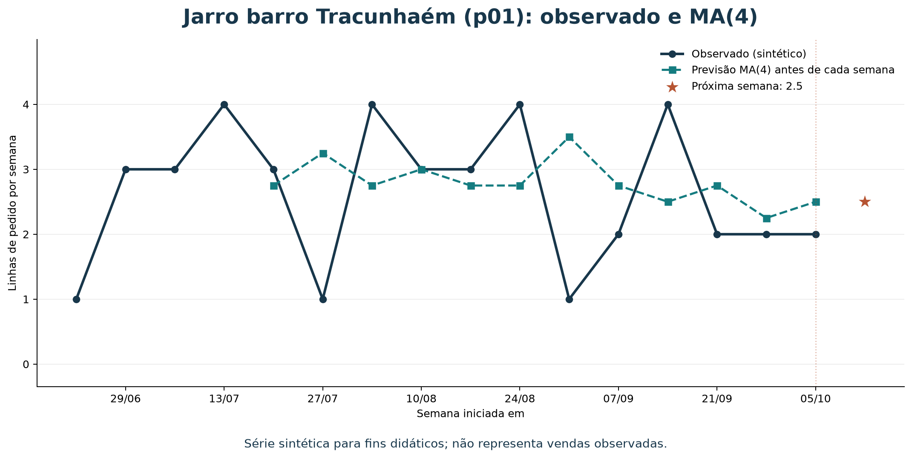
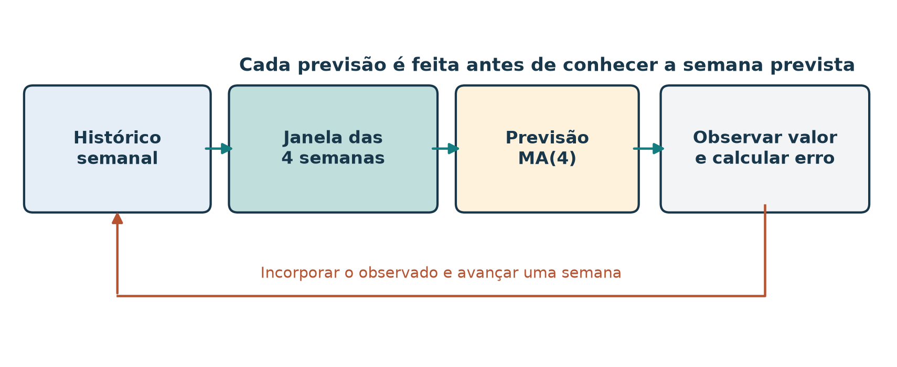
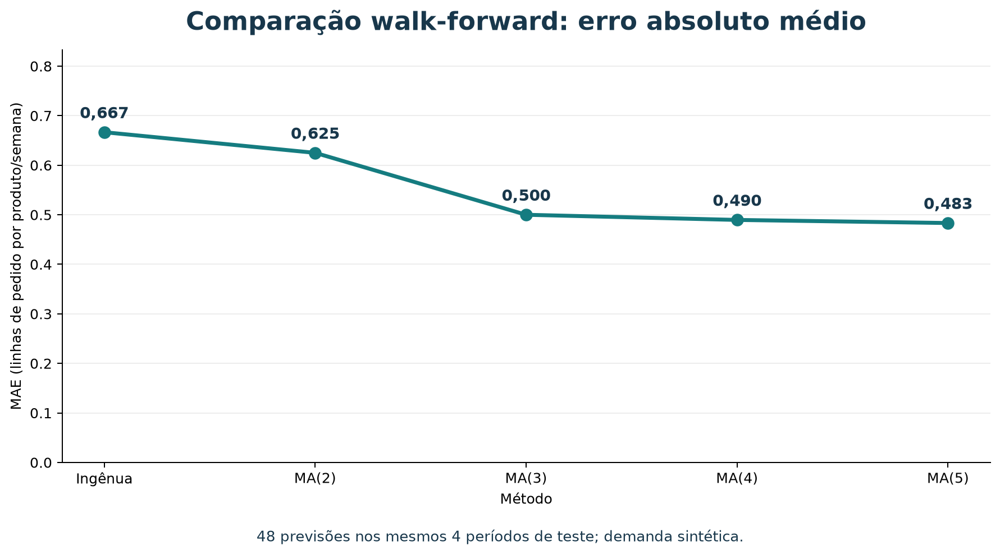
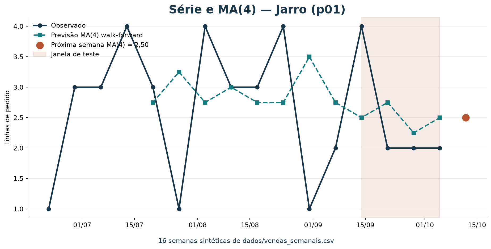
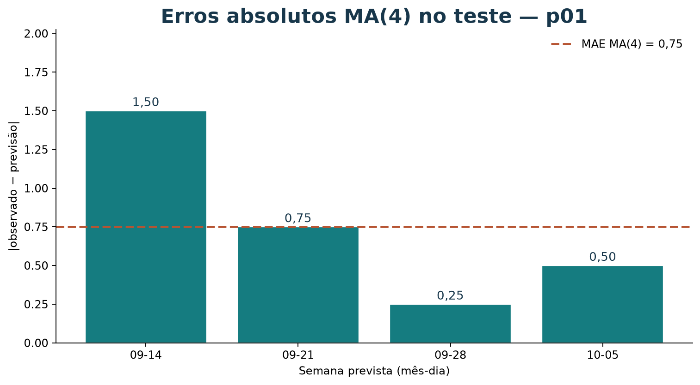
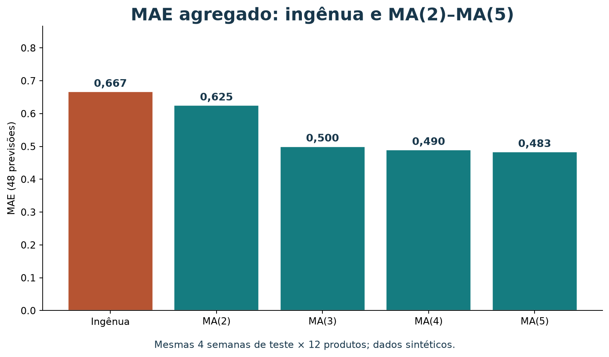

# Previsão de demanda semanal com média móvel

[Leia a versão web com o explorador interativo incorporado](https://lgallindo.github.io/recomendador-bentoml/demanda/).

Ao concluir este tutorial, você deverá conseguir organizar vendas semanais por
produto, calcular uma previsão com média móvel, comparar o resultado com uma
previsão ingênua, interpretar um erro de previsão e explorar a série com um
painel de BI. Você também distinguirá a previsão de uma contagem semanal da
popularidade usada pelo recomendador.

Os dados deste exercício são **sintéticos**. As 16 semanas distribuem os totais
de pedidos já existentes no catálogo. Elas servem para praticar o método e o
painel; o desempenho numa loja real exigiria histórico observado e avaliação
própria.

### Roteiro de estudo

Você pode seguir o roteiro abaixo em aproximadamente 65 minutos ou consultar
cada seção separadamente.

| Tempo sugerido | Atividade de estudo |
| --- | --- |
| 5 min | Entender o problema, a unidade e os dados |
| 8 min | Aprender a média móvel e calcular um exemplo à mão |
| 10 min | Executar o código com pandas |
| 12 min | Comparar janelas em avaliação temporal |
| 7 min | Interpretar resultados e limitações |
| 15 min | Explorar a série com BI e exportar uma evidência visual |
| 10 min | Resolver o exercício |

### Como este método se encaixa em IA e aprendizado de máquina

**Inteligência artificial (IA)** é o campo amplo que estuda sistemas capazes
de realizar tarefas como aprender, raciocinar, perceber e apoiar decisões.
**Aprendizado de máquina (ML)** é uma área da IA em que algoritmos aprendem
padrões a partir de dados. Métodos estatísticos de previsão e modelos de ML
podem abordar o mesmo problema por caminhos distintos.

Previsão de demanda é um **problema**: estimar valores futuros com base em
informações disponíveis. Estatística e previsão de séries temporais oferecem
métodos como médias móveis; ML pode usar características e exemplos históricos
para ajustar um modelo; regras de negócio também podem fornecer referências
simples. Esses caminhos podem se complementar.



*Figura 1 — O problema de prever demanda pode ser abordado por métodos
estatísticos ou de ML. A média móvel deste tutorial é um baseline estatístico
transparente, não um modelo treinado de ML. O diagrama é conceitual; as formas
não indicam proporções ou fronteiras formais entre disciplinas.*

Neste tutorial, você calcula uma regra fixa: a média das últimas quatro semanas.
Não há etapa de ajuste de parâmetros a partir de um conjunto rotulado, embora
seja possível escolher o tamanho da janela comparando previsões em dados de
desenvolvimento. Se depois comparar esse baseline com um modelo de regressão
que aprende a partir de exemplos, estará usando a média móvel como **referência**
para avaliar se a complexidade adicional traz ganho.

## 1. A pergunta de previsão

Um marketplace de artesanato precisa planejar a próxima semana. Para cada
produto, quer responder:

> Quantas linhas de pedido deste produto podemos esperar na próxima semana?

Esta é uma tarefa de **previsão de série temporal**: usamos observações
ordenadas no tempo para estimar um valor futuro. A média móvel é uma regra
simples, transparente e fácil de calcular. Ela não precisa de um pacote de
aprendizado de máquina; pandas ajuda a organizar e resumir os dados.

Neste tutorial, a unidade prevista é **linhas de pedido por produto por semana**.
Uma linha não é necessariamente uma unidade física: um pedido pode conter mais
de uma unidade. Para prever unidades, a fonte precisaria registrar quantidades
vendidas, e a coluna-alvo teria de ser definida de acordo.

### Popularidade não é previsão

O catálogo do recomendador registra `pedidos` por produto como um total
agregado. Esse valor ajuda a ordenar produtos populares, mas não tem datas e,
sozinho, não revela o comportamento de uma semana para outra.

A série em [`../dados/vendas_semanais.csv`](../dados/vendas_semanais.csv)
acrescenta as datas necessárias para exercitar um método temporal. Ela tem 16
semanas, de 22 de junho a 5 de outubro de 2026. Para cada produto, a soma das
semanas é igual ao total `pedidos` no
[`catálogo`](../dados/catalogo.json). Isso preserva os dados existentes, mas
não transforma a distribuição criada em histórico real.

As dez `cestas` do catálogo são exemplos separados para co-ocorrência entre
produtos. Elas não são a origem dos valores semanais e não devem ser somadas
para reproduzir as vendas.

## 2. Como funciona a média móvel

Uma média móvel de **quatro semanas** estima a semana seguinte usando a média
das quatro observações semanais mais recentes:

$$
\widehat{y}_{t+1}
= \frac{y_t + y_{t-1} + y_{t-2} + y_{t-3}}{4}
$$

`y_t` é a quantidade observada na semana mais recente; o acento circunflexo
indica uma estimativa, não uma venda já observada. A janela “se move” quando
uma nova semana é conhecida: a observação mais antiga sai do cálculo e a nova
entra.

| Observações semanais | Previsão para a próxima semana |
| --- | ---: |
| 1, 3, 3, 4 | (1 + 3 + 3 + 4) / 4 = 2,75 |
| 3, 3, 4, 3 | (3 + 3 + 4 + 3) / 4 = 3,25 |

Ao avançar uma semana, a primeira janela deixa de incluir o `1` e inclui o `3`
mais recente. Cada observação recebe o mesmo peso. Por isso, uma janela curta
responde mais rapidamente a mudanças, mas tende a oscilar mais; uma janela
longa suaviza mais, mas pode demorar a refletir mudanças.

### Conta completa: Jarro barro Tracunhaém

O produto `p01` tem as seguintes quatro observações mais recentes na série:

| Semana iniciada em | Linhas de pedido |
| --- | ---: |
| 2026-09-14 | 4 |
| 2026-09-21 | 2 |
| 2026-09-28 | 2 |
| 2026-10-05 | 2 |

Logo, a previsão de média móvel para a próxima semana é:

$$
\widehat{y}_{\mathrm{próxima}}
= \frac{4 + 2 + 2 + 2}{4}
= \frac{10}{4}
= 2{,}5
\text{ linhas de pedido}
$$

Uma previsão fracionária é válida: ela representa uma quantidade esperada, não
um pedido literal de meia linha. O arredondamento, quando necessário para uma
decisão operacional, deve ser feito na etapa de planejamento e não antes de
avaliar o erro do modelo.

### Uma referência simples: última semana

Compare a média móvel com uma previsão ingênua:

$$
\widehat{y}_{t+1}^{\mathrm{ingênua}} = y_t
$$

Para `p01`, a última semana observada tem 2 linhas, então essa previsão é 2.
A média móvel produz 2,5. Nenhuma regra é sempre melhor: é preciso compará-las
com semanas passadas que não foram usadas para construir a previsão.

## 3. Preparar e inspecionar a série

Cada linha do arquivo contém:

| Campo | Significado |
| --- | --- |
| `week_start` | Segunda-feira que inicia a semana |
| `product_id` | Identificador estável do produto |
| `order_line_count` | Linhas de pedido do produto naquela semana |

O arquivo contém também linhas com zero vendas. Elas são importantes: zero é
uma observação válida, não um valor ausente. O exercício exige uma linha por
produto por semana; assim, uma semana sem vendas continua explícita.

Antes de modelar, confira os dados:

```bash
uv run python scripts/validar_vendas_semanais.py
```

O validador verifica as 192 combinações de 16 semanas e 12 produtos, ausência
de duplicatas, ids conhecidos, contagens não negativas e reconciliação das
somas semanais com o catálogo.

O gráfico abaixo mostra a série de `p01`, previsões de média móvel feitas
somente com semanas anteriores e a previsão para a semana seguinte. Como a
entrada é sintética, as oscilações ilustram a conta, não um padrão real de
procura.



*Figura 2 — A previsão de cada semana usa apenas as quatro semanas anteriores.
O ponto final é a estimativa para a semana posterior ao histórico disponível.*

### Abrir os dados com pandas

O código a seguir parte da raiz do repositório. Se pandas não estiver
disponível no ambiente da aula, execute o exemplo com `uv run --with pandas`.

```python
from pathlib import Path

import pandas as pd

arquivo = Path("dados/vendas_semanais.csv")
vendas = pd.read_csv(arquivo, parse_dates=["week_start"])

print(vendas.head())
print("Linhas:", len(vendas))
print("Produtos:", vendas["product_id"].nunique())
print("Semanas:", vendas["week_start"].nunique())
```

Saída esperada:

```text
Linhas: 192
Produtos: 12
Semanas: 16
```

Para calcular uma média por produto, transforme a tabela longa em uma matriz:
linhas serão semanas e colunas serão produtos. A ordem cronológica é essencial.

```python
matriz = vendas.pivot(
    index="week_start",
    columns="product_id",
    values="order_line_count",
).sort_index()

print(matriz[["p01", "p02"]].tail())
```

Cada célula contém a contagem de um produto numa semana. Se você aplicar esse
código a outra fonte em que combinações ausentes significam zero, primeiro
complete explicitamente a grade de semanas e produtos. Não converta
automaticamente valores ausentes em zero quando eles puderem indicar falha de
coleta.

## 4. Calcular previsões para todos os produtos

A média das quatro linhas finais da matriz é a previsão para a semana seguinte
de cada produto. A última linha, por sua vez, é a referência ingênua:

```python
janela = 4

previsoes = pd.DataFrame(
    {
        "media_movel_4_semanas": matriz.tail(janela).mean(),
        "ultima_semana": matriz.iloc[-1],
    }
)
previsoes.index.name = "product_id"
print(previsoes.round(2))
```

Para o conjunto sintético, o resultado é:

| ID | Produto | Média móvel 4 semanas | Última semana |
| --- | --- | ---: | ---: |
| p01 | Jarro barro Tracunhaém | 2,50 | 2 |
| p02 | Prato esmaltado Tracunhaém | 1,50 | 1 |
| p03 | Boneca de barro | 1,00 | 0 |
| p04 | Rendeira Alto do Moura | 2,00 | 2 |
| p05 | Toalha de renda | 1,25 | 1 |
| p06 | Caminho de mesa renda | 0,50 | 0 |
| p07 | Xilogravura Pilar | 1,75 | 2 |
| p08 | Cordel ilustrado | 1,25 | 1 |
| p09 | Quadro xilo colorido | 0,25 | 0 |
| p10 | Cesto de palha | 1,25 | 1 |
| p11 | Bolsa de palha | 0,75 | 1 |
| p12 | Sousplat de palha | 0,00 | 0 |

Esses valores são uma demonstração da conta com quatro semanas, não uma
recomendação de estoque. Um valor esperado pode ser fracionário e não expressa
incerteza: a previsão `2,50` não informa, por si só, se a demanda provável está
perto de 2 ou pode variar muito.

## 5. Avaliar sem olhar para o futuro

Não avalie uma previsão com dados que ela já usou. Uma divisão aleatória pode
misturar semanas antigas e futuras entre treino e teste, quebrando a ordem que
existe na aplicação. Em previsão, a avaliação deve respeitar o tempo:

| Etapa | Semanas usadas |
| --- | --- |
| Histórico inicial | 12 primeiras semanas, de 2026-06-22 a 2026-09-07 |
| Teste temporal | 4 últimas semanas, de 2026-09-14 a 2026-10-05 |

Faremos uma avaliação **walk-forward** (origem deslizante): prever uma semana
do período de teste usando apenas as semanas anteriores; depois, quando a
semana real já é conhecida, incluí-la no histórico para prever a seguinte.
Assim simulamos previsões semanais sucessivas sem usar observações futuras.



*Figura 3 — A janela avança no tempo. Cada previsão é produzida antes de
consultar o valor real daquela semana; a observação é usada somente nas
previsões seguintes.*

### Erro absoluto médio

Para cada previsão, o erro absoluto é a distância entre previsto e observado:

$$
\mathrm{erro\ absoluto}_t = |y_t - \widehat{y}_t|
$$

O **erro absoluto médio**, ou MAE (*mean absolute error*), é a média dessas
distâncias:

$$
\mathrm{MAE} = \frac{1}{n}\sum_{t=1}^{n}|y_t-\widehat{y}_t|
$$

Ele fica na mesma unidade do alvo: aqui, linhas de pedido por produto por
semana. MAE 0,5 significa que, em média, a previsão ficou a meia linha da
contagem observada. Erros positivos e negativos não se cancelam, pois usamos
valor absoluto.

### Código de avaliação temporal

Este bloco continua o exemplo anterior. Para cada produto e cada uma das quatro
semanas reservadas, compara a média móvel de quatro semanas com a previsão
ingênua. Ao avançar pela janela de teste, usa as observações reais das semanas
anteriores, como faria uma atualização semanal.

```python
inicio_teste = len(matriz) - 4
erros_media_movel = []
erros_ingenua = []

for produto in matriz.columns:
    serie = matriz[produto]

    for posicao in range(inicio_teste, len(matriz)):
        observado = float(serie.iloc[posicao])
        previsao_media = float(serie.iloc[posicao - janela : posicao].mean())
        previsao_ingenua = float(serie.iloc[posicao - 1])

        erros_media_movel.append(abs(observado - previsao_media))
        erros_ingenua.append(abs(observado - previsao_ingenua))

mae_media = sum(erros_media_movel) / len(erros_media_movel)
mae_ingenua = sum(erros_ingenua) / len(erros_ingenua)

print(f"Casos avaliados: {len(erros_media_movel)}")
print(f"MAE média móvel: {mae_media:.2f}")
print(f"MAE ingênua: {mae_ingenua:.2f}")
```

Resultado esperado:

```text
Casos avaliados: 48
MAE média móvel: 0.49
MAE ingênua: 0.67
```

São 48 previsões: 12 produtos vezes 4 semanas de teste. Nesse recorte sintético,
a média móvel tem menor MAE. Isso não prova que vencerá em semanas futuras ou
em dados reais. Há somente quatro semanas de teste, e o histórico sintético foi
construído para repartir totais conhecidos.

### Exemplo de cálculo de erro no teste

Para `p01`, as quatro observações reais no período de teste são 4, 2, 2 e 2.
As previsões feitas antes de cada semana são:

| Semana prevista | Histórico usado pela média móvel | Previsão MA(4) | Previsão ingênua | Observado |
| --- | --- | ---: | ---: | ---: |
| 2026-09-14 | 3, 4, 1, 2 | 2,50 | 2 | 4 |
| 2026-09-21 | 4, 1, 2, 4 | 2,75 | 4 | 2 |
| 2026-09-28 | 1, 2, 4, 2 | 2,25 | 2 | 2 |
| 2026-10-05 | 2, 4, 2, 2 | 2,50 | 2 | 2 |

O MAE da média móvel para `p01` é:

$$
\frac{|4-2{,}5| + |2-2{,}75| + |2-2{,}25| + |2-2{,}5|}{4}
= \frac{1{,}5+0{,}75+0{,}25+0{,}5}{4}
= 0{,}75
$$

O MAE ingênuo de `p01` é:

$$
\frac{|4-2| + |2-4| + |2-2| + |2-2|}{4}
= \frac{2+2+0+0}{4}
= 1
$$

Para esse produto no período de teste, a média móvel teve MAE 0,75 e a
referência ingênua, 1,00. O resultado agregado dos 12 produtos difere; por
isso, é útil examinar erros por produto além de uma única média global.

### Comparação: previsão ingênua, MA(2), MA(3), MA(4) e MA(5)

Agora compare cinco métodos nas **mesmas 48 situações** (12 produtos vezes as
quatro semanas reservadas). A previsão ingênua equivale a uma média móvel de
uma observação: usa somente a semana imediatamente anterior. MA(2) até MA(5)
usam as duas a cinco observações anteriores, respectivamente.



*Figura 4 — MAE por janela, calculado sobre as mesmas semanas e produtos.
Menor é melhor nesta métrica. A diferença pequena entre MA(4) e MA(5) não
deve ser generalizada a partir de uma avaliação sintética de apenas quatro
semanas.*

O código calcula todas as previsões sem usar a observação da semana prevista.
Como os métodos compartilham o mesmo período de teste, a comparação é justa
para este exercício:

```python
periodos = {
    "Ingênua": 1,
    "MA(2)": 2,
    "MA(3)": 3,
    "MA(4)": 4,
    "MA(5)": 5,
}
inicio_teste = len(matriz) - 4
erros = {nome: [] for nome in periodos}

for produto in matriz.columns:
    serie = matriz[produto]

    for posicao in range(inicio_teste, len(matriz)):
        observado = float(serie.iloc[posicao])
        for nome, periodo in periodos.items():
            previsto = float(serie.iloc[posicao - periodo : posicao].mean())
            erros[nome].append(abs(observado - previsto))

maes = {
    nome: sum(erros_metodo) / len(erros_metodo)
    for nome, erros_metodo in erros.items()
}
for nome, mae in maes.items():
    print(f"{nome}: MAE = {mae:.3f}")
```

Resultados esperados:

| Método | Observações anteriores | MAE nas 48 previsões |
| --- | ---: | ---: |
| Ingênua | 1 | 0,667 |
| MA(2) | 2 | 0,625 |
| MA(3) | 3 | 0,500 |
| MA(4) | 4 | 0,490 |
| MA(5) | 5 | 0,483 |

Nesta comparação sintética, MA(5) tem o menor MAE, mas sua vantagem sobre
MA(4) é pequena: aproximadamente 0,006 linha por produto por semana. A
previsão ingênua é a pior das cinco neste teste. Isso não demonstra que MA(5)
seja a melhor escolha operacional; há somente quatro semanas de avaliação e
os valores foram construídos para o tutorial.

Também é possível comparar as previsões produzidas **agora**, usando todas as
16 semanas disponíveis. São estimativas para a semana seguinte ao histórico,
não observações nem garantias de vendas:

| Produto | Ingênua | MA(2) | MA(3) | MA(4) | MA(5) |
| --- | ---: | ---: | ---: | ---: | ---: |
| Jarro barro Tracunhaém (`p01`) | 2,00 | 2,00 | 2,00 | 2,50 | 2,40 |
| Prato esmaltado Tracunhaém (`p02`) | 1,00 | 1,50 | 1,33 | 1,50 | 1,60 |
| Boneca de barro (`p03`) | 0,00 | 0,50 | 1,00 | 1,00 | 1,00 |
| Rendeira Alto do Moura (`p04`) | 2,00 | 2,00 | 2,33 | 2,00 | 2,00 |
| Toalha de renda (`p05`) | 1,00 | 1,00 | 1,33 | 1,25 | 1,20 |
| Caminho de mesa renda (`p06`) | 0,00 | 0,00 | 0,33 | 0,50 | 0,40 |
| Xilogravura Pilar (`p07`) | 2,00 | 1,50 | 1,67 | 1,75 | 1,80 |
| Cordel ilustrado (`p08`) | 1,00 | 1,50 | 1,33 | 1,25 | 1,00 |
| Quadro xilo colorido (`p09`) | 0,00 | 0,50 | 0,33 | 0,25 | 0,40 |
| Cesto de palha (`p10`) | 1,00 | 1,50 | 1,33 | 1,25 | 1,40 |
| Bolsa de palha (`p11`) | 1,00 | 1,00 | 1,00 | 0,75 | 0,80 |
| Sousplat de palha (`p12`) | 0,00 | 0,00 | 0,00 | 0,00 | 0,20 |

As previsões finais podem diferir entre janelas porque cada janela enfatiza
uma quantidade distinta de histórico. O MAE do teste avalia erros passados; ele
não determina qual previsão futura ficará mais próxima. Se escolher uma janela,
use mais dados históricos representativos e mantenha um período de avaliação
final separado.

## 6. Interpretar e melhorar o experimento

O teste anterior responde uma pergunta delimitada: “qual teve menor MAE nas
48 previsões deste período sintético?” Ele não responde “qual terá melhor
resultado no próximo trimestre?” nem “quantas unidades devemos fabricar?”.

Antes de confiar numa avaliação, considere:

- **Tamanho do teste:** quatro semanas são poucas e podem não representar
  períodos mais longos.
- **Comparação por produto:** o erro agregado pode esconder produtos em que
  uma abordagem é consistentemente pior.
- **Unidade:** o alvo é linha de pedido, não quantidade física, receita ou lucro.
- **Disponibilidade:** a série não contém estoque, preço, promoções, feriados,
  prazo de entrega ou ruptura de estoque.
- **Origem sintética:** a forma semana a semana foi criada para reconciliar
  totais do catálogo; não representa sazonalidade, tendência ou comportamento
  observado.
- **Janela:** quatro semanas é uma escolha inicial, não um parâmetro universal.
  Compare algumas janelas em dados de desenvolvimento e deixe um período final
  reservado para a avaliação.

Se escolher a janela que teve melhor resultado em todas as semanas disponíveis
e depois relatar o mesmo resultado como avaliação independente, você usou os
dados de teste para tomar decisões. Separe desenvolvimento e avaliação final;
num projeto real, prefira uma avaliação temporal com vários pontos de origem.

A média móvel simples funciona melhor como **baseline**: uma referência
compreensível que métodos mais complexos precisam superar. Para demanda com
muitos zeros, mudanças de nível ou sazonalidade, outras abordagens podem ser
necessárias. Primeiro confira a qualidade e o significado dos dados; mais
complexidade não corrige uma unidade mal definida.

## 7. Como relatar uma previsão

Um relato reproduzível informa fonte, período, produto ou grupo de produtos,
alvo, janela, método de avaliação e métrica. Separe o resultado do teste da
previsão final, calculada depois de usar todo o histórico disponível.

Modelo para este exercício:

> Usei a série sintética de 16 semanas, de 2026-06-22 a 2026-10-05, cuja unidade
> é linha de pedido por produto por semana. Comparei MA(4) com a previsão
> ingênua “próxima semana = última semana” em walk-forward nas quatro últimas
> semanas, para 12 produtos (48 previsões). O MAE agregado foi 0,49 para MA(4)
> e 0,67 para a referência. Nesse pequeno teste sintético, MA(4) teve menor
> erro médio absoluto. O resultado é didático: não estima o desempenho numa
> loja real nem informa unidades, receita ou estoque necessário.

Para a estimativa final de `p01`, usando as quatro últimas semanas já observadas,
o resultado é 2,5 linhas de pedido esperadas na semana seguinte. Arredonde
somente se uma decisão operacional exigir uma quantidade inteira e documente
como fez isso.

## 8. Como BI ajuda você a visualizar previsões

**Business Intelligence (BI)** reúne práticas e ferramentas para organizar,
analisar e apresentar dados que apoiam decisões. Neste painel, você percorre a
série de um produto, confere previsões walk-forward e compara o MAE entre
janelas. Um gráfico bem apresentado acompanha a conta; a validação temporal e
o relato continuam necessários.

O [explorador de demanda](bi-demanda/index.html) oferece série, erros no teste,
comparação de janelas e tabela auditável. Você pode usá-lo incorporado à
[versão web deste tutorial](https://lgallindo.github.io/recomendador-bentoml/demanda/#explorador-interativo).
Para estudar offline, abra o HTML a partir de uma cópia local do repositório:
a página do arquivo no GitHub exibe o código. Consulte o
[roteiro de exploração](bi-demanda/README.md).

Para contas à mão na lousa, use também a
[planilha de sala](planilha-media-movel-demanda.xlsx): uma aba por produto, com
as 16 semanas do CSV nas primeiras linhas e colunas em branco para o quadro.
A extensão sintética dessa planilha **não** alimenta o explorador; o painel
usa somente `dados/vendas_semanais.csv`.

As figuras abaixo permitem estudar os mesmos recortes na versão Markdown.

### Série: observação, previsão e próxima semana



*Figura 5 — Observações em linha contínua; previsões MA(4) em tracejado. A faixa
sombreada marca as quatro semanas de teste. O ponto terracota é a estimativa
para a semana posterior ao histórico disponível. No explorador, troque o
produto e a janela para repetir a leitura.*

### Erros: distância em cada semana do teste



*Figura 6 — Cada barra é |observado − previsão| em uma semana prevista. A linha
tracejada marca o MAE de `p01` com MA(4). Use a tabela do painel para conferir
os denominadores da média móvel semana a semana.*

### Comparação de janelas: o mesmo teste para todos os métodos



*Figura 7 — MAE nas mesmas 48 previsões (12 produtos × 4 semanas). Menor é
melhor nesta métrica. No painel, a barra do método selecionado fica destacada
para você cruzar o agregado com o produto aberto à esquerda.*

### Atividade: do painel a um relato

1. Abra Jarro (`p01`) com MA(4). Anote a previsão da próxima semana e o MAE do
   produto no teste.
2. Na tabela, escolha uma semana e refaça a média das quatro anteriores à mão.
3. Troque para a previsão ingênua e descreva o que muda nos erros.
4. Exporte o CSV do teste ou um PNG e anexe ao modelo de relato da seção 7.

## 9. Exercício: preveja a demanda da Boneca

Usando `dados/vendas_semanais.csv`, produza uma previsão para Boneca de barro
(`p03`) com média móvel de quatro semanas e compare-a com a previsão ingênua.
Depois, avalie ambas nas quatro últimas semanas usando o mesmo procedimento
walk-forward. Você pode conferir a série e a tabela no
[explorador](bi-demanda/index.html).

Seu relato deve incluir:

1. As quatro observações usadas para a previsão futura.
2. A conta de MA(4) e o valor da previsão ingênua.
3. O MAE de cada método nas quatro semanas de teste para `p03`.
4. Uma frase sobre se esta série sintética permite concluir que o método
   funcionará em vendas futuras reais.

### Resolução comentada

As quatro últimas observações de `p03` são 1, 2, 1 e 0. A previsão da média
móvel é `(1 + 2 + 1 + 0) / 4 = 1`; a previsão ingênua é `0`, a última
observação.

No período de teste, os valores observados são 1, 2, 1 e 0. As previsões MA(4)
são 1; 1; 1,25; e 1,25. As previsões ingênuas são 1; 1; 2; e 1.

$$
\mathrm{MAE}_{\mathrm{MA(4)}}
= \frac{|1-1|+|2-1|+|1-1{,}25|+|0-1{,}25|}{4}
= \frac{0+1+0{,}25+1{,}25}{4}
= 0{,}625
$$

$$
\mathrm{MAE}_{\mathrm{ingênua}}
= \frac{|1-1|+|2-1|+|1-2|+|0-1|}{4}
= \frac{0+1+1+1}{4}
= 0{,}75
$$

MA(4) tem MAE ligeiramente menor para `p03` nesse período, mas quatro
observações de teste são insuficientes para garantir que será melhor adiante.
Além disso, a série foi construída sinteticamente. Use o exercício para praticar
o método, não como evidência comercial.

## Referências e leituras

1. HYNDMAN, Rob J.; ATHANASOPOULOS, George. *Forecasting: Principles and
   Practice*. 3. ed. Capítulo sobre médias móveis. Explica a suavização com
   médias móveis e suas limitações.
   [Moving averages](https://otexts.com/fpp3/moving-averages.html).
2. HYNDMAN, Rob J.; ATHANASOPOULOS, George. *Forecasting: Principles and
   Practice*. Capítulo sobre avaliação temporal e validação cruzada para séries.
   [Time series cross-validation](https://otexts.com/fpp3/tscv.html).
3. PANDAS. Documentação da operação `DataFrame.rolling`, para experimentar
   janelas móveis em dados tabulares.
   [Rolling window calculations](https://pandas.pydata.org/docs/user_guide/window.html).

## Reproduzir as figuras

Na raiz do repositório, execute:

```bash
uv run python scripts/gerar_figuras_demanda.py
uv run python scripts/gerar_bi_demanda.py
```

O primeiro script recria o mapa conceitual, a série MA(4), o fluxo walk-forward
e a comparação de MAE em `material/imagens/`. O segundo atualiza `dados.js` do
explorador e os espelhos estáticos `bi-demanda-*.png`. Ambos leem
`dados/vendas_semanais.csv`.
