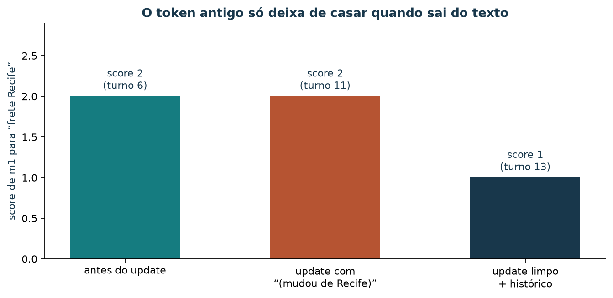

# Memória de agentes: lembrar preferências entre turnos no padrão Mem0

[Leia a versão web com o explorador incorporado](https://lgallindo.github.io/recomendador-bentoml/memoria/).

Uma cliente volta ao chat da loja de artesanato e escreve: “quero o mesmo frete
da outra vez”. Ela já tinha contado que recebe as compras em Recife, que não
gosta de peças de palha e que gasta no máximo uns R$ 150. Um modelo de
linguagem não guarda nada disso entre conversas: seus pesos são os mesmos para
todas as pessoas e não mudam quando alguém fala com ele. Para o atendimento
**lembrar**, a aplicação precisa guardar fatos sobre a cliente fora do modelo,
recuperá-los na hora certa, corrigi-los quando mudam e apagá-los quando ela
pedir.

Ao concluir esta aula, você deverá conseguir distinguir memória de usuário,
corpus documental e pesos do modelo; usar as quatro operações `add`, `search`,
`update` e `delete`; explicar escopos de usuário e de sessão; calcular à mão a
pontuação de busca do laboratório; reconhecer por que uma memória atualizada
ainda pode casar com o valor antigo; e justificar o que **não** guardar à luz
da LGPD.

O laboratório usa um store JSON local com a mesma forma de operações do
[Mem0](https://docs.mem0.ai/introduction), biblioteca de código aberto
(Apache-2.0) para memória de aplicações com modelos de linguagem. A busca do
laboratório conta palavras em comum; o Mem0 real usa um modelo de linguagem
para extrair fatos e embeddings para buscar por semelhança. Os dados são
sintéticos e os resultados demonstram o mecanismo, e não a qualidade de uma
memória em produção.

### Roteiro de estudo

| Tempo sugerido | Atividade |
| --- | --- |
| 8 min | Separar memória, corpus e pesos |
| 10 min | Vocabulário: memória, escopo e as quatro operações |
| 10 min | Calcular a pontuação de busca à mão |
| 15 min | Rodar a linha do tempo de 16 turnos e ler o store |
| 10 min | Entender o token antigo e uma política de atualização |
| 15 min | Explorar turnos e buscas no painel |
| 7 min | Privacidade: o que não guardar e como apagar |
| 10 min | Exercício com resolução comentada |

## 1. Três lugares para guardar o que o sistema “sabe”


*Figura 1 — A pergunta que decide o lugar é “para quem este fato vale e quem
pode mudá-lo?”. Uma política de devolução vale para todos os clientes; uma
preferência de frete vale para uma pessoa; um estilo de escrita está
espalhado nos pesos.*

| Lugar | Guarda | Exemplo nesta loja | Como muda |
| --- | --- | --- | --- |
| Corpus documental (RAG) | Políticas e fichas | “7 dias corridos para devolução” | Editando o Markdown e reindexando |
| Memória de usuário | Preferências e fatos de uma pessoa ou conversa | “Prefere frete para Olinda” | `add`, `update`, `delete` em tempo de execução |
| Pesos do modelo | Padrões estatísticos aprendidos | Vocabulário, estilo, conhecimento geral | Treino ou ajuste fino, offline e caro |

Misturar os lugares causa erros previsíveis. Uma regra de frete grátis gravada
como memória de uma cliente vale só para ela e envelhece sem ninguém perceber
quando a política muda. Uma preferência pessoal colocada no corpus aparece
para todo mundo.

## 2. Memória como estado fora do modelo

Na IA, um **agente** é um sistema que recebe uma situação, decide uma ação e a
executa, muitas vezes em vários passos. Quando o agente usa um modelo de
linguagem, a parte que **lembra** é o estado mantido pela aplicação.


*Figura 2 — A aplicação escreve no store (`add`, `update`, `delete`) e lê dele
(`search`) a cada turno. Os fatos recuperados viajam no prompt; o modelo não é
retreinado.*

### Vocabulário

| Termo | Definição nesta aula |
| --- | --- |
| **Memória** | Um registro curto em linguagem natural sobre um usuário, com `id`, `user_id`, texto e datas |
| **Store** | Onde as memórias ficam; aqui, `material/memoria/store_preferencias.json` |
| **Escopo de usuário** | A memória pertence a um `user_id` e só aparece em buscas desse usuário |
| **Escopo de sessão** | A memória também tem `session_id` e só aparece naquela conversa |
| **Escopo de agente** | No Mem0, memórias podem pertencer a um `agent_id` (o que o próprio agente aprendeu); o laboratório não usa |
| `add` | Cria uma memória nova |
| `search` | Devolve as memórias visíveis ao escopo, ordenadas por pontuação |
| `update` | Substitui o texto de uma memória existente pelo `id` |
| `delete` | Remove a memória do store |

## 3. A pontuação de busca do laboratório

O script [`demo_mem0_preferencias.py`](../scripts/demo_mem0_preferencias.py)
pontua cada memória por **sobreposição de tokens**. A consulta $q$ é convertida
em minúsculas e quebrada em tokens nos caracteres que não são letras, dígitos ou
sublinhado; chame essa lista de $T(q)$. Para uma memória de texto $m$,

$$
s(q, m) = \sum_{t \in T(q)} \mathbb{1}\big[t \text{ aparece como trecho de } m\big],
$$

em que $\mathbb{1}[\cdot]$ vale 1 quando a condição é verdadeira e 0 caso
contrário. A busca considera só as memórias **visíveis** ao escopo: mesmo
`user_id` e, se a memória tiver sessão, a mesma `session_id`. Ela devolve as
memórias com $s>0$, em ordem decrescente.

**Minúcia.** Consulta “frete Recife”, $T(q) = [\text{frete},\ \text{recife}]$.

| Memória | “frete” aparece? | “recife” aparece? | $s$ |
| --- | :---: | :---: | ---: |
| Cliente prefere frete para Recife. | sim | sim | 2 |
| Não gosta de peças de palha. | não | não | 0 |
| Cliente prefere frete para Olinda (mudou de Recife). | sim | sim | 2 |
| Cliente prefere frete para Olinda. | sim | não | 1 |

O teste é “aparece como trecho”, e não “é a mesma palavra”. Uma consulta com o
token `o` casaria com quase todas as memórias, e `rec` casaria com “Recife”.
Essa simplicidade é deliberada: você consegue conferir cada número à mão. O
Mem0 real compara **embeddings**, vetores numéricos que aproximam o sentido do
texto, e por isso encontra “mora em Olinda” para a consulta “endereço de
entrega”, coisa que a contagem de tokens não faz.

## 4. Linha do tempo: 16 turnos, dois usuários, uma sessão

Rode na raiz do repositório:

```bash
uv run python scripts/demo_mem0_preferencias.py --roteiro
```

Saída esperada no terminal:

```text
 1 add                   → Cliente prefere frete para Recife.
 2 add                   → Não gosta de peças de palha.
 3 add                   → Orçamento máximo cerca de R$ 150.
 4 add                   → Hoje procura presente para a mãe.
 5 add                   → Cliente prefere frete para Caruaru.
 6 search frete Recife   → [('m1', 2)]
 7 search frete          → [('m5', 1)]
 8 search presente mãe   → []
 9 search presente mãe   → [('m4', 2)]
10 update                → Cliente prefere frete para Olinda (mudou de Recife).
11 search frete Recife   → [('m1', 2)]
12 update                → Cliente prefere frete para Olinda.
13 search frete Recife   → [('m1', 1)]
14 search frete Olinda   → [('m1', 2)]
15 delete                → True
16 search palha          → []
```

O arquivo [`memoria/linha-do-tempo.json`](memoria/linha-do-tempo.json) guarda,
para cada turno, a ação, o escopo, o resultado e o store completo depois do
turno.

| Turno | Ação | Escopo | O que aconteceu | Por quê |
| ---: | --- | --- | --- | --- |
| 1–3 | `add` | `aluno_demo` | `m1` frete Recife, `m2` sem palha, `m3` orçamento | Fatos duráveis da cliente |
| 4 | `add` | `aluno_demo`, sessão `s1` | `m4` presente para a mãe | Vale só nesta conversa |
| 5 | `add` | `outra_cliente` | `m5` frete Caruaru | Outra pessoa |
| 6 | `search` “frete Recife” | `aluno_demo` | `m1` com $s=2$ | Os dois tokens aparecem |
| 7 | `search` “frete” | `outra_cliente` | só `m5`, $s=1$ | `m1` pertence a outro `user_id` |
| 8 | `search` “presente mãe” | `aluno_demo`, `s2` | nada | `m4` é da sessão `s1` |
| 9 | `search` “presente mãe” | `aluno_demo`, `s1` | `m4`, $s=2$ | Mesma sessão |
| 10 | `update m1` | — | “Olinda (mudou de Recife)” | Cliente se mudou |
| 11 | `search` “frete Recife” | `aluno_demo` | `m1` ainda com $s=2$ | O texto novo contém “Recife” |
| 12 | `update m1` com histórico | — | texto “Olinda”; valor anterior em `historico` | Política de atualização limpa |
| 13 | `search` “frete Recife” | `aluno_demo` | `m1` com $s=1$ | Só “frete” casa |
| 14 | `search` “frete Olinda” | `aluno_demo` | `m1` com $s=2$ | O valor atual vence |
| 15 | `delete m2` | — | `m2` sai do store | A cliente pediu para esquecer |
| 16 | `search` “palha” | `aluno_demo` | nada | Nada mais menciona palha |


*Figura 3 — Cada marcador é um turno; a forma indica a operação. As buscas
mostram `id:score`; “∅” significa nenhum resultado. A separação em faixas é o
escopo de usuário: nenhuma busca de uma faixa enxerga a outra.*

O modo padrão do script, sem `--roteiro`, executa a versão curta (três `add`,
uma busca, um `update`, duas buscas) e grava
[`memoria/resultado_memoria_preferencias.json`](memoria/resultado_memoria_preferencias.json):

```bash
uv run python scripts/demo_mem0_preferencias.py
```

## 5. O token antigo e a política de atualização

Os turnos 10 a 13 mostram um defeito sutil. Depois do primeiro `update`, a
memória diz “Cliente prefere frete para Olinda (mudou de Recife).” e a busca
por “frete Recife” continua devolvendo $s=2$, a mesma pontuação de antes.
Quem consultar o store para decidir o endereço pode ler a frase errada.



*Figura 4 — A pontuação só cai quando o valor antigo sai do texto pesquisável.
Guardar o passado é útil; guardá-lo no mesmo campo que a busca lê confunde
o presente com o histórico.*

A política do turno 12 separa os dois papéis: o campo `memory` guarda apenas o
**valor atual** e o campo `historico` guarda os valores anteriores, fora da
busca. Outras políticas possíveis:

| Política | Vantagem | Custo |
| --- | --- | --- |
| Substituir o texto e descartar o anterior | Simples; busca limpa | Perde a trilha de auditoria |
| Texto atual + histórico separado (turno 12) | Busca limpa e auditoria | Mais um campo para manter e apagar |
| Nova memória + marcar a anterior como inativa | Nada se reescreve | A busca precisa filtrar inativas |
| Deixar um modelo decidir `ADD`/`UPDATE`/`DELETE` | Lida com frases livres | Decisão menos previsível; exige revisão |

A última linha é o que o Mem0 faz por padrão: com `infer=True`, um modelo de
linguagem extrai fatos das mensagens e decide se cada fato cria, atualiza ou
remove uma memória existente.

## 6. Explore turnos e buscas no painel

O [explorador da memória](bi-memoria/index.html) percorre os 16 turnos
gravados. A cada turno você vê a ação, o resultado e o store completo; à
esquerda, escolhe `user_id`, `session_id` e uma consulta, e o painel recalcula
a pontuação $s(q,m)$ sobre o store daquele turno, mostrando quais tokens
casaram. Consulte o [roteiro de exploração](bi-memoria/README.md). Para estudar
offline, abra o HTML a partir de uma cópia local do repositório.

A linha do tempo é **gravada pelo script**; a busca é **recalculada no
navegador** com a mesma regra. O painel não grava nada no store. Para
regenerar os dados:

```bash
uv run python scripts/demo_mem0_preferencias.py --roteiro
uv run python scripts/gerar_bi_memoria.py
```

### Atividade no painel

1. No turno 6, busque “frete Recife” como `aluno_demo` e depois como
   `outra_cliente`. Compare os resultados.
2. No turno 9, busque “presente mãe” sem sessão, com `s1` e com `s2`.
3. Nos turnos 11 e 13, busque “frete Recife” e explique a diferença de score.
4. No turno 16, busque “palha” e “peças”. O que o `delete` garantiu?
5. Exporte o CSV de uma busca e o PNG de scores para o relato.

**Resolução comentada:** no turno 6, `aluno_demo` recebe `m1` com $s=2$;
`outra_cliente` recebe `m5` com $s=1$, porque só “frete” aparece em
“Cliente prefere frete para Caruaru.” e `m1` pertence a outro usuário. No
turno 9, sem sessão e com `s2` não há resultado; com `s1`, `m4` tem $s=2$. No
turno 11, `m1` contém “Recife” dentro de “(mudou de Recife)” e mantém $s=2$; no
turno 13, o texto é só “Olinda” e o score cai para 1. No turno 16, nem “palha”
nem “peças” encontram resultado, porque `m2` era a única memória com essas
palavras. O `delete` removeu a memória do store; ele não apaga cópias em
backups ou logs, que precisam de política própria.

## 7. Privacidade: o que não guardar

Memória de usuário é **tratamento de dados pessoais** e está sujeita à Lei
Geral de Proteção de Dados (LGPD, Lei nº 13.709/2018). Três princípios
orientam o desenho do store:

- **Necessidade (art. 6º, III):** guarde o mínimo para a finalidade. A cidade
  de entrega ajuda a calcular frete; o CPF completo não é necessário para
  lembrar uma preferência.
- **Dados sensíveis (art. 5º, II, e art. 11):** saúde, religião, origem racial,
  opinião política e vida sexual exigem cuidado reforçado. Um atendimento de
  loja não deve extrair esses fatos da conversa, mesmo quando a cliente os
  menciona de passagem.
- **Direitos do titular (art. 18):** a pessoa pode pedir acesso, correção e
  eliminação. As operações `search`, `update` e `delete` precisam atender esses
  pedidos por `user_id`, incluindo o histórico guardado pela política do
  turno 12.

| Guardar | Evitar |
| --- | --- |
| Cidade ou região de entrega preferida | Endereço completo, CPF, dados de cartão |
| Técnicas de artesanato de que gosta ou não | Motivos de saúde ou religião para uma escolha |
| Faixa de orçamento declarada | Renda, situação financeira inferida |
| Ocasião de compra na sessão (presente) | Informações sobre terceiros (“minha mãe está doente”) |

O turno 4 grava “Hoje procura presente para a mãe.” com escopo de **sessão**:
o fato ajuda nesta conversa e não precisa sobreviver a ela.

## 8. Caminho B: o Mem0 real (opcional)

O laboratório roda sem rede e sem chave. Para experimentar a biblioteca, o
pacote é `mem0ai`. Por padrão, ela usa um modelo de linguagem para extrair
fatos, um modelo de embeddings e um banco vetorial; a configuração
padrão da documentação usa a API da OpenAI e, portanto, exige
`OPENAI_API_KEY`. Outros provedores, inclusive locais, são configuráveis.

A forma das chamadas, conforme a
[documentação de operações](https://docs.mem0.ai/core-concepts/memory-operations/add)
consultada em 7 nov. 2026:

```python
from mem0 import Memory

m = Memory()  # configuração padrão: LLM + embeddings + banco vetorial
m.add([{"role": "user", "content": "Recebo minhas compras em Recife."}],
      user_id="aluno_demo")
m.search("onde entregar?", filters={"user_id": "aluno_demo"})
m.update(memory_id="…", text="Cliente prefere frete para Olinda.")
m.delete(memory_id="…")
```

Repare em duas diferenças em relação ao store da aula: `add` recebe
**mensagens** e o modelo decide quais fatos extrair (com `infer=False`, a
biblioteca grava o texto como veio); `search` filtra o escopo por `filters` e
ordena por semelhança de embeddings. Confira a documentação da versão que você
instalar: assinaturas mudam entre versões. Esta aula não executa o Caminho B.

Outras bibliotecas resolvem problemas vizinhos com contratos diferentes, como
grafos temporais de fatos (Graphiti) ou agentes com memória hierárquica
(Letta). O vocabulário desta aula — escopo, quatro operações, política de
atualização — serve para lê-las.

## 9. Limitações

- A busca por sobreposição de tokens não entende sinônimos nem sentido; ela
  existe para você conferir cada número à mão.
- O store é um arquivo JSON local, sem concorrência, criptografia nem
  controle de acesso.
- Os 16 turnos são roteirizados; nenhum modelo decide o que gravar.
- Os dados são sintéticos e não representam clientes reais.

## 10. Exercício: memória de uma nova cliente

Uma terceira cliente, `cliente_tres`, diz em três turnos: “moro em Caruaru”,
“adoro xilogravura” e “hoje é para um aniversário”. Depois diz “me mudei para
Garanhuns”. Entregue:

1. A classificação de cada fato em corpus, memória de usuário, memória de
   sessão ou nada, com uma frase de justificativa.
2. As chamadas `add` (com escopo) para os fatos que você decidiu guardar.
3. O cálculo à mão de $s(q,m)$ para a consulta “frete Caruaru” sobre a memória
   de endereço **antes** e **depois** do `update`, usando a política do
   turno 10 e a política do turno 12.
4. O resultado de “frete Caruaru” buscado como `aluno_demo`, com justificativa.
5. Que fatos você não guardaria se ela mencionasse que compra “porque a
   religião pede presentes artesanais nesta data”, citando o artigo da LGPD.

### Resolução comentada

**1.** “Moro em Caruaru” → memória de usuário (durável, usada no frete).
“Adoro xilogravura” → memória de usuário (preferência). “Hoje é para um
aniversário” → memória de sessão (vale nesta conversa). Nenhum dos três vai
para o corpus, que guarda políticas válidas para todos os clientes.

**2.** `add("Cliente prefere frete para Caruaru.", user_id="cliente_tres")`,
`add("Gosta de xilogravura.", user_id="cliente_tres")` e
`add("Hoje procura presente de aniversário.", user_id="cliente_tres", session_id="s1")`.

**3.** $T(q) = [\text{frete},\ \text{caruaru}]$. Antes do update, “Cliente
prefere frete para Caruaru.” tem $s=2$. Com a política do turno 10, o texto
“Cliente prefere frete para Garanhuns (mudou de Caruaru).” mantém $s=2$. Com a
política do turno 12, o texto “Cliente prefere frete para Garanhuns.” tem
$s=1$, e “Caruaru” fica no campo `historico`, fora da busca.

**4.** Nenhuma memória de `cliente_tres` aparece, porque a busca filtra por
`user_id`. Como `aluno_demo`, nada no store menciona Caruaru; “frete” casaria
com `m1` (“Cliente prefere frete para Olinda.”), que seria devolvida com $s=1$.
Nesse ponto, uma pontuação mínima ($s \geq 2$, por exemplo) evitaria trazer
uma memória que só compartilha a palavra “frete”.

**5.** A motivação religiosa é dado pessoal sensível (art. 5º, II, e art. 11
da LGPD) e não é necessária para sugerir peças ou calcular frete (princípio da
necessidade, art. 6º, III). A memória pode registrar, no máximo, “procura
presente” na sessão.

## Referências e artefatos

### Leitura

1. MEM0. **Introduction** e **Open source overview**. Documentação em inglês,
   [introdução](https://docs.mem0.ai/introduction) ·
   [código aberto](https://docs.mem0.ai/open-source/overview).
   **Para consultar:** componentes (LLM, embeddings, banco vetorial) e
   configuração padrão.
2. MEM0. **Memory operations: add, search, update, delete**.
   [add](https://docs.mem0.ai/core-concepts/memory-operations/add) ·
   [search](https://docs.mem0.ai/core-concepts/memory-operations/search) ·
   [update](https://docs.mem0.ai/core-concepts/memory-operations/update) ·
   [delete](https://docs.mem0.ai/core-concepts/memory-operations/delete).
   **Para consultar:** assinaturas atuais, `infer`, `filters` e metadados.
3. MEM0. **Repositório mem0ai/mem0**. [GitHub](https://github.com/mem0ai/mem0).
   **Para aprofundar:** código, licença Apache-2.0 e exemplos.
4. BRASIL. **Lei nº 13.709, de 14 de agosto de 2018** (Lei Geral de Proteção
   de Dados Pessoais).
   [Texto no Planalto](https://www.planalto.gov.br/ccivil_03/_ato2015-2018/2018/lei/l13709.htm).
   **Para consultar:** arts. 5º, 6º, 11 e 18.

Consulta dos materiais on-line: 7 nov. 2026.

### Artefatos no repositório

| Artefato | Papel |
| --- | --- |
| `scripts/demo_mem0_preferencias.py` | Store local com `add`/`search`/`update`/`delete`; `--roteiro` grava a linha do tempo |
| `material/memoria/linha-do-tempo.json` | 16 turnos com ação, escopo, resultado e store |
| `material/memoria/resultado_memoria_preferencias.json` | Versão curta do modo padrão |
| `material/memoria/store_preferencias.json` | Store de trabalho (não versionado) |
| `material/bi-memoria/` | Explorador turno a turno |
| `scripts/gerar_bi_memoria.py` | Gera `bi-memoria/dados.js` |
| `material/imagens/` (regenerar: `.local/scripts/gerar_figuras_chain_memoria.py`) | Gera as figuras desta aula |
