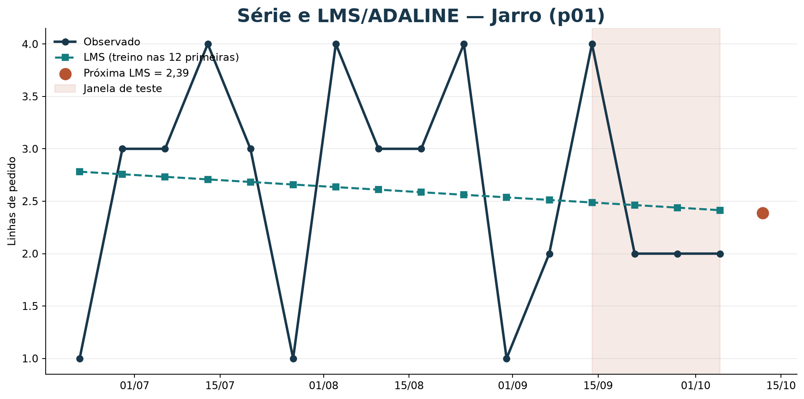
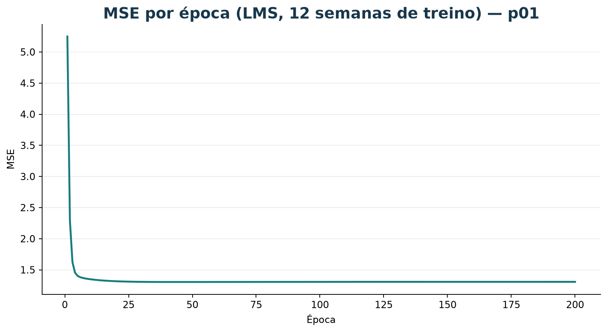
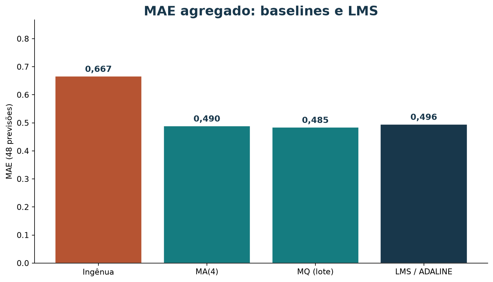

# Previsão de demanda com perceptron / LMS (ADALINE)

[Leia a versão web com o explorador](https://lgallindo.github.io/recomendador-bentoml/demanda-perc/).

Esta aula liga a **reta** dos mínimos quadrados a um modelo que **atualiza
pesos** a cada exemplo. Na demanda semanal usamos a regra LMS (ADALINE): erro
contínuo, não classificação 0/1. Uma subseção curta de funções booleanas cobre
separabilidade linear (AND, OR, XOR).

Os dados de demanda são **sintéticos** (`dados/vendas_semanais.csv`).

### Roteiro

| Tempo | Atividade |
| --- | --- |
| 10 min | Separabilidade linear em AND / OR / XOR |
| 10 min | Formatar entradas e a regra LMS |
| 15 min | Treinar na série, ver MSE por época |
| 15 min | Walk-forward e comparar com MA / MQ |
| 15 min | Explorador BI |
| 15 min | Endpoint BentoML mínimo |

## 1. Separabilidade linear (booleanos)

Em classificação binária, um perceptron clássico traça um hiperplano. Com duas
entradas 0/1:

| Função | Separável? |
| --- | --- |
| AND | Sim |
| OR | Sim |
| XOR | Não |

Desenhe os quatro pontos no plano e argumente. XOR exige uma fronteira que uma
única reta não realiza — daí redes com mais de uma camada depois.

## 2. Da classificação à previsão contínua

Na demanda, o alvo é a **contagem** de linhas de pedido, não um bit. A unidade
**ADALINE / LMS** prevê

$$
\widehat{y}_t = w_0 + w_1 t
$$

e atualiza os pesos com o erro contínuo:

$$
w \leftarrow w + \eta\,(y_t - \widehat{y}_t)\,x_t,
\quad x_t = (1,\ t)
$$

Isso é o mesmo espírito do perceptron (passo a passo), com perda quadrática
em vez de erro 0/1. **Não** é backprop de uma rede multilcamada.

## 3. Treinar nas 12 primeiras semanas

```bash
uv run python scripts/gerar_bi_demanda_perceptron.py
```

O script grava `material/bi-demanda-perceptron/pesos_p01.json` e o painel. O tempo entra **normalizado** (t / (n−1) no treino) para o passo LMS ficar
estável. Para Jarro (`p01`), 200 épocas com η = 0,05 nas 12 primeiras semanas
aproximam a reta de mínimos quadrados em lote nesta série curta.

A curva de MSE por época deve cair e estabilizar. Se não cair, revise η ou o
número de épocas.

## 4. Avaliar no tempo

Nas quatro últimas semanas, a cada origem o modelo **re-treina só com o
passado** e prevê a semana seguinte (piso em zero). Compare MAE com ingênua,
MA(4) e MQ em lote — mesmas 48 previsões.

## 5. Explorador BI

O [explorador](bi-demanda-perceptron/index.html) mostra série, MSE por época,
MAE agregado e tabela. Versão web:
[demanda-perc](https://lgallindo.github.io/recomendador-bentoml/demanda-perc/).







## 6. Endpoint BentoML

Com os pesos gerados:

```bash
uv run bentoml serve service_perceptron_demanda:PrevisaoLmsDemanda --reload
```

Chame a API `prever` com `indice_semana` (por exemplo `16` para a semana após o
histórico). O mesmo cálculo local:

```python
import json
from pathlib import Path

pesos = json.loads(Path("material/bi-demanda-perceptron/pesos_p01.json").read_text())
t = 16
bruto = pesos["bias"] + pesos["inclinacao"] * t
print(max(0.0, bruto))
```

Os dois caminhos devem coincidir.

## 7. Exercício

1. Marque AND, OR e XOR como separáveis ou não.
2. Formate uma tabela t → y para um produto (cinco linhas bastam).
3. Descreva o split: 12 treino / 4 teste, sem embaralhar.
4. Rode o gerador e anote o MSE da última época e o MAE LMS de `p01`.
5. Suba o serviço e compare a previsão para `t = 16` com o JSON de pesos.

## Referência

- ADALINE / LMS: atualização pelo erro contínuo (Widrow–Hoff).
- Código: `scripts/lms_demanda.py`, `scripts/gerar_bi_demanda_perceptron.py`,
  `service_perceptron_demanda.py`.
