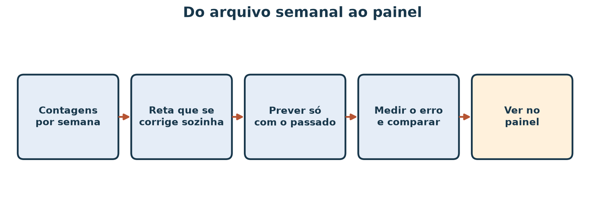
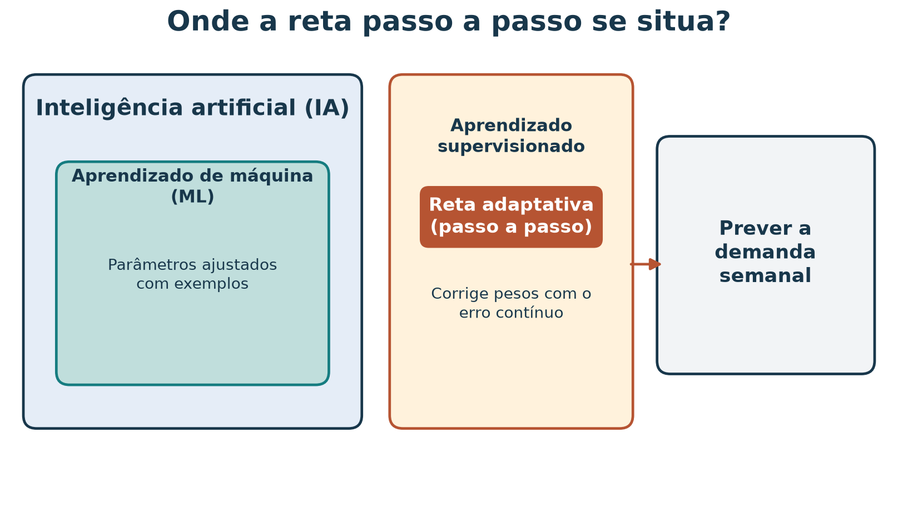

# Previsão de demanda com perceptron / LMS (ADALINE)

[Versão web com explorador](https://lgallindo.github.io/recomendador-bentoml/demanda-perc/).
Explorador no repositório:
[`bi-demanda-perceptron/index.html`](bi-demanda-perceptron/index.html).
Laboratório geométrico (fronteira, portas, PLA):
[`bi-demanda-perceptron/lab/index.html`](bi-demanda-perceptron/lab/index.html).

A loja já sabe pedir uma **reta** para resumir a demanda semanal — isso foi a
aula de
[mínimos quadrados](tutorial-regressao-quadrados-minimos-demanda-20261017.md).
Aqui a reta é a **mesma família**; o que muda é o caminho até os pesos: em vez
de ajustar o bloco de uma vez, a regra **corrige o palpite a cada semana**,
guiada pelo erro contínuo (observado menos previsto).

Antes de voltar às contagens, um **laboratório no plano** mostra o primo
classificador: o Perceptron de Rosenblatt, a fronteira linear e o algoritmo PLA.
Os dois usam a mesma soma ponderada; muda a saída (lado da classe versus nível
contínuo).

Os dados continuam **sintéticos** (`dados/vendas_semanais.csv`). Os exemplos
trabalhados de demanda são Jarro (`p01`) e Boneca (`p03`).

Leitura em ritmo próprio. Termos técnicos reunidos no
[glossário](#glossário) ao final.

## 1. A pergunta que já conhecemos

Quantas **linhas de pedido** cada peça tende a gerar na semana seguinte? A
unidade é a mesma da média móvel e da reta de mínimos quadrados. O ritual de
avaliação também: treinar só com o passado, prever a próxima semana, só então
incorporar o valor observado.

O que esta aula acrescenta é um **modo de chegar à reta**: empurrar os pesos
um pouco depois de cada semana, em vez de resolver o lote inteiro de uma só
vez.



*Figura 0 — Caminho desta aula: ler as contagens, deixar a reta se corrigir
semana a semana, prever só com o que já fechou, medir o erro frente a outros
métodos e conferir no painel.*



*Figura 1 — A reta passo a passo fica no aprendizado supervisionado: entrada e
alvo conhecidos, parâmetros ajustados com exemplos. As áreas são conceituais,
não uma medida de tamanho.*

## 2. Dois caminhos até a mesma reta

No tutorial de mínimos quadrados, cada produto ganha uma reta

$$
\widehat{y}_t = \beta_0 + \beta_1 t
$$

ajustada **de uma vez** ao bloco de semanas. Os coeficientes saem do critério
clássico: minimizar a soma dos resíduos ao quadrado.

Esta aula mantém a mesma forma — uma reta no tempo — e muda o **modo de
chegar aos pesos**. A regra passo a passo (ADALINE / LMS) **atualiza** \(w_0\)
e \(w_1\) a cada exemplo, guiada pelo erro contínuo \(y_t - \widehat{y}_t\).
Na série curta do marketplace, esse caminho itera até aproximar a mesma reta
do ajuste em lote.


*Figura 2 — À esquerda, o bloco inteiro de uma vez. À direita, um empurrão nos
pesos depois de cada semana. Em ambos os casos o erro é contínuo: contagem
observada menos palpite.*

## 3. História curta do modelo linear adaptativo

A ideia de “somar entradas, atravessar um limiar ou uma saída contínua e
corrigir pesos com o erro” tem nome e data. O caminho abaixo prepara o
laboratório no plano e o LMS na loja.

### 3.1 Neurônio formal e limiar

Nos anos 1940, **Warren McCulloch** e **Walter Pitts** propuseram um neurônio
formal: entradas binárias, estímulos excitatórios (e, se houver, inibitórios) e
um limiar \(\theta\). O neurônio dispara quando a soma dos estímulos ativos
ultrapassa o limiar.

Com duas entradas e limiar 2, o desenho realiza um **AND** lógico (precisam
estar as duas ativas). Com limiar 1, basta uma — um **OR**. Com uma entrada
inibitória, dá para negar. O modelo é lógico e abstrato: ainda não há algoritmo
de treino. Ele prepara o terreno: **unidade + limiar + composição**.

### 3.2 Perceptron de Rosenblatt

No fim dos anos 1950, **Frank Rosenblatt** descreveu o **perceptron**: entradas
reais, cada uma com um **peso**, bias (o truque \(x_0 = 1\)) e ativação
\(\mathrm{sinal}\):

$$
\widehat{y} = \mathrm{sinal}(\theta_0 + \theta_1 x_1 + \theta_2 x_2),\qquad
\mathrm{sinal}(z)=\begin{cases}+1 & z\ge 0\\ -1 & z< 0\end{cases}.
$$

Quando o rótulo previsto discorda do verdadeiro, a regra PLA (*Perceptron
Learning Algorithm*) atualiza

$$
\theta \leftarrow \theta + \eta\, y\, x
$$

(com \(x = (1, x_1, x_2)\) e \(y\in\{-1,+1\}\)). O erro que guia o passo é o
erro de **classificação** (lado certo ou errado).

O perceptron clássico responde bem a perguntas do tipo “a peça sai ou não
sai?”. A demanda semanal pergunta outra coisa: **quantas** linhas de pedido
tendem a aparecer.

### 3.3 Widrow–Hoff, ADALINE e LMS

**Bernard Widrow** e **Marcian Hoff** formularam a regra **LMS** (*least mean
squares*), associada ao ADALINE (*adaptive linear neuron*): a saída é
**contínua**, a perda é **quadrática**, e a atualização dos pesos segue o erro
\(y - \widehat{y}\) a cada exemplo.

É o mesmo espírito de “corrigir o modelo com o residual” dos mínimos
quadrados, agora **passo a passo**, com uma taxa de aprendizado \(\eta\), em
vez de uma única solução fechada do sistema normal.

### 3.4 Contagem da loja, não bit de prateleira

| Alvo | Família natural nesta aula |
| --- | --- |
| Bit / classe (saiu / não saiu) | Perceptron clássico + PLA |
| Contagem / nível contínuo (linhas na semana) | ADALINE / LMS |

A demanda semanal pede o segundo quadro. O laboratório das seções 4–5 fixa o
primeiro.

## 4. Laboratório: uma reta no plano

Abra o
[laboratório geométrico](bi-demanda-perceptron/lab/index.html)
e percorra os três painéis na ordem.

### 4.1 Fronteira e vetor de pesos

Com duas entradas, a fronteira é a reta \(\theta_0 + \theta_1 x_1 + \theta_2 x_2 = 0\).
O vetor \((\theta_1, \theta_2)\) é **perpendicular** à reta e aponta para o
semiplano da classe \(+1\). Mover só \(\theta_0\) translada a reta; mudar
\(\theta_1\) e \(\theta_2\) gira a normal.

### 4.2 AND, OR e XOR

Codificando falso como \(-1\) e verdadeiro como \(+1\):

| Função | Separável por uma reta? |
| --- | --- |
| AND | Sim |
| OR | Sim |
| XOR | Não |

No **AND**, só o canto \((+1,+1)\) é verdadeiro. No **OR**, só \((-1,-1)\) é
falso. No **XOR**, os verdadeiros ocupam cantos opostos na diagonal: qualquer
reta que tente juntá-los puxa um falso ou deixa um verdadeiro do lado errado.


*Figura 3 — Verde: alvo 1; terracota: alvo 0 (na figura estática). AND e OR
admitem um traço; XOR pede outra geometria. No laboratório a codificação é
±1.*

Uma rede com **duas** unidades na primeira camada e uma na saída consegue
realizar o XOR compondo fronteiras. O PLA sozinho, em uma unidade, não sobe
essa escada — daí a ponte para MLP e backpropagation no
[tutorial de redes](tutorial-treino-redes-neurais-20261026.md).

### 4.3 PLA ao vivo

No terceiro painel, o algoritmo procura um ponto mal classificado e aplica
\(\theta \leftarrow \theta + \eta\, y\, x\). No modo **separável**, a curva de
erros chega a zero. No **não separável**, ela oscila: não há garantia de
convergência.

## 5. Exemplo numérico do PLA

Quatro pontos no plano (OR com codificação ±1), bias com \(x_0 = 1\):

| \(x_1\) | \(x_2\) | \(y\) |
| ---: | ---: | ---: |
| 1 | 1 | \(+1\) |
| −1 | 1 | \(+1\) |
| 1 | −1 | \(+1\) |
| −1 | −1 | \(−1\) |

Comece com \(\theta^\top = (-1,-1,-1)\) e \(\eta = 1\). O ponto
\((-1,1)\) com alvo \(+1\) está do lado errado:

$$
(-1) + (-1)(-1) + (-1)(1) = -1 < 0 \Rightarrow \widehat{y}=-1 \neq +1.
$$

Atualização:

$$
\theta \leftarrow (-1,-1,-1) + (+1)\,(1,-1,1) = (0,-2,0).
$$

Repita até não restar erro (no laboratório, use **Um passo** e acompanhe a
curva). A intuição geométrica: somar \(y\,x\) gira o vetor de pesos na direção
que alinha melhor o semiplano com o ponto corrigido.

## 6. Da classificação à contagem: PLA e LMS

A mesma soma \(w^\top x\) aparece nos dois mundos.

| | Perceptron + PLA | ADALINE + LMS |
| --- | --- | --- |
| Saída | \(\mathrm{sinal}(w^\top x)\) | \(w^\top x\) (contínua) |
| Erro que guia | lado da classe | \(y - \widehat{y}\) |
| Atualização típica | \(w \leftarrow w + \eta\, y\, x\) (se errou) | \(w \leftarrow w + \eta\,(y-\widehat{y})\, x\) |
| Pergunta da loja | “sai / não sai?” | “quantas linhas nesta semana?” |

Na demanda semanal, \(x_t = (1,\ t/\mathrm{escala})\) e o alvo é a contagem
\(y_t\). O LMS é o primo **regressivo** do PLA: mesma geometria linear, perda
quadrática, saída contínua.

## 7. Corrigir o palpite semana a semana

Imagine que a loja já tem um palpite linear para o Jarro: “cerca de tantas
linhas nesta semana”. Fecha a semana, conta o observado, e vê o quanto o
palpite errou. Em vez de refazer a conta do zero com todas as semanas de uma
só vez, a regra LMS **empurra** os pesos um pouco na direção que reduziria
aquele erro — e passa à semana seguinte.

### Nomes do passo

- \(\widehat{y}_t\): palpite contínuo para a semana \(t\).
- \(y_t - \widehat{y}_t\): erro contínuo (observado menos palpite).
- \(\eta\): taxa de aprendizado — o tamanho do empurrão.
- \(x_t\): vetor de entrada daquele exemplo; aqui,
  \(x_t = (1,\ t/\mathrm{escala})\).
- \(w = (w_0, w_1)\): bias e peso do tempo normalizado.

### A atualização em uma linha

A unidade LMS prevê

$$
\widehat{y}_t = w_0 + w_1 \cdot \frac{t}{\mathrm{escala}}
$$

(com tempo normalizado no treino para estabilizar o passo) e atualiza

$$
w \leftarrow w + \eta\,(y_t - \widehat{y}_t)\,x_t,
\quad x_t = \bigl(1,\ t/\mathrm{escala}\bigr).
$$

É o espírito do perceptron (atualização local pelo erro), com perda
quadrática. O treino abaixo é **uma** unidade linear adaptativa — o ponto de
partida histórico das redes mais profundas, sem ainda ser backprop de uma
rede multicamada. Nos exemplos trabalhados (`p01`, `p03`), esse laço roda
com \(\eta = 0{,}05\) e 200 voltas completas (*épocas*) sobre as 12 primeiras
semanas.


*Figura 4 — Dentro de cada volta, todas as semanas do bloco de treino passam
pela correção; o erro médio da volta resume o ajuste.*

## 8. Exemplo trabalhado 1 — Jarro (`p01`)

Gere o painel e os pesos (na raiz do repositório):

```bash
uv run python scripts/gerar_bi_demanda_perceptron.py
```

O script grava `material/bi-demanda-perceptron/pesos_p01.json` (e também
`pesos_p03.json`), além de `dados.js` do explorador. O tempo entra
**normalizado** (`t / (n−1)` no treino) para o passo ficar estável.

Números deste material: **200 épocas**, \(\eta = 0{,}05\), treino nas
**12 primeiras semanas**. Para Jarro (`p01`):

| Quantidade | Valor aproximado |
| --- | ---: |
| Bias \(w_0\) | 2,782 |
| Inclinação (espaço normalizado) | −0,269 |
| Escala | 11 |
| Erro quadrático médio na última época | 1,307 |
| Previsão em `t = 16` (piso ≥ 0) | 2,390 |

A reta passo a passo aproxima a de mínimos quadrados em lote nesta série curta
(aquela previa cerca de 2,425 na mesma extrapolação).

```python
# Mesma lógica de scripts/lms_demanda.py — caminho feliz, comentado
from pathlib import Path
import sys

sys.path.insert(0, "scripts")
from lms_demanda import treinar_lms, previsao_nao_negativa

import csv

# Série de um produto a partir do CSV
valores = []
with Path("dados/vendas_semanais.csv").open(encoding="utf-8", newline="") as fh:
    for row in csv.DictReader(fh):
        if row["product_id"] == "p01":
            valores.append(int(row["order_line_count"]))

# Treino só nas 12 primeiras semanas
w, hist_mse, escala = treinar_lms(valores, epocas=200, lr=0.05, ate=12)
proxima = previsao_nao_negativa(w, float(len(valores)), escala)

print(f"bias={w[0]:.4f}  inclinacao={w[1]:.4f}  escala={escala}")
print(f"erro quadrático médio (última época)={hist_mse[-1]:.4f}")
print(f"previsão t={len(valores)} → {proxima:.4f}")
```

A curva de erro médio por época deve cair e estabilizar. Se não cair, revise
\(\eta\) ou o número de épocas.


*Figura 5 — Observações e reta ajustada nas 12 primeiras semanas; o ponto
terracota extrapola a semana seguinte.*


*Figura 6 — A curva deve descer e estabilizar ao longo das 200 épocas.*

## 9. Exemplo trabalhado 2 — Boneca (`p03`)

Com os mesmos hiperparâmetros nas 12 primeiras semanas de Boneca de barro:

| Quantidade | Valor aproximado |
| --- | ---: |
| Bias \(w_0\) | 1,538 |
| Inclinação (espaço normalizado) | −0,576 |
| Escala | 11 |
| Erro quadrático médio na última época | 0,164 |
| Previsão em `t = 16` (piso ≥ 0) | 0,700 |

Nas quatro semanas finais, prevendo **só com o passado**, o erro absoluto médio
desta reta para `p03` fica em torno de **0,636** (produto isolado). A reta de
mínimos quadrados em lote para o mesmo produto previa **0,800** em `t = 16`;
os dois caminhos permanecem na mesma família, com rotas diferentes até os
pesos.

Os pesos gravados estão em
[`material/bi-demanda-perceptron/pesos_p03.json`](bi-demanda-perceptron/pesos_p03.json).


*Figura 7 — Mesmo ritual do Jarro; outro produto, outros pesos.*


*Figura 8 — Curva de treino de `p03` nas mesmas 200 épocas.*

## 10. Avaliar no tempo

Nas quatro últimas semanas, a cada origem o modelo **re-treina só com o
passado** e prevê a semana seguinte (piso em zero). Compare o erro absoluto
médio com a previsão ingênua, a média móvel de quatro semanas e os mínimos
quadrados em lote — mesmas 48 previsões:

| Método | Erro absoluto médio agregado |
| --- | ---: |
| Ingênua | 0,667 |
| Média móvel (4 semanas) | 0,490 |
| Mínimos quadrados (lote) | 0,485 |
| Reta passo a passo (LMS) | 0,496 |

Nesta amostra sintética curta, a reta passo a passo fica perto do ajuste em
lote — o esperado quando a família de funções é a mesma e o treino online
converge.

## 11. Explorador no painel

O [explorador](bi-demanda-perceptron/index.html) mostra série, curva de treino,
erro absoluto médio agregado e tabela. Selecione **Jarro (`p01`)** e **Boneca
(`p03`)** — os dois exemplos deste tutorial. Guia curto em
[`bi-demanda-perceptron/README.md`](bi-demanda-perceptron/README.md).

O [laboratório geométrico](bi-demanda-perceptron/lab/index.html) fica ao lado:
fronteira, portas e PLA, antes de voltar às contagens.


*Figura 9 — Mesmas 48 previsões para todos os métodos. Menor valor é melhor
nesta métrica.*

## 12. Endpoint BentoML

Com os pesos gerados para `p01` (serviço de demonstração):

```bash
uv run bentoml serve service_perceptron_demanda:PrevisaoLmsDemanda --reload
```

Chame a API `prever` com `indice_semana` (por exemplo `16` para a semana após o
histórico). O mesmo cálculo local — **com a escala** gravada no JSON:

```python
import json
from pathlib import Path

pesos = json.loads(
    Path("material/bi-demanda-perceptron/pesos_p01.json").read_text(encoding="utf-8")
)
t = 16
escala = float(pesos["escala"])
bruto = pesos["bias"] + pesos["inclinacao"] * (t / escala)
print(max(0.0, bruto))
```

Os dois caminhos devem coincidir. Para Boneca, leia `pesos_p03.json` com a
mesma fórmula.

## Glossário

| Termo | Leitura nesta aula |
| --- | --- |
| **Neurônio MP** | Modelo de McCulloch–Pitts: entradas binárias e limiar. |
| **Perceptron** | Classificador de Rosenblatt: \(\mathrm{sinal}(w^\top x)\); atualiza com PLA. |
| **PLA** | Algoritmo de aprendizado do Perceptron: \(\theta \leftarrow \theta + \eta\, y\, x\) nos erros. |
| **ADALINE / LMS** | Unidade linear adaptativa: saída contínua; atualiza com \(y - \widehat{y}\). |
| **Separabilidade linear** | Classes que um único traço reto consegue separar no plano. |
| **Época** | Uma volta completa por todos os exemplos do bloco de treino. |
| **Taxa de aprendizado \(\eta\)** | Tamanho do empurrão nos pesos a cada exemplo. |
| **Bias \(w_0\)** | Termo constante da reta (intercepto no espaço normalizado). |
| **Inclinação \(w_1\)** | Peso do tempo normalizado. |
| **Escala** | Fator que divide \(t\) no treino para estabilizar o passo (aqui, \(n_{\mathrm{treino}}-1\)). |
| **Erro contínuo / resíduo** | Observado menos palpite, \(y_t - \widehat{y}_t\). |
| **Erro absoluto médio (MAE)** | Média de \(\lvert y - \widehat{y}\rvert\) nas previsões de teste. |
| **Erro quadrático médio (MSE)** | Média de \((y - \widehat{y})^2\); no treino LMS, resume cada época. |
| **Prever só com o passado** | Ritual temporal: treina sem ver a semana de teste, prevê, só então incorpora o observado (às vezes chamado *walk-forward*). |
| **Mínimos quadrados em lote** | Ajuste da reta ao bloco inteiro de uma vez (tutorial irmão). |

## Referência

- ADALINE / LMS: atualização pelo erro contínuo (Widrow–Hoff).
- Perceptron / PLA: Rosenblatt; neurônio formal: McCulloch–Pitts.
- Laboratório interativo do Caderno: `material/bi-demanda-perceptron/lab/`
  (pedagogia de fronteira/portas/PLA alinhada a materiais abertos pt-BR, entre
  eles o curso de Deep Learning de L. S. Kupssinskü, CC BY-SA 4.0).
- Leituras CESAR ingeridas: `wiki/leituras/ads032/` (Kup, Minicurso RNAs,
  Harpya).
- Código LMS: `scripts/lms_demanda.py`, `scripts/gerar_bi_demanda_perceptron.py`,
  `service_perceptron_demanda.py`.
