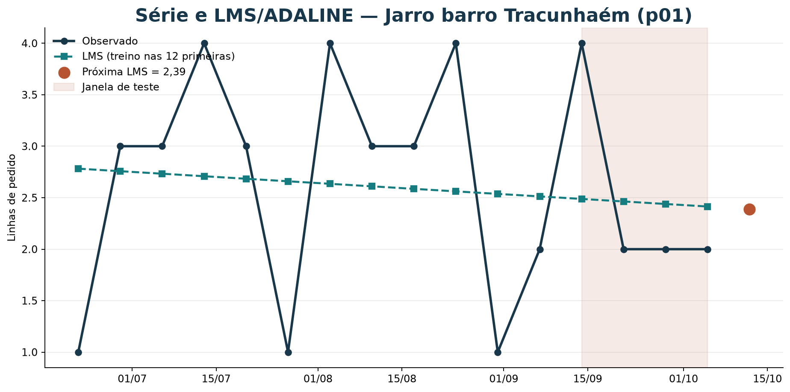
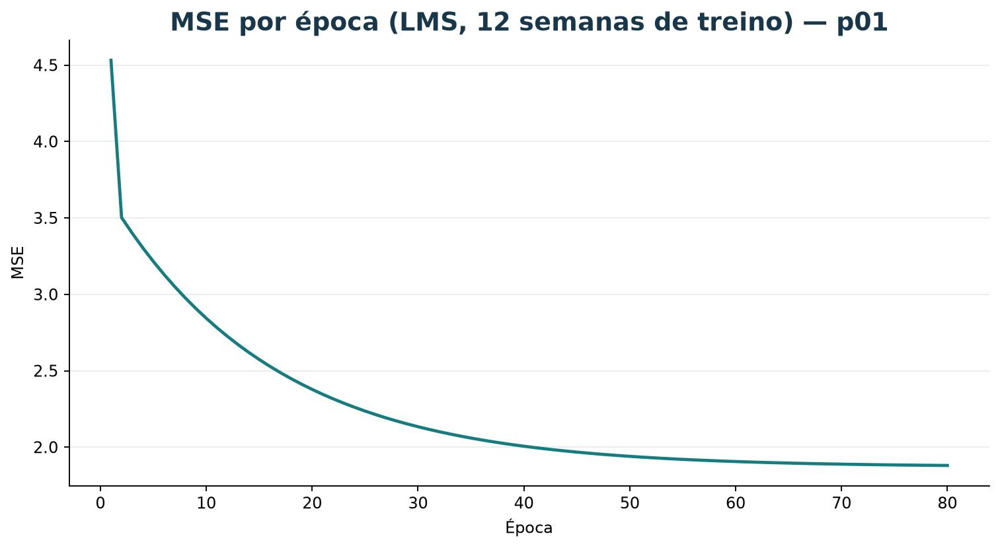
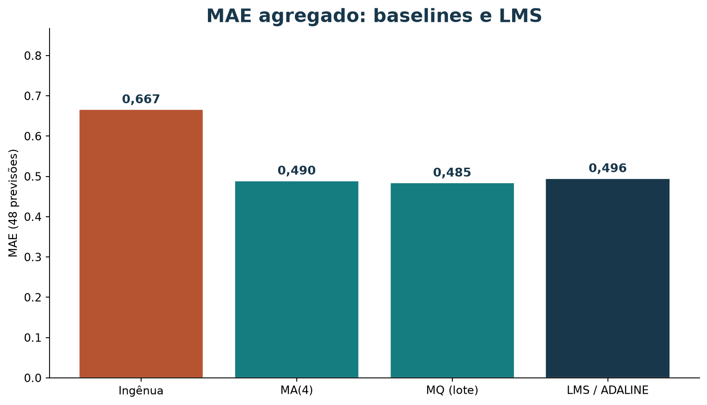

# Previsão de demanda com perceptron / LMS (ADALINE)

Ao concluir esta aula, você deverá conseguir situar o **perceptron** e a regra
**LMS / ADALINE** numa linha histórica curta, marcar AND, OR e XOR como
separáveis ou não por uma reta, treinar pesos com erro contínuo na série
semanal, comparar o resultado com médias móveis e com a
[reta de mínimos quadrados](tutorial-regressao-quadrados-minimos-demanda-20261017.md)
no mesmo walk-forward, e conferir a previsão num endpoint BentoML mínimo.

Os dados de demanda são **sintéticos** (`dados/vendas_semanais.csv`).

### Roteiro

| Tempo | Atividade |
| --- | --- |
| 15 min | Da reta de MQ à história do modelo linear adaptativo |
| 10 min | Separabilidade linear em AND / OR / XOR |
| 10 min | Formatar entradas e a regra LMS |
| 15 min | Treinar na série, ver MSE por época |
| 15 min | Walk-forward e comparar com MA / MQ |
| 15 min | Explorador BI |
| 15 min | Endpoint BentoML mínimo |

## 1. A reta que já conhecemos

No tutorial de mínimos quadrados, cada produto ganha uma reta

$$
\widehat{y}_t = \beta_0 + \beta_1 t
$$

ajustada **de uma vez** a um bloco de semanas (ou, no walk-forward, ao passado
disponível naquela origem). Os coeficientes saem do critério clássico: minimizar
a soma dos resíduos ao quadrado.

Esta aula mantém a **mesma família de funções** — uma reta no tempo — e muda o
**modo de chegar aos pesos**. Em vez de resolver o lote de uma só vez, a regra
LMS (ADALINE) **atualiza** \(w_0\) e \(w_1\) a cada exemplo, guiada pelo erro
contínuo \(y_t - \widehat{y}_t\). Na série curta do marketplace, esse caminho
iterativo aproxima a mesma reta que o ajuste em lote.

## 2. Camadas históricas do modelo linear adaptativo

A ideia de “somar entradas, atravessar um limiar ou uma saída contínua e
corrigir pesos com o erro” tem nome e data. As camadas abaixo bastam para
saber **por que** falamos de perceptron e de LMS na mesma aula de demanda.

### 2.1 Neurônio formal e limiar

Nos anos 1940, **Warren McCulloch** e **Walter Pitts** propuseram um modelo
simples de neurônio formal: combinar sinais de entrada e produzir uma saída
ligada a um limiar. O desenho é lógico e abstrato — uma peça fundadora da ideia
de rede — e ainda não é o algoritmo de treino que usaremos na planilha de
demanda. Ele prepara o terreno: **unidade linear (ou limiar) + composição**.

### 2.2 Perceptron de Rosenblatt

No fim dos anos 1950, **Frank Rosenblatt** descreveu o **perceptron**: um
classificador que separa classes com um hiperplano e **atualiza pesos** quando
o rótulo previsto discorda do rótulo verdadeiro. O erro que guia o passo é o
erro de **classificação** (acerto ou erro de lado), típico de alvos 0/1.

O perceptron clássico responde bem a perguntas do tipo “a peça sai ou não
sai?”. A demanda semanal desta loja pergunta outra coisa: **quantas** linhas de
pedido tendem a aparecer.

### 2.3 Widrow–Hoff, ADALINE e LMS

**Bernard Widrow** e **Marcian Hoff** formularam a regra **LMS** (*least mean
squares*), associada ao ADALINE (*adaptive linear neuron*): a saída é
**contínua**, a perda é **quadrática**, e a atualização dos pesos segue o erro
\(y - \widehat{y}\) a cada exemplo (ou em passos estocásticos equivalentes).

É o mesmo espírito de “corrigir o modelo com o residual”, agora alinhado ao
critério dos mínimos quadrados que você já viu em lote. A diferença operacional
é o **caminho**: passo a passo, com taxa de aprendizado \(\eta\), em vez de uma
única solução fechada do sistema normal.

### 2.4 Por que a demanda da loja pede LMS

| Alvo | Família natural nesta aula |
| --- | --- |
| Bit / classe (saiu / não saiu) | Perceptron clássico (erro 0/1) |
| Contagem / nível contínuo (linhas na semana) | ADALINE / LMS (erro contínuo) |

A unidade LMS prevê

$$
\widehat{y}_t = w_0 + w_1 t
$$

e atualiza

$$
w \leftarrow w + \eta\,(y_t - \widehat{y}_t)\,x_t,
\quad x_t = (1,\ t).
$$

É o espírito do perceptron (atualização local pelo erro), com perda
quadrática. O treino abaixo é **uma** unidade linear adaptativa — o ponto de
partida histórico das redes mais profundas, sem ainda ser backprop de uma
rede multilcamada.

## 3. Separabilidade linear (booleanos)

Antes de voltar à série semanal, um laboratório mínimo de classificação mostra
o alcance — e o limite — de **uma** reta (ou hiperplano) no plano.

Em classificação binária, um perceptron clássico traça um hiperplano. Com duas
entradas 0/1:

| Função | Separável? |
| --- | --- |
| AND | Sim |
| OR | Sim |
| XOR | Não |

Desenhe os quatro pontos no plano e argumente. XOR exige uma fronteira que uma
única reta não realiza; daí o interesse posterior por redes com mais de uma
camada. Na demanda, o alvo contínuo não pede essa fronteira booleana — o quadro
serve para fixar o vocabulário de **separabilidade linear** que a história do
perceptron tornou clássico.

## 4. Treinar nas 12 primeiras semanas

```bash
uv run python scripts/gerar_bi_demanda_perceptron.py
```

O script grava `material/bi-demanda-perceptron/pesos_p01.json` e o painel. O tempo entra **normalizado** (t / (n−1) no treino) para o passo LMS ficar
estável. Para Jarro (`p01`), 200 épocas com η = 0,05 nas 12 primeiras semanas
aproximam a reta de mínimos quadrados em lote nesta série curta.

A curva de MSE por época deve cair e estabilizar. Se não cair, revise η ou o
número de épocas.

## 5. Avaliar no tempo

Nas quatro últimas semanas, a cada origem o modelo **re-treina só com o
passado** e prevê a semana seguinte (piso em zero). Compare MAE com ingênua,
MA(4) e MQ em lote — mesmas 48 previsões.

## 6. Explorador BI

O [explorador](bi-demanda-perceptron/index.html) mostra série, MSE por época,
MAE agregado e tabela.







## 7. Endpoint BentoML

Com os pesos gerados:

```bash
uv run bentoml serve service_perceptron_demanda:PrevisaoLmsDemanda --reload
```

Chame a API `prever` com `indice_semana` (por exemplo `16` para a semana após o
histórico). O mesmo cálculo local:

```python
import json
from pathlib import Path

pesos = json.loads(Path("material/bi-demanda-perceptron/pesos_p01.json").read_text())
t = 16
bruto = pesos["bias"] + pesos["inclinacao"] * t
print(max(0.0, bruto))
```

Os dois caminhos devem coincidir.

## 8. Exercício

1. Em uma frase cada: Legendre/Gauss (MQ em lote) versus Widrow–Hoff (LMS passo
   a passo) — o que muda no *caminho* até a reta?
2. Marque AND, OR e XOR como separáveis ou não.
3. Formate uma tabela t → y para um produto (cinco linhas bastam).
4. Descreva o split: 12 treino / 4 teste, sem embaralhar.
5. Rode o gerador e anote o MSE da última época e o MAE LMS de `p01`.
6. Suba o serviço e compare a previsão para `t = 16` com o JSON de pesos.

## Referência

- ADALINE / LMS: atualização pelo erro contínuo (Widrow–Hoff).
- Perceptron: Rosenblatt; neurônio formal: McCulloch–Pitts (contexto histórico).
- Código: `scripts/lms_demanda.py`, `scripts/gerar_bi_demanda_perceptron.py`,
  `service_perceptron_demanda.py`.
