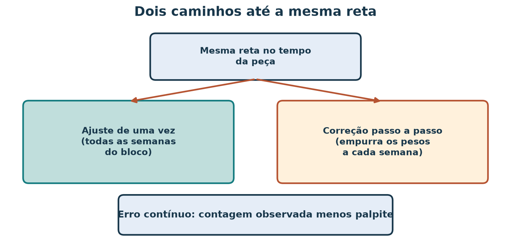
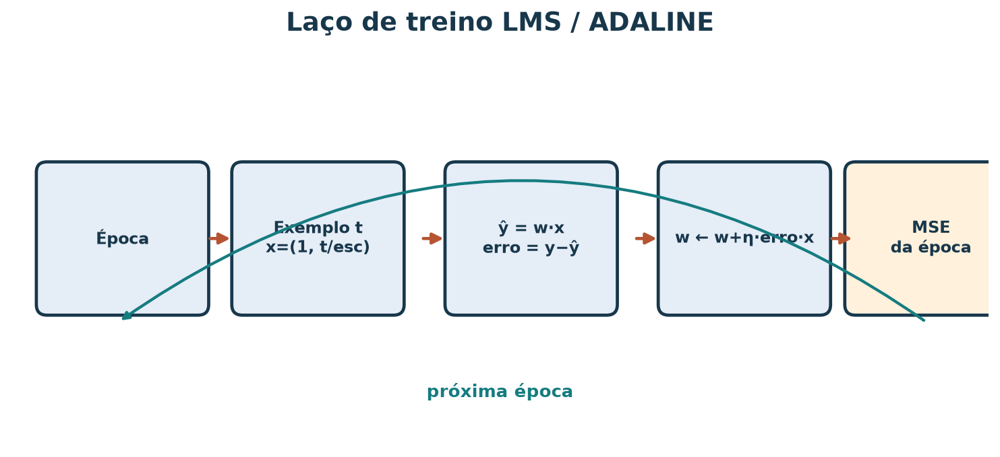
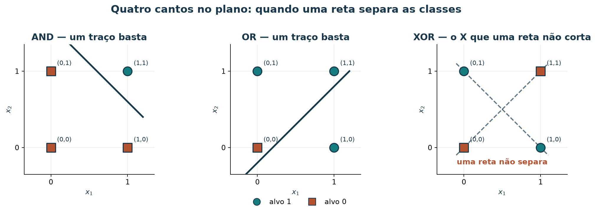
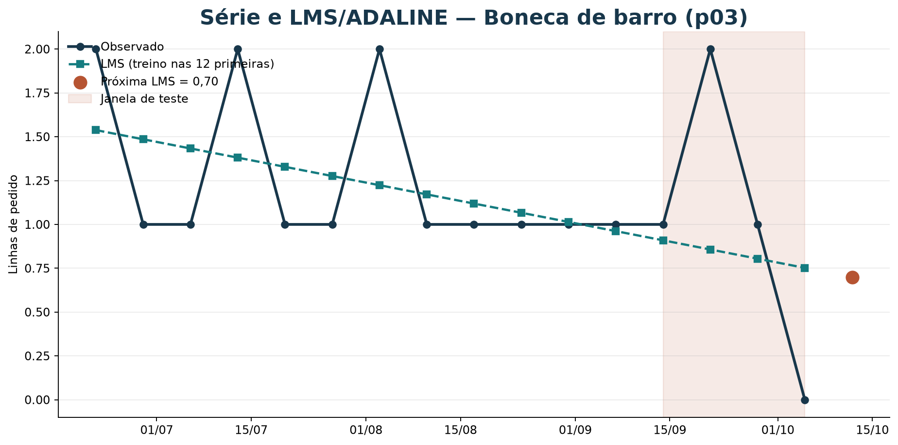
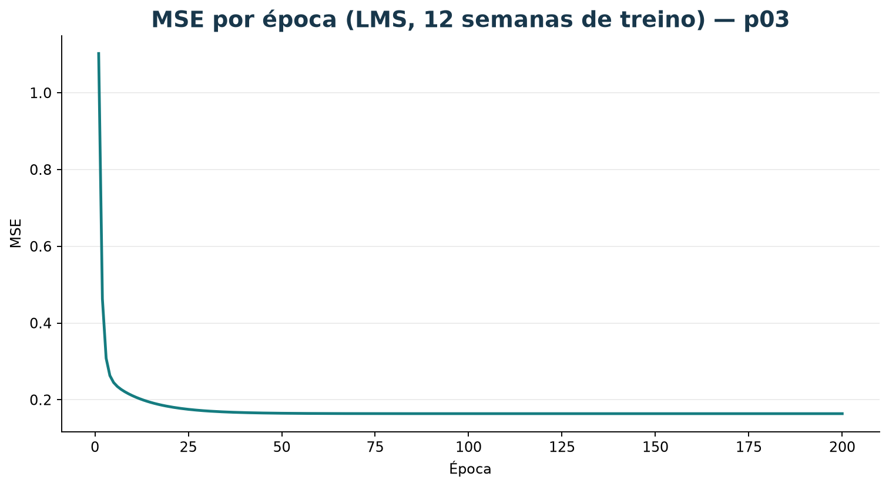

# Previsão de demanda com perceptron / LMS (ADALINE)

[Versão web com explorador](https://lgallindo.github.io/recomendador-bentoml/demanda-perc/).
Explorador no repositório:
[`bi-demanda-perceptron/index.html`](bi-demanda-perceptron/index.html).

Ao concluir esta aula, você deverá conseguir situar o **perceptron** e a regra
**LMS / ADALINE** numa linha histórica curta, marcar AND, OR e XOR como
separáveis ou não por uma reta, treinar pesos com erro contínuo na série
semanal, comparar o resultado com médias móveis e com a
[reta de mínimos quadrados](tutorial-regressao-quadrados-minimos-demanda-20261017.md)
no mesmo walk-forward, e conferir a previsão num endpoint BentoML mínimo.

Os dados de demanda são **sintéticos** (`dados/vendas_semanais.csv`).

Leitura em ritmo próprio: os exemplos trabalhados usam Jarro (`p01`) e Boneca
(`p03`); o painel BI e o JSON de pesos espelham os mesmos números.

## 1. A reta que já conhecemos

No tutorial de mínimos quadrados, cada produto ganha uma reta

$$
\widehat{y}_t = \beta_0 + \beta_1 t
$$

ajustada **de uma vez** a um bloco de semanas (ou, no walk-forward, ao passado
disponível naquela origem). Os coeficientes saem do critério clássico: minimizar
a soma dos resíduos ao quadrado.

Esta aula mantém a **mesma família de funções** — uma reta no tempo — e muda o
**modo de chegar aos pesos**. Em vez de resolver o lote de uma só vez, a regra
LMS (ADALINE) **atualiza** \(w_0\) e \(w_1\) a cada exemplo, guiada pelo erro
contínuo \(y_t - \widehat{y}_t\). Na série curta do marketplace, esse caminho
iterativo aproxima a mesma reta que o ajuste em lote.



*Figura 1 — MQ resolve o bloco de uma vez; LMS corrige os pesos a cada
exemplo. A perda continua quadrática.*

## 2. História curta do modelo linear adaptativo

A ideia de “somar entradas, atravessar um limiar ou uma saída contínua e
corrigir pesos com o erro” tem nome e data. O caminho curto abaixo basta para
saber **por que** falamos de perceptron e de LMS na mesma aula de demanda.

### 2.1 Neurônio formal e limiar

Nos anos 1940, **Warren McCulloch** e **Walter Pitts** propuseram um modelo
simples de neurônio formal: combinar sinais de entrada e produzir uma saída
ligada a um limiar. O desenho é lógico e abstrato — uma peça fundadora da ideia
de rede — e ainda não é o algoritmo de treino que usaremos na planilha de
demanda. Ele prepara o terreno: **unidade linear (ou limiar) + composição**.

### 2.2 Perceptron de Rosenblatt

No fim dos anos 1950, **Frank Rosenblatt** descreveu o **perceptron**: um
classificador que separa classes com um hiperplano e **atualiza pesos** quando
o rótulo previsto discorda do rótulo verdadeiro. O erro que guia o passo é o
erro de **classificação** (acerto ou erro de lado), típico de alvos 0/1.

O perceptron clássico responde bem a perguntas do tipo “a peça sai ou não
sai?”. A demanda semanal desta loja pergunta outra coisa: **quantas** linhas de
pedido tendem a aparecer.

### 2.3 Widrow–Hoff, ADALINE e LMS

**Bernard Widrow** e **Marcian Hoff** formularam a regra **LMS** (*least mean
squares*), associada ao ADALINE (*adaptive linear neuron*): a saída é
**contínua**, a perda é **quadrática**, e a atualização dos pesos segue o erro
\(y - \widehat{y}\) a cada exemplo (ou em passos estocásticos equivalentes).

É o mesmo espírito de “corrigir o modelo com o residual”, agora alinhado ao
critério dos mínimos quadrados que você já viu em lote. A diferença operacional
é o **caminho**: passo a passo, com taxa de aprendizado \(\eta\), em vez de uma
única solução fechada do sistema normal.

### 2.4 Contagem da loja, não bit de prateleira

| Alvo | Família natural nesta aula |
| --- | --- |
| Bit / classe (saiu / não saiu) | Perceptron clássico (erro 0/1) |
| Contagem / nível contínuo (linhas na semana) | ADALINE / LMS (erro contínuo) |

A demanda semanal pede o segundo quadro: um número, não um sim/não.

### 2.5 Corrigir o palpite semana a semana

Imagine que a loja já tem um palpite linear para o Jarro: “cerca de tantas
linhas nesta semana”. Fecha a semana, conta o observado, e vê o quanto o
palpite errou. Em vez de refazer a conta do zero com todas as semanas de uma
só vez, a regra LMS **empurra** os pesos um pouco na direção que reduziria
aquele erro — e passa à semana seguinte.

### 2.6 Nomes do passo LMS

- \(\widehat{y}_t\): palpite contínuo para a semana \(t\).
- \(y_t - \widehat{y}_t\): erro contínuo (observado menos palpite).
- \(\eta\): taxa de aprendizado — o tamanho do empurrão.
- \(x_t\): vetor de entrada daquele exemplo; aqui,
  \(x_t = (1,\ t/\mathrm{escala})\).
- \(w = (w_0, w_1)\): bias e peso do tempo normalizado.

### 2.7 A atualização em uma linha

A unidade LMS prevê

$$
\widehat{y}_t = w_0 + w_1 \cdot \frac{t}{\mathrm{escala}}
$$

(com tempo normalizado no treino para estabilizar o passo) e atualiza

$$
w \leftarrow w + \eta\,(y_t - \widehat{y}_t)\,x_t,
\quad x_t = \bigl(1,\ t/\mathrm{escala}\bigr).
$$

É o espírito do perceptron (atualização local pelo erro), com perda
quadrática. O treino abaixo é **uma** unidade linear adaptativa — o ponto de
partida histórico das redes mais profundas, sem ainda ser backprop de uma
rede multilcamada. Nos exemplos trabalhados (`p01`, `p03`), esse laço roda
com \(\eta = 0{,}05\) e 200 épocas sobre as 12 primeiras semanas.



*Figura 2 — Dentro de cada época, todos os pares \((t, y_t)\) do bloco de
treino passam pela regra LMS; o MSE da época resume o ajuste.*

## 3. Separabilidade linear no plano

Antes de voltar à série semanal, um laboratório mínimo de classificação mostra
o alcance — e o limite — de **uma** reta no plano. O vocabulário nasce da
história do perceptron; a demanda depois pede outra coisa.

### Quatro cantos no plano

Com duas entradas que só valem 0 ou 1, há exatamente quatro combinações:

| \(x_1\) | \(x_2\) | Canto |
| ---: | ---: | --- |
| 0 | 0 | canto inferior esquerdo |
| 0 | 1 | canto superior esquerdo |
| 1 | 0 | canto inferior direito |
| 1 | 1 | canto superior direito |

Pense nesses quatro pontos como peças sobre uma mesa. Uma função booleana
pinta cada peça de “verdadeiro” ou “falso”. A pergunta geométrica é simples:
existe um **traço reto** que deixa todos os verdadeiros de um lado e todos os
falsos do outro?

### AND e OR: um traço basta

No **AND**, só o canto `(1,1)` é verdadeiro; os outros três são falsos. Um
único traço isola aquele canto — os verdadeiros ficam juntos de um lado da
reta.

No **OR**, só o canto `(0,0)` é falso; os outros três são verdadeiros. De
novo, um traço basta: o falso fica sozinho de um lado.

Quando isso acontece, dizemos que a função é **linearmente separável**: existe
uma reta (em dimensão maior, um hiperplano) que separa as duas classes.

### XOR: o X que uma reta não corta

No **XOR**, os verdadeiros são `(0,1)` e `(1,0)` — cantos opostos na
diagonal. Os falsos ocupam a outra diagonal. Qualquer reta que tente deixar os
dois verdadeiros do mesmo lado acaba puxando consigo ao menos um falso, ou
deixa um verdadeiro do lado errado.

Uma única reta **não** realiza o XOR. Daí o interesse histórico por redes com
mais de uma camada: compor fronteiras que um só traço não desenha.



*Figura 3 — Verde: alvo 1; terracota: alvo 0. AND e OR admitem um traço; XOR
pede outra geometria.*

| Função | Separável por uma reta? |
| --- | --- |
| AND | Sim |
| OR | Sim |
| XOR | Não |

### Da classificação à contagem da loja

O quadro booleano fixa o vocabulário de **separabilidade linear**. Na demanda
semanal, o alvo é uma **contagem** — quantas linhas de pedido — não um bit de
classe. A reta LMS desta aula resume um **nível** no tempo; ela não precisa
cortar classes no plano \(x_1 \times x_2\). O laboratório de AND/OR/XOR fica
como mapa histórico do perceptron; o trabalho com `p01` e `p03` volta à série
de contagens.

## 4. Exemplo trabalhado 1 — Jarro (`p01`)

Gere o painel e os pesos (na raiz do repositório):

```bash
uv run python scripts/gerar_bi_demanda_perceptron.py
```

O script grava `material/bi-demanda-perceptron/pesos_p01.json` (e também
`pesos_p03.json`), além de `dados.js` do explorador. O tempo entra
**normalizado** (`t / (n−1)` no treino) para o passo LMS ficar estável.

Hiperparâmetros deste material: **200 épocas**, \(\eta = 0{,}05\), treino nas
**12 primeiras semanas**. Para Jarro (`p01`):

| Quantidade | Valor aproximado |
| --- | ---: |
| Bias \(w_0\) | 2,782 |
| Inclinação (espaço normalizado) | −0,269 |
| Escala | 11 |
| MSE da última época | 1,307 |
| Previsão LMS em `t = 16` (piso ≥ 0) | 2,390 |

A reta LMS aproxima a de mínimos quadrados em lote nesta série curta (MQ em
`p01` previa cerca de 2,425 na mesma extrapolação).

```python
# Mesma lógica de scripts/lms_demanda.py — caminho feliz, comentado
from pathlib import Path
import sys

sys.path.insert(0, "scripts")
from lms_demanda import treinar_lms, previsao_nao_negativa

import csv

# Série de um produto a partir do CSV
valores = []
with Path("dados/vendas_semanais.csv").open(encoding="utf-8", newline="") as fh:
    for row in csv.DictReader(fh):
        if row["product_id"] == "p01":
            valores.append(int(row["order_line_count"]))

# Treino só nas 12 primeiras semanas
w, hist_mse, escala = treinar_lms(valores, epocas=200, lr=0.05, ate=12)
proxima = previsao_nao_negativa(w, float(len(valores)), escala)

print(f"bias={w[0]:.4f}  inclinacao={w[1]:.4f}  escala={escala}")
print(f"MSE última época={hist_mse[-1]:.4f}")
print(f"previsão t={len(valores)} → {proxima:.4f}")
```

A curva de MSE por época deve cair e estabilizar. Se não cair, revise \(\eta\)
ou o número de épocas.


## 5. Exemplo trabalhado 2 — Boneca (`p03`)

Com os mesmos hiperparâmetros nas 12 primeiras semanas de Boneca de barro:

| Quantidade | Valor aproximado |
| --- | ---: |
| Bias \(w_0\) | 1,538 |
| Inclinação (espaço normalizado) | −0,576 |
| Escala | 11 |
| MSE da última época | 0,164 |
| Previsão LMS em `t = 16` (piso ≥ 0) | 0,700 |

No walk-forward das quatro semanas finais, o MAE LMS de `p03` fica em torno de
**0,636** (produto isolado). A reta MQ em lote para o mesmo produto previa
**0,800** em `t = 16`; LMS e MQ permanecem na mesma família, com caminhos
diferentes até os pesos.

Os pesos gravados estão em
[`material/bi-demanda-perceptron/pesos_p03.json`](bi-demanda-perceptron/pesos_p03.json).





## 6. Avaliar no tempo

Nas quatro últimas semanas, a cada origem o modelo **re-treina só com o
passado** e prevê a semana seguinte (piso em zero). Compare MAE com ingênua,
MA(4) e MQ em lote — mesmas 48 previsões:

| Método | MAE agregado |
| --- | ---: |
| Ingênua | 0,667 |
| MA(4) | 0,490 |
| MQ (lote) | 0,485 |
| LMS / ADALINE | 0,496 |

Nesta amostra sintética curta, LMS fica perto do MQ em lote — o esperado quando
a família de funções é a mesma e o treino online converge.

## 7. Explorador BI

O [explorador](bi-demanda-perceptron/index.html) mostra série, MSE por época,
MAE agregado e tabela. Selecione **Jarro (`p01`)** e **Boneca (`p03`)** no
painel — os dois exemplos deste tutorial. Guia curto em
[`bi-demanda-perceptron/README.md`](bi-demanda-perceptron/README.md).


## 8. Endpoint BentoML

Com os pesos gerados para `p01` (serviço de demonstração):

```bash
uv run bentoml serve service_perceptron_demanda:PrevisaoLmsDemanda --reload
```

Chame a API `prever` com `indice_semana` (por exemplo `16` para a semana após o
histórico). O mesmo cálculo local — **com a escala** gravada no JSON:

```python
import json
from pathlib import Path

pesos = json.loads(
    Path("material/bi-demanda-perceptron/pesos_p01.json").read_text(encoding="utf-8")
)
t = 16
escala = float(pesos["escala"])
bruto = pesos["bias"] + pesos["inclinacao"] * (t / escala)
print(max(0.0, bruto))
```

Os dois caminhos devem coincidir. Para Boneca, leia `pesos_p03.json` com a
mesma fórmula.

## Referência

- ADALINE / LMS: atualização pelo erro contínuo (Widrow–Hoff).
- Perceptron: Rosenblatt; neurônio formal: McCulloch–Pitts (contexto histórico).
- Código: `scripts/lms_demanda.py`, `scripts/gerar_bi_demanda_perceptron.py`,
  `service_perceptron_demanda.py`.
