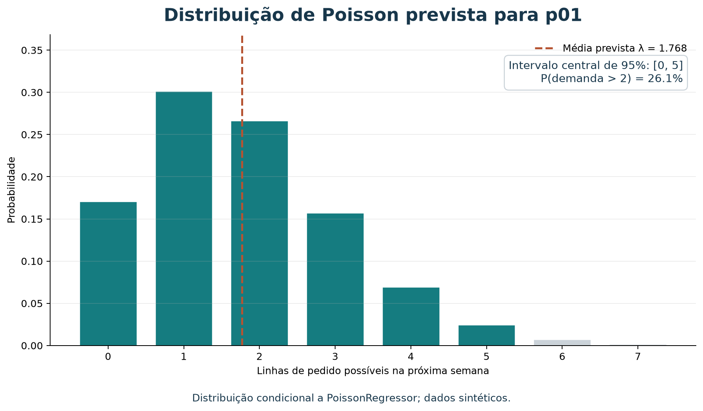

# Previsão probabilística de demanda com regressão de Poisson

O tutorial de mínimos quadrados produz uma estimativa pontual: um único número
de demanda esperada. Neste tutorial, ampliaremos a pergunta:

> Quais contagens de vendas são plausíveis na próxima semana, e com que
> probabilidades?

Usaremos regressão de Poisson para prever uma taxa `λ` e a distribuição de
probabilidade das contagens inteiras. O exemplo depende da série semanal
sintética do marketplace e não representa transações reais. É útil conhecer
os conceitos de avaliação temporal da
[média móvel](tutorial-media-movel-demanda-20261017.md) e da
[regressão por mínimos quadrados](tutorial-regressao-quadrados-minimos-demanda-20261017.md).

### Roteiro

| Tempo sugerido | Atividade |
| --- | --- |
| 8 min | Diferenciar ponto estimado e distribuição |
| 10 min | Entender a distribuição de Poisson |
| 12 min | Ajustar regressão e calcular probabilidades |
| 12 min | Avaliar previsões e intervalos no tempo |
| 8 min | Interpretar risco, hipóteses e limitações |

## 1. Da estimativa pontual à distribuição

Uma previsão pontual, como “2,4 linhas na semana seguinte”, resume a demanda em
um único valor esperado. Ela não informa se a contagem mais plausível é 2, se
zero é comum ou se 5 ainda é possível.

Uma previsão probabilística atribui uma distribuição a resultados possíveis.
Neste tutorial, o alvo é uma contagem não negativa: linhas de pedido por
produto por semana. O modelo estima uma taxa esperada `λ`; a distribuição de
Poisson transforma essa taxa em probabilidades para 0, 1, 2, ... linhas.

**Inteligência artificial (IA)** é o campo amplo de sistemas que podem aprender
ou apoiar decisões; **aprendizado de máquina (ML)** inclui métodos que ajustam
parâmetros a partir de exemplos. Regressão de Poisson é um modelo supervisionado
para uma variável-alvo de contagem. A distribuição estimada acrescenta
informação de incerteza à previsão, mas continua dependendo da qualidade dos
dados e das hipóteses do modelo.

## 2. A distribuição de Poisson

Se `Y` é uma contagem com taxa esperada `λ > 0`, sua probabilidade de assumir
um valor inteiro `k ≥ 0` é:

$$
P(Y=k\mid\lambda)=\frac{e^{-\lambda}\lambda^k}{k!}
$$

Na distribuição de Poisson, a média e a variância são ambas `λ`. Esse vínculo
é uma hipótese importante, não uma verdade sobre todo marketplace. Demanda
com variância muito maior que a média (sobredispersão), dependência temporal,
excesso de zeros ou eventos promocionais pode exigir outro modelo.

O modelo de regressão liga as características à taxa por meio de uma função
logarítmica:

$$
\log(\lambda_{p,t}) = \beta_0 + \alpha_p + \beta_1t
$$

`α_p` representa um efeito por produto; `t` é o índice semanal. O log garante
que `λ` previsto permaneça positivo. Neste exemplo, a regressão agrupa produtos,
usa indicadores de produto e compartilha uma tendência temporal. O ajuste
regularizado reduz a instabilidade, mas não cria informação que o histórico
curto não contém.

## 3. Ajustar o modelo com scikit-learn

O arquivo `dados/vendas_semanais.csv` contém 16 semanas e 12 produtos. A soma
de cada série coincide com o total `pedidos` do catálogo, mas a distribuição
temporal foi construída para o exercício. Confira sua estrutura:

```bash
uv run python scripts/validar_vendas_semanais.py
```

O código abaixo usa pandas para preparar dados, `PoissonRegressor` e
`OneHotEncoder` do scikit-learn, e `poisson` do SciPy para calcular
probabilidades. A partir da raiz, o pandas pode ser disponibilizado com:

```bash
uv run --with pandas python
```

```python
from pathlib import Path

import numpy as np
import pandas as pd
from scipy.stats import poisson
from sklearn.compose import ColumnTransformer
from sklearn.linear_model import PoissonRegressor
from sklearn.pipeline import make_pipeline
from sklearn.preprocessing import OneHotEncoder

vendas = pd.read_csv(
    Path("dados/vendas_semanais.csv"),
    parse_dates=["week_start"],
)
vendas = vendas.sort_values(["week_start", "product_id"]).reset_index(drop=True)
semanas = sorted(vendas["week_start"].unique())
produtos = sorted(vendas["product_id"].unique())
vendas["week_index"] = (
    vendas["week_start"].rank(method="dense").astype(int) - 1
) / 10

preprocessamento = ColumnTransformer(
    [
        (
            "produto",
            OneHotEncoder(categories=[produtos], handle_unknown="ignore"),
            ["product_id"],
        ),
        ("tempo", "passthrough", ["week_index"]),
    ]
)
modelo = make_pipeline(
    preprocessamento,
    PoissonRegressor(alpha=0.1, max_iter=1000),
)
modelo.fit(
    vendas[["product_id", "week_index"]],
    vendas["order_line_count"],
)
```

`alpha=0.1` define a regularização usada neste exemplo. O índice de semana é
dividido por 10 para manter a escala do preditor temporal moderada; todas as
previsões devem usar a mesma transformação.

### Distribuição prevista para o Jarro

Para prever a próxima semana após 16 observações, use índice 16/10 = 1,6 e
calcule a distribuição de contagens para `p01`:

```python
entrada = pd.DataFrame(
    [{"product_id": "p01", "week_index": 16 / 10}]
)
taxa = float(modelo.predict(entrada)[0])

limite_inferior, limite_superior = poisson.ppf(
    [0.025, 0.975],
    taxa,
).astype(int)
probabilidades = poisson.pmf(np.arange(8), taxa)
probabilidade_mais_de_duas = poisson.sf(2, taxa)

print(f"Taxa esperada (lambda): {taxa:.3f}")
print(f"Intervalo preditivo central 95%: [{limite_inferior}, {limite_superior}]")
print(f"P(demanda > 2): {probabilidade_mais_de_duas:.1%}")
for contagem, probabilidade in enumerate(probabilidades):
    print(f"P(demanda = {contagem}): {probabilidade:.1%}")
print(f"P(demanda >= 8): {poisson.sf(7, taxa):.1%}")
```

Para os parâmetros e dados deste tutorial, obtemos aproximadamente:

- `λ = 1,768` linhas de pedido esperadas.
- Intervalo preditivo central de 95%: **0 a 5** linhas.
- `P(demanda > 2) ≈ 26,1%`.

| Contagem | Probabilidade aproximada |
| ---: | ---: |
| 0 | 17,1% |
| 1 | 30,2% |
| 2 | 26,7% |
| 3 | 15,7% |
| 4 | 6,9% |
| 5 | 2,5% |
| 6 | 0,7% |
| 7 | 0,2% |
| 8 ou mais | <0,1% |



*Figura 1 — A distribuição mostra vários resultados possíveis para uma previsão.
O intervalo é condicional ao modelo de Poisson ajustado e não é uma garantia de
que a demanda ficará dentro dos limites.*

Por exemplo, se a loja decidir guardar duas linhas de pedido de cobertura, a
probabilidade modelada de a demanda exceder esse nível é cerca de 26,1%. Isso
não é automaticamente uma recomendação de estoque: uma decisão também depende
de custos de falta e sobra, lead time, unidades por linha, capacidade de
produção e outras informações não presentes neste conjunto.

## 4. Avaliar probabilidades em semanas futuras

Em cada ponto do teste, ajuste o modelo somente com semanas anteriores e
produza uma previsão para cada produto da semana seguinte. Depois da previsão,
compare a distribuição com a contagem observada. As quatro últimas semanas são
o teste; os demais dados usados em cada origem são apenas o passado disponível.

Além do MAE da taxa prevista, examinaremos:

- **Cobertura do intervalo de 95%:** proporção de observações dentro do
  intervalo preditivo central calculado antes de observar a semana.
- **Largura média:** média de `limite superior − limite inferior`. Intervalos
  mais estreitos são mais informativos, mas só se mantiverem cobertura adequada.
- **Log-verossimilhança negativa média:** penaliza distribuições que dão pouca
  probabilidade aos valores realmente observados. Menor é melhor; não é uma
  percentagem nem está na escala de linhas de pedido.

```python
inicio_teste = len(semanas) - 4
erros_pontuais = []
coberturas = []
larguras = []
log_perdas = []

for posicao in range(inicio_teste, len(semanas)):
    treino = vendas[vendas["week_index"] < posicao / 10]
    teste = vendas[vendas["week_index"] == posicao / 10].copy()

    modelo_fold = make_pipeline(
        ColumnTransformer(
            [
                (
                    "produto",
                    OneHotEncoder(categories=[produtos], handle_unknown="ignore"),
                    ["product_id"],
                ),
                ("tempo", "passthrough", ["week_index"]),
            ]
        ),
        PoissonRegressor(alpha=0.1, max_iter=1000),
    )
    modelo_fold.fit(
        treino[["product_id", "week_index"]],
        treino["order_line_count"],
    )

    teste["taxa"] = modelo_fold.predict(
        teste[["product_id", "week_index"]]
    )
    observados = teste["order_line_count"].to_numpy()
    taxas = teste["taxa"].to_numpy()
    inferiores = poisson.ppf(0.025, taxas).astype(int)
    superiores = poisson.ppf(0.975, taxas).astype(int)
    erros_pontuais.extend(np.abs(observados - taxas))
    coberturas.extend(
        (observados >= inferiores) & (observados <= superiores)
    )
    larguras.extend(superiores - inferiores)
    log_perdas.extend(-poisson.logpmf(observados, taxas))

print("Previsões:", len(erros_pontuais))
print(f"MAE da taxa: {np.mean(erros_pontuais):.3f}")
print(f"Cobertura dos intervalos: {np.mean(coberturas):.1%}")
print(f"Largura média dos intervalos: {np.mean(larguras):.3f}")
print(f"Log-perda média: {np.mean(log_perdas):.3f}")
```

Saída reproduzida com a série deste exercício:

| Medida | Resultado |
| --- | ---: |
| Previsões no teste | 48 |
| MAE da taxa esperada | 0,523 |
| Cobertura do intervalo central de 95% | 100% (48/48) |
| Largura média do intervalo discreto | 3,708 contagens |
| Log-perda média | 1,169 |

A cobertura de 100% parece alta, mas não prova boa calibração: são somente
quatro semanas, os registros são sintéticos e os intervalos têm largura média
de quase quatro contagens. Intervalos muito amplos podem cobrir observações
sem oferecer informação útil. Avalie **cobertura e largura em conjunto**,
idealmente em muitos períodos reais ainda não usados na modelagem.

## 5. Interpretar com cuidado

1. `λ` é a média condicional prevista pelo modelo; não significa que esse número
   de linhas ocorrerá exatamente.
2. O intervalo preditivo representa incerteza de contagem **sob as hipóteses
   do modelo**. Ele não incorpora automaticamente toda incerteza sobre
   parâmetros, mudança de mercado, ruptura de estoque ou qualidade dos dados.
3. Poisson supõe média igual à variância e contagens condicionalmente
   independentes. Se os dados reais forem sobredispersos ou tiverem padrão de
   zeros diferente, a distribuição poderá subestimar ou distorcer o risco.
4. A regressão aqui usa indicadores de produto e uma inclinação temporal comum.
   Com apenas 16 semanas artificiais, não há base para estimar sazonalidade
   anual, feriados ou efeitos promocionais.
5. “Probabilidade de exceder duas linhas” só vira decisão de estoque depois
   que custo, capacidade, lead time e significado de uma linha forem definidos.

## 6. Exercício: risco para estoque de dois

Use `p01` e o modelo acima. Calcule `P(Y > 2)` e `P(Y ≤ 2)` para a próxima
semana. Se a loja reservar capacidade para duas linhas, escreva uma frase
explicando o risco conforme o modelo e duas informações de negócio que ainda
seriam necessárias antes de decidir a quantidade física a produzir.

### Resolução comentada

Para `λ ≈ 1,768`, `P(Y > 2) ≈ 0,261` e `P(Y ≤ 2) ≈ 0,739`. Portanto, segundo
essa distribuição estimada, há cerca de 26% de chance de a contagem passar de
duas linhas na semana. Isso não implica 26% de chance de faltar duas unidades:
uma linha pode conter quantidades diferentes. A decisão também requer, por
exemplo, unidades em cada linha, custos de excesso e falta, estoque disponível
e prazo de reposição.

## Referências

1. SCIKIT-LEARN. `PoissonRegressor`: modelo generalizado de regressão de Poisson.
   [Documentação](https://scikit-learn.org/stable/modules/generated/sklearn.linear_model.PoissonRegressor.html).
2. SCI-PY. `scipy.stats.poisson`: função de massa de probabilidade, quantis e
   funções de sobrevivência para a distribuição de Poisson.
   [Documentação](https://docs.scipy.org/doc/scipy/reference/generated/scipy.stats.poisson.html).

As duas figuras de previsão podem ser recriadas a partir da raiz do repositório:

```bash
uv run --with scikit-learn python scripts/gerar_figuras_demanda.py
```
