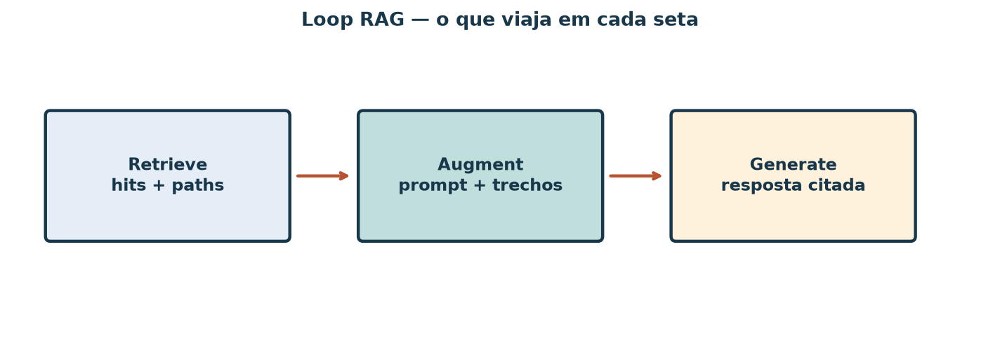
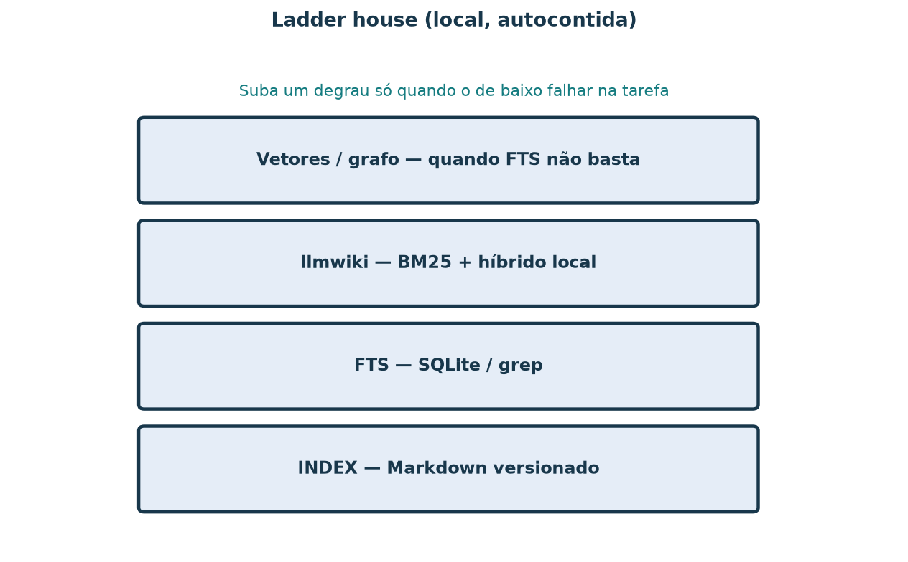

# RAG — recuperar, enriquecer, gerar

Mesma mini-wiki da aula llmwiki. Aqui o foco é o **padrão**: retrieve →
augment → generate, e a ladder local da casa.

## Objetivos

1. Diagrama do loop (o que viaja em cada seta).
2. Uma pergunta, dois retrieves: FTS vs llmwiki.
3. Resposta ancorada só nos trechos (citar paths).
4. Ladder: INDEX → FTS → llmwiki → vetores/grafo.
5. Um modo de falha + um check (com leitura de apoio).

## 1. Loop



*Figura 1 — No demo desta aula, “generate” é um template que cola trechos
(sem LLM). Em produção o gerador seria o modelo; a disciplina de citação
continua.*

## 2. Dois retrieves

Pergunta sugerida: *prazo de devolução e frete para Tracunhaém*.

**FTS (SQLite):**

```bash
uv run python scripts/demo_rag_fts.py --indexar
uv run python scripts/demo_rag_fts.py "devolução frete Tracunhaém"
```

**llmwiki:**

```bash
llmwiki search --wiki-root material/mini-wiki-rag --keyword "devolução frete Tracunhaém"
```

Liste os top hits lado a lado (path + score/trecho).

## 3. Resposta ancorada

```bash
uv run python scripts/demo_rag_ancorar.py
```

Ou escreva à mão ≤15 linhas citando só paths que apareceram nos hits. Se o
fato não estiver no corpus, diga isso.

## 4. Ladder



*Figura 2 — Viés local e autocontido: suba só quando o degrau de baixo não
resolver a tarefa.*

## 5. Falha + check (andaime)

| Modo de falha | O que parece | Check antes de confiar |
| --- | --- | --- |
| Chunk / página errada | Resposta fluida, fato de outro doc | Conferir se o path citado fala do mesmo tema |
| Doc ausente | Modelo “completa” de cabeça | Exigir path; se não houver hit, recusar |
| Citação inventada | Path bonito que não existe na wiki | `test -f` / abrir o arquivo |

Leitura curta (propositiva): trabalhos sobre *grounding* / *attribution* em
RAG e checklists de citação — use um artigo ou post técnico e cite o link na
entrega da tarefa 5.

## Exercício

1–5 conforme objetivos. JSON de apoio: `material/rag/resultado_rag_ancorado.json`.

## Referência

- Mini-wiki: `material/mini-wiki-rag/`
- Scripts: `demo_rag_fts.py`, `demo_rag_ancorar.py`, `gerar_figuras_rag.py`
