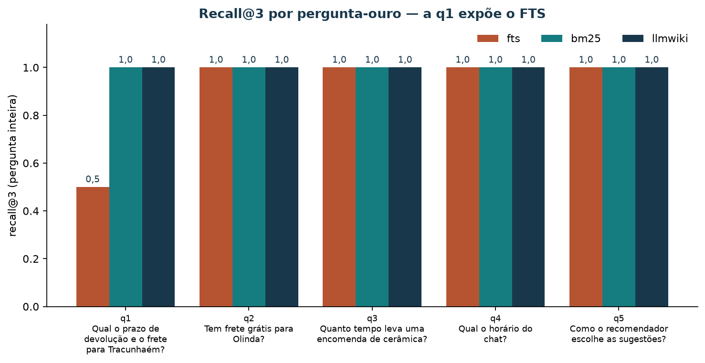

# Respostas ancoradas em documentos: recuperar, enriquecer, gerar (RAG)

[Leia a versão web com o explorador interativo incorporado](https://lgallindo.github.io/recomendador-bentoml/rag/).

Um cliente escreve no chat da loja: *“Qual o prazo de devolução e o frete para
Tracunhaém?”*. Um modelo de linguagem responderia com fluência, e talvez
inventasse “30 dias” porque é um prazo comum no comércio. A loja quer outra
coisa: uma resposta que use **apenas** o que está escrito nas suas políticas e
que diga de qual página veio cada fato. Esse arranjo tem nome: **geração
aumentada por recuperação**, ou RAG (*retrieval-augmented generation*).
Primeiro o sistema busca trechos nos documentos; depois monta um prompt com
esses trechos; por fim gera a resposta citando a origem.

Ao concluir este tutorial, você deverá conseguir descrever o que viaja em cada
etapa do RAG, montar um prompt aumentado, medir com **recall@k** se a busca
trouxe as páginas certas e diagnosticar uma falha real: na pergunta acima, a
busca padrão deste repositório deixa a política de devolução fora do prompt,
e o prazo de 7 dias desaparece da resposta. Você vai corrigir essa falha de
duas maneiras e medir o efeito.

Os documentos são uma mini-wiki sintética de oito páginas. A etapa de geração
é um **template** que cola os trechos recuperados; nenhum modelo de linguagem
roda nesta aula. A disciplina de recuperar, citar e se abster é a mesma
quando o template for trocado por um modelo.

### Roteiro de estudo

| Tempo sugerido | Atividade de estudo |
| --- | --- |
| 8 min | Situar RAG entre recuperação de informação e modelos de linguagem |
| 7 min | Ler o corpus e a pergunta do cliente |
| 10 min | Definir trecho, top-k, prompt aumentado, ancoragem e abstenção |
| 10 min | Rodar o loop com FTS5 e encontrar a falha |
| 10 min | Explicar a falha e corrigi-la de duas maneiras |
| 12 min | Avaliar com um conjunto-ouro: recall@k, precisão@k e abstenção |
| 8 min | Escolher o degrau da escada de recuperação |
| 10 min | Explorar no painel e exportar uma evidência |
| 10 min | Resolver o exercício |

## 1. Onde o RAG se situa

**Inteligência artificial (IA)** é o campo que estuda sistemas capazes de
perceber, raciocinar, aprender e apoiar decisões. Dentro dela, duas tradições
se encontram no RAG. A **recuperação de informação** encontra, numa coleção de
documentos, os que atendem a uma consulta: índices invertidos, BM25, busca
por vetores. O **aprendizado de máquina** produz os **modelos de linguagem**,
que geram texto plausível a partir de padrões aprendidos em grandes volumes de
dados. Plausível não quer dizer verdadeiro para a sua loja: o modelo não
conhece a política de devolução que só existe no seu Markdown.


*Figura 1 — Mapa conceitual, não proporcional. O RAG usa a recuperação para
decidir **o que** o gerador pode afirmar, e usa o gerador para redigir a
resposta. Neste tutorial a caixa da direita é substituída por um template.*

O artigo que deu nome à técnica (Lewis et al., 2020) combinava um recuperador
treinado com um gerador. Hoje o termo cobre qualquer arranjo em que a resposta
é condicionada a trechos recuperados no momento da pergunta, inclusive com
recuperadores clássicos como o deste tutorial.

## 2. O corpus e a pergunta

Os documentos ficam em [`mini-wiki-rag/`](mini-wiki-rag/). Cada página tem um
frontmatter com `title`, `description` e `tags`, seguido do texto.

| Página | Fato que contém |
| --- | --- |
| `devolucao.md` | **7 dias corridos** após o recebimento, peça sem uso e com embalagem original |
| `frete.md` | Tracunhaém e Alto do Moura: frete calculado por CEP; Pilar: frete grátis acima de R\$ 200 para Recife e Olinda; entrega em 3–5 dias úteis no Grande Recife |
| `prazos.md` | Peças de prateleira em 1–2 dias úteis; encomendas de cerâmica em até 15 dias úteis |
| `atendimento.md` | Chat das 9h às 18h, dias úteis; o bot “responde frete, prazo e devolução” |
| `inicio.md` | Página de entrada; cita frete, devolução e prazos sem dar números |
| `recomendador.md` | A API sugere peças por popularidade e co-ocorrência, com `score` e `reason` |
| `catalogo-p01.md` | Ficha do Jarro de barro de Tracunhaém (cerâmica) |
| `catalogo-p04.md` | Ficha da Rendeira do Alto do Moura (renda) |

A pergunta do cliente tem **duas partes**: o prazo de devolução, que está em
`devolucao.md`, e o frete para Tracunhaém, que está em `frete.md`. Uma
resposta correta precisa das duas páginas. Repare também em `atendimento.md`
e `inicio.md`: mencionam os assuntos, mas não trazem os fatos.

## 3. Vocabulário do loop


*Figura 2 — Os rótulos sobre as setas dizem o que passa de uma etapa à
seguinte. A conferência final faz parte do loop: sem ela, uma citação errada
passa despercebida.*

| Termo | Definição nesta aula | Exemplo |
| --- | --- | --- |
| **Trecho** (*chunk*) | Unidade de texto que a busca devolve e o prompt recebe | Aqui, uma página inteira com uma linha de destaque |
| **Ranking** | Lista de trechos ordenada por relevância estimada | `frete.md`, `catalogo-p01.md`, … |
| **Top-k** | Os $k$ primeiros do ranking; só eles entram no prompt | Com $k = 3$, a quarta página fica de fora |
| **Prompt aumentado** | Instrução + trechos com origem + pergunta | Figura 3 |
| **Ancoragem** (*grounding*) | Cada afirmação da resposta é sustentada por um trecho do prompt | “7 dias (devolucao.md)” |
| **Citação** | O path do trecho que sustenta a afirmação | `(frete.md)` |
| **Abstenção** | Responder que o corpus não contém a informação | Pergunta sobre Pix |

A consequência prática do top-k é dura: **o que não entra no prompt não pode
ser citado**. Se a página certa ficou na posição 5 e $k = 3$, nem o melhor
modelo do mundo encontrará o fato no prompt; ou ele se abstém, ou inventa.

## 4. Rodar o loop e encontrar a falha

Na raiz do repositório, sem instalar nada além do ambiente do projeto:

```bash
uv run python scripts/demo_rag_fts.py --indexar
uv run python scripts/demo_rag_ancorar.py
```

O primeiro comando cria `material/rag/fts.sqlite`, um índice **FTS5** do
SQLite (fora do Git). O segundo recupera os três melhores trechos para a
pergunta do cliente, monta a resposta por template e grava
[`rag/resultado_rag_ancorado.json`](rag/resultado_rag_ancorado.json).

Resultado esperado:

```text
Com base em frete.md, catalogo-p01.md, atendimento.md:
- (frete.md) … Tracunhaém e Alto do Moura: frete calculado por CEP …
- (catalogo-p01.md) … Jarro barro Tracunhaém … Região: Tracunhaém …
- (atendimento.md) … O bot responde frete, prazo e devolução …
```

As três citações existem e estão no corpus. A resposta parece bem ancorada,
mas **não contém o prazo de devolução**. `devolucao.md` ficou fora do top-3.
Com $k = 5$ ela aparece, em quinto:

```bash
uv run python scripts/demo_rag_fts.py "Qual o prazo de devolução e o frete para Tracunhaém?"
```

Ordem: `frete.md`, `catalogo-p01.md`, `atendimento.md`, `inicio.md`,
`devolucao.md`. Duas páginas que só **mencionam** o assunto ocupam vagas que
a página com o fato precisava.

### Por que a busca errou

O FTS5 ordena por uma variante de BM25: soma contribuições dos termos da
consulta presentes em cada documento, ponderadas por raridade e tamanho. O
script de indexação ([`demo_rag_fts.py`](../scripts/demo_rag_fts.py)) grava o
**corpo** de cada página, sem o frontmatter. No corpo de `devolucao.md` a
palavra “prazo” não aparece; ela só existe na `description` (“Prazo, estado
da peça…”). Assim, para essa consulta, `devolucao.md` casa apenas
“devolução”, enquanto `atendimento.md` casa “frete”, “prazo” e “devolução”
numa página curta. O BM25 recompensa cobrir vários termos, e cobrir não é
responder.

## 5. Duas correções, medidas

### Correção 1 — dividir a pergunta

Uma pergunta com duas partes vira duas consultas. Cada subpergunta contribui
com seu melhor trecho novo:

```bash
uv run python scripts/demo_rag_ancorar.py \
  --subpergunta "prazo de devolução" \
  --subpergunta "frete para Tracunhaém" \
  --saida material/rag/resultado_rag_subperguntas.json
```

Resultado esperado: `Com base em devolucao.md, frete.md:` e o trecho
“O cliente tem **7 dias corridos** após o recebimento…”. Mesmo recuperador,
mesmo índice; só a consulta mudou.

### Correção 2 — indexar também o frontmatter

O BM25 da biblioteca padrão em [`scripts/avaliar_rag.py`](../scripts/avaliar_rag.py)
pesquisa `title`, `description` e corpo, com $k_1 = 1{,}2$ e $b = 0{,}75$:

```bash
uv run python scripts/demo_rag_ancorar.py --recuperador bm25 \
  --saida material/rag/resultado_rag_bm25.json
```

Resultado esperado: `Com base em frete.md, atendimento.md, devolucao.md:`.
Os scores são `frete.md` 2,97, `atendimento.md` 2,97 e `devolucao.md` 2,44;
a política entra no prompt porque agora “prazo” casa na `description`.

As duas correções funcionam aqui por motivos diferentes, e a segunda é mais
frágil: na consulta curta `devolução frete Tracunhaém`, sem “prazo”, o mesmo
BM25 deixa `devolucao.md` em quinto. Dividir a pergunta ataca a causa
(duas necessidades numa consulta); indexar o frontmatter ataca um sintoma
(uma palavra que faltava no corpo).

![Anatomia do prompt aumentado: à esquerda, os blocos Instrução (só os trechos, citar, abster-se), Trechos recuperados (um bloco por hit, com path) e Pergunta. À direita, o texto real gerado com subperguntas: instrução, trecho [1] de devolucao.md com 7 dias corridos, trecho [2] de frete.md com frete calculado por CEP, e a pergunta do cliente.](imagens/rag-prompt-aumentado.png)

*Figura 3 — O prompt aumentado da correção 1, tal como o script o grava no
campo `prompt_aumentado` do JSON. A instrução manda usar só os trechos e se
abster quando faltar informação; os números entre colchetes permitem citar.*

## 6. Avaliar a recuperação com um conjunto-ouro

Uma pergunta só não basta para escolher um recuperador. O
[`rag/perguntas-ouro.json`](rag/perguntas-ouro.json) traz seis perguntas com
as páginas que contêm cada resposta. A q6 pergunta algo que o corpus não
responde.

| Id | Pergunta | Páginas relevantes |
| --- | --- | --- |
| q1 | Qual o prazo de devolução e o frete para Tracunhaém? | `devolucao.md`, `frete.md` |
| q2 | Tem frete grátis para Olinda? | `frete.md` |
| q3 | Quanto tempo leva uma encomenda de cerâmica? | `prazos.md` |
| q4 | Qual o horário do chat? | `atendimento.md` |
| q5 | Como o recomendador escolhe as sugestões? | `recomendador.md` |
| q6 | Vocês aceitam pagamento por Pix? | nenhuma: abster-se |

Seja $R$ o conjunto de páginas relevantes de uma pergunta e $T_k$ o top-k
devolvido.

### Recall@k: das páginas necessárias, quantas chegaram?

$$
\mathrm{recall}@k = \frac{\lvert R \cap T_k\rvert}{\lvert R\rvert}
$$

### Precisão@k: das vagas do prompt, quantas foram bem usadas?

$$
\text{precisão}@k = \frac{\lvert R \cap T_k\rvert}{k}
$$

**Minúcia.** Na q1 com FTS5 e $k = 3$: $R = \{\text{devolucao}, \text{frete}\}$,
$T_3 = \{\text{frete}, \text{catalogo-p01}, \text{atendimento}\}$. A
interseção tem uma página: recall $1/2 = 0{,}5$ e precisão $1/3 \approx 0{,}33$.
Numa pergunta com uma só página relevante, a precisão@3 nunca passa de
$1/3$: duas vagas sempre vão para trechos que não ajudam. Por isso o recall
é a métrica principal da recuperação no RAG, e a precisão mede o ruído que
o gerador terá de ignorar.

Rode a avaliação completa:

```bash
uv run python scripts/avaliar_rag.py
```

O script avalia FTS5, BM25 e, se o binário `llmwiki` estiver no PATH, a busca
`--keyword` da llmwiki (conferido com a versão 0.2.1). Grava
[`rag/avaliacao_rag.json`](rag/avaliacao_rag.json). Resultado esperado:

| Recuperador / estratégia | Recall@1 médio | Recall@3 médio | Abstenção na q6 |
| --- | ---: | ---: | --- |
| FTS5, pergunta inteira | 0,90 | **0,90** | sim |
| FTS5, subperguntas | 0,90 | 1,00 | sim |
| BM25, pergunta inteira | 0,90 | 1,00 | sim |
| BM25, subperguntas | 0,90 | 1,00 | sim |
| llmwiki, pergunta inteira | 0,90 | 1,00 | **não** |
| llmwiki, subperguntas | 0,90 | 1,00 | **não** |

O recall@1 médio é 0,90 para todos porque a q1 tem duas páginas relevantes:
uma vaga só comporta metade da resposta, e $(0{,}5 + 4 \times 1)/5 = 0{,}9$.



*Figura 4 — Uma única pergunta separa os recuperadores neste corpus. Em
cinco perguntas, uma diferença assim pode ser acaso; num projeto real, o
conjunto-ouro precisa de dezenas de perguntas escritas antes de comparar
ferramentas.*

### Abstenção: quando a melhor resposta é “não sei”

Para a q6, FTS5 e BM25 não acham nenhum termo da pergunta no corpus e
devolvem lista vazia; o template responde “Não encontrei trechos no corpus…”.
A llmwiki devolve `frete.md` (2,09), `prazos.md` (1,40) e mais duas páginas,
porque também pontua palavras curtas como “por”. Um gerador que recebesse
esses trechos poderia montar uma resposta sobre frete para uma pergunta sobre
Pix. Um recuperador que sempre devolve algo precisa de uma regra explícita
de abstenção: um score mínimo, ou a exigência de que os termos principais
da pergunta apareçam no trecho.

### Modos de falha e a checagem de cada um

| Modo de falha | Como aparece | Checagem antes de confiar |
| --- | --- | --- |
| Página certa fora do top-k | Resposta fluente e incompleta (q1 com FTS5) | Recall@k num conjunto-ouro; dividir perguntas compostas |
| Página que menciona sem responder | `atendimento.md` ocupa a vaga | Precisão@k; ler o trecho, não só o título |
| Pergunta sem resposta no corpus | Trechos irrelevantes viram resposta (q6 com llmwiki) | Pergunta-ouro sem relevantes; limiar de abstenção |
| Citação inexistente | Path plausível que não está na wiki | `test -f material/mini-wiki-rag/<path>`; o JSON traz `citacoes_existem` |
| Citação que não sustenta o fato | Path real, fato de outra página | Conferir se o trecho citado contém o número afirmado |
| Índice desatualizado | Política mudou, resposta antiga | Reindexar depois de cada edição (`--indexar`) |

## 7. A escada de recuperação local


*Figura 5 — Cada degrau resolve um tipo de falha e traz um custo novo. O
critério para subir é a medida no conjunto-ouro, não a novidade da
ferramenta.*

| Degrau | Quando basta | Sinal para subir |
| --- | --- | --- |
| 1 · Markdown e grep | Poucas páginas, perguntas com palavras exatas | Equipe passa a ler arquivos demais por pergunta |
| 2 · FTS5 | Centenas de páginas, termos do cliente iguais aos do texto | Recall@k baixo em perguntas compostas ou com campos fora do índice |
| 3 · BM25 com campos (llmwiki) | Precisa pesar título e descrição; quer híbrido opcional | Falhas por sinônimo: “troca” × “devolução”, “entrega” × “frete” |
| 4 · Vetores ou grafo | Muitas paráfrases; relações entre entidades | Custo de embeddings, reindexação e explicação do ranking passa a valer |

Na mini-wiki, a falha da q1 foi resolvida **sem subir de degrau**: dividir a
pergunta bastou para o FTS5. Esse é o resultado que a escada pede que você
procure primeiro.

## 8. Explorar o loop no painel

O [explorador de busca e RAG](bi-rag/index.html) reúne as etapas numa página:
escolha a pergunta, o recuperador, a estratégia e $k$; veja o ranking com a
contribuição de cada termo, o prompt aumentado verbatim, a resposta por
template com as checagens de citação e o recall@k das seis perguntas-ouro.
Você pode usá-lo incorporado à
[versão web deste tutorial](https://lgallindo.github.io/recomendador-bentoml/rag/#explorador-interativo)
ou abrir o HTML numa cópia local do repositório. Consulte o
[roteiro de exploração](bi-rag/README.md).

O painel recalcula o BM25 no navegador; FTS5 e llmwiki aparecem como
rankings já calculados pelos scripts, e por isso só existem para as perguntas
prontas. Nenhum modelo de linguagem é chamado.

### Atividade no painel

1. Clique em **Restaurar** (q1, FTS5, $k = 3$). Copie a checagem que acusa a
   página ausente.
2. Mude $k$ para 5. O recall sobe? Quantas vagas do prompt agora vão para
   páginas que não respondem?
3. Volte a $k = 3$ e escolha **Subperguntas intercaladas**. Compare o prompt
   do painel 03 com a Figura 3.
4. Escolha **q6** e alterne entre os três recuperadores. Registre qual se
   abstém.
5. Exporte o CSV do painel 05 e o PNG do ranking; escreva uma recomendação de
   até cinco frases: recuperador, estratégia, $k$, uma limitação e uma
   checagem obrigatória.

## 9. Limitações

- Oito páginas e seis perguntas mostram o procedimento; não sustentam a
  escolha de um recuperador para um acervo real.
- O “gerador” é um template. Com um modelo de linguagem surgem falhas novas:
  ignorar a instrução, misturar conhecimento prévio com o trecho, citar o
  path certo para o fato errado. A checagem de citações continua necessária.
- Os trechos aqui são páginas inteiras. Em documentos longos, a forma de
  cortar o texto em trechos muda o recall tanto quanto o recuperador.
- O conjunto-ouro foi escrito por quem conhece o corpus; perguntas de
  clientes reais usam outras palavras e testam sinônimos que estas não testam.

## 10. Exercício

Use a pergunta **“Tem frete grátis para Olinda e qual o prazo de entrega no
Grande Recife?”**.

1. Liste as páginas que contêm cada parte da resposta.
2. Rode `demo_rag_ancorar.py` com FTS5 e $k = 3$ (use `--pergunta` e uma
   `--saida` sua). Registre as citações e diga se a resposta está completa.
3. Calcule recall@3 e precisão@3 da sua execução.
4. Rode de novo com duas `--subpergunta` e compare.
5. Escreva o prompt aumentado que um modelo receberia na melhor das duas
   execuções.
6. Proponha uma sétima pergunta-ouro para o arquivo, com sua lista de
   relevantes, que teste abstenção ou sinônimo.

### Resolução comentada

**Páginas:** as duas partes estão em `frete.md` (“pedidos acima de R\$ 200
têm frete grátis para Recife e Olinda” e “Grande Recife 3–5” dias úteis).
Aqui $R = \{\text{frete.md}\}$; a pergunta é composta, mas uma página
responde às duas partes.

**FTS5, pergunta inteira:**

```bash
uv run python scripts/demo_rag_ancorar.py \
  --pergunta "Tem frete grátis para Olinda e qual o prazo de entrega no Grande Recife?" \
  --saida material/rag/exercicio-inteira.json
```

`frete.md` aparece entre os três primeiros, então recall@3 $= 1/1 = 1$ e
precisão@3 $= 1/3$. As outras duas vagas ficam com `devolucao.md` e
`atendimento.md`, que casam palavras da pergunta sem conter o que foi
perguntado.

**Subperguntas:** com `--subpergunta "frete grátis Olinda"` e
`--subpergunta "prazo de entrega Grande Recife"`, o script toma o melhor
trecho **novo** de cada subpergunta. Se as duas apontam para `frete.md`, a
segunda subpergunta traz a próxima página do seu ranking, que não ajuda.
Dividir a pergunta resolve necessidades em páginas diferentes; quando uma
página responde a tudo, dividir só acrescenta ruído.

**Prompt:** a instrução do script, um bloco `[1] (frete.md) …` com o trecho
e a pergunta original. Uma resposta ancorada diria: “Pedidos da Comunidade
do Pilar acima de R\$ 200 têm frete grátis para Olinda; a entrega no Grande
Recife leva de 3 a 5 dias úteis (frete.md).” Repare que a condição “acima de
R\$ 200, Comunidade do Pilar” precisa ir junto: cortar o trecho no meio
produziria uma resposta citada e enganosa.

**Sétima pergunta:** por exemplo, “Posso trocar uma peça que chegou
quebrada?”, com relevantes `devolucao.md` e `atendimento.md`. Ela testa
sinônimo (“trocar” e “quebrada” versus “devolução” e “avaria”) e mostra o
limite da busca por palavra-chave.

## Referências bibliográficas e roteiro de leitura

Consulta dos materiais on-line: 7 nov. 2026.

1. LEWIS, Patrick et al. **Retrieval-augmented generation for
   knowledge-intensive NLP tasks**. In: *Advances in Neural Information
   Processing Systems 33 (NeurIPS 2020)*, 2020.
   [arXiv:2005.11401](https://arxiv.org/abs/2005.11401).
   **Para aprofundar:** a proposta original de condicionar a geração a
   trechos recuperados no momento da pergunta.
2. MANNING, Christopher D.; RAGHAVAN, Prabhakar; SCHÜTZE, Hinrich.
   **Introduction to Information Retrieval**. Cambridge: Cambridge University
   Press, 2008. [Texto integral on-line](https://nlp.stanford.edu/IR-book/).
   **Para aprofundar:** o capítulo 8 trata de avaliação, conjuntos de
   relevância, precisão e recall.
3. ROBERTSON, Stephen; ZARAGOZA, Hugo. **The probabilistic relevance
   framework: BM25 and beyond**. *Foundations and Trends in Information
   Retrieval*, v. 3, n. 4, p. 333–389, 2009. DOI: 10.1561/1500000019.
   **Para aprofundar:** por que o BM25 recompensa cobrir termos e como pesos
   por campo mudam o ranking.
4. GAO, Yunfan et al. **Retrieval-augmented generation for large language
   models: a survey**. 2023. [arXiv:2312.10997](https://arxiv.org/abs/2312.10997).
   **Para aprofundar:** variações do loop, divisão de consultas e avaliação
   de ancoragem.
5. SQLITE. **SQLite FTS5 Extension**.
   [Documentação em inglês](https://www.sqlite.org/fts5.html).
   **Para consultar:** colunas indexadas, tokenizadores e a ordenação por
   `rank`.

| Artefato | Papel |
| --- | --- |
| `material/mini-wiki-rag/` | Corpus de oito páginas |
| `scripts/demo_rag_fts.py` | Índice e busca FTS5 |
| `scripts/demo_rag_ancorar.py` | Loop com template; `--recuperador`, `--k`, `--subpergunta`, `--saida` |
| `scripts/avaliar_rag.py` | BM25 da biblioteca padrão e avaliação no conjunto-ouro |
| `material/rag/perguntas-ouro.json` | Seis perguntas com páginas relevantes |
| `material/rag/avaliacao_rag.json` | Rankings e recall@k dos recuperadores |
| `material/rag/resultado_rag_*.json` | Respostas ancoradas das seções 4 e 5 |
| `material/bi-rag/` | Explorador de busca e RAG |
| `scripts/gerar_figuras_rag.py` | Figuras deste tutorial |
