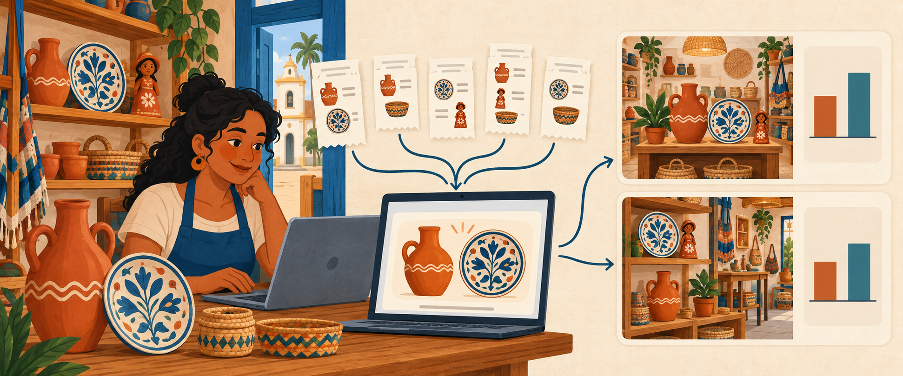
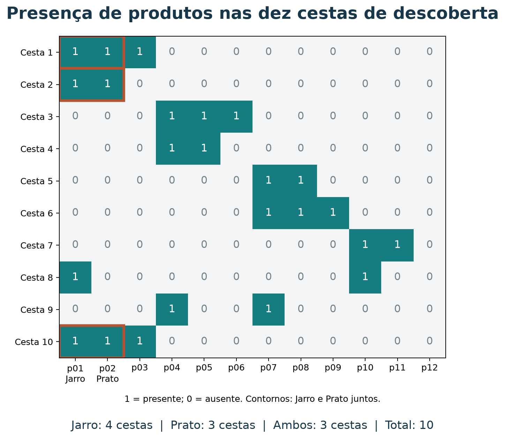
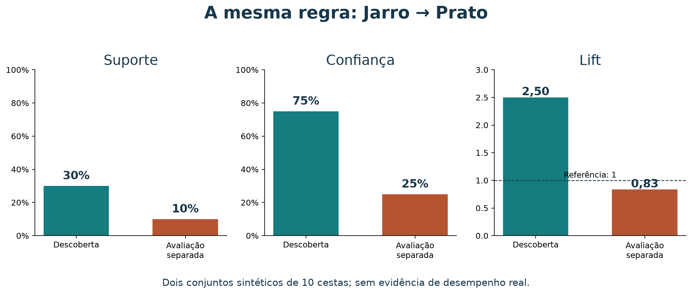

# Marketing orientado por dados: como minerar e relatar regras de associação

Ao concluir este tutorial, você deverá conseguir calcular suporte, confiança e
lift, ler um relatório de regras, justificar quais padrões merecem investigação
e transformar esses padrões em hipóteses de marketing. Você também produzirá
um breve relatório com contagens, métricas, interpretação e uma ação a testar.
Além disso, você situará a indução de regras dentro da inteligência artificial,
explicará sua relação com sistemas especialistas e distinguirá descoberta,
validação em novos dados e teste de uma ação de marketing.
As bases são sintéticas: a descoberta usa dez cestas e a comparação de validação
usa dez cestas adicionais. Os resultados não constituem evidência sobre
consumidores reais.

### Roteiro de estudo

Você pode seguir o roteiro abaixo em aproximadamente 60 minutos ou consultar
cada seção separadamente para revisar os conceitos e reproduzir os resultados.

| Tempo sugerido | Atividade de estudo |
| --- | --- |
| 10 min | Situar regras, aprendizado de máquina, IA e sistemas especialistas |
| 5 min | Ler as transações e formular a pergunta |
| 8 min | Construir as três métricas a partir de contagens |
| 7 min | Calcular uma regra e sua inversa |
| 7 min | Minerar itemsets e gerar regras |
| 8 min | Comparar resultados e escrever um relato |
| 10 min | Avaliar uma regra em transações separadas |
| 5 min | Resolver o exercício e discutir a interpretação |

## 1. Da inteligência artificial à indução de regras

**Inteligência artificial (IA)** é o campo que estuda e desenvolve sistemas
capazes de realizar tarefas como raciocinar, aprender, perceber e tomar decisões.
**Aprendizado de máquina**, ou *machine learning* (ML), é uma área da IA em que
algoritmos extraem padrões dos dados para construir modelos ou regras.
Você não precisa usar uma rede neural para trabalhar com aprendizado de máquina.
Veja a [introdução ao aprendizado de máquina da IBM](https://www.ibm.com/br-pt/think/topics/machine-learning).


*Figura 1 — Diagrama de Venn com conjuntos encaixados, também chamado diagrama
de inclusão ou de Euler. As áreas indicam pertencimento, não o tamanho relativo
dos campos. O mapa destaca o caminho deste tutorial, sem enumerar toda a IA.*

Leia a figura de fora para dentro:

1. **Inteligência artificial:** inclui abordagens que aprendem com dados e
   abordagens que representam conhecimento por símbolos e regras explícitas.
2. **Aprendizado de máquina:** aprende padrões a partir de exemplos. As pessoas
   ainda definem objetivos, dados, algoritmos e critérios de avaliação.
3. **Aprendizado não supervisionado:** procura estruturas nos dados sem uma
   resposta-alvo previamente rotulada para cada exemplo.
4. **Mineração de regras de associação:** encontra conjuntos frequentes e
   relações como `{Jarro} → {Prato}` nas transações. Você não fornece previamente
   uma lista de regras corretas para o algoritmo reproduzir.

Essa classificação acompanha a
[apresentação de aprendizado não supervisionado da IBM](https://www.ibm.com/br-pt/think/topics/unsupervised-learning),
que inclui associação entre suas tarefas. A mineração também é estudada em
mineração de dados e descoberta de conhecimento em bases de dados.

**Induzir uma regra** é partir de exemplos particulares para formular um padrão
mais geral. Neste exercício, o algoritmo identifica quais conjuntos e relações
aparecem nas cestas; as pessoas escolhem os limites de seleção. A existência da
regra não garante que ela se mantenha em outras compras: essa é uma questão de
validação.

Indução de regras é mais ampla que associação: métodos supervisionados também
podem aprender regras para prever uma classe conhecida, como “comprará” ou
“não comprará”. O círculo menor localiza **estas regras de associação**, não
todas as formas de aprendizado de regras. **Validação é uma prática transversal
do aprendizado de máquina**, e não um nível adicional da hierarquia: ela avalia
se regras e modelos funcionam além dos exemplos usados para construí-los.

### Regras e sistemas especialistas

Um **sistema especialista** é um sistema de IA que representa conhecimento de
um domínio delimitado e usa mecanismos de inferência para apoiar conclusões
ou recomendações que exigem conhecimento especializado. Na abordagem clássica
baseada em regras, você encontra:

- **Base de conhecimento:** fatos gerais e regras do domínio, muitas vezes
  escritas no formato **SE condição ENTÃO conclusão ou ação**.
- **Fatos do caso atual:** informações disponíveis sobre a situação analisada.
- **Motor de inferência:** mecanismo que verifica condições e aplica ou encadeia
  regras para chegar a conclusões, podendo registrar como elas foram obtidas.

Sistemas especialistas pertencem à **IA simbólica** e podem funcionar com
conhecimento fornecido por pessoas, sem aprender suas regras automaticamente.
O artigo de [Mendes (1997)](https://www.scielo.br/j/ci/a/MqGHKkTLcPxhhjgpDz9ZNNd/?lang=pt)
apresenta essa tradição na gestão da informação.

Você pode usar regras para definir o comportamento de um sistema especialista.
Um exemplo simplificado para apoio à loja seria:

```text
Fatos: o cliente consulta Jarro; Prato está em estoque;
       a relação Jarro → Prato foi aprovada para uso.

Regra: SE o cliente consulta Jarro
       E Prato está em estoque
       E a relação foi aprovada
       ENTÃO incluir Prato entre as sugestões e registrar a justificativa.
```

Aqui, a condição sobre estoque e a decisão de sugerir são políticas definidas
para a operação; a relação entre produtos pode ter origem em mineração e depois
ser validada e revisada. Você combina aprendizado de máquina com conhecimento
explícito em um **sistema híbrido**. Sistemas especialistas baseados em regras
e sistemas que aprendem com dados são abordagens da IA que podem cooperar.

Uma regra estatística `{Jarro} → {Prato}` descreve frequências; ela não prova
a implicação lógica “todo comprador de Jarro compra Prato”. Antes de transformá-la
em regra de ação, você precisa avaliar evidência, utilidade e condições de uso.
Um CSV de associações ou um único filtro `if` também não constitui, por si só,
um sistema especialista completo.

## 2. A pergunta e as transações

Uma loja de artesanato quer investigar: **quais produtos tendem a aparecer
juntos nas compras?** Uma regra como `{Jarro} → {Prato}` resume uma associação
entre presenças na mesma transação. A seta indica qual conjunto condiciona a
análise; não indica ordem de compra nem causa.

### Como os dados orientam uma decisão de marketing

A loja precisa decidir o que expor junto, que oferta combinada experimentar e
qual sugestão apresentar no carrinho. Aqui, **marketing centrado em dados**
significa tornar explícita a ligação entre pergunta comercial, registros de
compra, critérios de análise, ação proposta e avaliação de resultado. As regras
de associação ajudam a construir essa ligação: tornam um padrão de consumo
mensurável, comunicável e verificável.

Três perspectivas da literatura de marketing ajudam a compreender essa ligação:
a pesquisa começa com um problema de decisão e organiza a coleta e a análise
(Malhotra, 2019); as métricas relacionam decisões a desempenho
(Farris et al., 2012); a tecnologia deve contribuir para o valor entregue na
jornada do cliente (Kotler, Kartajaya e Setiawan, 2021). As referências
bibliográficas e os links de consulta estão ao final.



*Figura 2 — Dos registros de compra a uma hipótese de exposição de produtos.
Ilustração gerada por IA; as barras são ilustrativas e não representam resultados
medidos. Uma sugestão precisa ser avaliada antes de você atribuir a ela ganhos
comerciais.*

| Passo | Pergunta da equipe de marketing | Entrega da análise |
| --- | --- | --- |
| Decisão | Que combinação de produtos vale testar na vitrine? | Objetivo comercial explícito |
| Evidência | Quais itens aparecem juntos nas compras registradas? | Transações e contagens auditáveis |
| Comparação | O padrão é frequente? Supera a frequência habitual do item? | Suporte, confiança e lift |
| Ação | Como transformar esse padrão em uma oferta relevante? | Hipótese de exposição conjunta ou venda complementar |
| Aprendizado | A mudança melhorou o resultado para a loja e o cliente? | Teste da ação com métricas definidas previamente |

O cadastro e o histórico de compras também aparecem no material brasileiro do
[Sebrae sobre cadastro de clientes](https://meuatendimento.sebrae.com.br/sites/PortalSebrae/ufs/ap/artigos/como-elaborar-um-cadastro-de-clientes%2Cd1440d36ecfa1610VgnVCM1000004c00210aRCRD)
como insumos para identificar oportunidades de vendas. Para calcular as regras
deste tutorial basta o conjunto de itens por transação; identificar pessoas é
desnecessário.

Usaremos somente `cestas` de [`dados/catalogo.json`](../dados/catalogo.json).
Cada linha é uma transação. A ordem dos produtos dentro dela não importa;
repetir um produto na mesma cesta não aumenta sua contagem. Duas linhas com os
mesmos itens contam como duas transações, pois representam compras distintas.

| Cesta | Itens |
| --- | --- |
| 1 | p01, p02, p03 |
| 2 | p01, p02 |
| 3 | p04, p05, p06 |
| 4 | p04, p05 |
| 5 | p07, p08 |
| 6 | p07, p08, p09 |
| 7 | p10, p11 |
| 8 | p01, p10 |
| 9 | p04, p07 |
| 10 | p02, p03, p01 |

| ID | Produto | Número de cestas |
| --- | --- | ---: |
| p01 | Jarro barro Tracunhaém | 4 |
| p02 | Prato esmaltado Tracunhaém | 3 |
| p03 | Boneca de barro | 2 |
| p04 | Rendeira Alto do Moura | 3 |
| p05 | Toalha de renda | 2 |
| p06 | Caminho de mesa renda | 1 |
| p07 | Xilogravura Pilar | 3 |
| p08 | Cordel ilustrado | 2 |
| p09 | Quadro xilo colorido | 1 |
| p10 | Cesto de palha | 2 |
| p11 | Bolsa de palha | 1 |
| p12 | Sousplat de palha | 0 |

Há 12 produtos cadastrados, mas apenas 11 observados nas cestas. `p12` tem
suporte zero nesta amostra. Os campos `pedidos` e a série de vendas semanais
não participam das contas: todas as frequências abaixo vêm destas dez transações.



*Figura 3 — Cada linha representa uma transação; cada coluna, um produto.
Conte as presenças nas colunas de Jarro e Prato para reproduzir os denominadores
das métricas. O contorno marca as três ocorrências conjuntas.*

## 3. Três perguntas, três denominadores

Sejam A e B conjuntos de itens não vazios e sem itens em comum.
`n(A)` é o número de cestas contendo **todos** os itens de A; `N` é o total
de cestas. `A ∪ B` reúne os itens dos dois lados.

### Suporte: com que frequência os dois lados aparecem juntos?

$$
\operatorname{suporte}(A\rightarrow B)=\frac{n(A\cup B)}{N}
$$

O suporte da regra é o suporte do conjunto completo. Não confundir com
suporte do antecedente `n(A)/N` ou do consequente `n(B)/N`.

### Confiança: entre as cestas com A, quantas também contêm B?

$$
\operatorname{confianca}(A\rightarrow B)=\frac{n(A\cup B)}{n(A)}
$$

É a frequência condicional observada de B dado A. O denominador muda ao
inverter a regra, portanto a confiança pode mudar. Só calculamos quando `n(A)>0`.

### Lift: quanto a confiança supera a frequência habitual de B?

$$
\operatorname{lift}(A\rightarrow B)
=\frac{\operatorname{confianca}(A\rightarrow B)}{n(B)/N}
=\frac{N\,n(A\cup B)}{n(A)n(B)}
$$

| Valor | Leitura na amostra |
| --- | --- |
| Lift > 1 | Os conjuntos ocorrem juntos mais que o esperado sob independência |
| Lift = 1 | A co-presença coincide com a frequência esperada sob independência |
| Lift < 1 | Os conjuntos ocorrem juntos menos que o esperado sob independência |

Na discussão de marketing, suporte informa o alcance observado do padrão;
confiança informa a frequência de B entre as compras com A; lift compara essa
frequência com uma referência. Nenhuma das três mede, por si, lucro ou retorno
de campanha. Em especial, o **lift da regra não é o aumento de vendas causado
por uma campanha**: ele descreve uma associação nas transações analisadas.

Lift 2,5 significa **2,5 vezes a frequência de referência**, não 2,5% nem
aumento de 250%. Suporte e confiança ficam entre 0 e 1; lift pode ultrapassar 1.
Essas interpretações seguem as definições da
[documentação de regras de associação do mlxtend](https://rasbt.github.io/mlxtend/user_guide/frequent_patterns/association_rules/).

## 4. Conta completa: Jarro → Prato

Jarro (`p01`) aparece nas cestas 1, 2, 8 e 10: `n(A)=4`.
Prato (`p02`) aparece nas cestas 1, 2 e 10: `n(B)=3`.
Ambos aparecem nas cestas 1, 2 e 10: `n(A ∪ B)=3`. Temos `N=10`.

| Métrica | Cálculo | Resultado |
| --- | --- | --- |
| Suporte do antecedente | 4/10 | 40% |
| Suporte do consequente | 3/10 | 30% |
| Suporte da regra | 3/10 | 30% |
| Confiança | 3/4 | 75% |
| Lift | 0,75/0,30 | 2,50 |

**Relato:** “Jarro e Prato aparecem juntos em 3 das 10 cestas (suporte 30%).
Das 4 cestas com Jarro, 3 também contêm Prato (confiança 75%). A frequência
de Prato nesse grupo é 2,5 vezes sua frequência geral de 30% (lift 2,50).”

Agora inverta: **Prato → Jarro**. O suporte permanece 30%, a confiança passa
a `3/3=100%` e o lift é `1/0,40=2,50`. Para a regra inversa, suporte e lift
são iguais, mas a confiança pode diferir. Os 100% descrevem apenas três casos;
não garantem o comportamento da próxima compra.

## 5. Como as regras são mineradas

Neste conjunto de dados, aplique os seguintes critérios de seleção:

- Suporte mínimo **20%**, inclusive: pelo menos 2 das 10 cestas.
- Confiança mínima **60%**, inclusive.
- Lift **estritamente maior que 1**, para relatar associações positivas.

Esses limites permitem explorar padrões presentes em pelo menos duas cestas.
Eles não são universais. Defina os critérios e o escopo
antes de selecionar exemplos. Reduzir o suporte pode revelar padrões raros,
mas também produz regras sustentadas por poucas observações.

O processo tem duas etapas:

1. **Encontrar conjuntos frequentes.** Contar itemsets e reter os que atendem
   ao suporte. `{p01,p02}` tem suporte 30%; `{p01,p02,p03}` tem suporte 20%.
2. **Gerar e filtrar regras.** Para cada conjunto frequente S com pelo menos
   dois itens, escolher cada subconjunto próprio não vazio A como antecedente
   e usar `B = S − A`. Calcular confiança e lift; aplicar os filtros.

O trio `{p01,p02,p03}` gera seis candidatas, incluindo
`{p01,p02} → {p03}` e `{p01} → {p02,p03}`. Um lado com vários itens exige
que **todos** estejam presentes. A segunda candidata tem confiança `2/4=50%`
e é descartada pelo limite de 60%.

Apriori economiza trabalho usando a propriedade: **todo subconjunto de um
itemset frequente também é frequente**. Assim, se um conjunto não alcança o
suporte mínimo, seus superconjuntos podem ser podados. Veja a
[documentação do Apriori](https://rasbt.github.io/mlxtend/user_guide/frequent_patterns/apriori/).
O script deste tutorial enumera os subconjuntos observados diretamente; você
pode acompanhar as contagens no código. Ele não implementa Apriori. O custo
cresce exponencialmente com o tamanho da cesta, portanto use esta implementação
apenas com bases de cestas pequenas como a deste exercício.

### Executar e abrir o relatório

Na raiz do repositório, com Python 3, sem instalar pacotes:

```bash
python3 scripts/minerar_regras_associacao.py
```

Resultado esperado: **10 cestas; 14 regras**. O arquivo
[`regras-associacao-20261017.csv`](regras-associacao-20261017.csv) inclui nomes,
IDs, contagens, métricas e os três limites usados. Suporte e confiança estão
em proporções: `0.300000` significa 30%. Decimais usam ponto. Os filtros usam
frações exatas; o CSV arredonda para seis casas somente na exportação.

Para experimentar outro filtro e preservar o relatório original:

```bash
python3 scripts/minerar_regras_associacao.py --suporte-minimo 0.3 --confianca-minima 0.75 --saida material/regras-experimento.csv
```

A ordenação do relatório é lift decrescente, depois confiança e suporte
decrescentes, com desempate pelos IDs. Essa ordem facilita a inspeção e não
define automaticamente a melhor ação comercial.

## 6. Resultados completos e comparação

Abreviações: J = Jarro (`p01`), P = Prato (`p02`), B = Boneca (`p03`),
R = Rendeira (`p04`), T = Toalha (`p05`), X = Xilogravura (`p07`),
C = Cordel (`p08`). Chaves denotam conjuntos.

| Regra | n(A) | n(B) | Juntos | Suporte | Confiança | Lift |
| --- | ---: | ---: | ---: | ---: | ---: | ---: |
| {J,B} → P | 2 | 3 | 2 | 20% | 100% | 3,33 |
| B → P | 2 | 3 | 2 | 20% | 100% | 3,33 |
| B → {J,P} | 2 | 3 | 2 | 20% | 100% | 3,33 |
| T → R | 2 | 3 | 2 | 20% | 100% | 3,33 |
| C → X | 2 | 3 | 2 | 20% | 100% | 3,33 |
| {J,P} → B | 3 | 2 | 2 | 20% | 66,7% | 3,33 |
| P → B | 3 | 2 | 2 | 20% | 66,7% | 3,33 |
| P → {J,B} | 3 | 2 | 2 | 20% | 66,7% | 3,33 |
| R → T | 3 | 2 | 2 | 20% | 66,7% | 3,33 |
| X → C | 3 | 2 | 2 | 20% | 66,7% | 3,33 |
| P → J | 3 | 4 | 3 | 30% | 100% | 2,50 |
| {P,B} → J | 2 | 4 | 2 | 20% | 100% | 2,50 |
| B → J | 2 | 4 | 2 | 20% | 100% | 2,50 |
| J → P | 4 | 3 | 3 | 30% | 75% | 2,50 |

Prato → Boneca tem lift maior que Jarro → Prato, mas ocorre em menos cestas.
O primeiro destaca uma associação proporcionalmente mais forte; o segundo
abrange mais transações. Relate ambos os aspectos antes de sugerir uma ação.

Algumas regras são redundantes: nesta amostra, adicionar Jarro ao antecedente
de Boneca → Prato não altera os casos cobertos nem as métricas. Um relatório
curto pode priorizar a regra mais simples e declarar como removeu redundâncias.
O CSV preserva todas as 14 para permitir auditoria.

### Por que confiança alta não basta?

**Exemplo hipotético separado, fora do JSON:** em 100 cestas, B está em 90;
A está em 10; ambos estão em 8. A regra A → B tem suporte 8%, confiança 80%
e lift `0,80/0,90 ≈ 0,89`. Apesar dos 80%, B é menos frequente entre cestas
com A que na amostra inteira. O lift revela essa diferença de referência.

## 7. Como validar uma regra em dados separados

Calcular métricas nas mesmas cestas usadas para selecionar regras descreve a
**descoberta**. Para investigar se o padrão se mantém, fixe a regra escolhida
e recalcule suas métricas em transações que não participaram da seleção.

| Etapa | Pergunta | Evidência |
| --- | --- | --- |
| Descoberta | Que regras emergem das compras analisadas? | Itemsets, contagens e métricas na base de descoberta |
| Validação | A regra selecionada mantém o padrão em dados separados? | Métricas recalculadas para a mesma regra |
| Experimento de marketing | Agir com base na regra melhora o resultado? | Comparação entre grupos com e sem a intervenção |

### Um padrão pode enfraquecer

Mantenha **Jarro → Prato** como regra fixa. Além das dez cestas originais,
considere as dez transações sintéticas adicionais de
[`cestas-validacao-20261017.json`](cestas-validacao-20261017.json):

| Nova cesta | Itens |
| --- | --- |
| V1 | p01, p02 |
| V2 | p01, p03 |
| V3 | p01, p10 |
| V4 | p01, p04 |
| V5 | p02, p05 |
| V6 | p02, p07 |
| V7 | p04, p05 |
| V8 | p07, p08 |
| V9 | p10, p11 |
| V10 | p04, p06 |

Estas cestas adicionais são um **cenário hipotético construído para comparação**,
não um período observado nem evidência empírica independente. Elas não alteram
o relatório original de 14 regras. Recalcular a regra fixa não exige minerar
novamente nem misturar as duas bases.

| Contagem ou métrica | Descoberta: base original | Avaliação: cenário adicional |
| --- | ---: | ---: |
| Total de cestas | 10 | 10 |
| Cestas com Jarro | 4 | 4 |
| Cestas com Prato | 3 | 3 |
| Cestas com ambos | 3 | 1 |
| Suporte | 3/10 = 30% | 1/10 = 10% |
| Confiança | 3/4 = 75% | 1/4 = 25% |
| Lift | 0,75/0,30 = 2,50 | 0,25/0,30 ≈ 0,83 |



*Figura 4 — Avaliar a mesma regra em outra base pode mudar sua interpretação.
O lift passa para abaixo da referência 1; as frequências individuais de Jarro
e Prato continuam iguais. Os números são calculados a partir dos dois arquivos.*

Nesse cenário, a regra não atende mais aos critérios originais: suporte ≥ 20%,
confiança ≥ 60% e lift > 1. Isso ilustra por que você não deve confundir seleção
na base de descoberta com evidência de generalização. Dez transações por base
ainda são insuficientes para sustentar uma conclusão confiável sobre desempenho
real; a diferença não demonstra, por si só, uma mudança de mercado.

### Como preservar uma avaliação independente

Em um projeto real, separe dados de descoberta, dados para ajustar critérios
quando necessário e um conjunto reservado à avaliação final. Para uma aplicação
futura, uma separação temporal pode aproximar melhor o uso pretendido: aprender
com compras anteriores e avaliar em compras posteriores. Evite compartilhar
registros duplicados ou informações indevidas entre as etapas.

Defina as regras e os critérios antes de consultar a avaliação final. Se você
altera os filtros ou troca as regras repetidamente para melhorar o resultado
nesse conjunto, ele passa a participar da seleção; uma avaliação final exige
outros dados ainda não utilizados. Esse cuidado segue o princípio de prevenção
de [vazamento de dados explicado pelo scikit-learn](https://scikit-learn.org/stable/common_pitfalls.html).

Suporte e lift também não substituem uma análise de incerteza. **Confiança não
é certeza estatística nem nível de confiança de um intervalo.** Lift > 1 não
é, sozinho, teste de significância. Ao examinar muitas regras, você pode
encontrar padrões ocasionais; em aplicações reais, considere o volume de
observações, a incerteza das estimativas e a multiplicidade das comparações.

Mesmo uma regra estável em dados separados não mostra que exibir um produto
causa mais vendas. Para avaliar esse efeito, você precisa testar a ação de
marketing, como no exemplo da próxima seção.

## 8. Como escrever o relatório

Comece pela origem e pelo tamanho da amostra, unidade de transação, período
(aqui: exemplos sintéticos sem período real), critérios de seleção e método.
Apresente a regra por nome, suas contagens e as três métricas. Finalize com
uma interpretação e uma decisão proporcional à evidência.

Modelo reutilizável:

> Na base [origem/período], com N transações, usamos suporte ≥ […], confiança
> ≥ […] e lift > […]. A regra A → B aparece em […] transações (suporte […]).
> Entre […] transações com A, […] incluem B (confiança […]), enquanto B ocorre
> em […] da base inteira. O lift […] indica […]. Propomos investigar […],
> considerando o número de observações e validando em novos dados.

Se você também avaliou a regra em uma base separada, identifique essa base e
relate suas métricas em outro trecho. Por exemplo:

> No cenário adicional de dez cestas sintéticas, a regra fixa Jarro → Prato
> apresenta suporte 10%, confiança 25% e lift aproximadamente 0,83. Ela não
> atende aos critérios originais nesse cenário. A comparação exemplifica a
> avaliação em dados separados; como os dados foram construídos, não demonstra
> desempenho em compras reais nem efeito de uma ação comercial.

Para a loja, uma hipótese seria testar exposição conjunta de Jarro e Prato.
As métricas da amostra não demonstram que essa exposição aumentará vendas.
Em uso real, avalie estabilidade em outro período e faça um teste da intervenção.

### Da regra ao plano de marketing

O quadro abaixo é uma proposta de aplicação à loja, não um experimento realizado
nem uma conclusão dos dados sintéticos.

| Elemento | Exemplo de decisão documentada |
| --- | --- |
| Evidência exploratória | Jarro → Prato: suporte 30%, confiança 75%, lift 2,50 em dez cestas sintéticas |
| Hipótese comercial | Apresentar Prato como complemento ao Jarro pode facilitar a descoberta do produto |
| Ação a testar com dados reais | Exibir a sugestão de Prato na página do Jarro |
| Comparação | Distribuir aleatoriamente visitantes elegíveis entre a página atual e a página com sugestão; manter o visitante no mesmo grupo |
| Métrica principal | Pedidos contendo Prato por visitante elegível de cada grupo |
| Métricas complementares | Conversão total, receita e margem de contribuição por visitante; devoluções |
| Critério de decisão | Definir antes do teste o efeito mínimo relevante, tamanho da amostra, duração e análise de incerteza |
| Aprendizado | Decidir se adota, ajusta ou abandona a sugestão com base no efeito estimado e no custo da ação |

Cliques na sugestão ajudam a entender o processo, mas o resultado comercial
precisa ser avaliado com compras e custos. Oferecer desconto para montar um
combo é outra intervenção, com impacto próprio sobre margem; deve ter sua
hipótese e sua avaliação. Um teste que gere mais pedidos pode ainda reduzir
o resultado financeiro se o custo da oferta superar o ganho.

Separar a descoberta de uma associação da avaliação de uma ação é coerente com
a discussão de pesquisa experimental em marketing de Hernandez, Basso e
Brandão (2014). Use essa leitura para compreender a lógica experimental e
avaliar como um teste pode distinguir o efeito da sugestão de outros fatores.

**Verifique sua interpretação:** se o lift é 2,50, você pode prometer aumento
de 150% nas vendas ao mudar a vitrine? Não. Esse número compara frequências
observadas; o efeito da mudança precisa ser estimado em um teste apropriado.

Evite relatar apenas as maiores confianças ou lifts. Declare quantas regras
passaram nos filtros, não esconda a contagem absoluta e considere redundância.
Esta base minúscula serve para aprender a conta; associações observadas podem
ser instáveis. Associação não estabelece causalidade nem sequência temporal.

## 9. Exercício: produza seu relatório

Use as dez cestas para analisar a regra **Prato → Boneca**. Seu relatório deve
conter:

1. A origem dos dados, o total de transações e os três critérios de seleção.
2. As contagens de Prato, Boneca e do par, seguidas de suporte, confiança e lift.
3. Uma frase que interprete cada métrica e uma comparação com Boneca → Prato.
4. A decisão de incluir ou excluir a regra pelos filtros e a justificativa
   para a ausência de Jarro → {Prato,Boneca} no relatório completo.
5. Uma hipótese de ação de marketing, a métrica que você usaria para avaliar
   seu efeito e uma limitação da evidência disponível.
6. Um parágrafo explicando por que minerar essas associações é aprendizado
   não supervisionado dentro de ML e IA, e como uma regra aprovada poderia
   integrar a base de conhecimento de um sistema especialista.
7. Uma avaliação de **Jarro → Prato** nas cestas adicionais: recalcule suas
   métricas e explique a diferença entre descoberta, validação e experimento.

Você pode usar o modelo da seção 8 e conferir seus resultados na resolução a
seguir. A resolução permanece disponível para consulta durante o estudo.

### Resolução comentada

**Dados e critérios:** a fonte é o array `cestas` de `dados/catalogo.json`, com
dez transações sintéticas, sem período real. Os filtros são suporte ≥ 20%,
confiança ≥ 60% e lift > 1.

**Cálculos e interpretação:** Prato aparece em 3 cestas; Boneca em 2; ambos nas cestas 1 e 10.
Suporte `2/10=20%`; confiança `2/3≈66,7%`; lift `(2/3)/(2/10)=10/3≈3,33`.
Passa nos três filtros. A inversa tem confiança `2/2=100%`, com o mesmo
suporte e lift. “Em 2 das 10 cestas há Prato e Boneca; dois terços das cestas
com Prato incluem Boneca, cerca de 3,33 vezes a frequência geral de Boneca.”
Jarro → {Prato,Boneca} tem suporte 20% e lift 2,50, mas confiança de 50%:
é excluída pelo filtro de confiança.

**Hipótese e avaliação:** você pode propor uma sugestão de Boneca na página de
Prato. Em um teste com visitantes reais distribuídos aleatoriamente entre a
página atual e a página com sugestão, compare pedidos contendo Boneca por
visitante elegível e acompanhe a margem por visitante. O padrão vem de apenas
duas compras conjuntas em dados sintéticos: ele permite formular a hipótese,
mas não estimar o ganho que a intervenção causará.

**Posição na IA e uso das regras:** a mineração procura relações nas compras
sem uma resposta-alvo rotulada para cada cesta. Ela é uma tarefa de aprendizado
não supervisionado, dentro de aprendizado de máquina e de inteligência
artificial. Uma associação validada pode ajudar a construir uma regra de
sugestão na base de conhecimento de um sistema especialista; condições como
estoque e elegibilidade podem ser definidas por especialistas humanos. Aplicar
a regra com um motor de inferência é diferente de induzi-la a partir dos dados.

**Avaliação separada:** nas cestas adicionais, Jarro está em quatro transações,
Prato em três e ambos em uma. O suporte é 10%, a confiança é 25% e o lift é
aproximadamente 0,83. A regra não passa nos filtros originais nesse cenário.
A descoberta seleciona padrões; a validação investiga sua persistência em
dados separados; o experimento avalia o efeito de uma ação. Como ambas as
bases são pequenas e sintéticas, esse resultado demonstra o procedimento e
não valida ou invalida comercialmente a regra.

## Referências bibliográficas e roteiro de leitura

Você encontrará abaixo edições brasileiras em português, produção brasileira
de marketing e documentação técnica em inglês. Consulte as obras de marketing
para aprofundar a relação entre pesquisa, decisão e desempenho; use a
documentação técnica para revisar as fórmulas e a mineração. Os links dos livros
levam a fichas e apresentações; o texto integral pode exigir acesso por biblioteca
ou compra. Consulta dos materiais on-line: 17 out. 2026.

### Marketing, pesquisa e decisão — português brasileiro

1. KOTLER, Philip; KARTAJAYA, Hermawan; SETIAWAN, Iwan.
   **Marketing 5.0: tecnologia para a humanidade**. Tradução: André Fontenelle.
   Rio de Janeiro: Sextante, 2021. ISBN 9786555642407.
   [Ficha e apresentação da editora](https://sextante.com.br/products/marketing-5-0).
   **Para aprofundar:** estude como a tecnologia pode contribuir para criar
   valor ao longo da jornada do cliente e tornar uma sugestão relevante.

2. MALHOTRA, Naresh K. **Pesquisa de marketing: uma orientação aplicada**.
   7. ed. Porto Alegre: Bookman, 2019. ISBN impresso 9788582605097.
   [Ficha e sumário da editora](https://loja.grupoa.com.br/novo/pesquisa-de-marketing9788582605103-p1005514).
   **Para aprofundar:** relacione o problema de decisão ao desenho da pesquisa,
   à análise de dados e à comunicação das recomendações.

3. FARRIS, Paul W.; BENDLE, Neil T.; PFEIFER, Phillip E.; REIBSTEIN, David J.
   **Métricas de marketing: o guia definitivo de avaliação do desempenho do
   marketing**. 2. ed. Porto Alegre: Bookman, 2012.
   [Apresentação e sumário da edição brasileira](https://books.google.com.br/books?id=CnGveVVsldEC);
   [referência da edição no plano de ensino da Univesp](https://assets.univesp.br/blackboard/plano-de-ensino/disciplinas/ADM330.html).
   **Para aprofundar:** conecte indicadores de marketing a produto, promoção,
   rentabilidade e desempenho financeiro. Leitura complementar às três
   métricas de associação, sem equipará-las a retorno financeiro.

4. HERNANDEZ, José Mauro da Costa; BASSO, Kenny; BRANDÃO, Marcelo Moll.
   **Pesquisa experimental em marketing**. *Revista Brasileira de Marketing*,
   v. 13, n. 2, 2014. DOI: 10.5585/remark.v13i2.2692.
   [Registro e resumo no repositório da USP](https://repositorio.usp.br/item/002515847);
   [texto no periódico](https://periodicos.uninove.br/remark/article/download/12035/5670/58711).
   **Para aprofundar:** compreenda a função dos experimentos em marketing e
   use essa base para distinguir uma associação de um efeito de intervenção.

5. SEBRAE. **Como elaborar um cadastro de clientes**. Atualizado em
   30 maio 2025.
   [Artigo institucional](https://meuatendimento.sebrae.com.br/sites/PortalSebrae/ufs/ap/artigos/como-elaborar-um-cadastro-de-clientes%2Cd1440d36ecfa1610VgnVCM1000004c00210aRCRD).
   **Para aprofundar:** conheça a relação entre registros de clientes, histórico
   de compras e oportunidades de vendas para pequenos negócios.

### Fundamentos técnicos e reprodução

6. MLXTEND. **Association rules: association rules generation from frequent
   itemsets**. Documentação em inglês, [disponível on-line](https://rasbt.github.io/mlxtend/user_guide/frequent_patterns/association_rules/).
   **Para consultar:** revise as definições de suporte, confiança e lift.

7. MLXTEND. **Apriori: frequent itemsets via the Apriori algorithm**.
   Documentação em inglês, [disponível on-line](https://rasbt.github.io/mlxtend/user_guide/frequent_patterns/apriori/).
   **Para aprofundar:** explore a geração de itemsets frequentes e a propriedade
   de fechamento para subconjuntos.

8. IBM. **O que é o aprendizado de máquina?** [Introdução em português](https://www.ibm.com/br-pt/think/topics/machine-learning).
   **Para consultar:** situe aprendizado de máquina no campo da IA e compare
   diferentes formas de aprendizado.

9. IBM. **O que é aprendizado não supervisionado?** 2021.
   [Texto em português](https://www.ibm.com/br-pt/think/topics/unsupervised-learning).
   **Para consultar:** relacione mineração de associações, agrupamento e
   exploração de dados sem respostas-alvo rotuladas.

10. MENDES, Raquel Dias. **Inteligência artificial: sistemas especialistas no
    gerenciamento da informação**. *Ciência da Informação*, v. 26, n. 1, 1997.
    DOI: 10.1590/S0100-19651997000100006.
    [Artigo em português](https://www.scielo.br/j/ci/a/MqGHKkTLcPxhhjgpDz9ZNNd/?lang=pt).
    **Para aprofundar:** conheça a representação de conhecimento e a arquitetura
    de sistemas especialistas como abordagem de inteligência artificial.

11. SCIKIT-LEARN. **Common pitfalls and recommended practices**.
    [Documentação em inglês](https://scikit-learn.org/stable/common_pitfalls.html).
    **Para consultar:** compreenda por que usar dados de avaliação durante
    a seleção produz estimativas excessivamente otimistas.

Para uma leitura introdutória, comece pelo Sebrae e pelo resumo do
artigo de Hernandez, Basso e Brandão; use as obras de Kotler, Malhotra e
Farris para aprofundamento gerencial. Para reproduzir os números, consulte
os [dados do exercício](../dados/catalogo.json) e o
[script reproduzível](../scripts/minerar_regras_associacao.py).

---

**Nota de rodapé — relação com o recomendador existente.** A popularidade atual
é `pedidos / max(pedidos)`, calculada a partir de outro agregado; suporte usa
frequências nas cestas. A co-ocorrência começa com a mesma contagem de pares,
mas divide cada linha pelo maior contador de parceiros do produto de origem:
`cooc[A][B] = n({A,B}) / max_C n({A,C})`. As contagens são simétricas;
essa normalização pode produzir scores diferentes nos dois sentidos.
Confiança divide pelo número de cestas com o antecedente; lift também considera
a frequência do consequente. Portanto, co-ocorrência normalizada não é confiança
nem lift. A fórmula `0,7 × pop + 0,3 × cooc` e o filtro por técnica são escolhas
manuais do serviço. Aqui, as regras são geradas a partir de conjuntos observados
e selecionadas pelos limites declarados; este tutorial não modifica a API.
