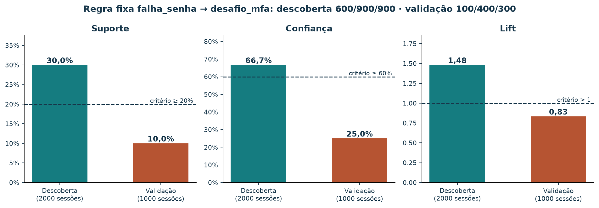

# Regras de associação a partir de logs de autenticação

[Leia a versão web](https://lgallindo.github.io/recomendador-bentoml/logs-auth/).

Ao concluir este roteiro, você conseguirá transformar linhas de log em sessões,
calcular suporte, confiança e lift, minerar associações e avaliar uma regra fixa
em outro conjunto. O objetivo é investigar o fluxo de autenticação de um servidor.
Os registros são inteiramente sintéticos; não demonstram comportamento de pessoas,
desempenho de um sistema real ou ocorrência de ataques.

Este é um estudo independente da [variante de compras](tutorial-regras-associacao-20261017.md).
O catálogo, as dez cestas de compras, `pedidos` e as vendas semanais permanecem
inalterados. Os logs não são a origem dessas compras ou desses totais. Aqui a
unidade de análise é uma sessão de autenticação fictícia, não uma compra.

## 1. Roteiro de 90 minutos

| Minutos | Atividade |
| --- | --- |
| 10 | Situar IA, aprendizado de máquina e associação |
| 15 | Ler o contrato dos logs e reconstruir sessões |
| 15 | Calcular suporte, confiança e lift |
| 10 | Executar a mineração e interpretar o CSV |
| 10 | Avaliar uma regra fixa em sessões separadas |
| 15 | Explorar sessões e regras no painel |
| 15 | Produzir um relatório e resolver o exercício |

Mineração de associações procura conjuntos frequentes sem uma resposta-alvo
rotulada por sessão: é uma tarefa de aprendizado não supervisionado, dentro de
aprendizado de máquina e IA. O algoritmo induz padrões a partir de exemplos;
as pessoas escolhem a representação e os critérios. Consulte a seção 1 do
[tutorial original](tutorial-regras-associacao-20261017.md) para o mapa conceitual
e a discussão sobre sistemas especialistas.

Uma regra estatística descreve frequências. Uma política operacional como
“SE ocorrer determinada condição ENTÃO encaminhar para revisão” é uma decisão
adicional. Uma base de conhecimento, fatos do caso e um motor de inferência podem
usar regras aprovadas em um sistema especialista; um CSV sozinho não constitui
esse sistema. Estes exemplos não justificam bloqueio automático de contas.

## 2. A pergunta e o significado dos registros

**Em quais sessões falhas de senha e desafios MFA aparecem juntos?** MFA significa
autenticação com múltiplos fatores. Nossa aplicação fictícia aceita senha e pode
solicitar um fator adicional. Algumas sessões terminam sem sucesso.

Os arquivos de entrada estão em [`dados/logs-autenticacao/`](../dados/logs-autenticacao/README.md).
São JSON Lines: cada linha é um objeto completo, sem lista externa.

```json
{"event_id":"descoberta-0001-01","timestamp":"2026-10-01T12:01:01+00:00","session_id":"descoberta-0001","evento":"falha_senha"}
```

| Campo | Contrato |
| --- | --- |
| `event_id` | Identificador único de uma ocorrência; reentrega preserva o ID |
| `timestamp` | Data/hora ISO com fuso; datas construídas, não períodos observados |
| `session_id` | Identificador de uma tentativa de fluxo que pode conter vários eventos |
| `evento` | Uma das cinco categorias abaixo |

| Evento | Significado no cenário |
| --- | --- |
| `falha_senha` | Uma senha foi recusada; pode haver nova tentativa |
| `senha_aceita` | A senha foi aceita; não significa login concluído |
| `desafio_mfa` | O fator adicional foi solicitado |
| `falha_mfa` | O fator adicional foi recusado |
| `login_sucesso` | A autenticação terminou com sucesso |

Neste cenário, sucesso exige senha aceita; desafio exige senha aceita e falha
MFA exige desafio. Há sucessos com e sem MFA. A ausência de sucesso representa
um fluxo sem conclusão registrada; o log sozinho não explica o motivo.
Não há usuários, senhas, tokens ou endereços IP. Uma sessão não equivale a uma
pessoa: uma pessoa poderia abrir várias sessões em um sistema real.

## 3. Das linhas às transações

O pipeline usa a biblioteca padrão do Python:

1. Ler cada linha, validando campos, strings, timestamp com fuso e categoria.
2. Remover entregas exatamente repetidas pelo `event_id`. Reutilizar o ID com
   conteúdo diferente causa erro, com arquivo e linha.
3. Agrupar por `session_id`, incluindo sessões sem sucesso.
4. Guardar o conjunto de categorias presentes em cada sessão.
5. Contar conjuntos frequentes, gerar regras e aplicar filtros.


*Figura 1 — Cada etapa muda a unidade contada: linhas, eventos únicos, sessões,
conjuntos e, por fim, regras. A quarta caixa, em destaque, é a escolha de
representação que você faz antes de minerar.*

Na sessão `descoberta-0001`, a sequência construída é:

```text
falha_senha, falha_senha, senha_aceita, desafio_mfa, login_sucesso
```

As duas falhas têm IDs diferentes: são duas ocorrências, não duplicatas.
A cesta usada pela mineração é:

```text
{falha_senha, senha_aceita, desafio_mfa, login_sucesso}
```

Uma reentrega da primeira linha aparece no fim do arquivo. Ela não acrescenta
um evento único nem uma sessão. Repetições de categoria dentro da sessão também
não aumentam sua presença. Já duas sessões distintas com o mesmo conjunto contam
duas vezes. **O denominador é o número de sessões, não o de linhas do log.**

| Cenário | Linhas | Eventos únicos | Reentregas | Sessões |
| --- | ---: | ---: | ---: | ---: |
| Descoberta | 5901 | 5900 | 1 | 2000 |
| Validação | 2401 | 2400 | 1 | 1000 |

O gerador repete 100 vezes o bloco-base original (20 e 10 sessões). As proporções
permanecem; as contagens absolutas crescem na mesma proporção.


*Figura 2 — Cada linha é uma transação; cada coluna, uma categoria de evento.
Conte as células das colunas Falha de senha e Desafio MFA para reproduzir os
denominadores da seção 4: 9 e 9 de 20, juntos em 6. Multiplicadas por 100,
essas contagens viram 900, 900 e 600.*

O JSON de saída mostra todas as sessões reconstruídas. A ordem das linhas não
altera a mineração: timestamps servem à leitura do exemplo, mas não são usados
para inferir sequência. A seta de uma associação não significa “aconteceu depois”.
Para investigar ordem ou tempo entre eventos seria necessário outro método.

Em logs sem `session_id`, seria necessário definir uma janela e uma chave de
agrupamento. Agrupar apenas por IP pode misturar pessoas; janelas diferentes
podem produzir regras diferentes. Logs HTTP comuns também podem não registrar
os eventos internos necessários. Esta versão usa sessões explícitas para tornar
a construção auditável. Não filtra apenas logins bem-sucedidos, pois isso mudaria
a população e excluiria justamente sessões com falha ou abandono.

## 4. Três métricas, três denominadores

Sejam A e B conjuntos não vazios e disjuntos. `n(A)` conta sessões contendo todos
os eventos de A; `N` é o total de sessões.

| Métrica | Fórmula | Pergunta |
| --- | --- | --- |
| Suporte | `n(A ∪ B) / N` | Em que fração das sessões os dois lados aparecem? |
| Confiança | `n(A ∪ B) / n(A)` | Entre sessões com A, quantas também têm B? |
| Lift | `N × n(A ∪ B) / (n(A) × n(B))` | Quanto a confiança supera a frequência geral de B? |

Na descoberta, para **falha_senha → desafio_mfa**:

- A aparece em 900 sessões.
- B aparece em 900 sessões.
- Ambos aparecem em 600 sessões.
- `N = 2000`.

Portanto, suporte = `600/2000 = 30%`; confiança = `600/900 ≈ 66,7%`;
lift = `(600/900)/(900/2000) = 40/27 ≈ 1,48`.

Relato: “Falha de senha e desafio MFA aparecem juntos em 600 das 2000 sessões.
Entre as 900 sessões com falha de senha, 600 incluem desafio MFA. Essa frequência
é aproximadamente 1,48 vez a frequência geral de desafio MFA, de 45%.”

Aqui a inversa tem as mesmas métricas porque os dois eventos aparecem em 900
sessões cada. Isso não é uma propriedade geral da confiança: o denominador troca
ao inverter a regra. Suporte e lift são simétricos para a regra inversa.

Lift > 1 indica co-presença acima da referência de independência na amostra;
lift = 1 coincide com essa referência; lift < 1 fica abaixo. Confiança não é nível
de confiança estatística, e lift > 1 não é teste de significância. Nenhuma métrica
mede risco de ataque, causa ou efeito de uma mudança de política.

## 5. Executar e ler os relatórios

Na raiz, com Python 3, sem instalar pacotes ou iniciar o BentoML:

```bash
python3 scripts/minerar_logs_autenticacao.py
python3 scripts/minerar_logs_autenticacao.py --cenario validacao
```

Os comandos geram, em [`logs-autenticacao/`](logs-autenticacao/), um JSON com
sessões, contagens e avaliação da regra fixa, e um CSV com todas as regras que
passam nos filtros de cada cenário. A avaliação da regra fixa é calculada mesmo
quando ela não passa nos filtros.

Critérios definidos para o exercício: **suporte ≥ 20%, confiança ≥ 60% e lift > 1**.
Na descoberta isso exige pelo menos 400 sessões conjuntas. A seleção resulta
em **27 regras**; na validação exploratória, em **9 regras** — os mesmos totais
do bloco-base, porque a mistura de caminhos não mudou. Não compare somente
esses totais para avaliar generalização: o tamanho da base também importa.

O script reutiliza a função de contagem do minerador original por meio de um
adaptador interno. Os eventos são seus itens; nenhuma cesta de compras é lida.
Enumera subconjuntos observados e suas partições: não implementa Apriori. O custo
é exponencial no número de categorias distintas por sessão; mantenha a pequena
representação deste exercício. Os filtros usam frações exatas e o CSV arredonda
na exportação para seis casas. Suporte e confiança são proporções, não porcentagens.
O CSV usa `total_sessoes` e é ordenado por lift, confiança, suporte e IDs.

| Exemplo na descoberta | Suporte | Confiança | Lift | Passa? |
| --- | ---: | ---: | ---: | --- |
| falha_senha → desafio_mfa | 30% | 66,7% | 1,48 | Sim |
| desafio_mfa → senha_aceita | 45% | 100% | 1,11 | Sim |
| falha_mfa → desafio_mfa | 5% | 100% | 2,22 | Não: suporte |

O segundo exemplo reflete uma dependência do fluxo construído: só se solicita
MFA depois da aceitação da senha. O terceiro mostra por que confiança alta não
basta: suporte fica em 5% (100 em 2000 sessões). Regras com vários eventos de
cada lado exigem todos eles na sessão e podem repetir informações cobertas por
regras simples. Ordenar por lift não define automaticamente prioridade operacional.


*Figura 3 — O número dentro de cada círculo conta as regras que coincidem nessa
posição; regras diferentes podem ter as mesmas métricas. A cor mostra o maior
lift do grupo, não uma média. As regras com 100% de confiança refletem, em
geral, dependências do fluxo construído, como desafio MFA → senha aceita.*

## 6. Avaliar em sessões separadas

Fixe `falha_senha → desafio_mfa` antes de consultar a validação.

| Base | N | n(A) | n(B) | Juntos | Suporte | Confiança | Lift |
| --- | ---: | ---: | ---: | ---: | ---: | ---: | ---: |
| Descoberta | 2000 | 900 | 900 | 600 | 30% | 66,7% | 1,48 |
| Validação | 1000 | 400 | 300 | 100 | 10% | 25% | 0,83 |



*Figura 4 — A mesma regra, fixada antes, recontada em sessões separadas. As
linhas tracejadas são os critérios definidos na descoberta. Na validação as três
métricas ficam abaixo deles; as contagens vêm dos dois arquivos JSON Lines.*

Na validação, a regra não passa nos três critérios originais. Isso demonstra o
procedimento com números construídos; não diagnostica mudança de um servidor real.
As datas sintéticas de 1 e 2 de outubro apenas organizam o exercício e não são
períodos observados. As sessões dos dois arquivos têm IDs distintos.

Selecionar muitas regras específicas pode favorecer coincidências da descoberta
(sobreajuste). Uma representação restrita pode perder relações relevantes
(subajuste), mas um filtro que exclui uma regra não basta para diagnosticá-lo.
Variação amostral, política MFA, cobertura dos logs e população também podem
alterar métricas. Estes logs são sintéticos e repetem o mesmo bloco-base: servem
ao exercício, não a conclusões operacionais.

Não reajuste os critérios repetidamente na validação e depois a apresente como
avaliação independente. O CSV de regras de validação é uma exploração opcional;
a comparação principal acompanha a regra previamente fixada. Uma avaliação final
após ajustes exigiria outras sessões reservadas. Em uso real, sessões incompletas
na fronteira da coleta e perdas de eventos também precisam ser examinadas.

## 7. Do padrão à investigação

Uma hipótese seria verificar se tipos de fluxo ou políticas explicam a associação.
Seria necessário conhecer a política aplicável e a cobertura dos registros antes
de interpretar diferenças. Não conclua que falhar a senha causa um desafio MFA.

Uma mudança no fluxo de autenticação exigiria uma avaliação própria, com critérios
de segurança, conclusão de login e atrito. Mineração descreve associações;
avaliação em outra base examina persistência; avaliação de uma intervenção examina
o efeito da mudança. Este tutorial realiza apenas as duas primeiras em dados
sintéticos e não implementa detecção de intrusão nem recomenda relaxar MFA.

Modelo de relatório:

> Analisamos 2000 sessões sintéticas, reconstruídas de 5901 linhas, com 5900
> eventos únicos e uma reentrega. Cada item indica presença de uma categoria na
> sessão. Com suporte ≥ 20%, confiança ≥ 60% e lift > 1, obtivemos 27 regras.
> A associação falha_senha → desafio_mfa tem contagens 900, 900 e 600, suporte
> 30%, confiança 66,7% e lift 1,48. Nas 1000 sessões separadas, as métricas são
> 10%, 25% e 0,83. Propomos investigar o papel da política de autenticação. O
> cenário construído não permite atribuir causas, identificar ataques ou decidir
> bloqueios.

## 8. Explorar sessões e regras no painel

O [explorador de logs](bi-logs/index.html) reúne, numa só página, as etapas deste
tutorial: a reconstrução de uma sessão a partir das linhas do arquivo, os tipos
de sessão, a dispersão das regras, a comparação da regra fixa entre as bases e a
tabela de auditoria. Você também pode usá-lo incorporado à
[versão web deste tutorial](https://lgallindo.github.io/recomendador-bentoml/logs-auth/#explorador-interativo).
Para estudar offline, abra o HTML a partir de uma cópia local do repositório; a
página do arquivo no GitHub mostra o código. O [roteiro de exploração](bi-logs/README.md)
descreve cada controle.

O painel aplica as mesmas regras de contagem do script: agrupa por `session_id`,
descarta reentregas, guarda presenças e usa os critérios de suporte ≥ 20%,
confiança ≥ 60% e lift > 1. Os filtros escolhem quais regras já selecionadas
aparecem; eles não mineram regras novas. O quadro da regra selecionada reconta
a regra a partir dos tipos de sessão de cada base, por isso mostra valores mesmo
quando ela não passa nos critérios.


*Figura 5 — Espelho estático do painel “Tipos de sessão”. Cada barra é um
conjunto exato de eventos. As barras em terra contêm os dois lados da regra fixa;
somá-las dá o suporte dessa regra em cada base.*

### Atividade no painel

1. Escolha a sessão `descoberta-0001`. Quantas linhas o arquivo tem para ela e
   qual delas é descartada? Por que a segunda falha de senha não é descartada?
2. Em **Tipos de sessão**, some as barras em terra da descoberta e compare com o
   suporte da regra fixa.
3. Na dispersão, selecione o círculo de suporte 30% e confiança 66,7%. Quantas
   regras ele reúne e quais têm lift diferente de 1,48?
4. Na tabela, selecione **Desafio MFA → Login com sucesso** e leia a comparação
   entre as bases. A regra se mantém?
5. Troque a base para **Validação**. Quantas regras passam nos filtros? A regra
   fixa aparece na tabela? E no quadro da regra selecionada?

### Resolução comentada da atividade

1. São seis linhas: as cinco ocorrências da sessão e a reentrega na linha 5901,
   que repete o `event_id` `descoberta-0001-01` com o mesmo conteúdo. A segunda
   falha de senha tem outro `event_id`: é uma nova tentativa, que não muda a
   presença da categoria no conjunto.
2. As barras em terra são 25% (500 sessões) e 5% (100 sessões): somam 30%, o
   suporte de falha_senha → desafio_mfa.
3. Cinco regras. Quatro têm lift 1,48: falha_senha → desafio_mfa, a inversa,
   {desafio_mfa, senha_aceita} → falha_senha e falha_senha → {desafio_mfa, senha_aceita}.
   Nesta última, acrescentar senha aceita ao consequente não muda nada, porque todo
   desafio MFA já exige senha aceita: o consequente continua em 900 sessões. Só
   desafio_mfa → {falha_senha, senha_aceita} tem lift aproximadamente 1,90: seu
   consequente está em 700 sessões, uma referência menor que 900.
4. Na descoberta: 700 sessões conjuntas, suporte 35%, confiança 77,8%, lift 1,04.
   Na validação: 200 de 1000, suporte 20%, confiança 66,7%, lift 1,11. Ela passa nas
   duas bases, mas com lift próximo de 1: a co-presença pouco supera a frequência
   geral de login com sucesso.
5. Nove regras. A regra fixa não aparece na tabela da validação porque não passa
   nos filtros, mas o quadro da regra selecionada continua mostrando suas contagens
   100, 400 e 300 e o lift 0,83.

## 9. Exercício e resolução

1. Reconstrua a sessão `descoberta-0001` e explique a diferença entre tentativa repetida e reentrega.
2. Calcule `desafio_mfa → login_sucesso` e a inversa na descoberta.
3. Verifique os filtros e explique por que uma confiança de 100% pode refletir política.
4. Recalcule a regra fixa na validação e escreva um relatório com limitações.
5. Explique por que isso é associação não supervisionada e que etapa adicional
   seria necessária para investigar sequência temporal.

### Resolução comentada

A sessão `descoberta-0001` tem cinco eventos únicos e quatro
categorias. As duas falhas são ocorrências distintas; a reentrega mantém o
primeiro ID. Desafio aparece em 900 sessões; sucesso em 1500; ambos em 700.
Para desafio → sucesso: suporte `700/2000=35%`, confiança `700/900≈77,8%`,
lift `(700/900)/(1500/2000)=28/27≈1,04`; passa. Para sucesso → desafio, suporte
e lift permanecem iguais, mas confiança `700/1500≈46,7%` não passa. Sucesso →
senha aceita tem confiança 100% por construção do fluxo, não por descobrir um
ataque. Na validação da regra fixa: suporte `100/1000`, confiança `100/400` e
lift `(100/400)/(300/1000)=5/6`. Não há rótulo-alvo por sessão, e os conjuntos
descartam a ordem; estudar sequência exigiria preservar e analisar a ordem dos
eventos com um método apropriado.

## 10. Reprodução e verificações

Os logs commitados permitem executar diretamente a mineração. Para reproduzi-los
com o mesmo conteúdo e conferir os casos de erro e as contas:

```bash
python3 scripts/gerar_logs_autenticacao.py
python3 -m unittest discover -s scripts -p 'test_logs_autenticacao.py'
```

Para outro log que cumpra o contrato, preserve os relatórios do exercício:

```bash
python3 scripts/minerar_logs_autenticacao.py --logs caminho/meu-log.jsonl --diretorio-saida material/logs-experimento
```

Esse comando usa os mesmos filtros e a mesma regra fixa. Os nomes de saída seguem
o cenário selecionado, não a data do log personalizado. O parser verifica o contrato;
não é um validador universal de políticas de autenticação. A coerência dos caminhos
dos fixtures é conferida pelos testes. Fundamentos e referências de IA, métricas,
generalização e validação estão no [tutorial original](tutorial-regras-associacao-20261017.md).

As figuras e os dados do explorador usam Matplotlib e as mesmas funções do
minerador. Com o ambiente do projeto instalado:

```bash
uv run python scripts/gerar_figuras_logs.py
uv run python scripts/gerar_bi_logs.py
```

O primeiro grava `logs-pipeline.png`, `logs-matriz-sessoes.png`,
`logs-dispersao-regras.png` e `logs-descoberta-validacao.png` em
`material/imagens/`. O segundo confere que as regras recalculadas coincidem com
os CSVs de `material/logs-autenticacao/` e grava `material/bi-logs/dados.js` e
`bi-logs-padroes.png`.

## Referências bibliográficas e roteiro de leitura

Consulta dos materiais on-line: 7 nov. 2026. Os livros podem exigir acesso por
biblioteca; as fichas indicadas trazem sumário e apresentação.

### Associação e mineração de dados

1. AGRAWAL, Rakesh; IMIELIŃSKI, Tomasz; SWAMI, Arun. Mining association rules
   between sets of items in large databases. In: **ACM SIGMOD International
   Conference on Management of Data**, 1993, p. 207–216.
   DOI: [10.1145/170036.170072](https://doi.org/10.1145/170036.170072).
   **Para aprofundar:** a formulação original de suporte e confiança sobre
   transações.
2. AGRAWAL, Rakesh; SRIKANT, Ramakrishnan. Fast algorithms for mining
   association rules. In: **20th International Conference on Very Large Data
   Bases (VLDB)**, 1994, p. 487–499.
   [Artigo em inglês](https://www.vldb.org/conf/1994/P487.PDF).
   **Para aprofundar:** o algoritmo Apriori e a poda por subconjuntos, que o
   script deste tutorial não implementa.
3. HAN, Jiawei; KAMBER, Micheline; PEI, Jian. **Data mining: concepts and
   techniques**. 3. ed. Waltham: Morgan Kaufmann, 2012. ISBN 9780123814791.
   [Ficha da editora](https://shop.elsevier.com/books/data-mining-concepts-and-techniques/han/978-0-12-381479-1);
   [página dos autores](https://hanj.cs.illinois.edu/bk3/).
   **Para aprofundar:** capítulos de padrões frequentes, avaliação de regras e
   medidas de interesse além do lift.
4. MLXTEND. **Association rules: association rules generation from frequent
   itemsets**. [Documentação em inglês](https://rasbt.github.io/mlxtend/user_guide/frequent_patterns/association_rules/).
   **Para consultar:** definições de suporte, confiança e lift usadas nas contas.

### Logs, autenticação e avaliação

5. KENT, Karen; SOUPPAYA, Murugiah. **Guide to computer security log
   management**. NIST Special Publication 800-92. Gaithersburg: NIST, 2006.
   [Publicação em inglês](https://csrc.nist.gov/pubs/sp/800/92/final).
   **Para aprofundar:** coleta, retenção e análise de logs, e por que cobertura e
   perdas de eventos afetam qualquer conclusão.
6. OWASP. **Logging Cheat Sheet**.
   [Guia em inglês](https://cheatsheetseries.owasp.org/cheatsheets/Logging_Cheat_Sheet.html).
   **Para consultar:** que eventos de autenticação registrar e o que nunca
   gravar em log, como senhas e tokens.
7. OWASP. **Multifactor Authentication Cheat Sheet**.
   [Guia em inglês](https://cheatsheetseries.owasp.org/cheatsheets/Multifactor_Authentication_Cheat_Sheet.html).
   **Para consultar:** quando um sistema solicita um fator adicional, o que
   ajuda a interpretar regras que refletem a política, e não o comportamento.
8. JSON LINES. **JSON Lines text file format**. [Especificação](https://jsonlines.org/).
   **Para consultar:** o formato dos arquivos de entrada, um objeto por linha.
9. SCIKIT-LEARN. **Common pitfalls and recommended practices**.
   [Documentação em inglês](https://scikit-learn.org/stable/common_pitfalls.html).
   **Para consultar:** por que ajustar critérios na base de avaliação torna a
   estimativa otimista.

Para começar, leia o guia de logging da OWASP e a seção de regras de associação
de Han, Kamber e Pei; use o artigo de 1994 para estudar a mineração eficiente.
