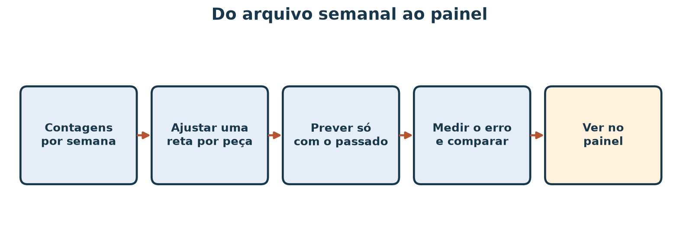
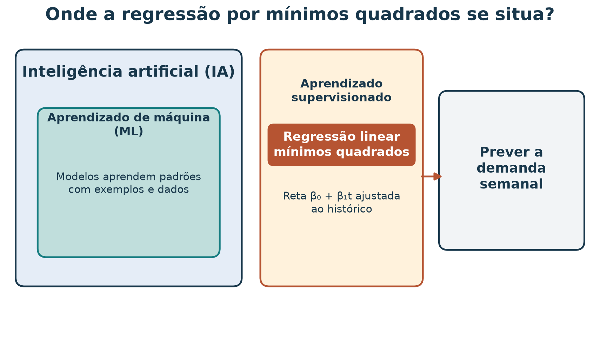
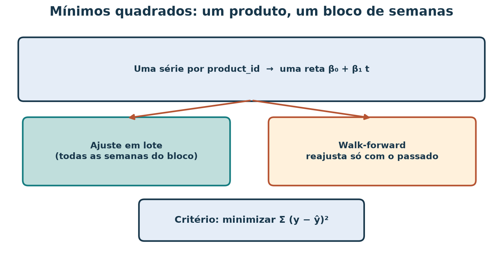
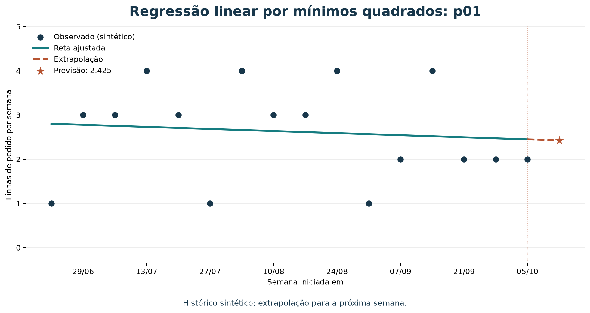
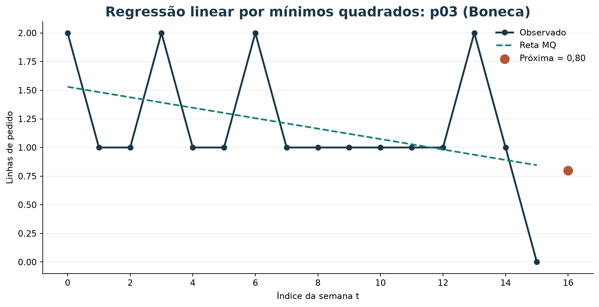
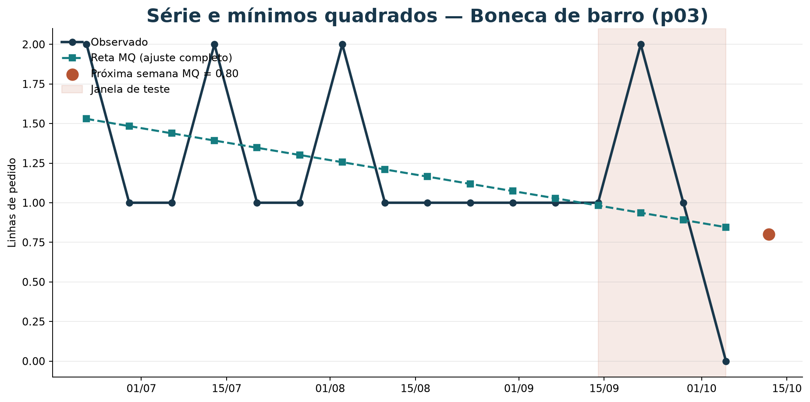
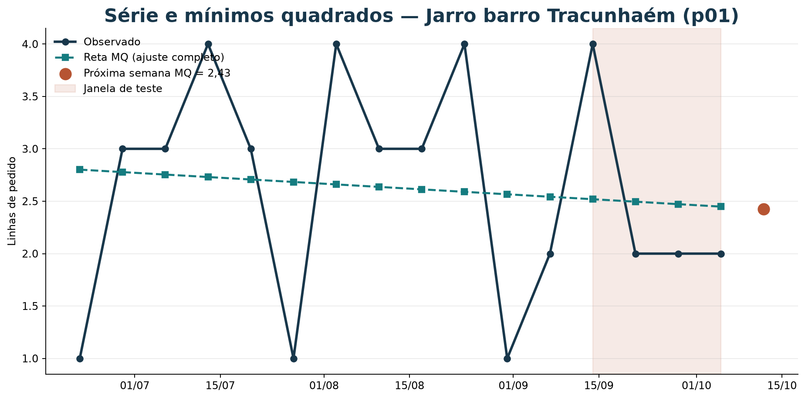
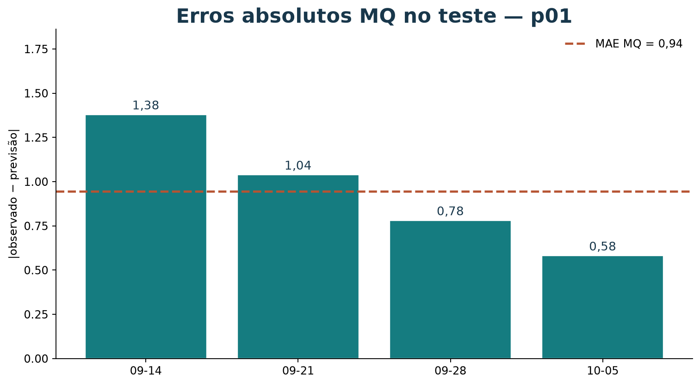
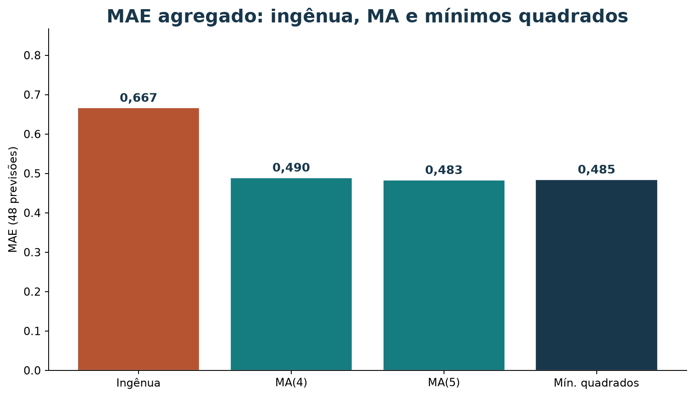

# Previsão de demanda com regressão por mínimos quadrados

Ao concluir este tutorial, você deverá conseguir situar a regressão linear na
história da medida e do aprendizado com dados, ajustar uma reta por **mínimos
quadrados** à série semanal de um produto, extrapolar a semana seguinte com
piso em zero quando preciso, e comparar o método com médias móveis e uma
previsão ingênua no mesmo protocolo walk-forward da
[`média móvel`](tutorial-media-movel-demanda-20261017.md).

Os dados são **sintéticos**: as 16 semanas distribuem os totais do catálogo e
não são vendas observadas. Resultados numéricos servem para reproduzir o método,
não para afirmar que existe tendência real.

Leitura em ritmo próprio: acompanhe os dois exemplos trabalhados (Jarro `p01` e
Boneca `p03`) e o explorador BI quando quiser ver a mesma reta no painel.

## 1. A pergunta da loja no tempo

A loja fecha a semana e já pensa na seguinte: quantas **linhas de pedido** cada
peça tende a gerar? A unidade é a mesma da média móvel — contagens por produto
por semana em
[`dados/vendas_semanais.csv`](../dados/vendas_semanais.csv).

Na média móvel, a previsão é a média das últimas \(N\) observações: a regra vem
pronta; o que se aprende, quando se aprende, é sobretudo **qual \(N\)** medir.
Aqui a pergunta muda de forma: em vez de uma média local, pedimos uma **reta**
que resuma a relação entre o índice da semana \(t\) e a contagem \(y_t\), e
usamos essa reta para olhar um passo à frente.

O protocolo de avaliação continua temporal: treinar só com o passado, prever a
próxima semana, só então incorporar o valor observado. O que muda é o **modelo**
dentro desse ritual.



*Figura 0 — Do arquivo semanal ao painel: a reta é o modelo; o walk-forward é o
ritual de avaliação; o BI espelha os mesmos números.*

## 2. Camadas: da medida à previsão aprendida

A reta por mínimos quadrados chegou à demanda semanal depois de atravessar
séculos de medida, estatística e, mais tarde, aprendizado de máquina. As
camadas abaixo são o caminho curto dessa história — o suficiente para saber
**de onde veio** a soma dos quadrados antes de digitá-la.

### 2.1 Mínimos quadrados no século XIX

No início do século XIX, astrônomos e geodesistas precisavam combinar muitas
observações imperfeitas numa única curva ou posição. **Adrien-Marie Legendre**
(1805) e **Carl Friedrich Gauss** (com trabalhos que se entrelaçam nessa época)
formulariam o critério que ainda usamos: escolher os parâmetros que **minimizam
a soma dos quadrados dos resíduos** — a diferença entre o medido e o previsto
pelo modelo.

A escolha do quadrado não é cosmética. Erros grandes pesam mais que erros
pequenos; erros de sinais opostos deixam de se anular na soma. A mesma ideia de
perda \(L_2\) aparece no tutorial da média móvel quando se fala do preço do
erro; aqui ela vira o **critério de ajuste** da reta.

### 2.2 “Regressão” como nome e gesto

Décadas depois, a estatística anglo-saxônica popularizou a palavra
**regressão** no estudo de relações entre variáveis medidas — o gesto de
descrever como uma grandeza acompanha outra. O nome ficou; o núcleo operativo
deste tutorial é mais estreito e mais antigo: **ajustar uma família simples de
funções** (aqui, retas) aos pares \((t, y_t)\) pelo critério dos mínimos
quadrados.

Na loja, a “outra variável” é o tempo discreto da semana. A demanda observada é
o alvo. A reta é o resumo linear desse histórico sintético.

### 2.3 Entrada no aprendizado supervisionado

**Inteligência artificial (IA)** é o campo amplo de sistemas que apoiam ou
automatizam tarefas como perceber, prever e decidir. **Aprendizado de máquina
(ML)** é a família de métodos em que o comportamento do sistema **depende de
dados** — parâmetros ou estruturas ajustados a exemplos.

Quando cada exemplo traz uma entrada e um alvo conhecido, falamos de
**aprendizado supervisionado**. Nesta aula:

| Peça | Papel |
| --- | --- |
| Entrada | índice da semana \(t\) (e, se quiser, um vetor que a represente) |
| Alvo | contagem observada \(y_t\) |
| Modelo | reta \(\widehat{y}_t = \beta_0 + \beta_1 t\) |
| Aprendizado | escolher \(\beta_0,\beta_1\) pelos mínimos quadrados nos exemplos |

A regressão linear é uma técnica estatística clássica; vira modelo de ML no
sentido operacional de **parâmetros estimados a partir dos dados** e depois
usados para prever.

### 2.4 Mapa deste tutorial



*Figura 1 — A regressão linear liga exemplos de entrada e alvo a uma função
ajustada. As relações são conceituais, não uma medida de tamanho das áreas.*

Leia de fora para dentro: a loja formula uma previsão; o ML oferece o ritual de
ajustar parâmetros a exemplos; os mínimos quadrados escolhem a reta. A unidade
permanece **linhas de pedido por produto por semana**. O arquivo sintético
continua sintético.

## 3. O que significa “mínimos quadrados”

Para um produto, associe a semana `t` à contagem observada `y_t`. Uma reta
prevê:

$$
\widehat{y}_t = \beta_0 + \beta_1 t
$$

- `β₀` é o intercepto: valor ajustado quando `t = 0`.
- `β₁` é a inclinação: variação média ajustada em linhas de pedido por semana.
- `ŷ_t` é a previsão do modelo para a semana `t`.

Os dados raramente ficam todos exatamente numa reta. Para ajustar os
coeficientes, mínimos quadrados escolhe a reta que minimiza a soma dos
**resíduos ao quadrado** — o mesmo espírito de Legendre e Gauss, agora com a
semana no eixo horizontal:

$$
\min_{\beta_0,\beta_1}\ \sum_{t=0}^{n-1}
\left(y_t - (\beta_0+\beta_1t)\right)^2
$$

Um resíduo é observado menos previsto. Elevar ao quadrado penaliza erros
grandes mais fortemente e evita que resíduos positivos e negativos se cancelem
na soma.

O ajuste é uma aproximação linear cuja utilidade se examina em semanas futuras
reservadas para teste. Uma reta pode ainda produzir previsões negativas, embora
contagens não possam ser negativas. Neste tutorial, aplicamos um limite inferior
de zero **após** prever: decisão prática de pós-processamento, distinta do
critério de mínimos quadrados em si.



*Figura 2 — Cada `product_id` tem a própria reta. O critério Σ(y−ŷ)² é o mesmo;
o que muda entre “ajuste completo” e walk-forward é **quais semanas** entram no
lote.*

## 4. Exemplo trabalhado 1 — Jarro (`p01`)

O arquivo tem 16 semanas, de 2026-06-22 a 2026-10-05, para 12 produtos. A
coluna `order_line_count` conta linhas de pedido semanais, não unidades físicas.
O script de validação verifica que todas as combinações produto/semana estão
presentes e que os totais reconciliam:

```bash
uv run python scripts/validar_vendas_semanais.py
```

O código abaixo organiza a tabela com pandas e ajusta a reta com
`LinearRegression` do scikit-learn. Na raiz do repositório:

```bash
uv run --with pandas --with scikit-learn python
```

```python
from pathlib import Path

import numpy as np
import pandas as pd
from sklearn.linear_model import LinearRegression

# Tabela longa → matriz semana × produto
vendas = pd.read_csv(
    Path("dados/vendas_semanais.csv"),
    parse_dates=["week_start"],
)
matriz = vendas.pivot(
    index="week_start",
    columns="product_id",
    values="order_line_count",
).sort_index()

# Exemplo 1: Jarro barro Tracunhaém
produto = "p01"
serie = matriz[produto]

# t = 0, 1, …, 15  (índice da semana no CSV)
semanas = np.arange(len(serie)).reshape(-1, 1)
alvos = serie.to_numpy()

# Ajuste em lote: uma reta para todo o histórico deste produto
modelo = LinearRegression().fit(semanas, alvos)

# Extrapolação um passo à frente (t = 16)
semana_seguinte = np.array([[len(serie)]])
previsao_bruta = float(modelo.predict(semana_seguinte)[0])
previsao = max(0.0, previsao_bruta)  # piso prático para contagem

print(f"Intercepto: {modelo.intercept_:.4f}")
print(f"Inclinação: {modelo.coef_[0]:.4f} linhas/semana")
print(f"Previsão bruta: {previsao_bruta:.4f}")
print(f"Previsão não negativa: {previsao:.4f}")
```

Para Jarro (`p01`), o ajuste com as 16 semanas resulta em:

$$
\widehat{y}_t = 2{,}8015 - 0{,}0235t
$$

A inclinação ajustada é aproximadamente **−0,024 linha por semana**. Ao
extrapolar para `t = 16`, a previsão é **2,425 linhas de pedido**. A pequena
inclinação negativa descreve a reta que melhor ajusta esta amostra sintética;
não demonstra uma queda real de demanda.



*Figura 3 — A reta resume a tendência linear ajustada ao histórico de `p01`.
O segmento futuro é uma extrapolação, não um valor observado.*

### Previsões para todos os produtos

O mesmo ajuste, feito separadamente para cada produto, produz as previsões:

| Produto | Intercepto | Inclinação por semana | Previsão bruta | Após limite em zero |
| --- | ---: | ---: | ---: | ---: |
| Jarro barro Tracunhaém (`p01`) | 2,801 | −0,024 | 2,425 | 2,425 |
| Prato esmaltado Tracunhaém (`p02`) | 1,904 | −0,021 | 1,575 | 1,575 |
| Boneca de barro (`p03`) | 1,529 | −0,046 | 0,800 | 0,800 |
| Rendeira Alto do Moura (`p04`) | 2,485 | −0,040 | 1,850 | 1,850 |
| Toalha de renda (`p05`) | 1,640 | −0,035 | 1,075 | 1,075 |
| Caminho de mesa renda (`p06`) | 0,897 | −0,028 | 0,450 | 0,450 |
| Xilogravura Pilar (`p07`) | 2,213 | −0,037 | 1,625 | 1,625 |
| Cordel ilustrado (`p08`) | 1,007 | 0,007 | 1,125 | 1,125 |
| Quadro xilo colorido (`p09`) | 0,926 | −0,049 | 0,150 | 0,150 |
| Cesto de palha (`p10`) | 1,875 | −0,050 | 1,075 | 1,075 |
| Bolsa de palha (`p11`) | 0,963 | −0,012 | 0,775 | 0,775 |
| Sousplat de palha (`p12`) | 1,029 | −0,071 | −0,100 | 0,000 |

Para `p12`, a reta prevê −0,1. Usar zero evita apresentar uma contagem negativa,
mas não garante uma distribuição válida nem corrige o modelo. Com alvos de
contagem, considere um modelo cuja saída respeite a escala e o domínio do
problema; também registre sempre qualquer pós-processamento.

## 5. Exemplo trabalhado 2 — Boneca (`p03`)

Repita o mesmo ritual com Boneca de barro (`p03`): troque `produto = "p03"` no
bloco anterior (ou filtre a coluna correspondente na matriz).

Com as 16 semanas:

$$
\widehat{y}_t = 1{,}5294 - 0{,}0456t
$$

| Quantidade | Valor |
| --- | ---: |
| Intercepto | 1,529 |
| Inclinação (linhas/semana) | −0,046 |
| Previsão bruta em `t = 16` | 0,800 |
| Após limite em zero | 0,800 |

A inclinação é mais íngreme que a do Jarro nesta amostra sintética. Ainda assim,
é só o resumo linear deste CSV — não uma tendência comercial observada.



*Figura 4 — Mesmo método do Jarro; outro produto, outra reta.*

Nas quatro semanas finais, com walk-forward **só com o passado**, o MAE de
mínimos quadrados para `p03` fica em torno de **0,614**; a média móvel de cinco
semanas, nas mesmas origens, fica em torno de **0,600**. Os dois números são
próximos nesta série curta.



*Figura 5 — O explorador permite selecionar Boneca e ler intercepto, inclinação
e erros do teste no mesmo layout usado para o Jarro.*

## 6. Avaliar respeitando o tempo

Usaremos as 12 primeiras semanas como histórico inicial e as quatro últimas
como teste, tal como no tutorial da média móvel. Em cada semana de teste,
ajustamos a reta novamente usando **somente** semanas anteriores e prevemos o
próximo ponto. Após observar o resultado real daquela semana, ela pode entrar
no histórico da previsão seguinte.

Para comparar escalas de erro:

$$
\mathrm{MAE} = \frac{1}{n}\sum_{i=1}^{n}|y_i-\widehat{y}_i|,
\qquad
\mathrm{RMSE} = \sqrt{\frac{1}{n}\sum_{i=1}^{n}(y_i-\widehat{y}_i)^2}
$$

RMSE penaliza erros grandes mais fortemente que MAE. Ambas as métricas estão
em linhas de pedido por produto por semana.

```python
inicio_teste = len(matriz) - 4
erros = []

# Mesmas 48 previsões: 12 produtos × 4 semanas de teste
for produto in matriz.columns:
    serie = matriz[produto]
    for posicao in range(inicio_teste, len(matriz)):
        # Treino: só o passado (t = 0 … posicao-1)
        x_treino = np.arange(posicao).reshape(-1, 1)
        y_treino = serie.iloc[:posicao].to_numpy()
        modelo = LinearRegression().fit(x_treino, y_treino)

        # Previsão da semana atual; piso em zero após o ajuste
        bruto = float(modelo.predict([[posicao]])[0])
        previsto = max(0.0, bruto)
        observado = float(serie.iloc[posicao])
        erros.append(observado - previsto)

mae = np.mean(np.abs(erros))
rmse = np.sqrt(np.mean(np.square(erros)))
print(f"Previsões avaliadas: {len(erros)}")
print(f"MAE: {mae:.3f}")
print(f"RMSE: {rmse:.3f}")
```

Saída neste conjunto:

```text
Previsões avaliadas: 48
MAE: 0.485
RMSE: 0.629
```

### Comparar com referências simples

Todos os métodos abaixo usam exatamente os mesmos 48 pares produto/semana:

| Método | MAE | RMSE |
| --- | ---: | ---: |
| Ingênua: última semana | 0,667 | — |
| Média móvel de 4 semanas | 0,490 | — |
| Média móvel de 5 semanas | 0,483 | — |
| Regressão linear, por produto | 0,485 | 0,629 |

A regressão tem MAE próximo ao das médias móveis. Neste pequeno teste, MA(5)
fica ligeiramente abaixo da regressão, com diferença de cerca de 0,001 linha.
Isso não estabelece um vencedor: são apenas quatro semanas sintéticas de teste.
O RMSE é apresentado para a regressão, mas só deve ser comparado com RMSE das
outras abordagens, não diretamente com os MAEs.

## 7. Interpretar o resultado

- Uma inclinação positiva ou negativa é a tendência **linear estimada no
  histórico usado**; não é causa nem garantia de continuidade.
- Prever além das semanas usadas para ajustar uma reta é **extrapolar**.
  Extrapolações longas são especialmente frágeis se a tendência mudar.
- A contagem é inteira, mas a previsão média pode ser fracionária. Não
  arredonde antes de calcular erros.
- O corte em zero evita valores negativos, mas altera a saída e precisa ser
  documentado. `p12` mostra essa situação neste próprio conjunto.
- O modelo ajusta uma reta individual para cada produto. Com apenas 12 pontos
  iniciais em cada origem, a inclinação pode ser instável.
- O arquivo é sintético e foi construído para reconciliar totais agregados.
  Não permite concluir que exista tendência, sazonalidade ou desempenho real.

Para testar desempenho comercial, são necessários mais dados históricos
observados, com datas, quantidades consistentes, estado dos pedidos, estoque e
contexto de promoções ou rupturas. Faça a avaliação em ordem temporal e compare
com baselines antes de implantar um modelo.

## 8. Como BI ajuda você a visualizar a reta

O [explorador de mínimos quadrados](bi-demanda-mq/index.html) mostra a série,
a reta ajustada, os erros no teste e o MAE ao lado da média móvel e da
previsão ingênua. No seletor de produto, abra **Jarro (`p01`)** e **Boneca
(`p03`)** — os dois exemplos deste tutorial — e compare intercepto, inclinação
e a tabela de teste. Detalhes de painéis em
[`bi-demanda-mq/README.md`](bi-demanda-mq/README.md).

As figuras abaixo espelham o painel na versão Markdown.



*Figura 6 — Observações e reta do ajuste completo; o ponto terracota extrapola
a semana seguinte. O MAE do teste, no painel, refaz o ajuste só com o passado.*



*Figura 7 — Erros walk-forward de mínimos quadrados em `p01`.*



*Figura 8 — Mesmas 48 previsões para todos os métodos. Menor MAE é melhor nesta
métrica; a diferença neste conjunto sintético é pequena.*

## Referência e reprodução

1. SCIKIT-LEARN. `LinearRegression`: mínimos quadrados ordinários para regressão
   linear.
   [Documentação](https://scikit-learn.org/stable/modules/generated/sklearn.linear_model.LinearRegression.html).

## Gerar as figuras do painel

Na raiz do repositório, execute:

```bash
uv run --with scikit-learn python scripts/gerar_bi_demanda_mq.py
```

O script atualiza `material/bi-demanda-mq/dados.js` e as ilustrações
`bi-demanda-mq-*.png` (incluindo `p01` e `p03`) em `material/imagens/`.
