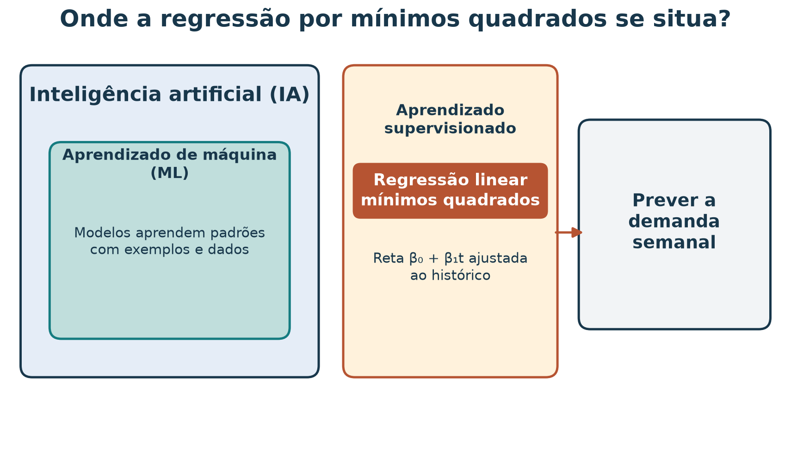
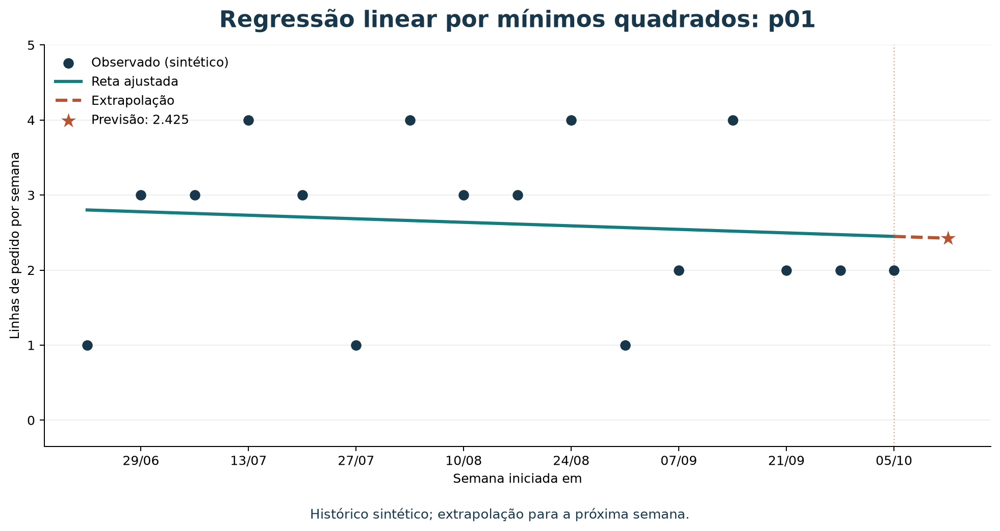
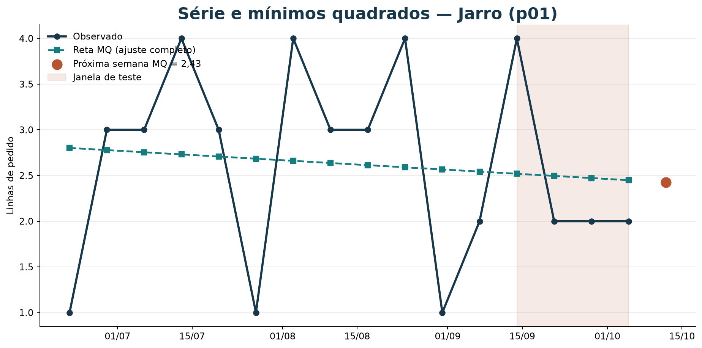
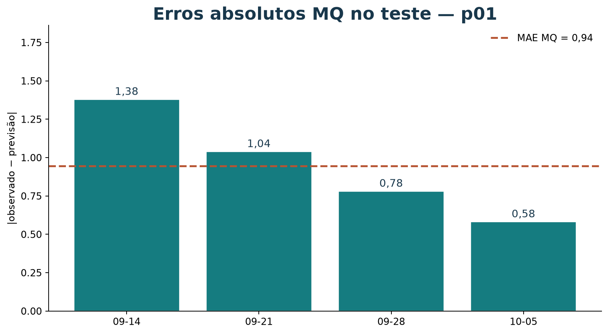
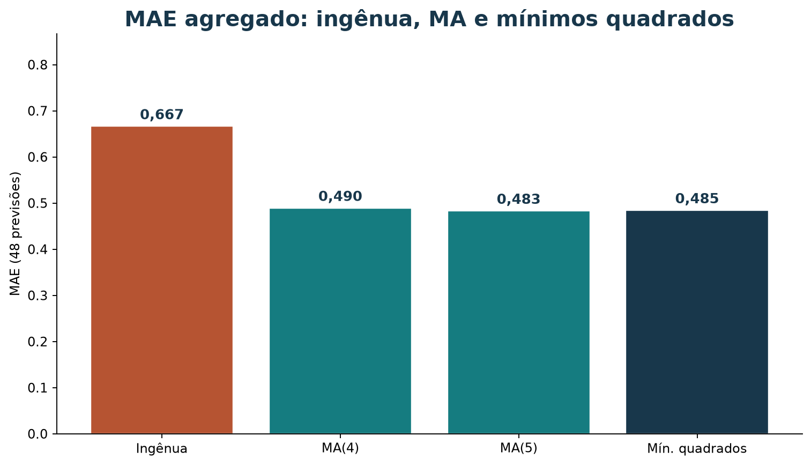

# Previsão de demanda com regressão por mínimos quadrados

[Leia a versão web com o explorador interativo incorporado](https://lgallindo.github.io/recomendador-bentoml/demanda-mq/).

Este tutorial parte da série semanal sintética do marketplace e do protocolo
walk-forward apresentado em
[`tutorial-media-movel-demanda-20261017.md`](tutorial-media-movel-demanda-20261017.md).
Você vai ajustar uma reta para cada produto usando regressão linear por mínimos
quadrados, extrapolar a tendência para a próxima semana e comparar o resultado
com médias móveis e uma previsão ingênua.

Os dados são **sintéticos**: as 16 semanas distribuem os totais do catálogo e
não são vendas observadas. Resultados numéricos servem para reproduzir o método,
não para afirmar que existe tendência real.

### Roteiro

| Tempo sugerido | Atividade |
| --- | --- |
| 8 min | Relacionar regressão, aprendizado de máquina e previsão |
| 10 min | Entender o ajuste por mínimos quadrados |
| 10 min | Ajustar uma reta e prever demanda |
| 12 min | Avaliar com origem temporal deslizante |
| 15 min | Explorar a série com BI e exportar uma evidência |
| 10 min | Interpretar resultados, limitações e exercício |

## 1. Onde a regressão se situa

Na média móvel, a regra de previsão é definida diretamente como a média das
últimas observações. Aqui, ajustaremos os coeficientes de uma reta a partir de
exemplos históricos. Essa é uma forma simples de **aprendizado supervisionado**:
cada semana fornece uma entrada (o tempo) e um alvo conhecido (a demanda
observada).

**Inteligência artificial (IA)** é o campo amplo de sistemas que executam
tarefas como aprender, raciocinar e apoiar decisões; **aprendizado de máquina
(ML)** é uma área da IA em que algoritmos ajustam modelos a partir de dados.
Regressão linear é uma técnica estatística que também é usada como modelo de
ML quando seus parâmetros são aprendidos dos exemplos.



*Figura 1 — A regressão linear liga exemplos de entrada e alvo a uma função
ajustada. As relações são conceituais, não uma medida de tamanho das áreas.*

O problema de negócio continua o mesmo: estimar **linhas de pedido por produto
por semana**. Regressão não muda a unidade nem transforma os dados sintéticos
em histórico real.

## 2. O que significa “mínimos quadrados”

Para um produto, associe a semana `t` à contagem observada `y_t`. Uma reta
prevê:

$$
\widehat{y}_t = \beta_0 + \beta_1 t
$$

- `β₀` é o intercepto: valor ajustado quando `t = 0`.
- `β₁` é a inclinação: variação média ajustada em linhas de pedido por semana.
- `ŷ_t` é a previsão do modelo para a semana `t`.

Os dados raramente ficam todos exatamente numa reta. Para ajustar os
coeficientes, mínimos quadrados escolhe a reta que minimiza a soma dos
**resíduos ao quadrado**:

$$
\min_{\beta_0,\beta_1}\ \sum_{t=0}^{n-1}
\left(y_t - (\beta_0+\beta_1t)\right)^2
$$

Um resíduo é observado menos previsto. Elevar ao quadrado penaliza erros
grandes mais fortemente e evita que resíduos positivos e negativos se cancelem
na soma.

O ajuste não prova que a demanda siga uma tendência linear. É uma aproximação
cuja utilidade deve ser examinada em semanas futuras reservadas para teste.
Além disso, uma reta pode produzir previsões negativas, embora contagens não
possam ser negativas. Neste tutorial, aplicaremos um limite inferior de zero
após prever; isso é uma decisão prática de pós-processamento, não parte do
ajuste por mínimos quadrados.

## 3. Carregar a série e ajustar um produto

O arquivo tem 16 semanas, de 2026-06-22 a 2026-10-05, para 12 produtos. A
coluna `order_line_count` conta linhas de pedido semanais, não unidades físicas.
O script de validação verifica que todas as combinações produto/semana estão
presentes e que os totais reconciliam:

```bash
uv run python scripts/validar_vendas_semanais.py
```

O código a seguir reaproveita pandas para organizar a tabela e
`LinearRegression` do scikit-learn para ajustar a reta. Na raiz do repositório,
execute com:

```bash
uv run --with pandas python
```

```python
from pathlib import Path

import numpy as np
import pandas as pd
from sklearn.linear_model import LinearRegression

vendas = pd.read_csv(
    Path("dados/vendas_semanais.csv"),
    parse_dates=["week_start"],
)
matriz = vendas.pivot(
    index="week_start",
    columns="product_id",
    values="order_line_count",
).sort_index()

produto = "p01"
serie = matriz[produto]
semanas = np.arange(len(serie)).reshape(-1, 1)

modelo = LinearRegression().fit(semanas, serie.to_numpy())
semana_seguinte = np.array([[len(serie)]])
previsao_bruta = float(modelo.predict(semana_seguinte)[0])
previsao = max(0.0, previsao_bruta)

print(f"Intercepto: {modelo.intercept_:.4f}")
print(f"Inclinação: {modelo.coef_[0]:.4f} linhas/semana")
print(f"Previsão bruta: {previsao_bruta:.4f}")
print(f"Previsão não negativa: {previsao:.4f}")
```

Para Jarro (`p01`), o ajuste com as 16 semanas resulta em:

$$
\widehat{y}_t = 2{,}8015 - 0{,}0235t
$$

A inclinação ajustada é aproximadamente **−0,024 linha por semana**. Ao
extrapolar para `t = 16`, a previsão é **2,425 linhas de pedido**. A pequena
inclinação negativa descreve a reta que melhor ajusta esta amostra sintética;
não demonstra uma queda real de demanda.



*Figura 2 — A reta resume a tendência linear ajustada ao histórico de `p01`.
O segmento futuro é uma extrapolação, não um valor observado.*

### Previsões para todos os produtos

O mesmo ajuste, feito separadamente para cada produto, produz as previsões:

| Produto | Intercepto | Inclinação por semana | Previsão bruta | Após limite em zero |
| --- | ---: | ---: | ---: | ---: |
| Jarro barro Tracunhaém (`p01`) | 2,801 | −0,024 | 2,425 | 2,425 |
| Prato esmaltado Tracunhaém (`p02`) | 1,904 | −0,021 | 1,575 | 1,575 |
| Boneca de barro (`p03`) | 1,529 | −0,046 | 0,800 | 0,800 |
| Rendeira Alto do Moura (`p04`) | 2,485 | −0,040 | 1,850 | 1,850 |
| Toalha de renda (`p05`) | 1,640 | −0,035 | 1,075 | 1,075 |
| Caminho de mesa renda (`p06`) | 0,897 | −0,028 | 0,450 | 0,450 |
| Xilogravura Pilar (`p07`) | 2,213 | −0,037 | 1,625 | 1,625 |
| Cordel ilustrado (`p08`) | 1,007 | 0,007 | 1,125 | 1,125 |
| Quadro xilo colorido (`p09`) | 0,926 | −0,049 | 0,150 | 0,150 |
| Cesto de palha (`p10`) | 1,875 | −0,050 | 1,075 | 1,075 |
| Bolsa de palha (`p11`) | 0,963 | −0,012 | 0,775 | 0,775 |
| Sousplat de palha (`p12`) | 1,029 | −0,071 | −0,100 | 0,000 |

Para `p12`, a reta prevê −0,1. Usar zero evita apresentar uma contagem negativa,
mas não garante uma distribuição válida nem corrige o modelo. Com alvos de
contagem, considere um modelo cuja saída respeite a escala e o domínio do
problema; também registre sempre qualquer pós-processamento.

## 4. Avaliar respeitando o tempo

Usaremos as 12 primeiras semanas como histórico inicial e as quatro últimas
como teste, tal como no tutorial da média móvel. Em cada semana de teste,
ajustamos a reta novamente usando **somente** semanas anteriores e prevemos o
próximo ponto. Após observar o resultado real daquela semana, ela pode entrar
no histórico da previsão seguinte.

Para comparar escalas de erro:

$$
\mathrm{MAE} = \frac{1}{n}\sum_{i=1}^{n}|y_i-\widehat{y}_i|,
\qquad
\mathrm{RMSE} = \sqrt{\frac{1}{n}\sum_{i=1}^{n}(y_i-\widehat{y}_i)^2}
$$

RMSE penaliza erros grandes mais fortemente que MAE. Ambas as métricas estão
em linhas de pedido por produto por semana.

```python
inicio_teste = len(matriz) - 4
erros = []

for produto in matriz.columns:
    serie = matriz[produto]
    for posicao in range(inicio_teste, len(matriz)):
        x_treino = np.arange(posicao).reshape(-1, 1)
        y_treino = serie.iloc[:posicao].to_numpy()
        modelo = LinearRegression().fit(x_treino, y_treino)

        bruto = float(modelo.predict([[posicao]])[0])
        previsto = max(0.0, bruto)
        observado = float(serie.iloc[posicao])
        erros.append(observado - previsto)

mae = np.mean(np.abs(erros))
rmse = np.sqrt(np.mean(np.square(erros)))
print(f"Previsões avaliadas: {len(erros)}")
print(f"MAE: {mae:.3f}")
print(f"RMSE: {rmse:.3f}")
```

Saída neste conjunto:

```text
Previsões avaliadas: 48
MAE: 0.485
RMSE: 0.629
```

### Comparar com referências simples

Todos os métodos abaixo usam exatamente os mesmos 48 pares produto/semana:

| Método | MAE | RMSE |
| --- | ---: | ---: |
| Ingênua: última semana | 0,667 | — |
| Média móvel de 4 semanas | 0,490 | — |
| Média móvel de 5 semanas | 0,483 | — |
| Regressão linear, por produto | 0,485 | 0,629 |

A regressão tem MAE próximo ao das médias móveis. Neste pequeno teste, MA(5)
fica ligeiramente abaixo da regressão, com diferença de cerca de 0,001 linha.
Isso não estabelece um vencedor: são apenas quatro semanas sintéticas de teste.
O RMSE é apresentado para a regressão, mas só deve ser comparado com RMSE das
outras abordagens, não diretamente com os MAEs.

## 5. Interpretar o resultado

- Uma inclinação positiva ou negativa é a tendência **linear estimada no
  histórico usado**; não é causa nem garantia de continuidade.
- Prever além das semanas usadas para ajustar uma reta é **extrapolar**.
  Extrapolações longas são especialmente frágeis se a tendência mudar.
- A contagem é inteira, mas a previsão média pode ser fracionária. Não
  arredonde antes de calcular erros.
- O corte em zero evita valores negativos, mas altera a saída e precisa ser
  documentado. `p12` mostra essa situação neste próprio conjunto.
- O modelo ajusta uma reta individual para cada produto. Com apenas 12 pontos
  iniciais em cada origem, a inclinação pode ser instável.
- O arquivo é sintético e foi construído para reconciliar totais agregados.
  Não permite concluir que exista tendência, sazonalidade ou desempenho real.

Para testar desempenho comercial, são necessários mais dados históricos
observados, com datas, quantidades consistentes, estado dos pedidos, estoque e
contexto de promoções ou rupturas. Faça a avaliação em ordem temporal e compare
com baselines antes de implantar um modelo.

## 6. Como BI ajuda você a visualizar a reta

O [explorador de mínimos quadrados](bi-demanda-mq/index.html) mostra a série,
a reta ajustada, os erros no teste e o MAE ao lado da média móvel e da
previsão ingênua. Você pode usá-lo na
[versão web deste tutorial](https://lgallindo.github.io/recomendador-bentoml/demanda-mq/#explorador-interativo)
ou abrir o HTML local. Consulte o [roteiro](bi-demanda-mq/README.md).

As figuras abaixo espelham o painel na versão Markdown.



*Figura 3 — Observações e reta do ajuste completo; o ponto terracota extrapola
a semana seguinte. O MAE do teste, no painel, refaz o ajuste só com o passado.*



*Figura 4 — Erros walk-forward de mínimos quadrados em `p01`.*



*Figura 5 — Mesmas 48 previsões para todos os métodos. Menor MAE é melhor nesta
métrica; a diferença neste conjunto sintético é pequena.*

### Atividade rápida no painel

1. Abra Jarro (`p01`) com mínimos quadrados. Anote intercepto, inclinação e a
   previsão da próxima semana.
2. Na tabela do teste, confira uma semana à mão (ajuste só com o passado).
3. Troque para MA(5) e diga o que muda no MAE do produto.
4. Exporte um PNG ou o CSV do teste.

## 7. Exercício: inclinação da Boneca

Ajuste uma regressão linear para Boneca de barro (`p03`) e responda:

1. Qual é a inclinação estimada em linhas por semana? É positiva ou negativa?
2. Qual é a previsão para a semana seguinte, antes e depois do limite em zero?
3. Qual o MAE de `p03` nas quatro semanas finais usando ajuste walk-forward?
4. Como a previsão de regressão se compara à média móvel de cinco semanas?
5. Por que a inclinação não prova uma tendência real do marketplace?

### Resolução comentada

Com as 16 semanas, `p03` tem intercepto aproximado 1,5294, inclinação
−0,0456 linha por semana e previsão bruta 0,8 para `t = 16`. Ela permanece
0,8 após o limite em zero.

Nas quatro semanas finais, a regressão por produto tem MAE aproximado **0,614**
para `p03`; a média móvel de cinco semanas tem MAE **0,600** no mesmo produto
e nas mesmas semanas. Os resultados são quase iguais e vêm de uma série
sintética curta; não demonstram qual método preverá melhor vendas futuras reais.

## Referência e reprodução

1. SCIKIT-LEARN. `LinearRegression`: mínimos quadrados ordinários para regressão
   linear.
   [Documentação](https://scikit-learn.org/stable/modules/generated/sklearn.linear_model.LinearRegression.html).

## Gerar a figura

Na raiz do repositório, execute:

```bash
uv run --with scikit-learn python scripts/gerar_figuras_demanda.py
```

O script lê a série em `dados/vendas_semanais.csv` e atualiza as ilustrações
dos tutoriais de demanda em `material/imagens/`.
