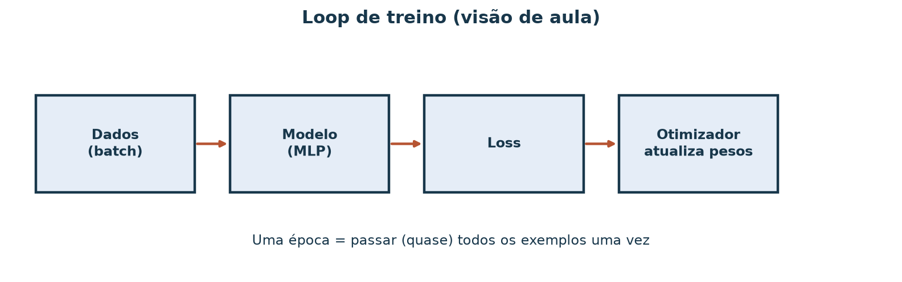
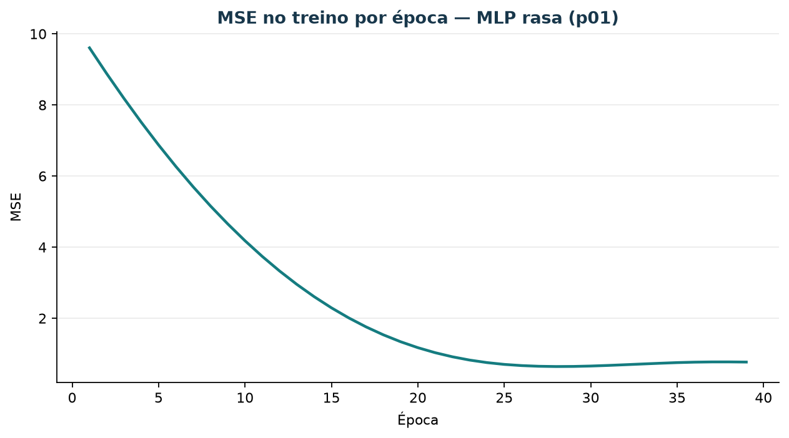

# Visão geral: treinar redes neurais

Depois da reta (mínimos quadrados) e dos pesos online (LMS), esta aula nomeia o
**loop de treino** de uma rede rasa e roda um experimento mínimo na mesma série
sintética de demanda — sem painel BI e sem GPU.

## Objetivos (cartão de cinco caixas)

Ao terminar, você deve conseguir:

1. Nomear **batch**, **época**, **loss** e **otimizador** (e o papel do modelo).
2. Carregar um conjunto pequeno e imprimir o **shape** das features e o tipo do alvo.
3. Treinar um **MLP raso** por poucas épocas e guardar a curva (ou tabela) de loss.
4. Medir o holdout e comparar com um **baseline burro** (média do treino).
5. Mudar **três knobs um de cada vez** (épocas, learning rate, largura) e dizer o
   que se moveu.

## 1. O loop em uma figura



*Figura 1 — Em cada passo o modelo prevê, a loss mede o erro, o otimizador
atualiza os pesos. Uma **época** é uma passagem (quase) completa pelos exemplos
de treino. Um **batch** é o pedaço de exemplos usado de uma vez.*

## 2. Dados desta demo

Usamos `dados/vendas_semanais.csv`, produto Jarro (`p01`). Features por semana:

- tempo normalizado `t / 15`
- contagem da semana anterior (atraso)

Alvo: linhas de pedido da semana. Split temporal: **12** treino / **4** teste
(sem embaralhar).

## 3. Rodar o experimento

Na raiz do repositório:

```bash
uv run python scripts/demo_treino_mlp_demanda.py
```

O script usa `MLPRegressor` (scikit-learn): uma camada escondida ReLU, otimizador
Adam. Grava:

- `material/redes/resultado_mlp_p01.json` — shapes, MAE, knobs
- `material/imagens/treino-redes-mse-p01.png` — MSE no treino por época
- `material/imagens/treino-redes-fluxo.png` — figura do loop

### Shape esperado

No JSON, confira algo na linha de:

- `shape_x_treino`: `[12, 2]`
- `dtype_y`: float (contagem)
- `mae_baseline_media` vs `mae_mlp_base`

## 4. Curva de loss



*Figura 2 — A curva deve cair e estabilizar. Se oscilar ou explodir, o learning
rate ou a largura pedem ajuste (tarefa 5).*

## 5. Três knobs, um de cada vez

O script já compara quatro corridas e registra MAE de teste:

| Corrida | O que muda |
| --- | --- |
| `base` | 40 épocas, lr 0,01, largura 8 |
| `mais_epocas` | 80 épocas |
| `lr_maior` | lr 0,05 |
| `mais_larga` | largura 16 |

Leia `resultado_mlp_p01.json` e escreva **três** frases: o que mudou no MAE (ou
na curva) em cada knob isolado. Se o MAE **não** mudar (curva já estável), diga
isso — também é um resultado.

## 6. Limitações (série curta)

- Com 12 pontos de treino, a MLP pode **decorar** o passado.
- Embaralhar semanas **vaza** futuro no treino — não faça isso aqui.
- Se o MAE da MLP não bater o da média (ou da MA/LMS das aulas anteriores), o
  baseline continua no comando: complexidade só vale se ganhar no teste.

## 7. Exercício

1. Desenhe o cartão das cinco caixas do loop (sem copiar a figura 1 ao pé da letra).
2. Rode o script e cole o `shape_x_treino` e os dois MAEs (baseline e MLP base).
3. Para cada um dos três knobs, uma frase sobre o que se moveu.
4. Em uma frase: o que fazer se o MAE da MLP for **pior** que o da média do
   treino neste toy (spoiler frequente com n=12).

## Referência

- scikit-learn `MLPRegressor`
  ([docs](https://scikit-learn.org/stable/modules/generated/sklearn.neural_network.MLPRegressor.html)).
- Código: `scripts/demo_treino_mlp_demanda.py`.
