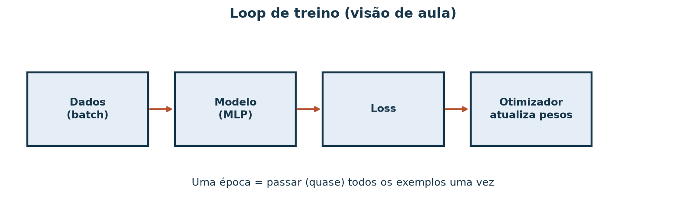
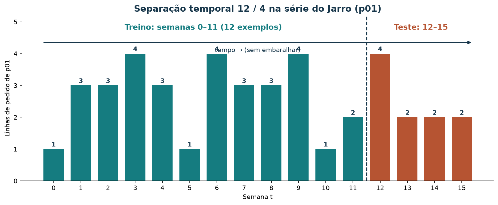
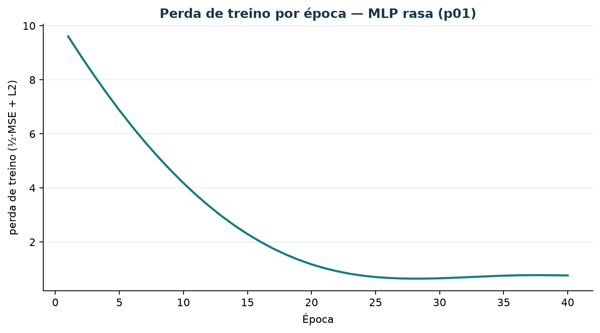
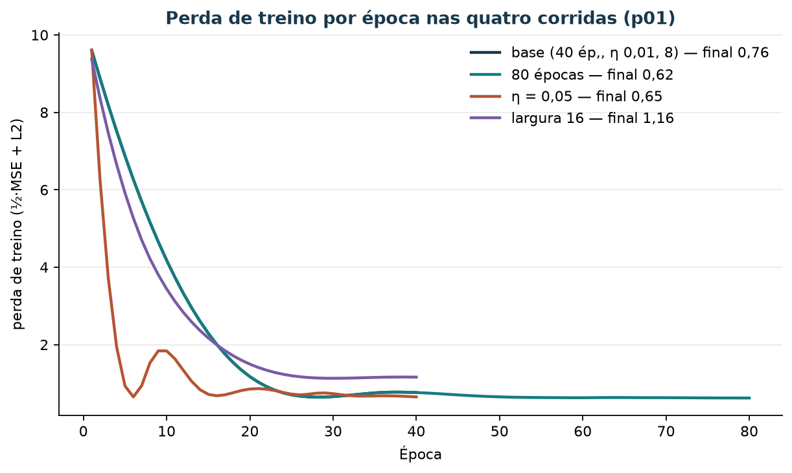
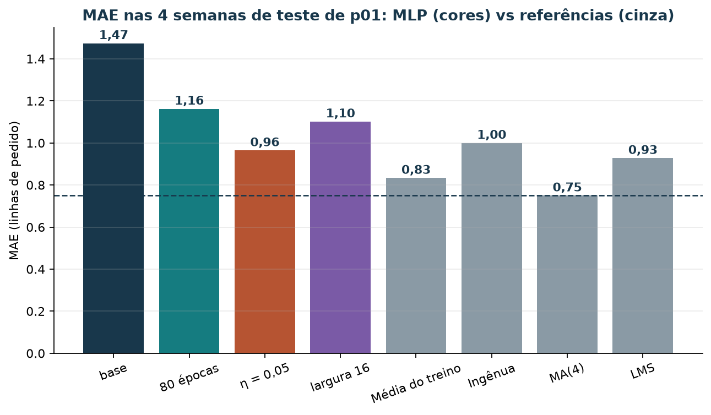

# Treinar uma rede neural rasa para prever demanda

[Leia a versão web com o explorador interativo incorporado](https://lgallindo.github.io/recomendador-bentoml/treino-redes/).

A loja de artesanato já prevê as linhas de pedido da semana seguinte com regras
simples: a média das últimas quatro semanas erra, em média, três quartos de
linha por semana no Jarro (`p01`). Alguém da equipe propõe trocar essa conta
por uma rede neural. A pergunta desta aula é concreta: **com doze semanas de
histórico, uma rede pequena aprende algo que a média móvel ainda não captura?**

Ao concluir este tutorial, você deverá conseguir descrever o **laço de treino**
(prever, medir a perda, calcular o gradiente, atualizar os pesos), executar um
passo de gradiente à mão, ler uma curva de perda, treinar uma MLP rasa com o
scikit-learn e comparar o resultado com referências simples no mesmo período de
teste. Você também mudará um hiperparâmetro de cada vez e relatará o que se
moveu.

Os dados são **sintéticos**: as 16 semanas distribuem os totais do catálogo da
loja didática. Os números servem para reproduzir o método e treinar o
julgamento; eles não demonstram que redes neurais funcionam (ou falham) em
vendas reais.

### Roteiro de estudo

| Tempo sugerido | Atividade de estudo |
| --- | --- |
| 8 min | Situar redes neurais em IA e aprendizado de máquina |
| 12 min | Vocabulário do laço: modelo, perda, gradiente, otimizador, época, lote |
| 10 min | Um passo de gradiente com números |
| 10 min | Montar entradas e alvo a partir da série; separar treino e teste no tempo |
| 15 min | Treinar a MLP, ler a curva de perda e comparar com referências |
| 15 min | Mudar um hiperparâmetro de cada vez no explorador |
| 10 min | Limitações e exercício com resolução |

## 1. Onde uma rede neural rasa se situa

**Inteligência artificial (IA)** é o campo que desenvolve sistemas capazes de
tarefas como perceber, prever e decidir. **Aprendizado de máquina (ML)** é a
área da IA em que um algoritmo ajusta um modelo a partir de exemplos. Quando
cada exemplo traz uma entrada e a resposta correta conhecida, o problema é de
**aprendizado supervisionado**. Prever a demanda da semana a partir do que já
aconteceu é um problema supervisionado: cada semana passada fornece um par
(entradas, demanda observada).

Uma **rede neural artificial** é uma família de modelos formada por unidades
simples, os **neurônios**, organizadas em camadas. Cada neurônio combina suas
entradas com pesos, soma um viés e aplica uma função não linear. Uma rede
**rasa** tem uma única camada escondida entre a entrada e a saída. A sigla
**MLP** (*multilayer perceptron*) é o nome usual dessas redes de camadas
densas.

O tutorial de
[perceptron / LMS](tutorial-perceptron-demanda-20261026.md) mostrou uma
**única** unidade linear (classificador com PLA ou reta LMS na demanda) e o
limite do XOR com uma só reta. Aqui entram **várias** unidades e uma função de
ativação suave: o erro de saída propaga-se pelas camadas (*backpropagation*) e
a descida de gradiente atualiza todos os pesos. O
[laboratório geométrico](bi-demanda-perceptron/lab/index.html) do Caderno fica
como lembrete visual da fronteira linear que a MLP generaliza.


*Figura 1 — A rede rasa é um modelo supervisionado dentro do aprendizado de
máquina. As áreas indicam pertencimento, não tamanho relativo. As referências
ao lado são o padrão de comparação: a rede só ganha espaço se errar menos que
elas no mesmo teste.*

## 2. O vocabulário do laço de treino

| Termo | O que é | Neste laboratório |
| --- | --- | --- |
| **Modelo** | Função com parâmetros ajustáveis que transforma entradas em previsão | MLP 2 → 8 → 1 |
| **Parâmetros** (pesos e vieses) | Números que o treino altera | 33 na rede base |
| **Perda** (*loss*) | Número que resume o erro nos exemplos de treino | metade do erro quadrático médio mais penalidade L2 |
| **Gradiente** | Direção, para cada parâmetro, em que a perda aumenta mais rápido | calculado pelo scikit-learn com *backpropagation* |
| **Otimizador** | Regra que usa o gradiente para atualizar os parâmetros | Adam |
| **Taxa de aprendizado** $\eta$ | Tamanho do passo de cada atualização | 0,01 na rede base |
| **Lote** (*batch*) | Conjunto de exemplos usado em uma atualização | as 12 semanas de treino de uma vez |
| **Época** | Uma passagem por todos os exemplos de treino | 40 na rede base |
| **Hiperparâmetro** | Escolha feita antes do treino, fora dos pesos | épocas, $\eta$, largura da camada |

Com 12 exemplos e lote automático do scikit-learn (`min(200, n)`), cada época
tem **um único lote** e, portanto, uma única atualização. Em bases grandes, uma
época reúne muitos lotes e muitas atualizações.



*Figura 2 — O laço de treino. A cada volta, o modelo prevê, a perda mede o
erro, o gradiente indica a direção de melhora e o otimizador altera os pesos.
O laço se repete por um número fixo de épocas.*

### A rede em fórmulas

Para uma entrada $x = (x_1, x_2)$, a camada escondida com 8 neurônios calcula

$$
h = \mathrm{ReLU}(W_1 x + b_1), \qquad \mathrm{ReLU}(z) = \max(0, z),
$$

e a saída de regressão é uma combinação linear dessas ativações:

$$
\widehat{y} = w_2^\top h + b_2 .
$$

$W_1$ tem $2 \times 8$ pesos, $b_1$ tem 8 vieses, $w_2$ tem 8 pesos e $b_2$ é um
número: $16 + 8 + 8 + 1 = 33$ parâmetros. A **ReLU** zera valores negativos;
sem ela, empilhar camadas lineares continuaria produzindo uma reta.

### A perda que o scikit-learn minimiza

O erro quadrático médio nos $n$ exemplos de treino é

$$
\mathrm{MSE} = \frac{1}{n}\sum_{i=1}^{n}\left(y_i - \widehat{y}_i\right)^2 .
$$

O `MLPRegressor` minimiza **metade** dessa quantidade e soma uma penalidade
pequena sobre o tamanho dos pesos, controlada por `alpha`:

$$
L = \frac{1}{2n}\sum_{i=1}^{n}\left(y_i - \widehat{y}_i\right)^2
+ \frac{\alpha}{2n}\sum_{w} w^2 .
$$

É esse $L$ que aparece em `loss_curve_` e nas curvas desta aula. Para comparar
com o erro de outros métodos, usamos o **MAE** no teste, na mesma unidade da
demanda:

$$
\mathrm{MAE} = \frac{1}{m}\sum_{j=1}^{m}\left|y_j - \widehat{y}_j\right| .
$$

### A atualização

O gradiente descendente move cada parâmetro um passo contra o gradiente:

$$
w \leftarrow w - \eta\ \frac{\partial L}{\partial w}.
$$

O **Adam** segue a mesma ideia, mas ajusta o tamanho do passo de cada parâmetro
com médias móveis dos gradientes recentes (Kingma e Ba, 2015). O
***backpropagation*** é o procedimento que calcula todas as derivadas
$\partial L / \partial w$ de uma rede reaproveitando os resultados camada a camada,
da saída para a entrada (Rumelhart, Hinton e Williams, 1986).

## 3. Um passo de gradiente com números

Antes de deixar a biblioteca trabalhar, faça um passo à mão. Use **um único
neurônio de saída linear**, sem camada escondida, para que as derivadas fiquem
curtas:

$$
\widehat{y} = w_1 x_1 + w_2 x_2 + b, \qquad L = \tfrac{1}{2}\ e^2, \quad e = y - \widehat{y}.
$$

As derivadas são $\partial L/\partial w_1 = -e\ x_1$, $\partial L/\partial w_2 = -e\ x_2$
e $\partial L/\partial b = -e$. Tome a semana 3 de `p01`: $x_1 = 3/15 = 0{,}2$,
atraso $x_2 = 3$ (demanda da semana 2) e alvo $y = 4$. Comece com
$w_1 = w_2 = 0{,}5$, $b = 0$ e $\eta = 0{,}05$.


*Figura 3 — Anatomia de um neurônio e um passo de gradiente. Na conta à mão a
saída é linear; na rede do laboratório, os neurônios escondidos aplicam ReLU e
a saída continua linear.*

| Etapa | Conta | Resultado |
| --- | --- | ---: |
| Prever | $0{,}5 \cdot 0{,}2 + 0{,}5 \cdot 3 + 0$ | 1,6 |
| Errar | $e = 4 - 1{,}6$ | 2,4 |
| Perda | $\tfrac{1}{2} \cdot 2{,}4^2$ | 2,88 |
| Gradientes | $-2{,}4 \cdot 0{,}2$; $-2{,}4 \cdot 3$; $-2{,}4$ | −0,48; −7,2; −2,4 |
| Atualizar | $w_1 = 0{,}5 + 0{,}05 \cdot 0{,}48$, e assim por diante | 0,524; 0,860; 0,120 |
| Conferir | $0{,}524 \cdot 0{,}2 + 0{,}860 \cdot 3 + 0{,}120$ | 2,80 (perda 0,71) |

A perda caiu de 2,88 para 0,71 em um passo. Repare no gradiente de $w_2$: ele é
quinze vezes maior que o de $w_1$ porque o atraso vale 3, enquanto o tempo
normalizado vale 0,2. Entradas em escalas diferentes recebem passos de tamanhos
diferentes; por isso é comum **padronizar** as entradas antes de treinar.

## 4. Da série a uma tabela de exemplos

A série de `p01` está em [`dados/vendas_semanais.csv`](../dados/vendas_semanais.csv)
(campos `week_start`, `product_id`, `order_line_count`). As 16 semanas são:

| t | 0 | 1 | 2 | 3 | 4 | 5 | 6 | 7 | 8 | 9 | 10 | 11 | 12 | 13 | 14 | 15 |
| --- | --- | --- | --- | --- | --- | --- | --- | --- | --- | --- | --- | --- | --- | --- | --- | --- |
| $y_t$ | 1 | 3 | 3 | 4 | 3 | 1 | 4 | 3 | 3 | 4 | 1 | 2 | 4 | 2 | 2 | 2 |

Cada semana vira um exemplo com duas entradas e um alvo:

| Entrada | Fórmula | Exemplo na semana 12 |
| --- | --- | --- |
| Tempo normalizado | $x_1 = t/15$ | 0,8 |
| Atraso | $x_2 = y_{t-1}$ (na semana 0, repete $y_0$) | 2 |
| Alvo | $y_t$ | 4 |

O atraso usa apenas a semana anterior, que já é conhecida no momento da
previsão. A separação é **temporal**: as semanas 0–11 formam o treino e as
semanas 12–15, o teste. Nada é embaralhado.



*Figura 4 — Treino no passado, teste no futuro relativo. Embaralhar as semanas
deixaria o modelo ver demandas posteriores às que ele precisa prever.*

Repare que, no teste, $x_1$ vai de 0,8 a 1,0, enquanto no treino ele vai de 0 a
0,733. A rede precisa **extrapolar** no tempo, uma tarefa em que redes com ReLU
tendem a prolongar a última inclinação aprendida.

## 5. Treinar e ler o resultado

Na raiz do repositório:

```bash
uv run python scripts/demo_treino_mlp_demanda.py
```

O script usa `MLPRegressor` com uma camada escondida ReLU, otimizador Adam,
`random_state=0` e `alpha=1e-4`. Ele grava:

| Arquivo | Conteúdo |
| --- | --- |
| [`redes/resultado_mlp_p01.json`](redes/resultado_mlp_p01.json) | Formatos, MAE da referência e das quatro corridas |
| [`redes/curvas_mlp_p01.json`](redes/curvas_mlp_p01.json) | Perda por época, previsões de teste de cada corrida e das referências |
| `imagens/treino-redes-mse-p01.png` | Curva de perda da corrida base |
| `imagens/treino-redes-fluxo.png` | Diagrama do laço |

Resultado esperado no JSON, com scikit-learn 1.9:

- `shape_x_treino`: `[12, 2]` (12 exemplos, 2 entradas);
- `dtype_y`: `float64 (linhas de pedido)`;
- `mae_baseline_media`: `0.8333…`;
- `mae_mlp_base`: `1.4737…`.

Versões diferentes da biblioteca podem alterar as casas decimais. Se isso
acontecer, use os números do seu JSON e mantenha o raciocínio.



*Figura 5 — A perda de treino cai de 9,61 para 0,76 em 40 épocas e ainda está
descendo no fim. A curva mede o ajuste às semanas de treino; ela não informa
o erro no teste.*

### A rede contra as referências

No mesmo teste de quatro semanas (demanda observada 4, 2, 2, 2):

| Método | Previsões nas semanas 12–15 | MAE no teste |
| --- | --- | ---: |
| Média do treino ($32/12 \approx 2{,}67$) | 2,67; 2,67; 2,67; 2,67 | 0,833 |
| Ingênua (repete a semana anterior) | 2; 4; 2; 2 | 1,000 |
| MA(4) (média das 4 semanas anteriores) | 2,50; 2,75; 2,25; 2,50 | **0,750** |
| LMS / ADALINE (reta online, reajustada a cada semana) | 2,49; 3,01; 2,71; 2,48 | 0,928 |
| MLP base | 3,66; 3,79; 3,84; 3,93 | 1,474 |

A MLP base prevê quase 4 linhas em todas as semanas de teste. Ela não terminou
de ajustar (a perda ainda caía) e extrapola uma tendência de alta que a série
não confirma. A média móvel, sem parâmetro algum aprendido por gradiente,
continua sendo a melhor previsão desta tabela.

## 6. Um hiperparâmetro de cada vez

O script repete o treino mudando **uma** escolha por vez a partir da corrida
base (40 épocas, $\eta = 0{,}01$, 8 neurônios). Mudar uma coisa de cada vez
permite atribuir a mudança no resultado à escolha alterada.

| Corrida | O que muda | Perda final de treino | MAE no teste |
| --- | --- | ---: | ---: |
| `base` | — | 0,762 | 1,474 |
| `mais_epocas` | 80 épocas | 0,620 | 1,162 |
| `lr_maior` | $\eta = 0{,}05$ | 0,648 | 0,964 |
| `mais_larga` | 16 neurônios (65 parâmetros) | 1,160 | 1,102 |

Leitura:

- **Mais épocas** dá ao otimizador mais passos: a perda cai mais e o MAE de teste
  melhora, porque a rede base estava subajustada.
- **Taxa de aprendizado maior** acelera a descida. A curva oscila nas primeiras
  épocas (veja no explorador) e termina com o melhor MAE das quatro corridas,
  0,964.
- **Camada mais larga**, com o mesmo número de épocas e a mesma taxa, termina com
  perda *maior*: mais parâmetros pedem mais passos para ajustar. O MAE melhora em
  relação à base por outra razão: a rede passa a seguir o atraso (prevê 4,04 na
  semana 13, logo depois do 4 da semana 12).
- **Nenhuma corrida** alcança a média do treino (0,833) nem a MA(4) (0,750).

## 7. Como avaliar sem se enganar

- **Teste intocado.** As semanas 12–15 não participam do treino nem da escolha
  de hiperparâmetros. Ao escolher a corrida com menor MAE de teste, você passa a
  usar o teste para selecionar; numa avaliação final, reserve outro período.
- **Referência antes do modelo.** Uma rede só merece espaço se errar menos que
  as referências simples no **mesmo** período e com a **mesma** métrica.
- **Poucas semanas, muita variação.** Com 4 semanas de teste, uma única semana
  difícil (o 4 da semana 12) pesa um quarto do MAE. Diferenças de poucos
  centésimos não sustentam uma conclusão.
- **Semente.** A inicialização dos pesos é aleatória; `random_state=0` torna o
  resultado reprodutível, mas outra semente produziria outros números.
- **Sobreajuste e subajuste.** A rede base está **subajustada** (perda ainda
  caindo). Com 33 parâmetros e 12 exemplos, mais treino também pode levar ao
  **sobreajuste**: memorizar o ruído das semanas de treino.

## 8. Explore as corridas com BI

O [explorador de redes neurais](bi-redes/index.html) mostra as quatro curvas de
perda sobrepostas, as previsões de cada corrida contra a série observada, as
barras de MAE com as referências e uma tabela das semanas de teste com
exportação em CSV e PNG. Você pode usá-lo incorporado à
[versão web deste tutorial](https://lgallindo.github.io/recomendador-bentoml/treino-redes/#explorador-interativo)
ou abrir o HTML a partir de uma cópia local do repositório. Consulte o
[roteiro de exploração](bi-redes/README.md).

O painel apresenta resultados já calculados pelo script: trocar a corrida não
treina uma rede nova no navegador.



*Figura 6 — Espelho estático do painel 02. A curva laranja ($\eta = 0{,}05$) desce
rápido, oscila e se estabiliza; a roxa (largura 16) desce mais devagar.*



*Figura 7 — Espelho estático do painel 04. As barras coloridas são corridas da
MLP; as cinzas, referências. A linha tracejada marca a MA(4), a menor barra.*

### Atividade no painel

1. Escolha a corrida `base` e marque **Média do treino**. Em que semana de teste
   a rede erra mais? Por quê?
2. Troque para $\eta = 0{,}05$. Descreva a forma da curva de perda nas primeiras
   dez épocas.
3. Compare `80 épocas` e `largura 16`: qual termina com menor perda de treino e
   qual tem menor MAE de teste? Explique por que as duas ordens podem diferir.
4. Exporte o CSV e um PNG e escreva três frases para a equipe da loja.

**Resolução comentada:** a rede base erra mais nas semanas 13–15 (prevê cerca
de 3,8 quando a demanda foi 2), pois extrapola uma tendência de alta. Com
$\eta = 0{,}05$, a perda cai de 9,61 para 0,65 em seis épocas, sobe até 1,84
nas épocas 9–10 e volta a cair até cerca de 0,7: o passo grande ultrapassa a
região de mínimo antes de se acomodar. `80 épocas` tem perda de treino menor (0,62 contra 1,16), mas MAE de
teste maior (1,16 contra 1,10): ajustar melhor o passado não garante prever
melhor o futuro. Uma mensagem possível: “Testamos uma rede neural pequena nas
últimas quatro semanas do Jarro. A melhor configuração errou 0,96 linha por
semana; a média móvel de quatro semanas errou 0,75. Com este histórico,
recomendamos manter a média móvel e reavaliar quando houver mais semanas.”

## 9. Limitações

- Doze exemplos de treino e quatro de teste são suficientes para mostrar o laço,
  não para escolher um modelo de produção.
- A entrada de tempo normalizado força a rede a extrapolar no teste. Outras
  entradas (mais atrasos, médias móveis como atributo) mudariam o problema.
- O scikit-learn esconde o *backpropagation* e o Adam; o passo à mão da seção 3
  usa um único neurônio linear para que a conta caiba no caderno.
- A série é sintética e de um único produto.

## 10. Exercício: seu relatório de treino

1. Rode o script e copie `shape_x_treino`, `mae_baseline_media` e `mae_mlp_base`.
2. Faça um passo de gradiente à mão para a **semana 7** de `p01` com o neurônio
   linear da seção 3, os mesmos pesos iniciais e $\eta = 0{,}05$. Informe
   previsão, erro, perda, gradientes, pesos novos e perda depois do passo.
3. Conte os parâmetros da rede `mais_larga` (2 → 16 → 1) e mostre a conta.
4. Para cada uma das três mudanças da seção 6, escreva uma frase sobre o que se
   moveu na perda de treino e no MAE de teste.
5. Em um parágrafo, recomende manter ou trocar a MA(4) e cite uma limitação da
   evidência.

### Resolução comentada

**1.** `shape_x_treino = [12, 2]`, `mae_baseline_media ≈ 0,833`,
`mae_mlp_base ≈ 1,474` (com scikit-learn 1.9; outras versões podem variar nas
casas decimais).

**2.** Na semana 7: $x_1 = 7/15 \approx 0{,}467$, atraso $x_2 = y_6 = 4$, alvo
$y_7 = 3$.
Previsão $0{,}5 \cdot 0{,}467 + 0{,}5 \cdot 4 = 2{,}233$; erro $e = 0{,}767$;
perda $\tfrac{1}{2} \cdot 0{,}767^2 \approx 0{,}294$.
Gradientes: $-0{,}358$ ($w_1$), $-3{,}067$ ($w_2$), $-0{,}767$ ($b$).
Pesos novos: $w_1 = 0{,}518$, $w_2 = 0{,}653$, $b = 0{,}038$.
Nova previsão $\approx 2{,}893$; perda $\approx 0{,}006$.

**3.** $(2 + 1) \cdot 16 + (16 + 1) \cdot 1 = 48 + 17 = 65$ parâmetros.

**4.** Mais épocas: a perda cai de 0,762 para 0,620 e o MAE, de 1,474 para
1,162. Taxa maior: perda 0,648 e MAE 0,964, o melhor das quatro. Mais largura:
perda sobe para 1,160 porque 40 passos não bastam para 65 parâmetros; o MAE
cai para 1,102 porque a rede passa a seguir o atraso.

**5.** Exemplo: “No teste das semanas 12–15 de `p01`, a MA(4) errou 0,75 linha
por semana e a melhor rede, 0,96. Recomendo manter a MA(4). A comparação usa
apenas quatro semanas sintéticas de um produto e uma semente; uma rede pode se
tornar competitiva com mais histórico e outras entradas, o que exigiria nova
avaliação em período reservado.”

## Referências bibliográficas e roteiro de leitura

Consulta dos materiais on-line: 7 nov. 2026.

1. HAYKIN, Simon. **Redes neurais: princípios e prática**. 2. ed. Porto Alegre:
   Bookman, 2001.
   **Para aprofundar:** neurônio, perceptron de múltiplas camadas e
   retropropagação, em português.
2. GOODFELLOW, Ian; BENGIO, Yoshua; COURVILLE, Aaron. **Deep learning**.
   Cambridge, MA: MIT Press, 2016.
   [Texto on-line em inglês](https://www.deeplearningbook.org/).
   **Para aprofundar:** capítulos 6 (redes *feedforward*) e 8 (otimização).
3. NIELSEN, Michael. **Neural networks and deep learning**. Determination
   Press, 2015. [Livro on-line em inglês](http://neuralnetworksanddeeplearning.com/).
   **Para consultar:** gradiente descendente e *backpropagation* passo a passo.
4. RUMELHART, David E.; HINTON, Geoffrey E.; WILLIAMS, Ronald J. Learning
   representations by back-propagating errors. **Nature**, v. 323,
   p. 533–536, 1986. DOI: 10.1038/323533a0.
5. KINGMA, Diederik P.; BA, Jimmy. Adam: a method for stochastic optimization.
   In: **ICLR**, 2015. [arXiv:1412.6980](https://arxiv.org/abs/1412.6980).
6. SCIKIT-LEARN. **Neural network models (supervised)**.
   [Guia do usuário em inglês](https://scikit-learn.org/stable/modules/neural_networks_supervised.html)
   e [referência do `MLPRegressor`](https://scikit-learn.org/stable/modules/generated/sklearn.neural_network.MLPRegressor.html).
   **Para consultar:** perda, `alpha`, `loss_curve_` e conselhos de
   padronização das entradas.
7. HYNDMAN, Rob J.; ATHANASOPOULOS, George. **Forecasting: principles and
   practice**. 3. ed. OTexts, 2021. [Livro on-line em inglês](https://otexts.com/fpp3/).
   **Para aprofundar:** avaliação de previsões com origem temporal e
   referências simples.

### Artefatos no repositório

| Artefato | Papel |
| --- | --- |
| `dados/vendas_semanais.csv` | Série semanal sintética (16 semanas × 12 produtos) |
| `scripts/demo_treino_mlp_demanda.py` | Treino da MLP rasa, quatro corridas e referências |
| `material/redes/resultado_mlp_p01.json` | Resumo numérico das corridas |
| `material/redes/curvas_mlp_p01.json` | Curvas de perda e previsões de teste |
| `material/bi-redes/` | Explorador interativo |
| `material/imagens/` (regenerar: `.local/scripts/gerar_figuras_redes.py`) | Diagramas desta aula |
| `scripts/gerar_bi_redes.py` | Dados do explorador e figuras `bi-redes-*.png` |
