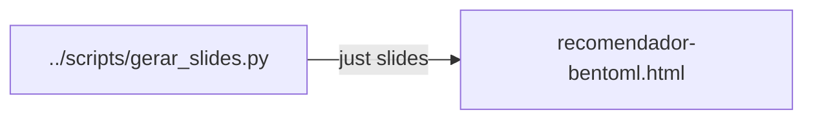

# Slides (`slides/`)

Deck HTML em tela cheia: a história começa na **vitrine**, passa por **métricas**
e pela **cesta de mercado**, separa **treino** de **inferência**, demonstra o
baseline com BentoML e fecha com variantes e empacote.

Gerado por [`../scripts/gerar_slides.py`](../scripts/gerar_slides.py).

**Arco:** cena → pacotes → sinais → métricas (prosa) → cesta → métricas nos dados
→ treino / inferência → API e demo → literatura → variantes → empacote.

| Arquivo | Conteúdo |
| --- | --- |
| [`recomendador-bentoml.html`](recomendador-bentoml.html) | 19 slides — ver arco abaixo |

### Arco (19 slides)

| # | Título |
| ---: | --- |
| 1 | Recomendador no BentoML |
| 2 | Pacotes |
| 3 | Sinais que a loja observa |
| 4 | Métricas do projeto |
| 5 | Cesta de mercado |
| 6 | Métricas nos dados |
| 7 | Dois pipelines — treino e inferência |
| 8 | Só o treino (offline) |
| 9 | Só a inferência (online) |
| 10 | Artefato no meio |
| 11 | Algoritmo na inferência |
| 12 | API — POST /recomendar |
| 13 | Como subir |
| 14 | Exemplo p01 |
| 15 | Nomes no código |
| 16 | Literatura de recomendação |
| 17 | Data Science → Machine Learning |
| 18 | Variantes |
| 19 | Empacote — inferência portátil |



### Navegação

Abrir o HTML no navegador. Teclas: `←` `→`, espaço, `Home` / `End`. Hash na URL
(`#3`) aponta o slide.

```bash
just slides
xdg-open slides/recomendador-bentoml.html
```

### Como encaixa no restante do repo

| Momento | Onde aprofundar |
| --- | --- |
| Sinais e catálogo | [`../dados/README.md`](../dados/README.md) |
| Contas do jarro `p01` | [`../material/README.md`](../material/README.md) |
| Regenerar o deck | [`../scripts/README.md`](../scripts/README.md) · `just slides` |
| Sistema completo (HTTP, fórmula, container) | [`../README.md`](../README.md) |
